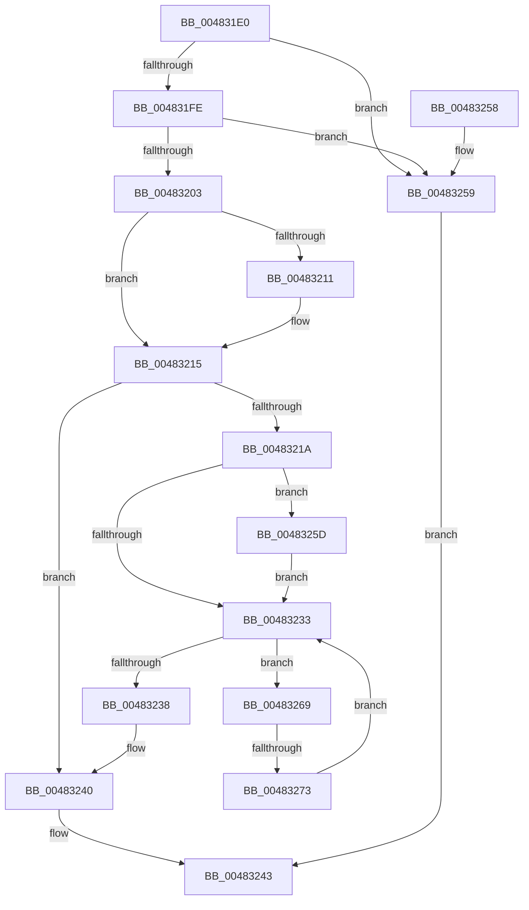

# IoGetSfioStreamIdentifier

- RVA: `0x004831E0`–`0x00483278` (길이 `152` bytes)
- VA: `0x00000001404831E0`
- 실행 섹션: `.text`
- PDB 이름 있음: `예`; PDB Function 태그: `예`
- unwind 정보 RVA: `0x00093238`
- 디코드: `47`개 명령, `152/152` bytes 표시
- 미해석 바이트: `0` (있으면 어셈블리에 `.byte`로 보존)

> 이 문서는 커널 이미지의 기계어와 PDB 기호를 분석해 생성했습니다. 4번과 5번은 함수 원형과 자료형을 바이너리 사용 방식에서 추정한 C 해석이며 원본 소스 복구 결과는 아닙니다.

## 1. Dependencies

- 직접 호출 지점: **2**; 고유 호출 대상: **2**
- 직접 호출자로 확인된 함수: **0**
- RIP 상대 이미지 참조: **0**

### Outgoing calls
- `0x00483224` → [KeAcquireSpinLockRaiseToDpc](../20/KeAcquireSpinLockRaiseToDpc_function_00208470.md) (function, `0x00208470`)
- `0x0048323B` → [KeReleaseSpinLock](../39/KeReleaseSpinLock_function_00392BA0.md) (function, `0x00392BA0`)

### Direct callers
- 이 함수 시작 RVA로 연결되는 직접 call은 확인되지 않았습니다. 간접 호출은 완전히 역산할 수 없습니다.

### Static image references
- 디코드된 RIP-relative 메모리 참조가 없습니다.

## 2. Other-region calls and transfers

- 다른 실행 섹션으로 향하는 call: **0**
- call이 아닌 외부 분기/꼬리 이동: **1**
  - `0x0048326D` → [sub_006F5300](../6F/Unknown_function_006F5300.md) (`tail-transfer`)

## 3. Assembly (complete function range)

```asm
004831E0  48 89 5C 24 08                  mov qword ptr [rsp + 8], rbx
004831E5  48 89 6C 24 10                  mov qword ptr [rsp + 0x10], rbp
004831EA  48 89 74 24 18                  mov qword ptr [rsp + 0x18], rsi
004831EF  57                              push rdi
004831F0  48 83 EC 20                     sub rsp, 0x20
004831F4  33 DB                           xor ebx, ebx
004831F6  48 8B F2                        mov rsi, rdx
004831F9  48 85 C9                        test rcx, rcx
004831FC  74 5B                           je 0x140483259
004831FE  48 85 D2                        test rdx, rdx
00483201  74 56                           je 0x140483259
00483203  48 8B 81 D0 00 00 00            mov rax, qword ptr [rcx + 0xd0]
0048320A  8B FB                           mov edi, ebx
0048320C  48 85 C0                        test rax, rax
0048320F  74 04                           je 0x140483215
00483211  48 8B 78 28                     mov rdi, qword ptr [rax + 0x28]
00483215  48 85 FF                        test rdi, rdi
00483218  74 26                           je 0x140483240
0048321A  48 8D A9 B8 00 00 00            lea rbp, [rcx + 0xb8]
00483221  48 8B CD                        mov rcx, rbp
00483224  E8 47 52 D8 FF                  call 0x140208470
00483229  8A D0                           mov dl, al
0048322B  48 8B 07                        mov rax, qword ptr [rdi]
0048322E  48 85 C0                        test rax, rax
00483231  74 2A                           je 0x14048325d
00483233  48 3B C7                        cmp rax, rdi
00483236  75 31                           jne 0x140483269
00483238  48 8B CD                        mov rcx, rbp
0048323B  E8 60 F9 F0 FF                  call 0x140392ba0
00483240  48 8B C3                        mov rax, rbx
00483243  48 8B 5C 24 30                  mov rbx, qword ptr [rsp + 0x30]
00483248  48 8B 6C 24 38                  mov rbp, qword ptr [rsp + 0x38]
0048324D  48 8B 74 24 40                  mov rsi, qword ptr [rsp + 0x40]
00483252  48 83 C4 20                     add rsp, 0x20
00483256  5F                              pop rdi
00483257  C3                              ret
00483258  CC                              int3
00483259  33 C0                           xor eax, eax
0048325B  EB E6                           jmp 0x140483243
0048325D  48 89 7F 08                     mov qword ptr [rdi + 8], rdi
00483261  48 8B C7                        mov rax, rdi
00483264  48 89 3F                        mov qword ptr [rdi], rdi
00483267  EB CA                           jmp 0x140483233
00483269  48 39 70 18                     cmp qword ptr [rax + 0x18], rsi
0048326D  0F 84 8D 20 27 00               je 0x1406f5300
00483273  48 8B 00                        mov rax, qword ptr [rax]
00483276  EB BB                           jmp 0x140483233
```

## 4. C-style interpretation (structured pseudocode)

```c
__int64 __fastcall IoGetSfioStreamIdentifier(__int64 a1, __int64 a2)
{
    __int64 result;
    __int64 v_rbx;
    __int64 v_rdi;
    __int64 v_rsp;
    unsigned __int64 v_stack_p10;
    unsigned __int64 v_stack_p18;
    unsigned __int64 v_stack_p8;

    v_stack_p8 = v_rbx;
    v_stack_p10 = v_rbp;
    v_stack_p18 = v_rsi;
    v_rsp = (v_rsp) - (32);
    v_rbx = 0;
    if (a1 == 0) goto loc_00483259;
    if (a2 == 0) goto loc_00483259;
    v_rdi = 0;
    if (*(unsigned __int64 *)(a1 + 208) != 0) {
        v_rdi = *(unsigned __int64 *)(*(unsigned __int64 *)(a1 + 208) + 40);
    }
    if (v_rdi == 0) goto loc_00483240;
    result = KeAcquireSpinLockRaiseToDpc(a1 + 184, a2, a3, a4);
    if (*(unsigned __int64 *)(v_rdi) == 0) goto loc_0048325D;
loc_00483233:
    if ((*(unsigned __int64 *)(v_rdi)) != v_rdi) goto loc_00483269;
    result = KeReleaseSpinLock(a1 + 184, (unsigned __int8)(result), a3, a4);
loc_00483240:
loc_00483243:
    v_rsp = (v_rsp) + (32);
    return 0;
loc_00483259:
    result = 0;
    goto loc_00483243;
loc_0048325D:
    *(unsigned __int64 *)(v_rdi + 8) = v_rdi;
    *(unsigned __int64 *)(v_rdi) = v_rdi;
    goto loc_00483233;
loc_00483269:
    goto loc_00483233;
}
```

## 5. (Beta) C Style

```c
int64_t IoGetSfioStreamIdentifier(int64_t Arg1, int64_t Arg2)
{
    int64_t result;
    int64_t local_rbx;
    int64_t local_rdi;
    int64_t local_rsp;
    uint64_t v_stack_p10;
    uint64_t v_stack_p18;
    uint64_t v_stack_p8;

    v_stack_p8 = local_rbx;
    v_stack_p10 = local_rbp;
    v_stack_p18 = local_rsi;
    local_rsp = (local_rsp) - (32);
    local_rbx = 0;
    if (Arg1 == 0) goto loc_00483259;
    if (Arg2 == 0) goto loc_00483259;
    local_rdi = 0;
    if (*(uint64_t *)(Arg1 + 0xD0) != 0) {
        local_rdi = *(uint64_t *)(*(uint64_t *)(Arg1 + 0xD0) + 0x28);
    }
    if (local_rdi == 0) goto loc_00483240;
    result = KeAcquireSpinLockRaiseToDpc(Arg1 + 184, Arg2, a3, a4);
    if (*(uint64_t *)(local_rdi) == 0) goto loc_0048325D;
loc_00483233:
    if ((*(uint64_t *)(local_rdi)) != local_rdi) goto loc_00483269;
    result = KeReleaseSpinLock(Arg1 + 184, (uint8_t)(result), a3, a4);
loc_00483240:
loc_00483243:
    local_rsp = (local_rsp) + (32);
    return 0;
loc_00483259:
    result = 0;
    goto loc_00483243;
loc_0048325D:
    *(uint64_t *)(local_rdi + 0x8) = local_rdi;
    *(uint64_t *)(local_rdi) = local_rdi;
    goto loc_00483233;
loc_00483269:
    goto loc_00483233;
}
```

## 6. Execution-region graph

[열기: 2D/3D 그래프와 함수 탐색 컨트롤 패널](../../../control-panel.html?section=text&rva=0x004831E0&view=graph)

- 2D 그래프는 위에서 아래로 흐르고, 3D 그래프는 빈 공간을 드래그해 회전합니다. Shift+드래그는 이동, 휠은 확대·축소, 함수 노드 선택은 대상 보고서 이동입니다.

### Static fallback


