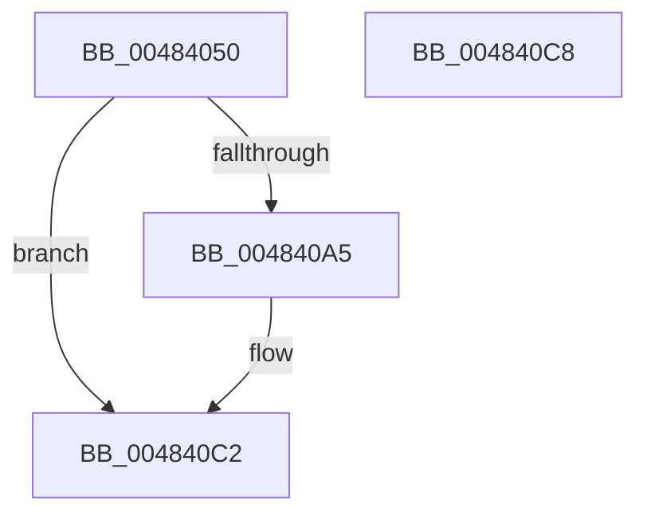

# IoSynchronousCallDriver

- RVA: `0x00484050`–`0x004840C9` (길이 `121` bytes)
- VA: `0x0000000140484050`
- 실행 섹션: `.text`
- PDB 이름 있음: `예`; PDB Function 태그: `아니요`
- unwind 정보 RVA: `0x000AF0B0`
- 디코드: `31`개 명령, `121/121` bytes 표시
- 미해석 바이트: `0` (있으면 어셈블리에 `.byte`로 보존)

> 이 문서는 커널 이미지의 기계어와 PDB 기호를 분석해 생성했습니다. 4번과 5번은 함수 원형과 자료형을 바이너리 사용 방식에서 추정한 C 해석이며 원본 소스 복구 결과는 아닙니다.

## 1. Dependencies

- 직접 호출 지점: **2**; 고유 호출 대상: **2**
- 직접 호출자로 확인된 함수: **19**
- RIP 상대 이미지 참조: **1**

### Outgoing calls
- `0x00484099` → [IofCallDriver](../29/IofCallDriver_function_0029B4B0.md) (function, `0x0029B4B0`)
- `0x004840BA` → [KeWaitForSingleObject](../20/KeWaitForSingleObject_function_0020E6B0.md) (function, `0x0020E6B0`)

### Direct callers
- [FsRtlGetFileExtents](../58/FsRtlGetFileExtents_function_00580F40.md) at `0x0058101D`
- [PopBatterySetChargeLimitControl](../5D/PopBatterySetChargeLimitControl_function_005D94D8.md) at `0x005D952B`
- [NT_DISK::Read](../../page/71/NT_DISK_Read_function_00717100.md) at `0x0071715E`
- [NT_DISK::Write](../../page/71/NT_DISK_Write_function_007171A0.md) at `0x007171FE`
- [PopAcquirePowerLimitInterface](../../page/75/PopAcquirePowerLimitInterface_function_00755E10.md) at `0x00755E79`
- [PopAcquireCoolingInterface](../../page/75/PopAcquireCoolingInterface_function_00756DF0.md) at `0x00756E54`
- [PopBatteryAdd](../../page/76/PopBatteryAdd_function_00766580.md) at `0x00766610`
- [PopBatteryInitialize](../../page/76/PopBatteryInitialize_function_00766834.md) at `0x007668B4`
- [PopBatteryInitialize](../../page/76/PopBatteryInitialize_function_00766834.md) at `0x00766931`
- [PopPowerAdapterAdd](../../page/76/PopPowerAdapterAdd_function_00767430.md) at `0x007674CC`
- [PopPowerAdapterQueryStatus](../../page/76/PopPowerAdapterQueryStatus_function_00767C44.md) at `0x00767CEA`
- [PopPowerAdapterReinitialize](../../page/76/PopPowerAdapterReinitialize_function_00767E48.md) at `0x00767EC1`
- [IoForwardIrpSynchronously](../../page/A4/IoForwardIrpSynchronously_function_00A48EA0.md) at `0x00A48EDC`
- [FsRtlMdlReadEx](../../page/A7/FsRtlMdlReadEx_function_00A7CB40.md) at `0x00A7CBFE`
- [PopBatteryQueryEstimatedTime](../../page/A9/PopBatteryQueryEstimatedTime_function_00A98E80.md) at `0x00A98EF1`
- [WmipGetFilePDO](../../page/AA/WmipGetFilePDO_function_00AAF454.md) at `0x00AAF50A`
- [PopBatteryReadTag](../../page/AC/PopBatteryReadTag_function_00AC5E1C.md) at `0x00AC5E72`
- [PopBatteryQueryStatus](../../page/AE/PopBatteryQueryStatus_function_00AE1450.md) at `0x00AE15E9`
- [PopBatteryWorker](../../page/AE/PopBatteryWorker_function_00AE1650.md) at `0x00AE1BBB`
- [sub_00B406D6](../../page/B4/Unknown_function_00B406D6.md) at `0x00B406F3`

### Static image references
- `0x0048407F` → RVA `0x0048B010` (`CmpCompleteFlushAndPurgeIrp`; read)

## 2. Other-region calls and transfers

- 다른 실행 섹션으로 향하는 call: **0**
- 별도 외부 분기/꼬리 이동을 확인하지 못했습니다.

## 3. Assembly (complete function range)

```asm
00484050  4C 8B DC                        mov r11, rsp
00484053  53                              push rbx
00484054  48 83 EC 50                     sub rsp, 0x50
00484058  83 64 24 34 00                  and dword ptr [rsp + 0x34], 0
0048405D  49 8D 43 E0                     lea rax, [r11 - 0x20]
00484061  C7 44 24 30 00 00 06 00         mov dword ptr [rsp + 0x30], 0x60000
00484069  48 8B DA                        mov rbx, rdx
0048406C  49 89 43 E8                     mov qword ptr [r11 - 0x18], rax
00484070  49 8D 43 E0                     lea rax, [r11 - 0x20]
00484074  49 89 43 E0                     mov qword ptr [r11 - 0x20], rax
00484078  48 8B 82 B8 00 00 00            mov rax, qword ptr [rdx + 0xb8]
0048407F  48 8D 15 8A 6F 00 00            lea rdx, [rip + 0x6f8a]
00484086  48 89 50 F0                     mov qword ptr [rax - 0x10], rdx
0048408A  49 8D 53 D8                     lea rdx, [r11 - 0x28]
0048408E  48 89 50 F8                     mov qword ptr [rax - 8], rdx
00484092  48 8B D3                        mov rdx, rbx
00484095  C6 40 BB E0                     mov byte ptr [rax - 0x45], 0xe0
00484099  E8 12 74 E1 FF                  call 0x14029b4b0
0048409E  3D 03 01 00 00                  cmp eax, 0x103
004840A3  75 1D                           jne 0x1404840c2
004840A5  48 83 64 24 20 00               and qword ptr [rsp + 0x20], 0
004840AB  48 8D 4C 24 30                  lea rcx, [rsp + 0x30]
004840B0  45 33 C9                        xor r9d, r9d
004840B3  45 33 C0                        xor r8d, r8d
004840B6  41 8D 51 05                     lea edx, [r9 + 5]
004840BA  E8 F1 A5 D8 FF                  call 0x14020e6b0
004840BF  8B 43 30                        mov eax, dword ptr [rbx + 0x30]
004840C2  48 83 C4 50                     add rsp, 0x50
004840C6  5B                              pop rbx
004840C7  C3                              ret
004840C8  CC                              int3
```

## 4. C-style interpretation (structured pseudocode)

```c
__int64 __fastcall IoSynchronousCallDriver(__int64 a1, __int64 a2, int a3, int a4)
{
    __int64 result;
    __int64 v_rsp;
    unsigned int v_stack_m24;
    unsigned int v_stack_m28;
    unsigned __int64 v_stack_m38;

    v_rsp = (v_rsp) - (80);
    v_stack_m28 = 0x60000ULL;
    *(unsigned __int64 *)(v_rsp - 24) = v_rsp - 32;
    *(unsigned __int64 *)(v_rsp - 32) = v_rsp - 32;
    *(unsigned __int64 *)(*(unsigned __int64 *)(a2 + 184) - 16) = v_rip + 28554;
    *(unsigned __int64 *)(*(unsigned __int64 *)(a2 + 184) - 8) = v_rsp - 40;
    *(unsigned __int8 *)(*(unsigned __int64 *)(a2 + 184) - 69) = 224;
    result = IofCallDriver(a1, a2, a3, a4);
    if (((unsigned int)(result)) == 259) {
        a1 = v_stack_m28;
        a4 = 0;
        a3 = 0;
        a2 = a4 + 5;
        result = KeWaitForSingleObject(a1, a2, a3, a4);
        result = *(unsigned int *)(a2 + 48);
    }
    v_rsp = (v_rsp) + (80);
    return result;
}
```

## 5. (Beta) C Style

```c
int64_t IoSynchronousCallDriver(int64_t Arg1, void *Arg2, int32_t Arg3, int32_t Arg4)
{
    uint8_t *arg2 = (uint8_t *)Arg2;

    int64_t result;
    int64_t local_rsp;
    uint32_t v_stack_m24;
    uint32_t v_stack_m28;
    uint64_t v_stack_m38;

    local_rsp = (local_rsp) - (80);
    v_stack_m28 = 0x60000ULL;
    *(uint64_t *)(local_rsp - 0x18) = local_rsp - 32;
    *(uint64_t *)(local_rsp - 0x20) = local_rsp - 32;
    *(uint64_t *)(*(uint64_t *)(arg2 + 0xB8) - 0x10) = v_rip + 28554;
    *(uint64_t *)(*(uint64_t *)(arg2 + 0xB8) - 0x8) = local_rsp - 40;
    *(uint8_t *)(*(uint64_t *)(arg2 + 0xB8) - 0x45) = 224;
    result = IofCallDriver(Arg1, Arg2, Arg3, Arg4);
    if (((uint32_t)(result)) == 259) {
        Arg1 = v_stack_m28;
        Arg4 = 0;
        Arg3 = 0;
        Arg2 = Arg4 + 5;
        result = KeWaitForSingleObject(Arg1, Arg2, Arg3, Arg4);
        result = *(uint32_t *)(arg2 + 0x30);
    }
    local_rsp = (local_rsp) + (80);
    return result;
}
```

### 관측된 메모리 오프셋

구조체 형식이 확인되지 않은 접근은 인자 기준의 오프셋으로만 기록했습니다.

| 기준 인자 | 오프셋 표현 | 폭 (bit) | 접근 |
|---|---:|---:|---|
| `Arg2` | `+ 0x30` | `32` | `R` |
| `Arg2` | `+ 0xB8` | `64` | `R` |

## 6. Execution-region graph

[열기: 2D/3D 그래프와 함수 탐색 컨트롤 패널](../../../control-panel.html?section=text&rva=0x00484050&view=graph)

- 2D 그래프는 위에서 아래로 흐르고, 3D 그래프는 빈 공간을 드래그해 회전합니다. Shift+드래그는 이동, 휠은 확대·축소, 함수 노드 선택은 대상 보고서 이동입니다.

### Static fallback


