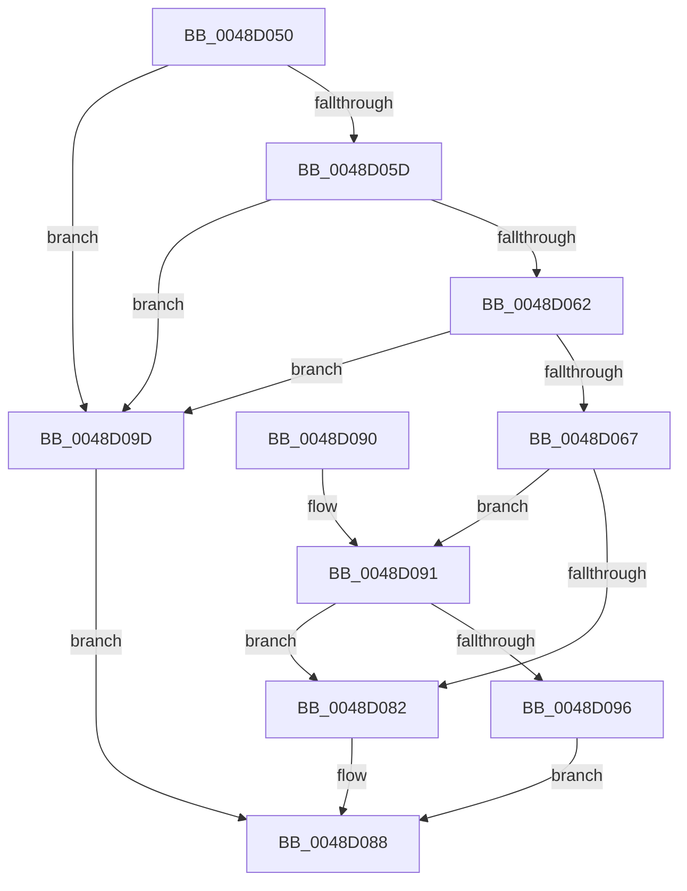

# IoTestDependency

- RVA: `0x0048D050`–`0x0048D0A4` (길이 `84` bytes)
- VA: `0x000000014048D050`
- 실행 섹션: `.text`
- PDB 이름 있음: `예`; PDB Function 태그: `아니요`
- unwind 정보 RVA: `0x0006EDB4`
- 디코드: `28`개 명령, `84/84` bytes 표시
- 미해석 바이트: `0` (있으면 어셈블리에 `.byte`로 보존)

> 이 문서는 커널 이미지의 기계어와 PDB 기호를 분석해 생성했습니다. 4번과 5번은 함수 원형과 자료형을 바이너리 사용 방식에서 추정한 C 해석이며 원본 소스 복구 결과는 아닙니다.

## 1. Dependencies

- 직접 호출 지점: **1**; 고유 호출 대상: **1**
- 직접 호출자로 확인된 함수: **0**
- RIP 상대 이미지 참조: **0**

### Outgoing calls
- `0x0048D096` → [PipFindDependencyNodePath](PipFindDependencyNodePath_function_0048D0AC.md) (function, `0x0048D0AC`)

### Direct callers
- 이 함수 시작 RVA로 연결되는 직접 call은 확인되지 않았습니다. 간접 호출은 완전히 역산할 수 없습니다.

### Static image references
- 디코드된 RIP-relative 메모리 참조가 없습니다.

## 2. Other-region calls and transfers

- 다른 실행 섹션으로 향하는 call: **0**
- 별도 외부 분기/꼬리 이동을 확인하지 못했습니다.

## 3. Assembly (complete function range)

```asm
0048D050  40 53                           push rbx
0048D052  48 83 EC 20                     sub rsp, 0x20
0048D056  33 DB                           xor ebx, ebx
0048D058  48 85 C9                        test rcx, rcx
0048D05B  74 40                           je 0x14048d09d
0048D05D  48 85 D2                        test rdx, rdx
0048D060  74 3B                           je 0x14048d09d
0048D062  48 3B CA                        cmp rcx, rdx
0048D065  74 36                           je 0x14048d09d
0048D067  48 8B 81 38 01 00 00            mov rax, qword ptr [rcx + 0x138]
0048D06E  48 8B 48 50                     mov rcx, qword ptr [rax + 0x50]
0048D072  48 8B 82 38 01 00 00            mov rax, qword ptr [rdx + 0x138]
0048D079  48 8B 50 50                     mov rdx, qword ptr [rax + 0x50]
0048D07D  48 85 C9                        test rcx, rcx
0048D080  75 0F                           jne 0x14048d091
0048D082  41 89 18                        mov dword ptr [r8], ebx
0048D085  41 89 19                        mov dword ptr [r9], ebx
0048D088  8B C3                           mov eax, ebx
0048D08A  48 83 C4 20                     add rsp, 0x20
0048D08E  5B                              pop rbx
0048D08F  C3                              ret
0048D090  CC                              int3
0048D091  48 85 D2                        test rdx, rdx
0048D094  74 EC                           je 0x14048d082
0048D096  E8 11 00 00 00                  call 0x14048d0ac
0048D09B  EB EB                           jmp 0x14048d088
0048D09D  BB 0D 00 00 C0                  mov ebx, 0xc000000d
0048D0A2  EB E4                           jmp 0x14048d088
```

## 4. C-style interpretation (structured pseudocode)

```c
__int64 __fastcall IoTestDependency(__int64 a1, __int64 a2, __int64 a3, __int64 a4)
{
    __int64 result;
    __int64 v_rbx;
    __int64 v_rsp;

    v_rsp = (v_rsp) - (32);
    v_rbx = 0;
    if (a1 == 0) goto loc_0048D09D;
    if (a2 == 0) goto loc_0048D09D;
    if (a1 == a2) goto loc_0048D09D;
    if (*(unsigned __int64 *)(*(unsigned __int64 *)(a1 + 312) + 80) != 0) goto loc_0048D091;
loc_0048D082:
    *(unsigned int *)(a3) = 0;
    *(unsigned int *)(a4) = 0;
loc_0048D088:
    v_rsp = (v_rsp) + (32);
    return 0;
loc_0048D091:
    if (*(unsigned __int64 *)(*(unsigned __int64 *)(a2 + 312) + 80) == 0) goto loc_0048D082;
    result = PipFindDependencyNodePath(*(unsigned __int64 *)(*(unsigned __int64 *)(a1 + 312) + 80), *(unsigned __int64 *)(*(unsigned __int64 *)(a2 + 312) + 80), a3, a4);
    goto loc_0048D088;
loc_0048D09D:
    goto loc_0048D088;
}
```

## 5. (Beta) C Style

```c
int64_t IoTestDependency(int64_t Arg1, int64_t Arg2, void *Arg3, void *Arg4)
{
    uint8_t *arg3 = (uint8_t *)Arg3;
    uint8_t *arg4 = (uint8_t *)Arg4;

    int64_t result;
    int64_t local_rbx;
    int64_t local_rsp;

    local_rsp = (local_rsp) - (32);
    local_rbx = 0;
    if (Arg1 == 0) goto loc_0048D09D;
    if (Arg2 == 0) goto loc_0048D09D;
    if (Arg1 == Arg2) goto loc_0048D09D;
    if (*(uint64_t *)(*(uint64_t *)(Arg1 + 0x138) + 0x50) != 0) goto loc_0048D091;
loc_0048D082:
    *(uint32_t *)(arg3) = 0;
    *(uint32_t *)(arg4) = 0;
loc_0048D088:
    local_rsp = (local_rsp) + (32);
    return 0;
loc_0048D091:
    if (*(uint64_t *)(*(uint64_t *)(Arg2 + 0x138) + 0x50) == 0) goto loc_0048D082;
    result = PipFindDependencyNodePath(*(uint64_t *)(*(uint64_t *)(Arg1 + 0x138) + 0x50), *(uint64_t *)(*(uint64_t *)(Arg2 + 0x138) + 0x50), Arg3, Arg4);
    goto loc_0048D088;
loc_0048D09D:
    goto loc_0048D088;
}
```

### 관측된 메모리 오프셋

구조체 형식이 확인되지 않은 접근은 인자 기준의 오프셋으로만 기록했습니다.

| 기준 인자 | 오프셋 표현 | 폭 (bit) | 접근 |
|---|---:|---:|---|
| `Arg3` | `+ 0x0` | `32` | `W` |
| `Arg4` | `+ 0x0` | `32` | `W` |

## 6. Execution-region graph

[열기: 2D/3D 그래프와 함수 탐색 컨트롤 패널](../../../control-panel.html?section=text&rva=0x0048D050&view=graph)

- 2D 그래프는 위에서 아래로 흐르고, 3D 그래프는 빈 공간을 드래그해 회전합니다. Shift+드래그는 이동, 휠은 확대·축소, 함수 노드 선택은 대상 보고서 이동입니다.

### Static fallback


