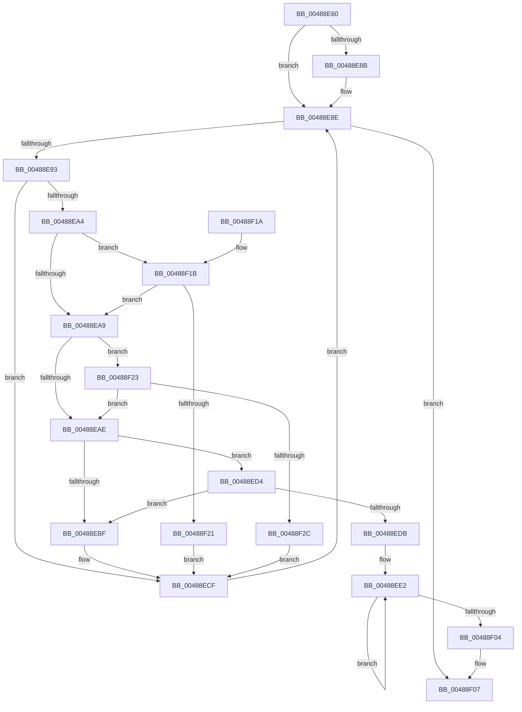

# IopCheckListForCancelableIrp

- RVA: `0x00488E60`–`0x00488F2E` (길이 `206` bytes)
- VA: `0x0000000140488E60`
- 실행 섹션: `.text`
- PDB 이름 있음: `예`; PDB Function 태그: `아니요`
- unwind 정보 RVA: `0x000AFE4C`
- 디코드: `62`개 명령, `206/206` bytes 표시
- 미해석 바이트: `0` (있으면 어셈블리에 `.byte`로 보존)

> 이 문서는 커널 이미지의 기계어와 PDB 기호를 분석해 생성했습니다. 4번과 5번은 함수 원형과 자료형을 바이너리 사용 방식에서 추정한 C 해석이며 원본 소스 복구 결과는 아닙니다.

## 1. Dependencies

- 직접 호출 지점: **0**; 고유 호출 대상: **0**
- 직접 호출자로 확인된 함수: **1**
- RIP 상대 이미지 참조: **0**

### Outgoing calls
- 직접 디코드된 call 명령이 없습니다.

### Direct callers
- [sub_00207169](../20/Unknown_function_00207169.md) at `0x002071F1`

### Static image references
- 디코드된 RIP-relative 메모리 참조가 없습니다.

## 2. Other-region calls and transfers

- 다른 실행 섹션으로 향하는 call: **0**
- 별도 외부 분기/꼬리 이동을 확인하지 못했습니다.

## 3. Assembly (complete function range)

```asm
00488E60  48 89 5C 24 08                  mov qword ptr [rsp + 8], rbx
00488E65  48 89 74 24 10                  mov qword ptr [rsp + 0x10], rsi
00488E6A  48 89 7C 24 18                  mov qword ptr [rsp + 0x18], rdi
00488E6F  48 8B 74 24 30                  mov rsi, qword ptr [rsp + 0x30]
00488E74  49 8B F9                        mov rdi, r9
00488E77  4C 8B 54 24 28                  mov r10, qword ptr [rsp + 0x28]
00488E7C  48 8B D9                        mov rbx, rcx
00488E7F  41 B3 01                        mov r11b, 1
00488E82  48 83 26 00                     and qword ptr [rsi], 0
00488E86  4D 85 D2                        test r10, r10
00488E89  75 03                           jne 0x140488e8e
00488E8B  4C 8B 11                        mov r10, qword ptr [rcx]
00488E8E  49 3B DA                        cmp rbx, r10
00488E91  74 74                           je 0x140488f07
00488E93  4D 8D 4A E0                     lea r9, [r10 - 0x20]
00488E97  49 8B 41 58                     mov rax, qword ptr [r9 + 0x58]
00488E9B  48 83 E0 F9                     and rax, 0xfffffffffffffff9
00488E9F  48 3B C2                        cmp rax, rdx
00488EA2  75 2B                           jne 0x140488ecf
00488EA4  4D 85 C0                        test r8, r8
00488EA7  75 72                           jne 0x140488f1b
00488EA9  48 85 FF                        test rdi, rdi
00488EAC  75 75                           jne 0x140488f23
00488EAE  41 0F BE 49 42                  movsx ecx, byte ptr [r9 + 0x42]
00488EB3  41 0F BE 41 43                  movsx eax, byte ptr [r9 + 0x43]
00488EB8  83 C1 02                        add ecx, 2
00488EBB  3B C1                           cmp eax, ecx
00488EBD  7C 15                           jl 0x140488ed4
00488EBF  41 8B 41 10                     mov eax, dword ptr [r9 + 0x10]
00488EC3  25 00 00 01 00                  and eax, 0x10000
00488EC8  F7 D8                           neg eax
00488ECA  1A C0                           sbb al, al
00488ECC  44 22 D8                        and r11b, al
00488ECF  4D 8B 12                        mov r10, qword ptr [r10]
00488ED2  EB BA                           jmp 0x140488e8e
00488ED4  41 80 79 44 00                  cmp byte ptr [r9 + 0x44], 0
00488ED9  75 E4                           jne 0x140488ebf
00488EDB  49 8B 41 58                     mov rax, qword ptr [r9 + 0x58]
00488EDF  45 32 DB                        xor r11b, r11b
00488EE2  48 8B D0                        mov rdx, rax
00488EE5  48 8B C8                        mov rcx, rax
00488EE8  83 E2 06                        and edx, 6
00488EEB  48 83 E1 F9                     and rcx, 0xfffffffffffffff9
00488EEF  48 83 C2 02                     add rdx, 2
00488EF3  4C 8B C0                        mov r8, rax
00488EF6  48 0B D1                        or rdx, rcx
00488EF9  F0 49 0F B1 51 58               lock cmpxchg qword ptr [r9 + 0x58], rdx
00488EFF  4C 3B C0                        cmp r8, rax
00488F02  75 DE                           jne 0x140488ee2
00488F04  4C 89 0E                        mov qword ptr [rsi], r9
00488F07  48 8B 5C 24 08                  mov rbx, qword ptr [rsp + 8]
00488F0C  41 8A C3                        mov al, r11b
00488F0F  48 8B 74 24 10                  mov rsi, qword ptr [rsp + 0x10]
00488F14  48 8B 7C 24 18                  mov rdi, qword ptr [rsp + 0x18]
00488F19  C3                              ret
00488F1A  CC                              int3
00488F1B  4D 39 41 48                     cmp qword ptr [r9 + 0x48], r8
00488F1F  74 88                           je 0x140488ea9
00488F21  EB AC                           jmp 0x140488ecf
00488F23  49 39 B9 98 00 00 00            cmp qword ptr [r9 + 0x98], rdi
00488F2A  74 82                           je 0x140488eae
00488F2C  EB A1                           jmp 0x140488ecf
```

## 4. C-style interpretation (structured pseudocode)

```c
__int64 __fastcall IopCheckListForCancelableIrp(__int64 a1, __int64 a2, __int64 a3, __int64 a4, __int64 a5, __int64 a6)
{
    __int64 result;
    __int64 v_r10;
    __int64 v_r11;
    unsigned __int64 v_stack_p10;
    unsigned __int64 v_stack_p18;
    unsigned __int64 v_stack_p8;

    v_stack_p8 = v_rbx;
    v_stack_p10 = v_rsi;
    v_stack_p18 = v_rdi;
    v_r10 = a5;
    if (a5 == 0) {
        v_r10 = *(unsigned __int64 *)(a1);
    }
    if (a1 == v_r10) goto loc_00488F07;
    result = (*(unsigned __int64 *)(v_r10 - 32 + 88)) & (-7);
    if (result != a2) goto loc_00488ECF;
    if (a3 != 0) goto loc_00488F1B;
loc_00488EA9:
    if (a4 != 0) goto loc_00488F23;
loc_00488EAE:
    a1 = (unsigned int)(((__int8)(*(unsigned __int8 *)(v_r10 - 32 + 66))) + (2));
    if (((unsigned int)((__int8)(*(unsigned __int8 *)(v_r10 - 32 + 67)))) < ((unsigned int)(a1))) goto loc_00488ED4;
loc_00488EBF:
    result = (unsigned int)(((unsigned int)(*(unsigned int *)(v_r10 - 32 + 16))) & (0x10000ULL));
    result = (unsigned int)(-(result));
    v_r11 = (unsigned __int8)((1) & ((unsigned __int8)(result)));
loc_00488ECF:
    goto loc_00488E8E;
loc_00488ED4:
    if ((*(unsigned __int8 *)(v_r10 - 32 + 68)) != 0) goto loc_00488EBF;
    v_r11 = 0;
loc_00488EE2:
    a2 = (unsigned int)((*(unsigned __int64 *)(v_r10 - 32 + 88)) & (6));
    a1 = (*(unsigned __int64 *)(v_r10 - 32 + 88)) & (-7);
    a2 = (a2) + (2);
    a2 = (a2) | (a1);
    if ((*(unsigned __int64 *)(v_r10 - 32 + 88)) != (*(unsigned __int64 *)(v_r10 - 32 + 88))) goto loc_00488EE2;
    *(unsigned __int64 *)(a6) = v_r10 - 32;
loc_00488F07:
    return 0;
loc_00488F1B:
    if ((*(unsigned __int64 *)(v_r10 - 32 + 72)) == (*(unsigned __int64 *)(v_r10 - 32 + 88))) goto loc_00488EA9;
    goto loc_00488ECF;
loc_00488F23:
    if ((*(unsigned __int64 *)(v_r10 - 32 + 152)) == v_stack_p18) goto loc_00488EAE;
    goto loc_00488ECF;
}
```

## 5. (Beta) C Style

```c
int64_t IopCheckListForCancelableIrp(void *Arg1, int64_t Arg2, int64_t Arg3, int64_t Arg4, int64_t Arg5, void *Arg6)
{
    uint8_t *arg1 = (uint8_t *)Arg1;
    uint8_t *arg6 = (uint8_t *)Arg6;

    int64_t result;
    int64_t local_r10;
    int64_t local_r11;
    uint64_t v_stack_p10;
    uint64_t v_stack_p18;
    uint64_t v_stack_p8;

    v_stack_p8 = local_rbx;
    v_stack_p10 = local_rsi;
    v_stack_p18 = local_rdi;
    local_r10 = Arg5;
    if (Arg5 == 0) {
        local_r10 = *(uint64_t *)(arg1);
    }
    if (Arg1 == local_r10) goto loc_00488F07;
    result = (*(uint64_t *)(local_r10 - 0x20 + 0x58)) & (-7);
    if (result != Arg2) goto loc_00488ECF;
    if (Arg3 != 0) goto loc_00488F1B;
loc_00488EA9:
    if (Arg4 != 0) goto loc_00488F23;
loc_00488EAE:
    Arg1 = (uint32_t)(((int8_t)(*(uint8_t *)(local_r10 - 0x20 + 0x42))) + (2));
    if (((uint32_t)((int8_t)(*(uint8_t *)(local_r10 - 0x20 + 0x43)))) < ((uint32_t)(Arg1))) goto loc_00488ED4;
loc_00488EBF:
    result = (uint32_t)(((uint32_t)(*(uint32_t *)(local_r10 - 0x20 + 0x10))) & (0x10000ULL));
    result = (uint32_t)(-(result));
    local_r11 = (uint8_t)((1) & ((uint8_t)(result)));
loc_00488ECF:
    goto loc_00488E8E;
loc_00488ED4:
    if ((*(uint8_t *)(local_r10 - 0x20 + 0x44)) != 0) goto loc_00488EBF;
    local_r11 = 0;
loc_00488EE2:
    Arg2 = (uint32_t)((*(uint64_t *)(local_r10 - 0x20 + 0x58)) & (6));
    Arg1 = (*(uint64_t *)(local_r10 - 0x20 + 0x58)) & (-7);
    Arg2 = (Arg2) + (2);
    Arg2 = (Arg2) | (Arg1);
    if ((*(uint64_t *)(local_r10 - 0x20 + 0x58)) != (*(uint64_t *)(local_r10 - 0x20 + 0x58))) goto loc_00488EE2;
    *(uint64_t *)(arg6) = local_r10 - 32;
loc_00488F07:
    return 0;
loc_00488F1B:
    if ((*(uint64_t *)(local_r10 - 0x20 + 0x48)) == (*(uint64_t *)(local_r10 - 0x20 + 0x58))) goto loc_00488EA9;
    goto loc_00488ECF;
loc_00488F23:
    if ((*(uint64_t *)(local_r10 - 0x20 + 0x98)) == v_stack_p18) goto loc_00488EAE;
    goto loc_00488ECF;
}
```

### 관측된 메모리 오프셋

구조체 형식이 확인되지 않은 접근은 인자 기준의 오프셋으로만 기록했습니다.

| 기준 인자 | 오프셋 표현 | 폭 (bit) | 접근 |
|---|---:|---:|---|
| `Arg1` | `+ 0x0` | `64` | `R` |
| `Arg6` | `+ 0x0` | `64` | `R/W` |
| `Arg6` | `+ 0x0` | `64` | `W` |

## 6. Execution-region graph

[열기: 2D/3D 그래프와 함수 탐색 컨트롤 패널](../../../control-panel.html?section=text&rva=0x00488E60&view=graph)

- 2D 그래프는 위에서 아래로 흐르고, 3D 그래프는 빈 공간을 드래그해 회전합니다. Shift+드래그는 이동, 휠은 확대·축소, 함수 노드 선택은 대상 보고서 이동입니다.

### Static fallback


