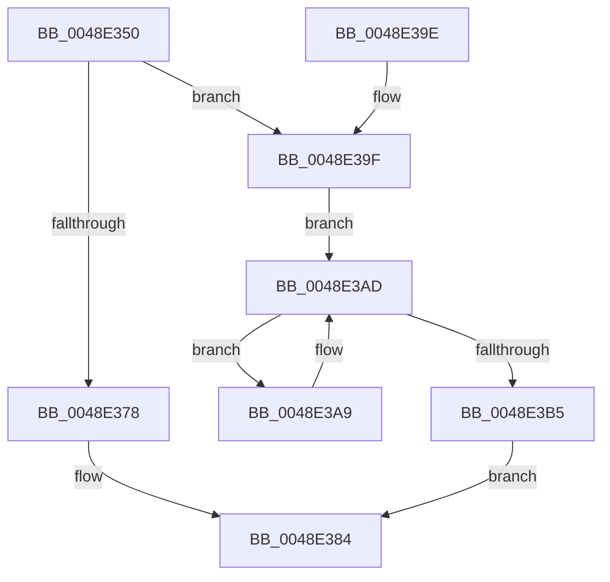

# IopInsertRemoveDevice

- RVA: `0x0048E350`–`0x0048E3BE` (길이 `110` bytes)
- VA: `0x000000014048E350`
- 실행 섹션: `.text`
- PDB 이름 있음: `예`; PDB Function 태그: `아니요`
- unwind 정보 RVA: `0x000707E0`
- 디코드: `33`개 명령, `110/110` bytes 표시
- 미해석 바이트: `0` (있으면 어셈블리에 `.byte`로 보존)

> 이 문서는 커널 이미지의 기계어와 PDB 기호를 분석해 생성했습니다. 4번과 5번은 함수 원형과 자료형을 바이너리 사용 방식에서 추정한 C 해석이며 원본 소스 복구 결과는 아닙니다.

## 1. Dependencies

- 직접 호출 지점: **2**; 고유 호출 대상: **2**
- 직접 호출자로 확인된 함수: **2**
- RIP 상대 이미지 참조: **0**

### Outgoing calls
- `0x0048E36D` → [KeAcquireQueuedSpinLock](../27/KeAcquireQueuedSpinLock_function_00273D80.md) (function, `0x00273D80`)
- `0x0048E389` → [KeReleaseQueuedSpinLock](../27/KeReleaseQueuedSpinLock_function_00272540.md) (function, `0x00272540`)

### Direct callers
- [IopCompleteUnloadOrDelete](../27/IopCompleteUnloadOrDelete_function_00270BC8.md) at `0x00270D5C`
- [IoCreateDevice](../../page/9A/IoCreateDevice_function_009A4B00.md) at `0x009A4E61`

### Static image references
- 디코드된 RIP-relative 메모리 참조가 없습니다.

## 2. Other-region calls and transfers

- 다른 실행 섹션으로 향하는 call: **0**
- 별도 외부 분기/꼬리 이동을 확인하지 못했습니다.

## 3. Assembly (complete function range)

```asm
0048E350  48 89 5C 24 08                  mov qword ptr [rsp + 8], rbx
0048E355  48 89 74 24 10                  mov qword ptr [rsp + 0x10], rsi
0048E35A  57                              push rdi
0048E35B  48 83 EC 20                     sub rsp, 0x20
0048E35F  48 8B F1                        mov rsi, rcx
0048E362  41 8A D8                        mov bl, r8b
0048E365  B9 0A 00 00 00                  mov ecx, 0xa
0048E36A  48 8B FA                        mov rdi, rdx
0048E36D  E8 0E 5A DE FF                  call 0x140273d80
0048E372  8A D0                           mov dl, al
0048E374  84 DB                           test bl, bl
0048E376  74 27                           je 0x14048e39f
0048E378  4C 8B 46 08                     mov r8, qword ptr [rsi + 8]
0048E37C  4C 89 47 10                     mov qword ptr [rdi + 0x10], r8
0048E380  48 89 7E 08                     mov qword ptr [rsi + 8], rdi
0048E384  B9 0A 00 00 00                  mov ecx, 0xa
0048E389  E8 B2 41 DE FF                  call 0x140272540
0048E38E  48 8B 5C 24 30                  mov rbx, qword ptr [rsp + 0x30]
0048E393  48 8B 74 24 38                  mov rsi, qword ptr [rsp + 0x38]
0048E398  48 83 C4 20                     add rsp, 0x20
0048E39C  5F                              pop rdi
0048E39D  C3                              ret
0048E39E  CC                              int3
0048E39F  48 8B 4F 08                     mov rcx, qword ptr [rdi + 8]
0048E3A3  48 83 C1 08                     add rcx, 8
0048E3A7  EB 04                           jmp 0x14048e3ad
0048E3A9  48 8D 48 10                     lea rcx, [rax + 0x10]
0048E3AD  48 8B 01                        mov rax, qword ptr [rcx]
0048E3B0  48 3B C7                        cmp rax, rdi
0048E3B3  75 F4                           jne 0x14048e3a9
0048E3B5  48 8B 47 10                     mov rax, qword ptr [rdi + 0x10]
0048E3B9  48 89 01                        mov qword ptr [rcx], rax
0048E3BC  EB C6                           jmp 0x14048e384
```

## 4. C-style interpretation (structured pseudocode)

```c
__int64 __fastcall IopInsertRemoveDevice(__int64 a1, __int64 a2, unsigned __int8 a3)
{
    __int64 result;
    __int64 v_rsp;
    unsigned __int64 v_stack_p10;
    unsigned __int64 v_stack_p8;

    v_stack_p8 = v_rbx;
    v_stack_p10 = v_rsi;
    v_rsp = (v_rsp) - (32);
    result = KeAcquireQueuedSpinLock(10, a2, a3, a4);
    if (a3 == 0) goto loc_0048E39F;
    *(unsigned __int64 *)(a2 + 16) = *(unsigned __int64 *)(a1 + 8);
    *(unsigned __int64 *)(a1 + 8) = a2;
loc_0048E384:
    result = KeReleaseQueuedSpinLock(10, (unsigned __int8)(result), *(unsigned __int64 *)(a1 + 8), a4);
    v_rsp = (v_rsp) + (32);
    return result;
loc_0048E39F:
    a1 = (*(unsigned __int64 *)(a2 + 8)) + (8);
    goto loc_0048E3AD;
loc_0048E3A9:
loc_0048E3AD:
    if ((*(unsigned __int64 *)(result + 16)) != a2) goto loc_0048E3A9;
    *(unsigned __int64 *)(result + 16) = *(unsigned __int64 *)(a2 + 16);
    goto loc_0048E384;
}
```

## 5. (Beta) C Style

```c
int64_t IopInsertRemoveDevice(void *Arg1, void *Arg2, uint8_t Arg3)
{
    uint8_t *arg1 = (uint8_t *)Arg1;
    uint8_t *arg2 = (uint8_t *)Arg2;

    int64_t result;
    int64_t local_rsp;
    uint64_t v_stack_p10;
    uint64_t v_stack_p8;

    v_stack_p8 = local_rbx;
    v_stack_p10 = local_rsi;
    local_rsp = (local_rsp) - (32);
    result = KeAcquireQueuedSpinLock(10, Arg2, Arg3, a4);
    if (Arg3 == 0) goto loc_0048E39F;
    *(uint64_t *)(arg2 + 0x10) = *(uint64_t *)(arg1 + 0x8);
    *(void **)(arg1 + 0x8) = Arg2;
loc_0048E384:
    result = KeReleaseQueuedSpinLock(10, (uint8_t)(result), *(uint64_t *)(arg1 + 0x8), a4);
    local_rsp = (local_rsp) + (32);
    return result;
loc_0048E39F:
    Arg1 = (*(uint64_t *)(arg2 + 0x8)) + (8);
    goto loc_0048E3AD;
loc_0048E3A9:
loc_0048E3AD:
    if ((*(uint64_t *)(result + 0x10)) != Arg2) goto loc_0048E3A9;
    *(uint64_t *)(result + 0x10) = *(uint64_t *)(arg2 + 0x10);
    goto loc_0048E384;
}
```

### 관측된 메모리 오프셋

구조체 형식이 확인되지 않은 접근은 인자 기준의 오프셋으로만 기록했습니다.

| 기준 인자 | 오프셋 표현 | 폭 (bit) | 접근 |
|---|---:|---:|---|
| `Arg1` | `+ 0x8` | `64` | `R` |
| `Arg1` | `+ 0x8` | `64` | `W` |
| `Arg2` | `+ 0x8` | `64` | `R` |
| `Arg2` | `+ 0x10` | `64` | `R` |
| `Arg2` | `+ 0x10` | `64` | `W` |

## 6. Execution-region graph

[열기: 2D/3D 그래프와 함수 탐색 컨트롤 패널](../../../control-panel.html?section=text&rva=0x0048E350&view=graph)

- 2D 그래프는 위에서 아래로 흐르고, 3D 그래프는 빈 공간을 드래그해 회전합니다. Shift+드래그는 이동, 휠은 확대·축소, 함수 노드 선택은 대상 보고서 이동입니다.

### Static fallback


