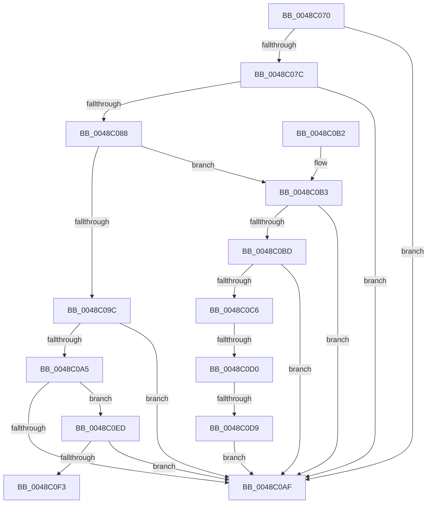

# IopIrpHasValidCombinationOfExtensionTypes

- RVA: `0x0048C070`–`0x0048C0F8` (길이 `136` bytes)
- VA: `0x000000014048C070`
- 실행 섹션: `.text`
- PDB 이름 있음: `예`; PDB Function 태그: `예`
- unwind 정보 RVA: `0x000DB714`
- 디코드: `43`개 명령, `136/136` bytes 표시
- 미해석 바이트: `0` (있으면 어셈블리에 `.byte`로 보존)

> 이 문서는 커널 이미지의 기계어와 PDB 기호를 분석해 생성했습니다. 4번과 5번은 함수 원형과 자료형을 바이너리 사용 방식에서 추정한 C 해석이며 원본 소스 복구 결과는 아닙니다.

## 1. Dependencies

- 직접 호출 지점: **0**; 고유 호출 대상: **0**
- 직접 호출자로 확인된 함수: **3**
- RIP 상대 이미지 참조: **0**

### Outgoing calls
- 직접 디코드된 call 명령이 없습니다.

### Direct callers
- [IopPerfCallDriver](../4A/IopPerfCallDriver_function_004A9680.md) at `0x004A9729`
- [IoSetAdapterCryptoEngineExtension](../59/IoSetAdapterCryptoEngineExtension_function_00598520.md) at `0x00598531`
- [IoSetFsZeroingOffsetRequired](../59/IoSetFsZeroingOffsetRequired_function_005985C0.md) at `0x005985DF`

### Static image references
- 디코드된 RIP-relative 메모리 참조가 없습니다.

## 2. Other-region calls and transfers

- 다른 실행 섹션으로 향하는 call: **0**
- call이 아닌 외부 분기/꼬리 이동: **3**
  - `0x0048C0CA` → `0x006F639A` (`tail-transfer`)
  - `0x0048C0D3` → `0x006F639A` (`tail-transfer`)
  - `0x0048C0F3` → `0x006F639A` (`tail-transfer`)

## 3. Assembly (complete function range)

```asm
0048C070  66 90                           nop
0048C072  90                              nop
0048C073  44 8B CA                        mov r9d, edx
0048C076  80 79 47 00                     cmp byte ptr [rcx + 0x47], 0
0048C07A  7C 33                           jl 0x14048c0af
0048C07C  4C 8B 81 C8 00 00 00            mov r8, qword ptr [rcx + 0xc8]
0048C083  4D 85 C0                        test r8, r8
0048C086  74 27                           je 0x14048c0af
0048C088  8B CA                           mov ecx, edx
0048C08A  41 BA B2 00 00 00               mov r10d, 0xb2
0048C090  BA 01 00 00 00                  mov edx, 1
0048C095  D3 E2                           shl edx, cl
0048C097  41 84 D2                        test r10b, dl
0048C09A  75 17                           jne 0x14048c0b3
0048C09C  B9 00 02 00 00                  mov ecx, 0x200
0048C0A1  85 D1                           test ecx, edx
0048C0A3  74 0A                           je 0x14048c0af
0048C0A5  41 0F B7 40 02                  movzx eax, word ptr [r8 + 2]
0048C0AA  66 85 C1                        test cx, ax
0048C0AD  75 3E                           jne 0x14048c0ed
0048C0AF  B0 01                           mov al, 1
0048C0B1  C3                              ret
0048C0B2  CC                              int3
0048C0B3  41 0F B7 48 02                  movzx ecx, word ptr [r8 + 2]
0048C0B8  41 84 CA                        test r10b, cl
0048C0BB  74 F2                           je 0x14048c0af
0048C0BD  8B C1                           mov eax, ecx
0048C0BF  41 23 C2                        and eax, r10d
0048C0C2  3B C2                           cmp eax, edx
0048C0C4  74 E9                           je 0x14048c0af
0048C0C6  41 83 F9 01                     cmp r9d, 1
0048C0CA  0F 84 CA A2 26 00               je 0x1406f639a
0048C0D0  F6 C1 02                        test cl, 2
0048C0D3  0F 84 C1 A2 26 00               je 0x1406f639a
0048C0D9  BA FE FF 00 00                  mov edx, 0xfffe
0048C0DE  66 23 CA                        and cx, dx
0048C0E1  49 83 60 28 00                  and qword ptr [r8 + 0x28], 0
0048C0E6  66 41 89 48 02                  mov word ptr [r8 + 2], cx
0048C0EB  EB C2                           jmp 0x14048c0af
0048C0ED  23 C1                           and eax, ecx
0048C0EF  3B C2                           cmp eax, edx
0048C0F1  74 BC                           je 0x14048c0af
0048C0F3  E9 A2 A2 26 00                  jmp 0x1406f639a
```

## 4. C-style interpretation (structured pseudocode)

```c
__int64 __fastcall IopIrpHasValidCombinationOfExtensionTypes(__int64 a1, int a2)
{
    __int64 result;

    if ((*(unsigned __int8 *)(a1 + 71)) < 0) goto loc_0048C0AF;
    if (*(unsigned __int64 *)(a1 + 200) == 0) goto loc_0048C0AF;
    a2 = (unsigned int)((1) << ((unsigned __int8)((unsigned int)(a2))));
    if (((178) & ((unsigned __int8)(a2))) != 0) goto loc_0048C0B3;
    if (((512) & (a2)) == 0) goto loc_0048C0AF;
    if (((512) & ((unsigned __int16)(*(unsigned __int16 *)(*(unsigned __int64 *)(a1 + 200) + 2)))) != 0) goto loc_0048C0ED;
loc_0048C0AF:
    return 1;
loc_0048C0B3:
    if (((178) & ((unsigned __int8)(*(unsigned __int16 *)(*(unsigned __int64 *)(a1 + 200) + 2)))) == 0) goto loc_0048C0AF;
    result = (unsigned int)(((unsigned int)((unsigned int)(*(unsigned __int16 *)(*(unsigned __int64 *)(a1 + 200) + 2)))) & (178));
    if (((unsigned int)(result)) == a2) goto loc_0048C0AF;
    a1 = (unsigned __int16)((*(unsigned __int16 *)(*(unsigned __int64 *)(a1 + 200) + 2)) & ((unsigned __int16)((unsigned int)(0xFFFEULL))));
    *(unsigned __int16 *)(*(unsigned __int64 *)(a1 + 200) + 2) = (unsigned __int16)(a1);
    goto loc_0048C0AF;
loc_0048C0ED:
    result = (unsigned int)((result) & ((unsigned int)(a1)));
    if (((unsigned int)(result)) == ((unsigned int)((unsigned int)(0xFFFEULL)))) goto loc_0048C0AF;
}
```

## 5. (Beta) C Style

```c
int64_t IopIrpHasValidCombinationOfExtensionTypes(void *Arg1, int32_t Arg2)
{
    uint8_t *arg1 = (uint8_t *)Arg1;

    int64_t result;

    if ((*(uint8_t *)(arg1 + 0x47)) < 0) goto loc_0048C0AF;
    if (*(uint64_t *)(arg1 + 0xC8) == 0) goto loc_0048C0AF;
    Arg2 = (uint32_t)((1) << ((uint8_t)((uint32_t)(Arg2))));
    if (((178) & ((uint8_t)(Arg2))) != 0) goto loc_0048C0B3;
    if (((512) & (Arg2)) == 0) goto loc_0048C0AF;
    if (((512) & ((uint16_t)(*(uint16_t *)(*(uint64_t *)(arg1 + 0xC8) + 0x2)))) != 0) goto loc_0048C0ED;
loc_0048C0AF:
    return 1;
loc_0048C0B3:
    if (((178) & ((uint8_t)(*(uint16_t *)(*(uint64_t *)(arg1 + 0xC8) + 0x2)))) == 0) goto loc_0048C0AF;
    result = (uint32_t)(((uint32_t)((uint32_t)(*(uint16_t *)(*(uint64_t *)(arg1 + 0xC8) + 0x2)))) & (178));
    if (((uint32_t)(result)) == Arg2) goto loc_0048C0AF;
    Arg1 = (uint16_t)((*(uint16_t *)(*(uint64_t *)(arg1 + 0xC8) + 0x2)) & ((uint16_t)((uint32_t)(0xFFFEULL))));
    *(uint16_t *)(*(uint64_t *)(arg1 + 0xC8) + 0x2) = (uint16_t)(Arg1);
    goto loc_0048C0AF;
loc_0048C0ED:
    result = (uint32_t)((result) & ((uint32_t)(Arg1)));
    if (((uint32_t)(result)) == ((uint32_t)((uint32_t)(0xFFFEULL)))) goto loc_0048C0AF;
}
```

### 관측된 메모리 오프셋

구조체 형식이 확인되지 않은 접근은 인자 기준의 오프셋으로만 기록했습니다.

| 기준 인자 | 오프셋 표현 | 폭 (bit) | 접근 |
|---|---:|---:|---|
| `Arg1` | `+ 0x47` | `8` | `R` |
| `Arg1` | `+ 0xC8` | `64` | `R` |

## 6. Execution-region graph

[열기: 2D/3D 그래프와 함수 탐색 컨트롤 패널](../../../control-panel.html?section=text&rva=0x0048C070&view=graph)

- 2D 그래프는 위에서 아래로 흐르고, 3D 그래프는 빈 공간을 드래그해 회전합니다. Shift+드래그는 이동, 휠은 확대·축소, 함수 노드 선택은 대상 보고서 이동입니다.

### Static fallback


