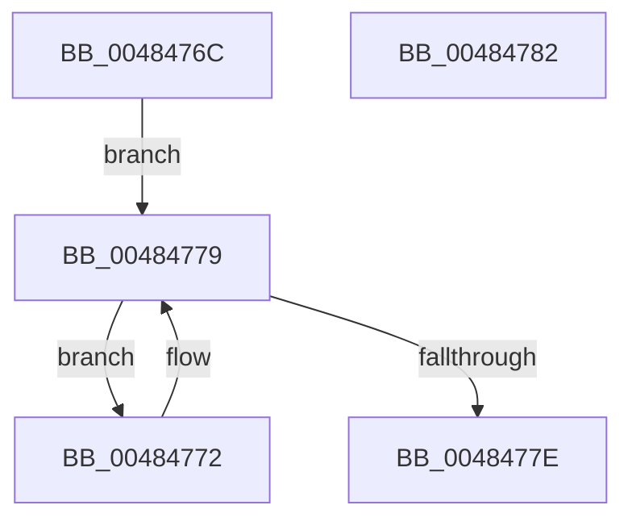

# IopSymlinkGetMostRecentlyUsedName

- RVA: `0x0048476C`–`0x00484783` (길이 `23` bytes)
- VA: `0x000000014048476C`
- 실행 섹션: `.text`
- PDB 이름 있음: `예`; PDB Function 태그: `아니요`
- unwind 정보 RVA: `0x000DB714`
- 디코드: `9`개 명령, `23/23` bytes 표시
- 미해석 바이트: `0` (있으면 어셈블리에 `.byte`로 보존)

> 이 문서는 커널 이미지의 기계어와 PDB 기호를 분석해 생성했습니다. 4번과 5번은 함수 원형과 자료형을 바이너리 사용 방식에서 추정한 C 해석이며 원본 소스 복구 결과는 아닙니다.

## 1. Dependencies

- 직접 호출 지점: **0**; 고유 호출 대상: **0**
- 직접 호출자로 확인된 함수: **5**
- RIP 상대 이미지 참조: **0**

### Outgoing calls
- 직접 디코드된 call 명령이 없습니다.

### Direct callers
- [IopParseDevice](../../page/89/IopParseDevice_function_0089E510.md) at `0x0089F91C`
- [IopSymlinkProcessReparse](../../page/A3/IopSymlinkProcessReparse_function_00A330B4.md) at `0x00A33129`
- [IopGraftName](../../page/A3/IopGraftName_function_00A33160.md) at `0x00A333E5`
- [IopSymlinkRememberJunction](../../page/A3/IopSymlinkRememberJunction_function_00A33524.md) at `0x00A33570`
- [sub_00B39C68](../../page/B3/Unknown_function_00B39C68.md) at `0x00B39F1C`

### Static image references
- 디코드된 RIP-relative 메모리 참조가 없습니다.

## 2. Other-region calls and transfers

- 다른 실행 섹션으로 향하는 call: **0**
- 별도 외부 분기/꼬리 이동을 확인하지 못했습니다.

## 3. Assembly (complete function range)

```asm
0048476C  48 8B 41 08                     mov rax, qword ptr [rcx + 8]
00484770  EB 07                           jmp 0x140484779
00484772  48 8B C8                        mov rcx, rax
00484775  48 8B 40 08                     mov rax, qword ptr [rax + 8]
00484779  48 85 C0                        test rax, rax
0048477C  75 F4                           jne 0x140484772
0048477E  48 8B C1                        mov rax, rcx
00484781  C3                              ret
00484782  CC                              int3
```

## 4. C-style interpretation (structured pseudocode)

```c
__int64 __fastcall IopSymlinkGetMostRecentlyUsedName(__int64 a1)
{
    goto loc_00484779;
loc_00484772:
loc_00484779:
    if (*(unsigned __int64 *)(*(unsigned __int64 *)(a1 + 8) + 8) != 0) goto loc_00484772;
    return *(unsigned __int64 *)(a1 + 8);
}
```

## 5. (Beta) C Style

```c
int64_t IopSymlinkGetMostRecentlyUsedName(void *Arg1)
{
    uint8_t *arg1 = (uint8_t *)Arg1;

    goto loc_00484779;
loc_00484772:
loc_00484779:
    if (*(uint64_t *)(*(uint64_t *)(arg1 + 0x8) + 0x8) != 0) goto loc_00484772;
    return *(uint64_t *)(arg1 + 0x8);
}
```

### 관측된 메모리 오프셋

구조체 형식이 확인되지 않은 접근은 인자 기준의 오프셋으로만 기록했습니다.

| 기준 인자 | 오프셋 표현 | 폭 (bit) | 접근 |
|---|---:|---:|---|
| `Arg1` | `+ 0x8` | `64` | `R` |

## 6. Execution-region graph

[열기: 2D/3D 그래프와 함수 탐색 컨트롤 패널](../../../control-panel.html?section=text&rva=0x0048476C&view=graph)

- 2D 그래프는 위에서 아래로 흐르고, 3D 그래프는 빈 공간을 드래그해 회전합니다. Shift+드래그는 이동, 휠은 확대·축소, 함수 노드 선택은 대상 보고서 이동입니다.

### Static fallback


