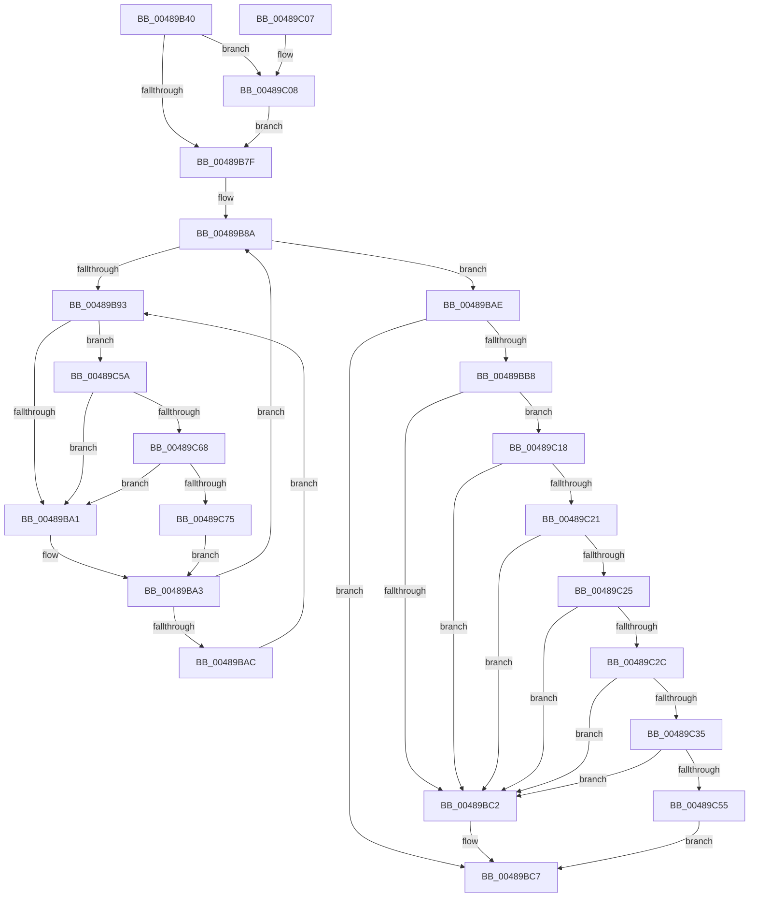

# KeAlertThread

- RVA: `0x00489B40`–`0x00489C81` (길이 `321` bytes)
- VA: `0x0000000140489B40`
- 실행 섹션: `.text`
- PDB 이름 있음: `예`; PDB Function 태그: `아니요`
- unwind 정보 RVA: `0x000B0068`
- 디코드: `86`개 명령, `321/321` bytes 표시
- 미해석 바이트: `0` (있으면 어셈블리에 `.byte`로 보존)

> 이 문서는 커널 이미지의 기계어와 PDB 기호를 분석해 생성했습니다. 4번과 5번은 함수 원형과 자료형을 바이너리 사용 방식에서 추정한 C 해석이며 원본 소스 복구 결과는 아닙니다.

## 1. Dependencies

- 직접 호출 지점: **5**; 고유 호출 대상: **5**
- 직접 호출자로 확인된 함수: **5**
- RIP 상대 이미지 참조: **3**

### Outgoing calls
- `0x00489BE0` → [KiExitDispatcher](../25/KiExitDispatcher_function_00251CF0.md) (function, `0x00251CF0`)
- `0x00489C0E` → [KiRaiseIrqlProcessIrqlFlags](../4F/KiRaiseIrqlProcessIrqlFlags_function_004F56FC.md) (function, `0x004F56FC`)
- `0x00489C44` → [KiSignalThread](../21/KiSignalThread_function_0021F9E0.md) (function, `0x0021F9E0`)
- `0x00489C68` → [KiCheckVpBackingLongSpinWaitHypercall](../30/KiCheckVpBackingLongSpinWaitHypercall_function_0030F490.md) (function, `0x0030F490`)
- `0x00489C77` → [HvlNotifyLongSpinWait](../30/HvlNotifyLongSpinWait_function_0030F460.md) (function, `0x0030F460`)

### Direct callers
- [IoDecrementKeepAliveCount](IoDecrementKeepAliveCount_function_004898E0.md) at `0x004899B3`
- [KeRequestTerminationThread](KeRequestTerminationThread_function_00489A58.md) at `0x00489B0E`
- [IopCancelIrpsInCurrentThreadListSpecialApc](../49/IopCancelIrpsInCurrentThreadListSpecialApc_function_00497B40.md) at `0x00497C2E`
- [KeAlertResumeThread](../5B/KeAlertResumeThread_function_005B8E60.md) at `0x005B8E8F`
- [NtAlertThread](../../page/A8/NtAlertThread_function_00A89FB0.md) at `0x00A8A00C`

### Static image references
- `0x00489B72` → RVA `0x00FC6D20` (`ALMOSTRO`; read)
- `0x00489B95` → RVA `0x00FC52AC` (`ALMOSTRO`; reference)
- `0x00489C5A` → RVA `0x00FC6AB8` (`ALMOSTRO`; read)

## 2. Other-region calls and transfers

- 다른 실행 섹션으로 향하는 call: **0**
- 별도 외부 분기/꼬리 이동을 확인하지 못했습니다.

## 3. Assembly (complete function range)

```asm
00489B40  48 8B C4                        mov rax, rsp
00489B43  48 89 58 08                     mov qword ptr [rax + 8], rbx
00489B47  48 89 68 10                     mov qword ptr [rax + 0x10], rbp
00489B4B  48 89 70 18                     mov qword ptr [rax + 0x18], rsi
00489B4F  48 89 78 20                     mov qword ptr [rax + 0x20], rdi
00489B53  41 54                           push r12
00489B55  41 56                           push r14
00489B57  41 57                           push r15
00489B59  48 83 EC 30                     sub rsp, 0x30
00489B5D  48 0F BE EA                     movsx rbp, dl
00489B61  48 8B D9                        mov rbx, rcx
00489B64  45 0F 20 C6                     mov r14, cr8
00489B68  41 BC 02 00 00 00               mov r12d, 2
00489B6E  45 0F 22 C4                     mov cr8, r12
00489B72  83 3D A7 D1 B3 00 00            cmp dword ptr [rip + 0xb3d1a7], 0
00489B79  0F 85 89 00 00 00               jne 0x140489c08
00489B7F  65 4C 8B 3C 25 20 00 00 00      mov r15, qword ptr gs:[0x20]
00489B88  33 FF                           xor edi, edi
00489B8A  F0 48 0F BA 6B 40 00            lock bts qword ptr [rbx + 0x40], 0
00489B91  73 1B                           jae 0x140489bae
00489B93  FF C7                           inc edi
00489B95  85 3D 11 B7 B3 00               test dword ptr [rip + 0xb3b711], edi
00489B9B  0F 84 B9 00 00 00               je 0x140489c5a
00489BA1  F3 90                           pause
00489BA3  48 8B 43 40                     mov rax, qword ptr [rbx + 0x40]
00489BA7  48 85 C0                        test rax, rax
00489BAA  74 DE                           je 0x140489b8a
00489BAC  EB E5                           jmp 0x140489b93
00489BAE  40 8A 74 1D 72                  mov sil, byte ptr [rbp + rbx + 0x72]
00489BB3  40 84 F6                        test sil, sil
00489BB6  75 0F                           jne 0x140489bc7
00489BB8  8A 83 84 01 00 00               mov al, byte ptr [rbx + 0x184]
00489BBE  3C 05                           cmp al, 5
00489BC0  74 56                           je 0x140489c18
00489BC2  C6 44 1D 72 01                  mov byte ptr [rbp + rbx + 0x72], 1
00489BC7  33 D2                           xor edx, edx
00489BC9  48 C7 43 40 00 00 00 00         mov qword ptr [rbx + 0x40], 0
00489BD1  45 8B CC                        mov r9d, r12d
00489BD4  44 88 74 24 20                  mov byte ptr [rsp + 0x20], r14b
00489BD9  49 8B CF                        mov rcx, r15
00489BDC  44 8D 42 01                     lea r8d, [rdx + 1]
00489BE0  E8 0B 81 DC FF                  call 0x140251cf0
00489BE5  48 8B 5C 24 50                  mov rbx, qword ptr [rsp + 0x50]
00489BEA  40 8A C6                        mov al, sil
00489BED  48 8B 74 24 60                  mov rsi, qword ptr [rsp + 0x60]
00489BF2  48 8B 6C 24 58                  mov rbp, qword ptr [rsp + 0x58]
00489BF7  48 8B 7C 24 68                  mov rdi, qword ptr [rsp + 0x68]
00489BFC  48 83 C4 30                     add rsp, 0x30
00489C00  41 5F                           pop r15
00489C02  41 5E                           pop r14
00489C04  41 5C                           pop r12
00489C06  C3                              ret
00489C07  CC                              int3
00489C08  41 8A D4                        mov dl, r12b
00489C0B  41 8A CE                        mov cl, r14b
00489C0E  E8 E9 BA 06 00                  call 0x1404f56fc
00489C13  E9 67 FF FF FF                  jmp 0x140489b7f
00489C18  8A 43 70                        mov al, byte ptr [rbx + 0x70]
00489C1B  24 07                           and al, 7
00489C1D  3C 04                           cmp al, 4
00489C1F  74 A1                           je 0x140489bc2
00489C21  3C 03                           cmp al, 3
00489C23  74 9D                           je 0x140489bc2
00489C25  8B 43 74                        mov eax, dword ptr [rbx + 0x74]
00489C28  A8 10                           test al, 0x10
00489C2A  74 96                           je 0x140489bc2
00489C2C  40 3A AB 87 01 00 00            cmp bpl, byte ptr [rbx + 0x187]
00489C33  7F 8D                           jg 0x140489bc2
00489C35  45 33 C9                        xor r9d, r9d
00489C38  41 B8 01 01 00 00               mov r8d, 0x101
00489C3E  48 8B D3                        mov rdx, rbx
00489C41  49 8B CF                        mov rcx, r15
00489C44  E8 97 5D D9 FF                  call 0x14021f9e0
00489C49  80 4B 70 80                     or byte ptr [rbx + 0x70], 0x80
00489C4D  84 C0                           test al, al
00489C4F  0F 84 6D FF FF FF               je 0x140489bc2
00489C55  E9 6D FF FF FF                  jmp 0x140489bc7
00489C5A  8B 05 58 CE B3 00               mov eax, dword ptr [rip + 0xb3ce58]
00489C60  A8 40                           test al, 0x40
00489C62  0F 84 39 FF FF FF               je 0x140489ba1
00489C68  E8 23 58 E8 FF                  call 0x14030f490
00489C6D  84 C0                           test al, al
00489C6F  0F 84 2C FF FF FF               je 0x140489ba1
00489C75  8B CF                           mov ecx, edi
00489C77  E8 E4 57 E8 FF                  call 0x14030f460
00489C7C  E9 22 FF FF FF                  jmp 0x140489ba3
```

## 4. C-style interpretation (structured pseudocode)

```c
__int64 __fastcall KeAlertThread(__int64 a1, int a2)
{
    __int64 result;
    __int64 v_rdi;
    __int64 v_rsp;
    unsigned __int8 v_stack_m28;
    unsigned __int64 v_stack_p10;
    unsigned __int64 v_stack_p18;
    unsigned __int64 v_stack_p20;
    unsigned __int64 v_stack_p8;

    *(unsigned __int64 *)(v_rsp + 8) = v_rbx;
    *(unsigned __int64 *)(v_rsp + 16) = v_rbp;
    *(unsigned __int64 *)(v_rsp + 24) = v_rsi;
    *(unsigned __int64 *)(v_rsp + 32) = v_rdi;
    v_rsp = (v_rsp) - (48);
    if ((*(unsigned int *)(v_rip + 11784615)) != 0) goto loc_00489C08;
loc_00489B7F:
    v_rdi = 0;
loc_00489B8A:
    if (condition_is_above_or_equal) goto loc_00489BAE;
loc_00489B93:
    v_rdi = (unsigned int)((v_rdi) + 1);
    if (((*(unsigned int *)(v_rip + 11777809)) & ((unsigned int)(v_rdi))) == 0) goto loc_00489C5A;
loc_00489BA1:
loc_00489BA3:
    if (*(unsigned __int64 *)(a1 + 64) == 0) goto loc_00489B8A;
    goto loc_00489B93;
loc_00489BAE:
    if ((unsigned __int8)(*(unsigned __int8 *)((__int8)((unsigned __int8)(a2)) + a1 * 1 + 114)) != 0) goto loc_00489BC7;
    if (((unsigned __int8)(*(unsigned __int8 *)(a1 + 388))) == 5) goto loc_00489C18;
loc_00489BC2:
    *(unsigned __int8 *)((__int8)((unsigned __int8)(a2)) + a1 * 1 + 114) = 1;
loc_00489BC7:
    a2 = 0;
    *(unsigned __int64 *)(a1 + 64) = 0;
    v_stack_m28 = (unsigned __int8)(v_cr8);
    result = KiExitDispatcher(*(unsigned __int64 *)(gs_base + (0 + 32)), a2, a2 + 1, 2);
    v_rsp = (v_rsp) + (48);
    return (unsigned __int8)(*(unsigned __int8 *)((__int8)((unsigned __int8)(a2)) + a1 * 1 + 114));
loc_00489C08:
    result = KiRaiseIrqlProcessIrqlFlags((unsigned __int8)(v_cr8), 2, a2 + 1, 2);
    goto loc_00489B7F;
loc_00489C18:
    result = (unsigned __int8)((*(unsigned __int8 *)(v_stack_p8 + 112)) & (7));
    if (((unsigned __int8)(result)) == 4) goto loc_00489BC2;
    if (((unsigned __int8)(result)) == 3) goto loc_00489BC2;
    if ((((unsigned __int8)((unsigned int)(*(unsigned int *)(v_stack_p8 + 116)))) & (16)) == 0) goto loc_00489BC2;
    if (((unsigned __int8)(v_stack_p10)) > (*(unsigned __int8 *)(v_stack_p8 + 391))) goto loc_00489BC2;
    a4 = 0;
    result = KiSignalThread(*(unsigned __int64 *)(gs_base + (0 + 32)), v_stack_p8, 257, a4);
    if ((unsigned __int8)(result) == 0) goto loc_00489BC2;
    goto loc_00489BC7;
loc_00489C5A:
    if ((((unsigned __int8)((unsigned int)(*(unsigned int *)(v_rip + 11783768)))) & (64)) == 0) goto loc_00489BA1;
    result = KiCheckVpBackingLongSpinWaitHypercall(*(unsigned __int64 *)(gs_base + (0 + 32)), v_stack_p8, 257, a4);
    if ((unsigned __int8)(result) == 0) goto loc_00489BA1;
    result = HvlNotifyLongSpinWait((unsigned int)((unsigned int)(v_stack_p20)), v_stack_p8, 257, a4);
    goto loc_00489BA3;
}
```

## 5. (Beta) C Style

```c
int64_t KeAlertThread(void *Arg1, void *Arg2)
{
    uint8_t *arg1 = (uint8_t *)Arg1;
    uint8_t *arg2 = (uint8_t *)Arg2;

    int64_t result;
    int64_t local_rdi;
    int64_t local_rsp;
    uint8_t v_stack_m28;
    uint64_t v_stack_p10;
    uint64_t v_stack_p18;
    uint64_t v_stack_p20;
    uint64_t v_stack_p8;

    *(uint64_t *)(local_rsp + 0x8) = local_rbx;
    *(uint64_t *)(local_rsp + 0x10) = local_rbp;
    *(uint64_t *)(local_rsp + 0x18) = local_rsi;
    *(uint64_t *)(local_rsp + 0x20) = local_rdi;
    local_rsp = (local_rsp) - (48);
    if ((*(uint32_t *)(v_rip + 0xB3D1A7)) != 0) goto loc_00489C08;
loc_00489B7F:
    local_rdi = 0;
loc_00489B8A:
    if (condition_is_above_or_equal) goto loc_00489BAE;
loc_00489B93:
    local_rdi = (uint32_t)((local_rdi) + 1);
    if (((*(uint32_t *)(v_rip + 0xB3B711)) & ((uint32_t)(local_rdi))) == 0) goto loc_00489C5A;
loc_00489BA1:
loc_00489BA3:
    if (*(uint64_t *)(arg1 + 0x40) == 0) goto loc_00489B8A;
    goto loc_00489B93;
loc_00489BAE:
    if ((uint8_t)(*(uint8_t *)((int8_t)((uint8_t)(arg2)) + arg1 * 1 + 0x72)) != 0) goto loc_00489BC7;
    if (((uint8_t)(*(uint8_t *)(arg1 + 0x184))) == 5) goto loc_00489C18;
loc_00489BC2:
    *(uint8_t *)((int8_t)((uint8_t)(arg2)) + arg1 * 1 + 0x72) = 1;
loc_00489BC7:
    Arg2 = 0;
    *(uint64_t *)(arg1 + 0x40) = 0;
    v_stack_m28 = (uint8_t)(v_cr8);
    result = KiExitDispatcher(*(uint64_t *)(gs_base + (0 + 0x20)), Arg2, Arg2 + 1, 2);
    local_rsp = (local_rsp) + (48);
    return (uint8_t)(*(uint8_t *)((int8_t)((uint8_t)(arg2)) + arg1 * 1 + 0x72));
loc_00489C08:
    result = KiRaiseIrqlProcessIrqlFlags((uint8_t)(v_cr8), 2, Arg2 + 1, 2);
    goto loc_00489B7F;
loc_00489C18:
    result = (uint8_t)((*(uint8_t *)(v_stack_p8 + 0x70)) & (7));
    if (((uint8_t)(result)) == 4) goto loc_00489BC2;
    if (((uint8_t)(result)) == 3) goto loc_00489BC2;
    if ((((uint8_t)((uint32_t)(*(uint32_t *)(v_stack_p8 + 0x74)))) & (16)) == 0) goto loc_00489BC2;
    if (((uint8_t)(v_stack_p10)) > (*(uint8_t *)(v_stack_p8 + 0x187))) goto loc_00489BC2;
    a4 = 0;
    result = KiSignalThread(*(uint64_t *)(gs_base + (0 + 0x20)), v_stack_p8, 257, a4);
    if ((uint8_t)(result) == 0) goto loc_00489BC2;
    goto loc_00489BC7;
loc_00489C5A:
    if ((((uint8_t)((uint32_t)(*(uint32_t *)(v_rip + 0xB3CE58)))) & (64)) == 0) goto loc_00489BA1;
    result = KiCheckVpBackingLongSpinWaitHypercall(*(uint64_t *)(gs_base + (0 + 0x20)), v_stack_p8, 257, a4);
    if ((uint8_t)(result) == 0) goto loc_00489BA1;
    result = HvlNotifyLongSpinWait((uint32_t)((uint32_t)(v_stack_p20)), v_stack_p8, 257, a4);
    goto loc_00489BA3;
}
```

### 관측된 메모리 오프셋

구조체 형식이 확인되지 않은 접근은 인자 기준의 오프셋으로만 기록했습니다.

| 기준 인자 | 오프셋 표현 | 폭 (bit) | 접근 |
|---|---:|---:|---|
| `Arg1` | `+ 0x40` | `64` | `R` |
| `Arg1` | `+ 0x40` | `64` | `R/W` |
| `Arg1` | `+ 0x40` | `64` | `W` |
| `Arg1` | `+ 0x70` | `8` | `R` |
| `Arg1` | `+ 0x70` | `8` | `R/W` |
| `Arg1` | `+ 0x74` | `32` | `R` |
| `Arg1` | `+ 0x184` | `8` | `R` |
| `Arg1` | `+ 0x187` | `8` | `R` |
| `Arg2` | `+ 0x72 + rbx*1` | `8` | `R` |

## 6. Execution-region graph

[열기: 2D/3D 그래프와 함수 탐색 컨트롤 패널](../../../control-panel.html?section=text&rva=0x00489B40&view=graph)

- 2D 그래프는 위에서 아래로 흐르고, 3D 그래프는 빈 공간을 드래그해 회전합니다. Shift+드래그는 이동, 휠은 확대·축소, 함수 노드 선택은 대상 보고서 이동입니다.

### Static fallback


