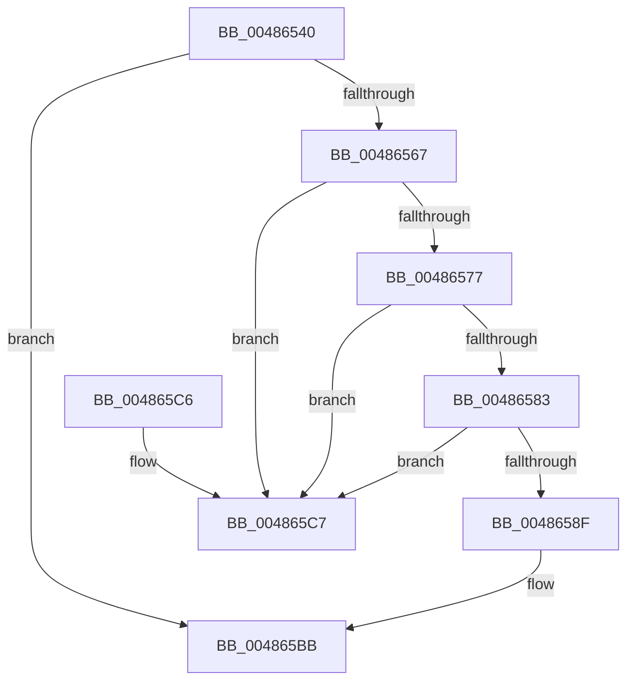

# KeAttachProcess

- RVA: `0x00486540`–`0x004865E8` (길이 `168` bytes)
- VA: `0x0000000140486540`
- 실행 섹션: `.text`
- PDB 이름 있음: `예`; PDB Function 태그: `아니요`
- unwind 정보 RVA: `0x000AF804`
- 디코드: `41`개 명령, `168/168` bytes 표시
- 미해석 바이트: `0` (있으면 어셈블리에 `.byte`로 보존)

> 이 문서는 커널 이미지의 기계어와 PDB 기호를 분석해 생성했습니다. 4번과 5번은 함수 원형과 자료형을 바이너리 사용 방식에서 추정한 C 해석이며 원본 소스 복구 결과는 아닙니다.

## 1. Dependencies

- 직접 호출 지점: **3**; 고유 호출 대상: **3**
- 직접 호출자로 확인된 함수: **4**
- RIP 상대 이미지 참조: **0**

### Outgoing calls
- `0x00486597` → [KiAcquireThreadLockRaiseToDpc](../39/KiAcquireThreadLockRaiseToDpc_function_00396280.md) (function, `0x00396280`)
- `0x004865B6` → [KiAttachProcess](../21/KiAttachProcess_function_002182D0.md) (function, `0x002182D0`)
- `0x004865E2` → [KeBugCheckEx](../4F/KeBugCheckEx_function_004FD660.md) (function, `0x004FD660`)

### Direct callers
- [KiExecuteSmtIsolationThread](../5C/KiExecuteSmtIsolationThread_function_005C4070.md) at `0x005C4099`
- [KiExecuteDpcDelegate](../5C/KiExecuteDpcDelegate_function_005C8620.md) at `0x005C8643`
- [KiCompleteKernelInit](../../pagelk/B6/KiCompleteKernelInit_function_00B66090.md) at `0x00B6611E`
- [PopGracefulShutdown](../../pagelk/B6/PopGracefulShutdown_function_00B6BEC8.md) at `0x00B6C136`

### Static image references
- 디코드된 RIP-relative 메모리 참조가 없습니다.

## 2. Other-region calls and transfers

- 다른 실행 섹션으로 향하는 call: **0**
- 별도 외부 분기/꼬리 이동을 확인하지 못했습니다.

## 3. Assembly (complete function range)

```asm
00486540  48 89 5C 24 10                  mov qword ptr [rsp + 0x10], rbx
00486545  57                              push rdi
00486546  48 83 EC 30                     sub rsp, 0x30
0048654A  65 48 8B 1C 25 88 01 00 00      mov rbx, qword ptr gs:[0x188]
00486553  48 8B F9                        mov rdi, rcx
00486556  C6 44 24 40 00                  mov byte ptr [rsp + 0x40], 0
0048655B  4C 8B 83 B8 00 00 00            mov r8, qword ptr [rbx + 0xb8]
00486562  4C 3B C1                        cmp r8, rcx
00486565  74 54                           je 0x1404865bb
00486567  0F B6 8B 4A 02 00 00            movzx ecx, byte ptr [rbx + 0x24a]
0048656E  BA 01 00 01 00                  mov edx, 0x10001
00486573  84 C9                           test cl, cl
00486575  75 50                           jne 0x1404865c7
00486577  65 8B 04 25 3C 3A 00 00         mov eax, dword ptr gs:[0x3a3c]
0048657F  85 C2                           test edx, eax
00486581  75 44                           jne 0x1404865c7
00486583  F7 87 88 00 00 00 00 08 00 00   test dword ptr [rdi + 0x88], 0x800
0048658D  75 38                           jne 0x1404865c7
0048658F  48 8D 54 24 40                  lea rdx, [rsp + 0x40]
00486594  48 8B CB                        mov rcx, rbx
00486597  E8 E4 FC F0 FF                  call 0x140396280
0048659C  44 8A 44 24 40                  mov r8b, byte ptr [rsp + 0x40]
004865A1  48 8D 83 58 02 00 00            lea rax, [rbx + 0x258]
004865A8  45 33 C9                        xor r9d, r9d
004865AB  48 89 44 24 20                  mov qword ptr [rsp + 0x20], rax
004865B0  48 8B D7                        mov rdx, rdi
004865B3  48 8B CB                        mov rcx, rbx
004865B6  E8 15 1D D9 FF                  call 0x1402182d0
004865BB  48 8B 5C 24 48                  mov rbx, qword ptr [rsp + 0x48]
004865C0  48 83 C4 30                     add rsp, 0x30
004865C4  5F                              pop rdi
004865C5  C3                              ret
004865C6  CC                              int3
004865C7  65 8B 04 25 3C 3A 00 00         mov eax, dword ptr gs:[0x3a3c]
004865CF  4C 8B C9                        mov r9, rcx
004865D2  48 23 C2                        and rax, rdx
004865D5  B9 05 00 00 00                  mov ecx, 5
004865DA  48 8B D7                        mov rdx, rdi
004865DD  48 89 44 24 20                  mov qword ptr [rsp + 0x20], rax
004865E2  E8 79 70 07 00                  call 0x1404fd660
004865E7  CC                              int3
```

## 4. C-style interpretation (structured pseudocode)

```c
__int64 __fastcall KeAttachProcess(__int64 a1, __int64 a2, __int64 a3, int a4)
{
    __int64 result;
    __int64 v_rsp;
    unsigned __int64 v_stack_m18;
    unsigned __int64 v_stack_p10;
    unsigned __int64 v_stack_p20;
    unsigned __int8 v_stack_p8;

    v_stack_p10 = v_rbx;
    v_rsp = (v_rsp) - (48);
    v_stack_p8 = 0;
    if ((*(unsigned __int64 *)(*(unsigned __int64 *)(gs_base + (0 + 392)) + 184)) == a1) goto loc_004865BB;
    if ((unsigned __int8)(*(unsigned __int8 *)(*(unsigned __int64 *)(gs_base + (0 + 392)) + 586)) != 0) goto loc_004865C7;
    if ((((unsigned int)((unsigned int)(0x10001ULL))) & ((unsigned int)((unsigned int)(*(unsigned int *)(gs_base + (0 + 14908)))))) != 0) goto loc_004865C7;
    if (((*(unsigned int *)(a1 + 136)) & (0x800ULL)) != 0) goto loc_004865C7;
    result = KiAcquireThreadLockRaiseToDpc(*(unsigned __int64 *)(gs_base + (0 + 392)), v_stack_p8, *(unsigned __int64 *)(*(unsigned __int64 *)(gs_base + (0 + 392)) + 184), a4);
    a4 = 0;
    v_stack_m18 = *(unsigned __int64 *)(gs_base + (0 + 392)) + 600;
    result = KiAttachProcess(*(unsigned __int64 *)(gs_base + (0 + 392)), a1, v_stack_p8, a4);
loc_004865BB:
    v_rsp = (v_rsp) + (48);
    return result;
loc_004865C7:
    result = ((unsigned int)(*(unsigned int *)(gs_base + (0 + 14908)))) & (a1);
    v_stack_p20 = result;
    result = KeBugCheckEx(5, a1, v_stack_p8, *(unsigned __int64 *)(gs_base + (0 + 392)));
    return result;
}
```

## 5. (Beta) C Style

```c
int64_t KeAttachProcess(void *Arg1, int64_t Arg2, int64_t Arg3, int32_t Arg4)
{
    uint8_t *arg1 = (uint8_t *)Arg1;

    int64_t result;
    int64_t local_rsp;
    uint64_t v_stack_m18;
    uint64_t v_stack_p10;
    uint64_t v_stack_p20;
    uint8_t v_stack_p8;

    v_stack_p10 = local_rbx;
    local_rsp = (local_rsp) - (48);
    v_stack_p8 = 0;
    if ((*(uint64_t *)(*(uint64_t *)(gs_base + (0 + 0x188)) + 0xB8)) == Arg1) goto loc_004865BB;
    if ((uint8_t)(*(uint8_t *)(*(uint64_t *)(gs_base + (0 + 0x188)) + 0x24A)) != 0) goto loc_004865C7;
    if ((((uint32_t)((uint32_t)(0x10001ULL))) & ((uint32_t)((uint32_t)(*(uint32_t *)(gs_base + (0 + 0x3A3C)))))) != 0) goto loc_004865C7;
    if (((*(uint32_t *)(arg1 + 0x88)) & (0x800ULL)) != 0) goto loc_004865C7;
    result = KiAcquireThreadLockRaiseToDpc(*(uint64_t *)(gs_base + (0 + 0x188)), v_stack_p8, *(uint64_t *)(*(uint64_t *)(gs_base + (0 + 0x188)) + 0xB8), Arg4);
    Arg4 = 0;
    v_stack_m18 = *(uint64_t *)(gs_base + (0 + 0x188)) + 600;
    result = KiAttachProcess(*(uint64_t *)(gs_base + (0 + 0x188)), Arg1, v_stack_p8, Arg4);
loc_004865BB:
    local_rsp = (local_rsp) + (48);
    return result;
loc_004865C7:
    result = ((uint32_t)(*(uint32_t *)(gs_base + (0 + 0x3A3C)))) & (Arg1);
    v_stack_p20 = result;
    result = KeBugCheckEx(5, Arg1, v_stack_p8, *(uint64_t *)(gs_base + (0 + 0x188)));
    return result;
}
```

### 관측된 메모리 오프셋

구조체 형식이 확인되지 않은 접근은 인자 기준의 오프셋으로만 기록했습니다.

| 기준 인자 | 오프셋 표현 | 폭 (bit) | 접근 |
|---|---:|---:|---|
| `Arg1` | `+ 0x88` | `32` | `R` |

## 6. Execution-region graph

[열기: 2D/3D 그래프와 함수 탐색 컨트롤 패널](../../../control-panel.html?section=text&rva=0x00486540&view=graph)

- 2D 그래프는 위에서 아래로 흐르고, 3D 그래프는 빈 공간을 드래그해 회전합니다. Shift+드래그는 이동, 휠은 확대·축소, 함수 노드 선택은 대상 보고서 이동입니다.

### Static fallback


