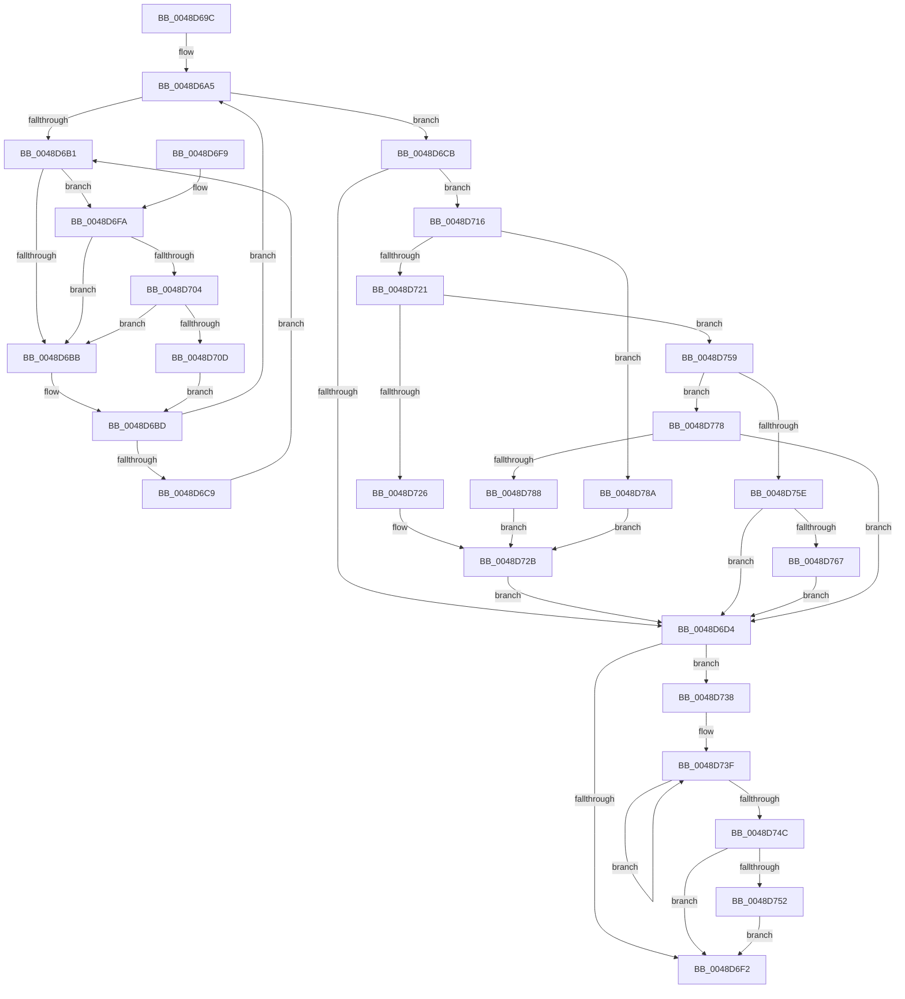

# KeClearForceIdle

- RVA: `0x0048D69C`–`0x0048D7A1` (길이 `261` bytes)
- VA: `0x000000014048D69C`
- 실행 섹션: `.text`
- PDB 이름 있음: `예`; PDB Function 태그: `아니요`
- unwind 정보 RVA: `0x000B1454`
- 디코드: `71`개 명령, `261/261` bytes 표시
- 미해석 바이트: `0` (있으면 어셈블리에 `.byte`로 보존)

> 이 문서는 커널 이미지의 기계어와 PDB 기호를 분석해 생성했습니다. 4번과 5번은 함수 원형과 자료형을 바이너리 사용 방식에서 추정한 C 해석이며 원본 소스 복구 결과는 아닙니다.

## 1. Dependencies

- 직접 호출 지점: **7**; 고유 호출 대상: **6**
- 직접 호출자로 확인된 함수: **1**
- RIP 상대 이미지 참조: **9**

### Outgoing calls
- `0x0048D704` → [KiCheckVpBackingLongSpinWaitHypercall](../30/KiCheckVpBackingLongSpinWaitHypercall_function_0030F490.md) (function, `0x0030F490`)
- `0x0048D70F` → [HvlNotifyLongSpinWait](../30/HvlNotifyLongSpinWait_function_0030F460.md) (function, `0x0030F460`)
- `0x0048D726` → [KiSetForceIdleState](KiSetForceIdleState_function_0048DCC0.md) (function, `0x0048DCC0`)
- `0x0048D752` → [KiRemoveSystemWorkPriorityKick](../26/KiRemoveSystemWorkPriorityKick_function_002631D0.md) (function, `0x002631D0`)
- `0x0048D76E` → [KiResetForceIdle](../3A/KiResetForceIdle_function_003A4160.md) (function, `0x003A4160`)
- `0x0048D78C` → [KiSetForceIdleState](KiSetForceIdleState_function_0048DCC0.md) (function, `0x0048DCC0`)
- `0x0048D79A` → [KeRemoveQueueDpcEx](../46/KeRemoveQueueDpcEx_function_0046CDC0.md) (function, `0x0046CDC0`)

### Direct callers
- [PopDeepSleepSetDisengageReason](../38/PopDeepSleepSetDisengageReason_function_0038FEC4.md) at `0x0038FF4F`

### Static image references
- `0x0048D6A5` → RVA `0x00F23140` (`.data`; read/write)
- `0x0048D6B3` → RVA `0x00FC52AC` (`ALMOSTRO`; reference)
- `0x0048D6BD` → RVA `0x00F23140` (`.data`; read)
- `0x0048D6CB` → RVA `0x00FC6FF0` (`ALMOSTRO`; read)
- `0x0048D6FA` → RVA `0x00FC6AB8` (`ALMOSTRO`; read)
- `0x0048D716` → RVA `0x00F233CC` (`.data`; read)
- `0x0048D72B` → RVA `0x00F23148` (`.data`; write)
- `0x0048D778` → RVA `0x00F23148` (`.data`; read)
- `0x0048D793` → RVA `0x00F23100` (`.data`; read)

## 2. Other-region calls and transfers

- 다른 실행 섹션으로 향하는 call: **0**
- 별도 외부 분기/꼬리 이동을 확인하지 못했습니다.

## 3. Assembly (complete function range)

```asm
0048D69C  40 53                           push rbx
0048D69E  48 83 EC 20                     sub rsp, 0x20
0048D6A2  FA                              cli
0048D6A3  33 DB                           xor ebx, ebx
0048D6A5  F0 48 0F BA 2D 91 5A A9 00 00   lock bts qword ptr [rip + 0xa95a91], 0
0048D6AF  73 1A                           jae 0x14048d6cb
0048D6B1  FF C3                           inc ebx
0048D6B3  85 1D F3 7B B3 00               test dword ptr [rip + 0xb37bf3], ebx
0048D6B9  74 3F                           je 0x14048d6fa
0048D6BB  F3 90                           pause
0048D6BD  48 8B 05 7C 5A A9 00            mov rax, qword ptr [rip + 0xa95a7c]
0048D6C4  48 85 C0                        test rax, rax
0048D6C7  74 DC                           je 0x14048d6a5
0048D6C9  EB E6                           jmp 0x14048d6b1
0048D6CB  83 3D 1E 99 B3 00 00            cmp dword ptr [rip + 0xb3991e], 0
0048D6D2  74 42                           je 0x14048d716
0048D6D4  F0 48 83 25 63 5A A9 00 00      lock and qword ptr [rip + 0xa95a63], 0
0048D6DD  65 48 8B 0C 25 20 00 00 00      mov rcx, qword ptr gs:[0x20]
0048D6E6  4C 8B 81 B8 8E 00 00            mov r8, qword ptr [rcx + 0x8eb8]
0048D6ED  4D 85 C0                        test r8, r8
0048D6F0  75 46                           jne 0x14048d738
0048D6F2  FB                              sti
0048D6F3  48 83 C4 20                     add rsp, 0x20
0048D6F7  5B                              pop rbx
0048D6F8  C3                              ret
0048D6F9  CC                              int3
0048D6FA  8B 05 B8 93 B3 00               mov eax, dword ptr [rip + 0xb393b8]
0048D700  A8 40                           test al, 0x40
0048D702  74 B7                           je 0x14048d6bb
0048D704  E8 87 1D E8 FF                  call 0x14030f490
0048D709  84 C0                           test al, al
0048D70B  74 AE                           je 0x14048d6bb
0048D70D  8B CB                           mov ecx, ebx
0048D70F  E8 4C 1D E8 FF                  call 0x14030f460
0048D714  EB A7                           jmp 0x14048d6bd
0048D716  8B 0D B0 5C A9 00               mov ecx, dword ptr [rip + 0xa95cb0]
0048D71C  83 E9 01                        sub ecx, 1
0048D71F  74 69                           je 0x14048d78a
0048D721  83 E9 01                        sub ecx, 1
0048D724  75 33                           jne 0x14048d759
0048D726  E8 95 05 00 00                  call 0x14048dcc0
0048D72B  48 C7 05 12 5A A9 00 00 00 00 00  mov qword ptr [rip + 0xa95a12], 0
0048D736  EB 9C                           jmp 0x14048d6d4
0048D738  41 0F 0D 08                     prefetchw byte ptr [r8]
0048D73C  41 8B 00                        mov eax, dword ptr [r8]
0048D73F  8B D0                           mov edx, eax
0048D741  0F BA F2 15                     btr edx, 0x15
0048D745  F0 41 0F B1 10                  lock cmpxchg dword ptr [r8], edx
0048D74A  75 F3                           jne 0x14048d73f
0048D74C  0F BA E0 15                     bt eax, 0x15
0048D750  73 A0                           jae 0x14048d6f2
0048D752  E8 79 5A DD FF                  call 0x1402631d0
0048D757  EB 99                           jmp 0x14048d6f2
0048D759  83 E9 01                        sub ecx, 1
0048D75C  74 1A                           je 0x14048d778
0048D75E  83 F9 01                        cmp ecx, 1
0048D761  0F 85 6D FF FF FF               jne 0x14048d6d4
0048D767  8A D1                           mov dl, cl
0048D769  B9 03 00 00 00                  mov ecx, 3
0048D76E  E8 ED 69 F1 FF                  call 0x1403a4160
0048D773  E9 5C FF FF FF                  jmp 0x14048d6d4
0048D778  48 8B 05 C9 59 A9 00            mov rax, qword ptr [rip + 0xa959c9]
0048D77F  48 85 C0                        test rax, rax
0048D782  0F 84 4C FF FF FF               je 0x14048d6d4
0048D788  EB A1                           jmp 0x14048d72b
0048D78A  33 C9                           xor ecx, ecx
0048D78C  E8 2F 05 00 00                  call 0x14048dcc0
0048D791  33 D2                           xor edx, edx
0048D793  48 8D 0D 66 59 A9 00            lea rcx, [rip + 0xa95966]
0048D79A  E8 21 F6 FD FF                  call 0x14046cdc0
0048D79F  EB 8A                           jmp 0x14048d72b
```

## 4. C-style interpretation (structured pseudocode)

```c
__int64 __fastcall KeClearForceIdle(void)
{
    __int64 result;
    __int64 v_rbx;
    __int64 v_rsp;

    v_rsp = (v_rsp) - (32);
    v_rbx = 0;
loc_0048D6A5:
    if (condition_is_above_or_equal) goto loc_0048D6CB;
loc_0048D6B1:
    v_rbx = (unsigned int)((v_rbx) + 1);
    if (((*(unsigned int *)(v_rip + 11762675)) & ((unsigned int)(v_rbx))) == 0) goto loc_0048D6FA;
loc_0048D6BB:
loc_0048D6BD:
    if (*(unsigned __int64 *)(v_rip + 11098748) == 0) goto loc_0048D6A5;
    goto loc_0048D6B1;
loc_0048D6CB:
    if ((*(unsigned int *)(v_rip + 11770142)) == 0) goto loc_0048D716;
loc_0048D6D4:
    if (*(unsigned __int64 *)(*(unsigned __int64 *)(gs_base + (0 + 32)) + 36536) != 0) goto loc_0048D738;
loc_0048D6F2:
    v_rsp = (v_rsp) + (32);
    return *(unsigned __int64 *)(v_rip + 11098748);
loc_0048D6FA:
    if ((((unsigned __int8)((unsigned int)(*(unsigned int *)(v_rip + 11768760)))) & (64)) == 0) goto loc_0048D6BB;
    result = KiCheckVpBackingLongSpinWaitHypercall(*(unsigned __int64 *)(gs_base + (0 + 32)), a2, *(unsigned __int64 *)(*(unsigned __int64 *)(gs_base + (0 + 32)) + 36536), a4);
    if ((unsigned __int8)(result) == 0) goto loc_0048D6BB;
    result = HvlNotifyLongSpinWait((unsigned int)((unsigned int)(v_rbx)), a2, *(unsigned __int64 *)(*(unsigned __int64 *)(gs_base + (0 + 32)) + 36536), a4);
    goto loc_0048D6BD;
loc_0048D716:
    a1 = (unsigned int)(((unsigned int)(*(unsigned int *)(v_rip + 11099312))) - (1));
    if (condition_is_equal) goto loc_0048D78A;
    a1 = (unsigned int)((a1) - (1));
    if (condition_is_not_equal) goto loc_0048D759;
    result = KiSetForceIdleState(a1, a2, *(unsigned __int64 *)(*(unsigned __int64 *)(gs_base + (0 + 32)) + 36536), a4);
loc_0048D72B:
    *(unsigned __int64 *)(v_rip + 11098642) = 0;
    goto loc_0048D6D4;
loc_0048D738:
loc_0048D73F:
    if (condition_is_not_equal) goto loc_0048D73F;
    if (condition_is_above_or_equal) goto loc_0048D6F2;
    result = KiRemoveSystemWorkPriorityKick(a1, (unsigned int)((unsigned int)((unsigned int)(*(unsigned int *)(*(unsigned __int64 *)(*(unsigned __int64 *)(gs_base + (0 + 32)) + 36536))))), *(unsigned __int64 *)(*(unsigned __int64 *)(gs_base + (0 + 32)) + 36536), a4);
    goto loc_0048D6F2;
loc_0048D759:
    a1 = (unsigned int)((a1) - (1));
    if (condition_is_equal) goto loc_0048D778;
    if (((unsigned int)(a1)) != 1) goto loc_0048D6D4;
    result = KiResetForceIdle(3, (unsigned __int8)(a1), *(unsigned __int64 *)(*(unsigned __int64 *)(gs_base + (0 + 32)) + 36536), a4);
    goto loc_0048D6D4;
loc_0048D778:
    if (*(unsigned __int64 *)(v_rip + 11098569) == 0) goto loc_0048D6D4;
    goto loc_0048D72B;
loc_0048D78A:
    a1 = 0;
    result = KiSetForceIdleState(a1, (unsigned __int8)(a1), *(unsigned __int64 *)(*(unsigned __int64 *)(gs_base + (0 + 32)) + 36536), a4);
    a2 = 0;
    result = KeRemoveQueueDpcEx(v_rip + 11098470, a2, *(unsigned __int64 *)(*(unsigned __int64 *)(gs_base + (0 + 32)) + 36536), a4);
    goto loc_0048D72B;
}
```

## 5. (Beta) C Style

```c
void KeClearForceIdle(void)
{
    int64_t result;
    int64_t local_rbx;
    int64_t local_rsp;

    local_rsp = (local_rsp) - (32);
    local_rbx = 0;
loc_0048D6A5:
    if (condition_is_above_or_equal) goto loc_0048D6CB;
loc_0048D6B1:
    local_rbx = (uint32_t)((local_rbx) + 1);
    if (((*(uint32_t *)(v_rip + 0xB37BF3)) & ((uint32_t)(local_rbx))) == 0) goto loc_0048D6FA;
loc_0048D6BB:
loc_0048D6BD:
    if (*(uint64_t *)(v_rip + 0xA95A7C) == 0) goto loc_0048D6A5;
    goto loc_0048D6B1;
loc_0048D6CB:
    if ((*(uint32_t *)(v_rip + 0xB3991E)) == 0) goto loc_0048D716;
loc_0048D6D4:
    if (*(uint64_t *)(*(uint64_t *)(gs_base + (0 + 0x20)) + 0x8EB8) != 0) goto loc_0048D738;
loc_0048D6F2:
    local_rsp = (local_rsp) + (32);
    return *(uint64_t *)(v_rip + 0xA95A7C);
loc_0048D6FA:
    if ((((uint8_t)((uint32_t)(*(uint32_t *)(v_rip + 0xB393B8)))) & (64)) == 0) goto loc_0048D6BB;
    result = KiCheckVpBackingLongSpinWaitHypercall(*(uint64_t *)(gs_base + (0 + 0x20)), a2, *(uint64_t *)(*(uint64_t *)(gs_base + (0 + 0x20)) + 0x8EB8), a4);
    if ((uint8_t)(result) == 0) goto loc_0048D6BB;
    result = HvlNotifyLongSpinWait((uint32_t)((uint32_t)(local_rbx)), a2, *(uint64_t *)(*(uint64_t *)(gs_base + (0 + 0x20)) + 0x8EB8), a4);
    goto loc_0048D6BD;
loc_0048D716:
    a1 = (uint32_t)(((uint32_t)(*(uint32_t *)(v_rip + 0xA95CB0))) - (1));
    if (condition_is_equal) goto loc_0048D78A;
    a1 = (uint32_t)((a1) - (1));
    if (condition_is_not_equal) goto loc_0048D759;
    result = KiSetForceIdleState(a1, a2, *(uint64_t *)(*(uint64_t *)(gs_base + (0 + 0x20)) + 0x8EB8), a4);
loc_0048D72B:
    *(uint64_t *)(v_rip + 0xA95A12) = 0;
    goto loc_0048D6D4;
loc_0048D738:
loc_0048D73F:
    if (condition_is_not_equal) goto loc_0048D73F;
    if (condition_is_above_or_equal) goto loc_0048D6F2;
    result = KiRemoveSystemWorkPriorityKick(a1, (uint32_t)((uint32_t)((uint32_t)(*(uint32_t *)(*(uint64_t *)(*(uint64_t *)(gs_base + (0 + 0x20)) + 0x8EB8))))), *(uint64_t *)(*(uint64_t *)(gs_base + (0 + 0x20)) + 0x8EB8), a4);
    goto loc_0048D6F2;
loc_0048D759:
    a1 = (uint32_t)((a1) - (1));
    if (condition_is_equal) goto loc_0048D778;
    if (((uint32_t)(a1)) != 1) goto loc_0048D6D4;
    result = KiResetForceIdle(3, (uint8_t)(a1), *(uint64_t *)(*(uint64_t *)(gs_base + (0 + 0x20)) + 0x8EB8), a4);
    goto loc_0048D6D4;
loc_0048D778:
    if (*(uint64_t *)(v_rip + 0xA959C9) == 0) goto loc_0048D6D4;
    goto loc_0048D72B;
loc_0048D78A:
    a1 = 0;
    result = KiSetForceIdleState(a1, (uint8_t)(a1), *(uint64_t *)(*(uint64_t *)(gs_base + (0 + 0x20)) + 0x8EB8), a4);
    a2 = 0;
    result = KeRemoveQueueDpcEx(v_rip + 11098470, a2, *(uint64_t *)(*(uint64_t *)(gs_base + (0 + 0x20)) + 0x8EB8), a4);
    goto loc_0048D72B;
}
```

## 6. Execution-region graph

[열기: 2D/3D 그래프와 함수 탐색 컨트롤 패널](../../../control-panel.html?section=text&rva=0x0048D69C&view=graph)

- 2D 그래프는 위에서 아래로 흐르고, 3D 그래프는 빈 공간을 드래그해 회전합니다. Shift+드래그는 이동, 휠은 확대·축소, 함수 노드 선택은 대상 보고서 이동입니다.

### Static fallback


