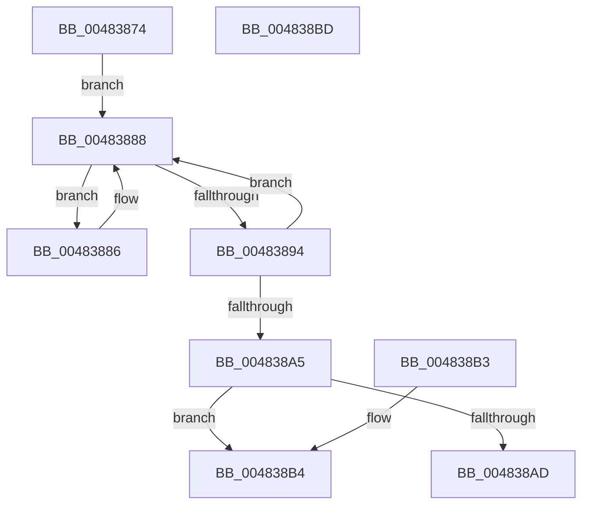

# KeCpuSetQueryUnparkRecommendation

- RVA: `0x00483874`–`0x004838BE` (길이 `74` bytes)
- VA: `0x0000000140483874`
- 실행 섹션: `.text`
- PDB 이름 있음: `예`; PDB Function 태그: `아니요`
- unwind 정보 RVA: `0x000DB714`
- 디코드: `25`개 명령, `74/74` bytes 표시
- 미해석 바이트: `0` (있으면 어셈블리에 `.byte`로 보존)

> 이 문서는 커널 이미지의 기계어와 PDB 기호를 분석해 생성했습니다. 4번과 5번은 함수 원형과 자료형을 바이너리 사용 방식에서 추정한 C 해석이며 원본 소스 복구 결과는 아닙니다.

## 1. Dependencies

- 직접 호출 지점: **0**; 고유 호출 대상: **0**
- 직접 호출자로 확인된 함수: **1**
- RIP 상대 이미지 참조: **2**

### Outgoing calls
- 직접 디코드된 call 명령이 없습니다.

### Direct callers
- [sub_006F6620](../6F/Unknown_function_006F6620.md) at `0x006F68A8`

### Static image references
- `0x00483877` → RVA `0x00FC8320` (`ALMOSTRO`; read)
- `0x00483888` → RVA `0x00FC6BF8` (`ALMOSTRO`; read)

## 2. Other-region calls and transfers

- 다른 실행 섹션으로 향하는 call: **0**
- 별도 외부 분기/꼬리 이동을 확인하지 못했습니다.

## 3. Assembly (complete function range)

```asm
00483874  44 8B C9                        mov r9d, ecx
00483877  4C 8D 1D A2 4A B4 00            lea r11, [rip + 0xb44aa2]
0048387E  4D 03 C9                        add r9, r9
00483881  4C 8B D2                        mov r10, rdx
00483884  EB 02                           jmp 0x140483888
00483886  F3 90                           pause
00483888  48 8B 0D 69 33 B4 00            mov rcx, qword ptr [rip + 0xb43369]
0048388F  F6 C1 01                        test cl, 1
00483892  75 F2                           jne 0x140483886
00483894  4B 8B 14 CB                     mov rdx, qword ptr [r11 + r9*8]
00483898  90                              nop
00483899  48 8B 05 58 33 B4 00            mov rax, qword ptr [rip + 0xb43358]
004838A0  48 3B C1                        cmp rax, rcx
004838A3  75 E3                           jne 0x140483888
004838A5  48 F7 D2                        not rdx
004838A8  49 23 D2                        and rdx, r10
004838AB  75 07                           jne 0x1404838b4
004838AD  49 21 10                        and qword ptr [r8], rdx
004838B0  32 C0                           xor al, al
004838B2  C3                              ret
004838B3  CC                              int3
004838B4  49 89 10                        mov qword ptr [r8], rdx
004838B7  F3 48 0F B8 C2                  popcnt rax, rdx
004838BC  C3                              ret
004838BD  CC                              int3
```

## 4. C-style interpretation (structured pseudocode)

```c
__int64 __fastcall KeCpuSetQueryUnparkRecommendation(int a1, __int64 a2, __int64 a3)
{
    __int64 result;

    a4 = ((unsigned int)(a1)) + ((unsigned int)(a1));
    goto loc_00483888;
loc_00483886:
loc_00483888:
    if ((((unsigned __int8)(*(unsigned __int64 *)(v_rip + 11809641))) & (1)) != 0) goto loc_00483886;
    if ((*(unsigned __int64 *)(v_rip + 11809624)) != (*(unsigned __int64 *)(v_rip + 11809641))) goto loc_00483888;
    a2 = ~(*(unsigned __int64 *)(v_rip + 11815586 + a4 * 8));
    a2 = (a2) & (a2);
    if (condition_is_not_equal) goto loc_004838B4;
    result = 0;
    return result;
loc_004838B4:
    *(unsigned __int64 *)(a3) = a2;
    return result;
}
```

## 5. (Beta) C Style

```c
int64_t KeCpuSetQueryUnparkRecommendation(int32_t Arg1, int64_t Arg2, void *Arg3)
{
    uint8_t *arg3 = (uint8_t *)Arg3;

    int64_t result;

    a4 = ((uint32_t)(Arg1)) + ((uint32_t)(Arg1));
    goto loc_00483888;
loc_00483886:
loc_00483888:
    if ((((uint8_t)(*(uint64_t *)(v_rip + 0xB43369))) & (1)) != 0) goto loc_00483886;
    if ((*(uint64_t *)(v_rip + 0xB43358)) != (*(uint64_t *)(v_rip + 0xB43369))) goto loc_00483888;
    Arg2 = ~(*(uint64_t *)(v_rip + 0xB44AA2 + a4 * 8));
    Arg2 = (Arg2) & (Arg2);
    if (condition_is_not_equal) goto loc_004838B4;
    result = 0;
    return result;
loc_004838B4:
    *(uint64_t *)(arg3) = Arg2;
    return result;
}
```

### 관측된 메모리 오프셋

구조체 형식이 확인되지 않은 접근은 인자 기준의 오프셋으로만 기록했습니다.

| 기준 인자 | 오프셋 표현 | 폭 (bit) | 접근 |
|---|---:|---:|---|
| `Arg3` | `+ 0x0` | `64` | `R/W` |
| `Arg3` | `+ 0x0` | `64` | `W` |

## 6. Execution-region graph

[열기: 2D/3D 그래프와 함수 탐색 컨트롤 패널](../../../control-panel.html?section=text&rva=0x00483874&view=graph)

- 2D 그래프는 위에서 아래로 흐르고, 3D 그래프는 빈 공간을 드래그해 회전합니다. Shift+드래그는 이동, 휠은 확대·축소, 함수 노드 선택은 대상 보고서 이동입니다.

### Static fallback


