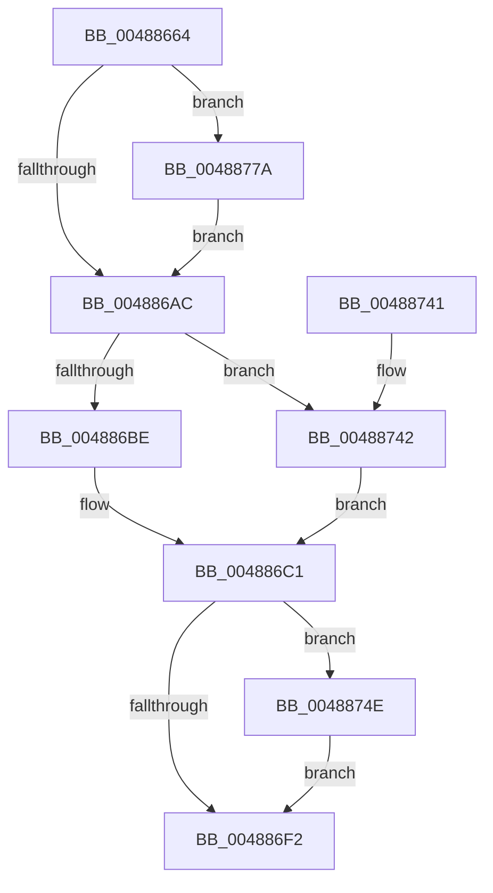

# KeInitializeInterruptEx

- RVA: `0x00488664`–`0x00488791` (길이 `301` bytes)
- VA: `0x0000000140488664`
- 실행 섹션: `.text`
- PDB 이름 있음: `예`; PDB Function 태그: `아니요`
- unwind 정보 RVA: `0x00090784`
- 디코드: `73`개 명령, `301/301` bytes 표시
- 미해석 바이트: `0` (있으면 어셈블리에 `.byte`로 보존)

> 이 문서는 커널 이미지의 기계어와 PDB 기호를 분석해 생성했습니다. 4번과 5번은 함수 원형과 자료형을 바이너리 사용 방식에서 추정한 C 해석이며 원본 소스 복구 결과는 아닙니다.

## 1. Dependencies

- 직접 호출 지점: **2**; 고유 호출 대상: **2**
- 직접 호출자로 확인된 함수: **3**
- RIP 상대 이미지 참조: **1**

### Outgoing calls
- `0x00488691` → [memset](../6C/memset_function_006C6C40.md) (function, `0x006C6C40`)
- `0x0048871D` → [KiInitializeInterrupt](KiInitializeInterrupt_function_00488798.md) (function, `0x00488798`)

### Direct callers
- [HalpCreateInterrupt](../55/HalpCreateInterrupt_function_0055BA00.md) at `0x0055BAA8`
- [KeInitializeInterrupt](../5B/KeInitializeInterrupt_function_005BE520.md) at `0x005BE592`
- [IopConnectInterrupt](../../page/90/IopConnectInterrupt_function_00900B40.md) at `0x00900F24`

### Static image references
- `0x0048877E` → RVA `0x00444DC0` (`KiInterruptMessageDispatch`; read)

## 2. Other-region calls and transfers

- 다른 실행 섹션으로 향하는 call: **0**
- 별도 외부 분기/꼬리 이동을 확인하지 못했습니다.

## 3. Assembly (complete function range)

```asm
00488664  48 8B C4                        mov rax, rsp
00488667  48 89 58 08                     mov qword ptr [rax + 8], rbx
0048866B  48 89 68 10                     mov qword ptr [rax + 0x10], rbp
0048866F  48 89 70 18                     mov qword ptr [rax + 0x18], rsi
00488673  48 89 78 20                     mov qword ptr [rax + 0x20], rdi
00488677  41 56                           push r14
00488679  48 83 EC 20                     sub rsp, 0x20
0048867D  49 8B E8                        mov rbp, r8
00488680  48 8B F2                        mov rsi, rdx
00488683  33 D2                           xor edx, edx
00488685  41 B8 20 01 00 00               mov r8d, 0x120
0048868B  49 8B D9                        mov rbx, r9
0048868E  48 8B F9                        mov rdi, rcx
00488691  E8 AA E5 23 00                  call 0x1406c6c40
00488696  45 33 C9                        xor r9d, r9d
00488699  C7 07 16 00 20 01               mov dword ptr [rdi], 0x1200016
0048869F  48 89 5F 30                     mov qword ptr [rdi + 0x30], rbx
004886A3  48 85 F6                        test rsi, rsi
004886A6  0F 84 CE 00 00 00               je 0x14048877a
004886AC  48 8B 54 24 58                  mov rdx, qword ptr [rsp + 0x58]
004886B1  48 89 77 18                     mov qword ptr [rdi + 0x18], rsi
004886B5  48 85 D2                        test rdx, rdx
004886B8  0F 84 84 00 00 00               je 0x140488742
004886BE  48 8B C2                        mov rax, rdx
004886C1  8A 4C 24 78                     mov cl, byte ptr [rsp + 0x78]
004886C5  48 89 47 48                     mov qword ptr [rdi + 0x48], rax
004886C9  8B 44 24 68                     mov eax, dword ptr [rsp + 0x68]
004886CD  89 47 58                        mov dword ptr [rdi + 0x58], eax
004886D0  8B 84 24 80 00 00 00            mov eax, dword ptr [rsp + 0x80]
004886D7  89 47 6C                        mov dword ptr [rdi + 0x6c], eax
004886DA  8A 84 24 88 00 00 00            mov al, byte ptr [rsp + 0x88]
004886E1  88 47 64                        mov byte ptr [rdi + 0x64], al
004886E4  8A 44 24 70                     mov al, byte ptr [rsp + 0x70]
004886E8  88 47 5C                        mov byte ptr [rdi + 0x5c], al
004886EB  88 4F 5D                        mov byte ptr [rdi + 0x5d], cl
004886EE  84 C9                           test cl, cl
004886F0  74 5C                           je 0x14048874e
004886F2  8B 84 24 90 00 00 00            mov eax, dword ptr [rsp + 0x90]
004886F9  48 8B CF                        mov rcx, rdi
004886FC  89 47 60                        mov dword ptr [rdi + 0x60], eax
004886FF  8A 84 24 A0 00 00 00            mov al, byte ptr [rsp + 0xa0]
00488706  88 47 65                        mov byte ptr [rdi + 0x65], al
00488709  48 8B 84 24 A8 00 00 00         mov rax, qword ptr [rsp + 0xa8]
00488711  48 89 87 A0 00 00 00            mov qword ptr [rdi + 0xa0], rax
00488718  33 C0                           xor eax, eax
0048871A  89 47 68                        mov dword ptr [rdi + 0x68], eax
0048871D  E8 76 00 00 00                  call 0x140488798
00488722  48 8B 5C 24 30                  mov rbx, qword ptr [rsp + 0x30]
00488727  48 8B 6C 24 38                  mov rbp, qword ptr [rsp + 0x38]
0048872C  48 8B 74 24 40                  mov rsi, qword ptr [rsp + 0x40]
00488731  44 88 4F 5F                     mov byte ptr [rdi + 0x5f], r9b
00488735  48 8B 7C 24 48                  mov rdi, qword ptr [rsp + 0x48]
0048873A  48 83 C4 20                     add rsp, 0x20
0048873E  41 5E                           pop r14
00488740  C3                              ret
00488741  CC                              int3
00488742  48 8D 47 38                     lea rax, [rdi + 0x38]
00488746  4C 89 08                        mov qword ptr [rax], r9
00488749  E9 73 FF FF FF                  jmp 0x1404886c1
0048874E  48 8B 4C 24 60                  mov rcx, qword ptr [rsp + 0x60]
00488753  66 C7 01 01 00                  mov word ptr [rcx], 1
00488758  48 8D 41 08                     lea rax, [rcx + 8]
0048875C  C6 41 02 06                     mov byte ptr [rcx + 2], 6
00488760  C7 41 04 01 00 00 00            mov dword ptr [rcx + 4], 1
00488767  48 89 40 08                     mov qword ptr [rax + 8], rax
0048876B  48 89 00                        mov qword ptr [rax], rax
0048876E  48 89 8F 80 00 00 00            mov qword ptr [rdi + 0x80], rcx
00488775  E9 78 FF FF FF                  jmp 0x1404886f2
0048877A  8B 44 24 50                     mov eax, dword ptr [rsp + 0x50]
0048877E  48 8D 35 3B C6 FB FF            lea rsi, [rip - 0x439c5]
00488785  89 47 28                        mov dword ptr [rdi + 0x28], eax
00488788  48 89 6F 20                     mov qword ptr [rdi + 0x20], rbp
0048878C  E9 1B FF FF FF                  jmp 0x1404886ac
```

## 4. C-style interpretation (structured pseudocode)

```c
__int64 __fastcall KeInitializeInterruptEx(__int64 a1, __int64 a2, __int64 a3, __int64 a4, unsigned int a5, __int64 a6, __int64 a7, unsigned int a8, unsigned __int8 a9, unsigned __int8 a10, unsigned int a11, unsigned __int8 a12, unsigned int a13, __int64 a14, unsigned __int8 a15, __int64 a16)
{
    __int64 result;
    __int64 v_rsp;
    unsigned __int64 v_stack_p10;
    unsigned __int64 v_stack_p18;
    unsigned __int64 v_stack_p20;
    unsigned __int64 v_stack_p8;

    *(unsigned __int64 *)(v_rsp + 8) = v_rbx;
    *(unsigned __int64 *)(v_rsp + 16) = v_rbp;
    *(unsigned __int64 *)(v_rsp + 24) = v_rsi;
    *(unsigned __int64 *)(v_rsp + 32) = v_rdi;
    v_rsp = (v_rsp) - (32);
    a2 = 0;
    result = memset(a1, a2, 288, a4);
    a4 = 0;
    *(unsigned int *)(a1) = 0x1200016ULL;
    *(unsigned __int64 *)(a1 + 48) = 0;
    if (0 == 0) goto loc_0048877A;
loc_004886AC:
    *(unsigned __int64 *)(a1 + 24) = 0;
    if (a6 == 0) goto loc_00488742;
loc_004886C1:
    *(unsigned __int64 *)(a1 + 72) = a6;
    *(unsigned int *)(a1 + 88) = (unsigned int)((unsigned int)(a8));
    *(unsigned int *)(a1 + 108) = (unsigned int)((unsigned int)(a11));
    *(unsigned __int8 *)(a1 + 100) = a12;
    *(unsigned __int8 *)(a1 + 92) = a9;
    *(unsigned __int8 *)(a1 + 93) = a10;
    if (a10 == 0) goto loc_0048874E;
loc_004886F2:
    *(unsigned int *)(a1 + 96) = (unsigned int)((unsigned int)(a13));
    *(unsigned __int8 *)(a1 + 101) = a15;
    *(unsigned __int64 *)(a1 + 160) = a16;
    result = 0;
    *(unsigned int *)(a1 + 104) = 0;
    result = KiInitializeInterrupt(a1, a6, 288, a4);
    *(unsigned __int8 *)(a1 + 95) = 0;
    v_rsp = (v_rsp) + (32);
    return result;
loc_00488742:
    *(unsigned __int64 *)(v_stack_p20 + 56) = 0;
    goto loc_004886C1;
loc_0048874E:
    *(unsigned __int16 *)(a7) = 1;
    *(unsigned __int8 *)(a7 + 2) = 6;
    *(unsigned int *)(a7 + 4) = 1;
    *(unsigned __int64 *)(a7 + 8 + 8) = a7 + 8;
    *(unsigned __int64 *)(a7 + 8) = a7 + 8;
    *(unsigned __int64 *)(v_stack_p20 + 128) = a7;
    goto loc_004886F2;
loc_0048877A:
    *(unsigned int *)(v_stack_p20 + 40) = (unsigned int)((unsigned int)(a5));
    *(unsigned __int64 *)(v_stack_p20 + 32) = v_stack_p10;
    goto loc_004886AC;
}
```

## 5. (Beta) C Style

```c
int64_t KeInitializeInterruptEx(void *Interrupt, int64_t Arg2, int64_t Arg3, int64_t Arg4, uint32_t Arg5, int64_t Arg6, void *Arg7, uint32_t Arg8, uint8_t Arg9, uint8_t Arg10, uint32_t Arg11, uint8_t Arg12, uint32_t Arg13, uint64_t Arg14, uint8_t Arg15, int64_t Arg16)
{
    uint8_t *interrupt = (uint8_t *)Interrupt;
    uint8_t *arg7 = (uint8_t *)Arg7;

    int64_t result;
    int64_t local_rsp;
    uint64_t v_stack_p10;
    uint64_t v_stack_p18;
    uint64_t v_stack_p20;
    uint64_t v_stack_p8;

    *(uint64_t *)(local_rsp + 0x8) = local_rbx;
    *(uint64_t *)(local_rsp + 0x10) = local_rbp;
    *(uint64_t *)(local_rsp + 0x18) = local_rsi;
    *(uint64_t *)(local_rsp + 0x20) = local_rdi;
    local_rsp = (local_rsp) - (32);
    Arg2 = 0;
    result = memset(Interrupt, Arg2, 288, Arg4);
    Arg4 = 0;
    *(uint32_t *)(interrupt) = 0x1200016ULL;
    *(uint64_t *)(interrupt + 0x30) = 0;
    if (0 == 0) goto loc_0048877A;
loc_004886AC:
    *(uint64_t *)(interrupt + 0x18) = 0;
    if (Arg6 == 0) goto loc_00488742;
loc_004886C1:
    *(uint64_t *)(interrupt + 0x48) = Arg6;
    *(uint32_t *)(interrupt + 0x58) = (uint32_t)((uint32_t)(Arg8));
    *(uint32_t *)(interrupt + 0x6C) = (uint32_t)((uint32_t)(Arg11));
    *(uint8_t *)(interrupt + 0x64) = Arg12;
    *(uint8_t *)(interrupt + 0x5C) = Arg9;
    *(uint8_t *)(interrupt + 0x5D) = Arg10;
    if (Arg10 == 0) goto loc_0048874E;
loc_004886F2:
    *(uint32_t *)(interrupt + 0x60) = (uint32_t)((uint32_t)(Arg13));
    *(uint8_t *)(interrupt + 0x65) = Arg15;
    *(uint64_t *)(interrupt + 0xA0) = Arg16;
    result = 0;
    *(uint32_t *)(interrupt + 0x68) = 0;
    result = KiInitializeInterrupt(Interrupt, Arg6, 288, Arg4);
    *(uint8_t *)(interrupt + 0x5F) = 0;
    local_rsp = (local_rsp) + (32);
    return result;
loc_00488742:
    *(uint64_t *)(v_stack_p20 + 0x38) = 0;
    goto loc_004886C1;
loc_0048874E:
    *(uint16_t *)(arg7) = 1;
    *(uint8_t *)(arg7 + 0x2) = 6;
    *(uint32_t *)(arg7 + 0x4) = 1;
    *(void **)(arg7 + 0x8 + 0x8) = Arg7 + 8;
    *(void **)(arg7 + 0x8) = Arg7 + 8;
    *(void **)(v_stack_p20 + 0x80) = Arg7;
    goto loc_004886F2;
loc_0048877A:
    *(uint32_t *)(v_stack_p20 + 0x28) = (uint32_t)((uint32_t)(Arg5));
    *(uint64_t *)(v_stack_p20 + 0x20) = v_stack_p10;
    goto loc_004886AC;
}
```

### 관측된 메모리 오프셋

구조체 형식이 확인되지 않은 접근은 인자 기준의 오프셋으로만 기록했습니다.

| 기준 인자 | 오프셋 표현 | 폭 (bit) | 접근 |
|---|---:|---:|---|
| `Interrupt` | `+ 0x0` | `32` | `W` |
| `Interrupt` | `+ 0x0` | `64` | `W` |
| `Interrupt` | `+ 0x18` | `64` | `W` |
| `Interrupt` | `+ 0x20` | `64` | `W` |
| `Interrupt` | `+ 0x28` | `32` | `W` |
| `Interrupt` | `+ 0x30` | `64` | `W` |
| `Interrupt` | `+ 0x38` | `64` | `R` |
| `Interrupt` | `+ 0x48` | `64` | `W` |
| `Interrupt` | `+ 0x58` | `32` | `W` |
| `Interrupt` | `+ 0x5C` | `8` | `W` |
| `Interrupt` | `+ 0x5D` | `8` | `W` |
| `Interrupt` | `+ 0x5F` | `8` | `W` |
| `Interrupt` | `+ 0x60` | `32` | `W` |
| `Interrupt` | `+ 0x64` | `8` | `W` |
| `Interrupt` | `+ 0x65` | `8` | `W` |
| `Interrupt` | `+ 0x68` | `32` | `W` |
| `Interrupt` | `+ 0x6C` | `32` | `W` |
| `Interrupt` | `+ 0x80` | `64` | `W` |
| `Interrupt` | `+ 0xA0` | `64` | `W` |
| `Arg7` | `+ 0x0` | `16` | `W` |
| `Arg7` | `+ 0x0` | `64` | `W` |
| `Arg7` | `+ 0x2` | `8` | `W` |
| `Arg7` | `+ 0x4` | `32` | `W` |
| `Arg7` | `+ 0x8` | `64` | `R` |
| `Arg7` | `+ 0x8` | `64` | `W` |

## 6. Execution-region graph

[열기: 2D/3D 그래프와 함수 탐색 컨트롤 패널](../../../control-panel.html?section=text&rva=0x00488664&view=graph)

- 2D 그래프는 위에서 아래로 흐르고, 3D 그래프는 빈 공간을 드래그해 회전합니다. Shift+드래그는 이동, 휠은 확대·축소, 함수 노드 선택은 대상 보고서 이동입니다.

### Static fallback


