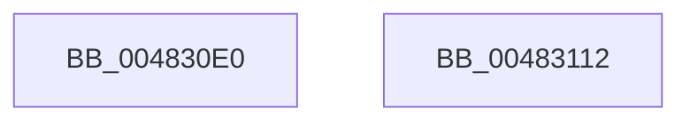

# KeInitializeMutex

- RVA: `0x004830E0`–`0x00483113` (길이 `51` bytes)
- VA: `0x00000001404830E0`
- 실행 섹션: `.text`
- PDB 이름 있음: `예`; PDB Function 태그: `아니요`
- unwind 정보 RVA: `0x000DB714`
- 디코드: `15`개 명령, `51/51` bytes 표시
- 미해석 바이트: `0` (있으면 어셈블리에 `.byte`로 보존)

> 이 문서는 커널 이미지의 기계어와 PDB 기호를 분석해 생성했습니다. 4번과 5번은 함수 원형과 자료형을 바이너리 사용 방식에서 추정한 C 해석이며 원본 소스 복구 결과는 아닙니다.

## 1. Dependencies

- 직접 호출 지점: **0**; 고유 호출 대상: **0**
- 직접 호출자로 확인된 함수: **5**
- RIP 상대 이미지 참조: **0**

### Outgoing calls
- 직접 디코드된 call 명령이 없습니다.

### Direct callers
- [Pdcv2ActivationClientRegister](../../page/79/Pdcv2ActivationClientRegister_function_0079AF28.md) at `0x0079AFC0`
- [EtwpPreInitializeSiloState](../../page/7B/EtwpPreInitializeSiloState_function_007B76BC.md) at `0x007B77B2`
- [EtwpInitLoggerContext](../../page/A7/EtwpInitLoggerContext_function_00A7154C.md) at `0x00A716DB`
- [KeAllocateCalloutStackEx](../../page/A7/KeAllocateCalloutStackEx_function_00A7F030.md) at `0x00A7F0D5`
- [HalpInitGenericErrorSourcePollingRoutine](../../pagelk/B5/HalpInitGenericErrorSourcePollingRoutine_function_00B5E498.md) at `0x00B5E4D0`

### Static image references
- 디코드된 RIP-relative 메모리 참조가 없습니다.

## 2. Other-region calls and transfers

- 다른 실행 섹션으로 향하는 call: **0**
- 별도 외부 분기/꼬리 이동을 확인하지 못했습니다.

## 3. Assembly (complete function range)

```asm
004830E0  0F 57 C0                        xorps xmm0, xmm0
004830E3  33 C0                           xor eax, eax
004830E5  0F 11 01                        movups xmmword ptr [rcx], xmm0
004830E8  0F 11 41 10                     movups xmmword ptr [rcx + 0x10], xmm0
004830EC  0F 11 41 20                     movups xmmword ptr [rcx + 0x20], xmm0
004830F0  48 89 41 30                     mov qword ptr [rcx + 0x30], rax
004830F4  48 8D 41 08                     lea rax, [rcx + 8]
004830F8  C6 01 02                        mov byte ptr [rcx], 2
004830FB  C7 41 04 01 00 00 00            mov dword ptr [rcx + 4], 1
00483102  48 89 40 08                     mov qword ptr [rax + 8], rax
00483106  48 89 00                        mov qword ptr [rax], rax
00483109  80 61 30 FE                     and byte ptr [rcx + 0x30], 0xfe
0048310D  C6 41 31 01                     mov byte ptr [rcx + 0x31], 1
00483111  C3                              ret
00483112  CC                              int3
```

## 4. C-style interpretation (structured pseudocode)

```c
__int64 __fastcall KeInitializeMutex(__int64 a1)
{
    __int64 result;

    result = 0;
    *(unsigned __int64 *)(a1) = v_xmm0;
    *(unsigned __int64 *)(a1 + 16) = v_xmm0;
    *(unsigned __int64 *)(a1 + 32) = v_xmm0;
    *(unsigned __int64 *)(a1 + 48) = 0;
    *(unsigned __int8 *)(a1) = 2;
    *(unsigned int *)(a1 + 4) = 1;
    *(unsigned __int64 *)(a1 + 8 + 8) = a1 + 8;
    *(unsigned __int64 *)(a1 + 8) = a1 + 8;
    *(unsigned __int8 *)(a1 + 49) = 1;
    return a1 + 8;
}
```

## 5. (Beta) C Style

```c
void *KeInitializeMutex(void *Mutex)
{
    uint8_t *mutex = (uint8_t *)Mutex;

    int64_t result;

    result = 0;
    *(uint64_t *)(mutex) = v_xmm0;
    *(uint64_t *)(mutex + 0x10) = v_xmm0;
    *(uint64_t *)(mutex + 0x20) = v_xmm0;
    *(uint64_t *)(mutex + 0x30) = 0;
    *(uint8_t *)(mutex) = 2;
    *(uint32_t *)(mutex + 0x4) = 1;
    *(void **)(mutex + 0x8 + 0x8) = Mutex + 8;
    *(void **)(mutex + 0x8) = Mutex + 8;
    *(uint8_t *)(mutex + 0x31) = 1;
    return Mutex + 8;
}
```

### 관측된 메모리 오프셋

구조체 형식이 확인되지 않은 접근은 인자 기준의 오프셋으로만 기록했습니다.

| 기준 인자 | 오프셋 표현 | 폭 (bit) | 접근 |
|---|---:|---:|---|
| `Mutex` | `+ 0x0` | `8` | `W` |
| `Mutex` | `+ 0x0` | `64` | `W` |
| `Mutex` | `+ 0x0` | `128` | `R` |
| `Mutex` | `+ 0x4` | `32` | `W` |
| `Mutex` | `+ 0x8` | `64` | `R` |
| `Mutex` | `+ 0x8` | `64` | `W` |
| `Mutex` | `+ 0x10` | `128` | `R` |
| `Mutex` | `+ 0x20` | `128` | `R` |
| `Mutex` | `+ 0x30` | `8` | `R/W` |
| `Mutex` | `+ 0x30` | `64` | `W` |
| `Mutex` | `+ 0x31` | `8` | `W` |

## 6. Execution-region graph

[열기: 2D/3D 그래프와 함수 탐색 컨트롤 패널](../../../control-panel.html?section=text&rva=0x004830E0&view=graph)

- 2D 그래프는 위에서 아래로 흐르고, 3D 그래프는 빈 공간을 드래그해 회전합니다. Shift+드래그는 이동, 휠은 확대·축소, 함수 노드 선택은 대상 보고서 이동입니다.

### Static fallback


