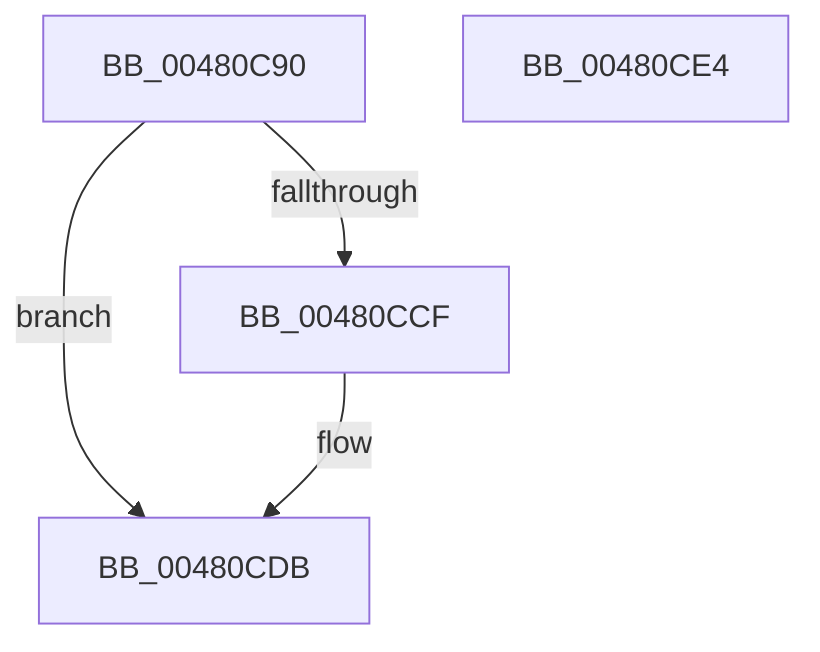

# KeInitializeQueue

- RVA: `0x00480C90`–`0x00480CE5` (길이 `85` bytes)
- VA: `0x0000000140480C90`
- 실행 섹션: `.text`
- PDB 이름 있음: `예`; PDB Function 태그: `아니요`
- unwind 정보 RVA: `0x0005CF00`
- 디코드: `27`개 명령, `85/85` bytes 표시
- 미해석 바이트: `0` (있으면 어셈블리에 `.byte`로 보존)

> 이 문서는 커널 이미지의 기계어와 PDB 기호를 분석해 생성했습니다. 4번과 5번은 함수 원형과 자료형을 바이너리 사용 방식에서 추정한 C 해석이며 원본 소스 복구 결과는 아닙니다.

## 1. Dependencies

- 직접 호출 지점: **1**; 고유 호출 대상: **1**
- 직접 호출자로 확인된 함수: **5**
- RIP 상대 이미지 참조: **0**

### Outgoing calls
- `0x00480CD4` → [KeQueryActiveProcessorCountEx](../24/KeQueryActiveProcessorCountEx_function_00249EF0.md) (function, `0x00249EF0`)

### Direct callers
- [NtCreateIoCompletion](../../page/A2/NtCreateIoCompletion_function_00A2CA60.md) at `0x00A2CAE8`
- [EtwpCreateUmReplyObject](../../page/A8/EtwpCreateUmReplyObject_function_00A8DBE4.md) at `0x00A8DC60`
- [FsRtlInitializeWorkerThread](../../init/C2/FsRtlInitializeWorkerThread_function_00C29624.md) at `0x00C2967B`
- [IoInitSystemPreDrivers](../../init/C2/IoInitSystemPreDrivers_function_00C2AC3C.md) at `0x00C2B9F5`
- [ExpWorkerFactoryInitialization](../../init/C5/ExpWorkerFactoryInitialization_function_00C54250.md) at `0x00C54313`

### Static image references
- 디코드된 RIP-relative 메모리 참조가 없습니다.

## 2. Other-region calls and transfers

- 다른 실행 섹션으로 향하는 call: **0**
- 별도 외부 분기/꼬리 이동을 확인하지 못했습니다.

## 3. Assembly (complete function range)

```asm
00480C90  40 53                           push rbx
00480C92  48 83 EC 20                     sub rsp, 0x20
00480C96  48 8B D9                        mov rbx, rcx
00480C99  C6 01 04                        mov byte ptr [rcx], 4
00480C9C  33 C9                           xor ecx, ecx
00480C9E  66 C7 43 01 00 10               mov word ptr [rbx + 1], 0x1000
00480CA4  48 8D 43 08                     lea rax, [rbx + 8]
00480CA8  89 4B 04                        mov dword ptr [rbx + 4], ecx
00480CAB  48 89 40 08                     mov qword ptr [rax + 8], rax
00480CAF  48 89 00                        mov qword ptr [rax], rax
00480CB2  48 8D 43 18                     lea rax, [rbx + 0x18]
00480CB6  48 89 40 08                     mov qword ptr [rax + 8], rax
00480CBA  48 89 00                        mov qword ptr [rax], rax
00480CBD  48 8D 43 30                     lea rax, [rbx + 0x30]
00480CC1  48 89 40 08                     mov qword ptr [rax + 8], rax
00480CC5  48 89 00                        mov qword ptr [rax], rax
00480CC8  89 4B 28                        mov dword ptr [rbx + 0x28], ecx
00480CCB  85 D2                           test edx, edx
00480CCD  75 0C                           jne 0x140480cdb
00480CCF  B9 FF FF 00 00                  mov ecx, 0xffff
00480CD4  E8 17 92 DC FF                  call 0x140249ef0
00480CD9  8B D0                           mov edx, eax
00480CDB  89 53 2C                        mov dword ptr [rbx + 0x2c], edx
00480CDE  48 83 C4 20                     add rsp, 0x20
00480CE2  5B                              pop rbx
00480CE3  C3                              ret
00480CE4  CC                              int3
```

## 4. C-style interpretation (structured pseudocode)

```c
__int64 __fastcall KeInitializeQueue(__int64 a1, int a2)
{
    __int64 result;
    __int64 v_rsp;

    v_rsp = (v_rsp) - (32);
    *(unsigned __int8 *)(a1) = 4;
    a1 = 0;
    *(unsigned __int16 *)(a1 + 1) = 0x1000ULL;
    *(unsigned int *)(a1 + 4) = 0;
    *(unsigned __int64 *)(a1 + 8 + 8) = a1 + 8;
    *(unsigned __int64 *)(a1 + 8) = a1 + 8;
    *(unsigned __int64 *)(a1 + 24 + 8) = a1 + 24;
    *(unsigned __int64 *)(a1 + 24) = a1 + 24;
    *(unsigned __int64 *)(a1 + 48 + 8) = a1 + 48;
    *(unsigned __int64 *)(a1 + 48) = a1 + 48;
    *(unsigned int *)(a1 + 40) = 0;
    result = a1 + 48;
    if (a2 == 0) {
        a1 = 0xFFFFULL;
        result = KeQueryActiveProcessorCountEx(a1, a2, a3, a4);
        a2 = (unsigned int)(result);
    }
    *(unsigned int *)(a1 + 44) = a2;
    v_rsp = (v_rsp) + (32);
    return result;
}
```

## 5. (Beta) C Style

```c
int64_t KeInitializeQueue(void *Queue, int32_t Arg2)
{
    uint8_t *queue = (uint8_t *)Queue;

    int64_t result;
    int64_t local_rsp;

    local_rsp = (local_rsp) - (32);
    *(uint8_t *)(queue) = 4;
    Queue = 0;
    *(uint16_t *)(queue + 0x1) = 0x1000ULL;
    *(uint32_t *)(queue + 0x4) = 0;
    *(void **)(queue + 0x8 + 0x8) = Queue + 8;
    *(void **)(queue + 0x8) = Queue + 8;
    *(void **)(queue + 0x18 + 0x8) = Queue + 24;
    *(void **)(queue + 0x18) = Queue + 24;
    *(void **)(queue + 0x30 + 0x8) = Queue + 48;
    *(void **)(queue + 0x30) = Queue + 48;
    *(uint32_t *)(queue + 0x28) = 0;
    result = Queue + 48;
    if (Arg2 == 0) {
        Queue = 0xFFFFULL;
        result = KeQueryActiveProcessorCountEx(Queue, Arg2, a3, a4);
        Arg2 = (uint32_t)(result);
    }
    *(uint32_t *)(queue + 0x2C) = Arg2;
    local_rsp = (local_rsp) + (32);
    return result;
}
```

### 관측된 메모리 오프셋

구조체 형식이 확인되지 않은 접근은 인자 기준의 오프셋으로만 기록했습니다.

| 기준 인자 | 오프셋 표현 | 폭 (bit) | 접근 |
|---|---:|---:|---|
| `Queue` | `+ 0x0` | `8` | `W` |
| `Queue` | `+ 0x0` | `64` | `W` |
| `Queue` | `+ 0x1` | `16` | `W` |
| `Queue` | `+ 0x4` | `32` | `W` |
| `Queue` | `+ 0x8` | `64` | `R` |
| `Queue` | `+ 0x8` | `64` | `W` |
| `Queue` | `+ 0x18` | `64` | `R` |
| `Queue` | `+ 0x28` | `32` | `W` |
| `Queue` | `+ 0x2C` | `32` | `W` |
| `Queue` | `+ 0x30` | `64` | `R` |

## 6. Execution-region graph

[열기: 2D/3D 그래프와 함수 탐색 컨트롤 패널](../../../control-panel.html?section=text&rva=0x00480C90&view=graph)

- 2D 그래프는 위에서 아래로 흐르고, 3D 그래프는 빈 공간을 드래그해 회전합니다. Shift+드래그는 이동, 휠은 확대·축소, 함수 노드 선택은 대상 보고서 이동입니다.

### Static fallback


