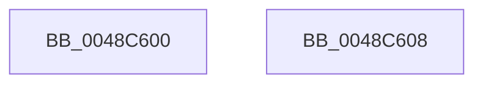

# KeQueryActiveGroupCount

- RVA: `0x0048C600`–`0x0048C609` (길이 `9` bytes)
- VA: `0x000000014048C600`
- 실행 섹션: `.text`
- PDB 이름 있음: `예`; PDB Function 태그: `아니요`
- unwind 정보 RVA: `0x000DB714`
- 디코드: `3`개 명령, `9/9` bytes 표시
- 미해석 바이트: `0` (있으면 어셈블리에 `.byte`로 보존)

> 이 문서는 커널 이미지의 기계어와 PDB 기호를 분석해 생성했습니다. 4번과 5번은 함수 원형과 자료형을 바이너리 사용 방식에서 추정한 C 해석이며 원본 소스 복구 결과는 아닙니다.

## 1. Dependencies

- 직접 호출 지점: **0**; 고유 호출 대상: **0**
- 직접 호출자로 확인된 함수: **10**
- RIP 상대 이미지 참조: **1**

### Outgoing calls
- 직접 디코드된 call 명령이 없습니다.

### Direct callers
- [NtSetInformationCpuPartition](../../page/78/NtSetInformationCpuPartition_function_00783510.md) at `0x00783666`
- [EtwpProcessorRundown](../../page/7C/EtwpProcessorRundown_function_007C0868.md) at `0x007C0977`
- [ExpNodeInitialize](../../page/7C/ExpNodeInitialize_function_007CF8A0.md) at `0x007CF8E7`
- [NtSetInformationThread](../../page/8C/NtSetInformationThread_function_008C9F60.md) at `0x008CB0DE`
- [IopConnectInterrupt](../../page/90/IopConnectInterrupt_function_00900B40.md) at `0x00900BF9`
- [NtPowerInformation](../../page/95/NtPowerInformation_function_00955D80.md) at `0x00957160`
- [PsCreateSystemThreadEx](../../page/9E/PsCreateSystemThreadEx_function_009ED120.md) at `0x009ED216`
- [NtSetInformationJobObject](../../page/9F/NtSetInformationJobObject_function_009F84C0.md) at `0x009F960F`
- [PspAllocateProcess](../../page/A1/PspAllocateProcess_function_00A13B3C.md) at `0x00A14E23`
- [ExpQuerySystemInformation](../../page/A5/ExpQuerySystemInformation_function_00A57858.md) at `0x00A57C83`
- [ExpQuerySystemInformation](../../page/A5/ExpQuerySystemInformation_function_00A57858.md) at `0x00A5ACF3`

### Static image references
- `0x0048C600` → RVA `0x00FC5018` (`ALMOSTRO`; read)

## 2. Other-region calls and transfers

- 다른 실행 섹션으로 향하는 call: **0**
- 별도 외부 분기/꼬리 이동을 확인하지 못했습니다.

## 3. Assembly (complete function range)

```asm
0048C600  0F B7 05 11 8A B3 00            movzx eax, word ptr [rip + 0xb38a11]
0048C607  C3                              ret
0048C608  CC                              int3
```

## 4. C-style interpretation (structured pseudocode)

```c
__int64 __fastcall KeQueryActiveGroupCount(void)
{
    return *(unsigned __int16 *)(v_rip + 11766289);
}
```

## 5. (Beta) C Style

```c
void KeQueryActiveGroupCount(void)
{
    return *(uint16_t *)(v_rip + 0xB38A11);
}
```

## 6. Execution-region graph

[열기: 2D/3D 그래프와 함수 탐색 컨트롤 패널](../../../control-panel.html?section=text&rva=0x0048C600&view=graph)

- 2D 그래프는 위에서 아래로 흐르고, 3D 그래프는 빈 공간을 드래그해 회전합니다. Shift+드래그는 이동, 휠은 확대·축소, 함수 노드 선택은 대상 보고서 이동입니다.

### Static fallback


