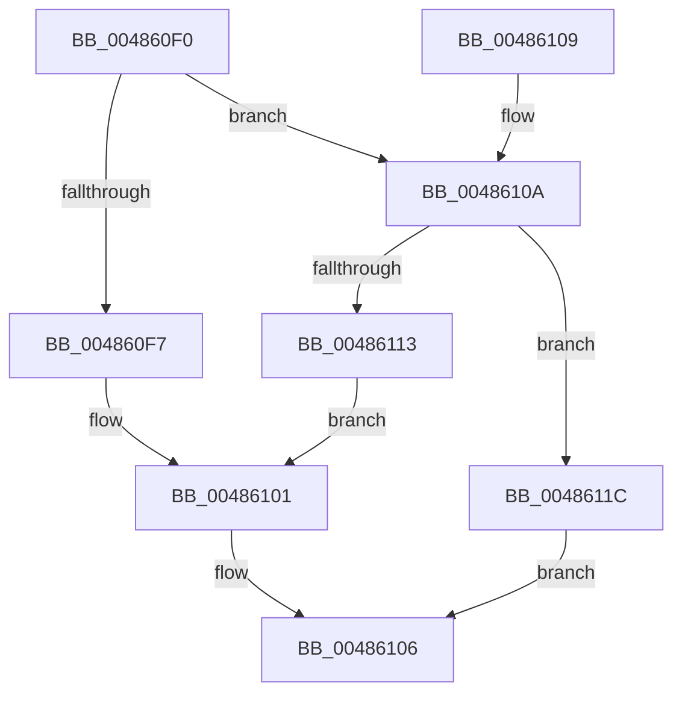

# KeQueryActiveProcessorCount

- RVA: `0x004860F0`–`0x00486120` (길이 `48` bytes)
- VA: `0x00000001404860F0`
- 실행 섹션: `.text`
- PDB 이름 있음: `예`; PDB Function 태그: `아니요`
- unwind 정보 RVA: `0x000DB714`
- 디코드: `15`개 명령, `48/48` bytes 표시
- 미해석 바이트: `0` (있으면 어셈블리에 `.byte`로 보존)

> 이 문서는 커널 이미지의 기계어와 PDB 기호를 분석해 생성했습니다. 4번과 5번은 함수 원형과 자료형을 바이너리 사용 방식에서 추정한 C 해석이며 원본 소스 복구 결과는 아닙니다.

## 1. Dependencies

- 직접 호출 지점: **0**; 고유 호출 대상: **0**
- 직접 호출자로 확인된 함수: **0**
- RIP 상대 이미지 참조: **2**

### Outgoing calls
- 직접 디코드된 call 명령이 없습니다.

### Direct callers
- 이 함수 시작 RVA로 연결되는 직접 call은 확인되지 않았습니다. 간접 호출은 완전히 역산할 수 없습니다.

### Static image references
- `0x004860F7` → RVA `0x00FC7128` (`ALMOSTRO`; read)
- `0x0048610A` → RVA `0x00FC5018` (`ALMOSTRO`; read)

## 2. Other-region calls and transfers

- 다른 실행 섹션으로 향하는 call: **0**
- 별도 외부 분기/꼬리 이동을 확인하지 못했습니다.

## 3. Assembly (complete function range)

```asm
004860F0  33 C0                           xor eax, eax
004860F2  48 85 C9                        test rcx, rcx
004860F5  74 13                           je 0x14048610a
004860F7  48 8B 05 2A 10 B4 00            mov rax, qword ptr [rip + 0xb4102a]
004860FE  48 89 01                        mov qword ptr [rcx], rax
00486101  F3 48 0F B8 C8                  popcnt rcx, rax
00486106  8B C1                           mov eax, ecx
00486108  C3                              ret
00486109  CC                              int3
0048610A  66 3B 05 07 EF B3 00            cmp ax, word ptr [rip + 0xb3ef07]
00486111  73 09                           jae 0x14048611c
00486113  48 8B 05 0E 10 B4 00            mov rax, qword ptr [rip + 0xb4100e]
0048611A  EB E5                           jmp 0x140486101
0048611C  8B C8                           mov ecx, eax
0048611E  EB E6                           jmp 0x140486106
```

## 4. C-style interpretation (structured pseudocode)

```c
__int64 __fastcall KeQueryActiveProcessorCount(__int64 a1)
{
    __int64 result;

    result = 0;
    if (a1 == 0) goto loc_0048610A;
    *(unsigned __int64 *)(a1) = *(unsigned __int64 *)(v_rip + 11800618);
loc_00486101:
loc_00486106:
    return (unsigned int)((unsigned int)(a1));
loc_0048610A:
    if (((unsigned __int16)((unsigned int)((unsigned int)(a1)))) >= (*(unsigned __int16 *)(v_rip + 11792135))) goto loc_0048611C;
    goto loc_00486101;
loc_0048611C:
    goto loc_00486106;
}
```

## 5. (Beta) C Style

```c
int64_t KeQueryActiveProcessorCount(int64_t Arg1)
{
    int64_t result;

    result = 0;
    if (Arg1 == 0) goto loc_0048610A;
    *(uint64_t *)(Arg1) = *(uint64_t *)(v_rip + 0xB4102A);
loc_00486101:
loc_00486106:
    return (uint32_t)((uint32_t)(Arg1));
loc_0048610A:
    if (((uint16_t)((uint32_t)((uint32_t)(Arg1)))) >= (*(uint16_t *)(v_rip + 0xB3EF07))) goto loc_0048611C;
    goto loc_00486101;
loc_0048611C:
    goto loc_00486106;
}
```

## 6. Execution-region graph

[열기: 2D/3D 그래프와 함수 탐색 컨트롤 패널](../../../control-panel.html?section=text&rva=0x004860F0&view=graph)

- 2D 그래프는 위에서 아래로 흐르고, 3D 그래프는 빈 공간을 드래그해 회전합니다. Shift+드래그는 이동, 휠은 확대·축소, 함수 노드 선택은 대상 보고서 이동입니다.

### Static fallback


