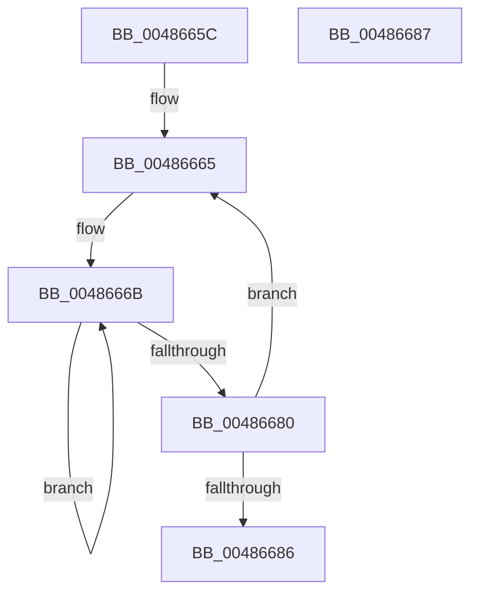

# KeQueryCycleTimeStatsProcessor

- RVA: `0x0048665C`–`0x00486688` (길이 `44` bytes)
- VA: `0x000000014048665C`
- 실행 섹션: `.text`
- PDB 이름 있음: `예`; PDB Function 태그: `아니요`
- unwind 정보 RVA: `0x000DB714`
- 디코드: `12`개 명령, `44/44` bytes 표시
- 미해석 바이트: `0` (있으면 어셈블리에 `.byte`로 보존)

> 이 문서는 커널 이미지의 기계어와 PDB 기호를 분석해 생성했습니다. 4번과 5번은 함수 원형과 자료형을 바이너리 사용 방식에서 추정한 C 해석이며 원본 소스 복구 결과는 아닙니다.

## 1. Dependencies

- 직접 호출 지점: **0**; 고유 호출 대상: **0**
- 직접 호출자로 확인된 함수: **1**
- RIP 상대 이미지 참조: **0**

### Outgoing calls
- 직접 디코드된 call 명령이 없습니다.

### Direct callers
- [ExpQuerySystemInformation](../../page/A5/ExpQuerySystemInformation_function_00A57858.md) at `0x00A5A5BF`

### Static image references
- 디코드된 RIP-relative 메모리 참조가 없습니다.

## 2. Other-region calls and transfers

- 다른 실행 섹션으로 향하는 call: **0**
- 별도 외부 분기/꼬리 이동을 확인하지 못했습니다.

## 3. Assembly (complete function range)

```asm
0048665C  48 2B CA                        sub rcx, rdx
0048665F  41 B9 04 00 00 00               mov r9d, 4
00486665  41 B8 02 00 00 00               mov r8d, 2
0048666B  48 8B 84 11 80 87 00 00         mov rax, qword ptr [rcx + rdx + 0x8780]
00486673  48 89 02                        mov qword ptr [rdx], rax
00486676  48 83 C2 08                     add rdx, 8
0048667A  49 83 E8 01                     sub r8, 1
0048667E  75 EB                           jne 0x14048666b
00486680  49 83 E9 01                     sub r9, 1
00486684  75 DF                           jne 0x140486665
00486686  C3                              ret
00486687  CC                              int3
```

## 4. C-style interpretation (structured pseudocode)

```c
__int64 __fastcall KeQueryCycleTimeStatsProcessor(__int64 a1, __int64 a2)
{
    a1 = (a1) - (a2);
loc_00486665:
loc_0048666B:
    *(unsigned __int64 *)(a2) = *(unsigned __int64 *)(a1 + a2 * 1 + 34688);
    a2 = (a2) + (8);
    a3 = (2) - (1);
    if (condition_is_not_equal) goto loc_0048666B;
    a4 = (4) - (1);
    if (condition_is_not_equal) goto loc_00486665;
    return *(unsigned __int64 *)(a1 + a2 * 1 + 34688);
}
```

## 5. (Beta) C Style

```c
int64_t KeQueryCycleTimeStatsProcessor(void *Arg1, void *Arg2)
{
    uint8_t *arg1 = (uint8_t *)Arg1;
    uint8_t *arg2 = (uint8_t *)Arg2;

    Arg1 = (Arg1) - (Arg2);
loc_00486665:
loc_0048666B:
    *(uint64_t *)(arg2) = *(uint64_t *)(arg1 + arg2 * 1 + 0x8780);
    Arg2 = (Arg2) + (8);
    a3 = (2) - (1);
    if (condition_is_not_equal) goto loc_0048666B;
    a4 = (4) - (1);
    if (condition_is_not_equal) goto loc_00486665;
    return *(uint64_t *)(arg1 + arg2 * 1 + 0x8780);
}
```

### 관측된 메모리 오프셋

구조체 형식이 확인되지 않은 접근은 인자 기준의 오프셋으로만 기록했습니다.

| 기준 인자 | 오프셋 표현 | 폭 (bit) | 접근 |
|---|---:|---:|---|
| `Arg1` | `+ 0x8780 + rdx*1` | `64` | `R` |
| `Arg2` | `+ 0x0` | `64` | `W` |

## 6. Execution-region graph

[열기: 2D/3D 그래프와 함수 탐색 컨트롤 패널](../../../control-panel.html?section=text&rva=0x0048665C&view=graph)

- 2D 그래프는 위에서 아래로 흐르고, 3D 그래프는 빈 공간을 드래그해 회전합니다. Shift+드래그는 이동, 휠은 확대·축소, 함수 노드 선택은 대상 보고서 이동입니다.

### Static fallback


