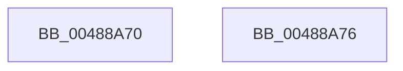

# KeQueryHeteroCpuPolicyThread

- RVA: `0x00488A70`–`0x00488A77` (길이 `7` bytes)
- VA: `0x0000000140488A70`
- 실행 섹션: `.text`
- PDB 이름 있음: `예`; PDB Function 태그: `아니요`
- unwind 정보 RVA: `0x000DB714`
- 디코드: `3`개 명령, `7/7` bytes 표시
- 미해석 바이트: `0` (있으면 어셈블리에 `.byte`로 보존)

> 이 문서는 커널 이미지의 기계어와 PDB 기호를 분석해 생성했습니다. 4번과 5번은 함수 원형과 자료형을 바이너리 사용 방식에서 추정한 C 해석이며 원본 소스 복구 결과는 아닙니다.

## 1. Dependencies

- 직접 호출 지점: **0**; 고유 호출 대상: **0**
- 직접 호출자로 확인된 함수: **11**
- RIP 상대 이미지 참조: **0**

### Outgoing calls
- 직접 디코드된 call 명령이 없습니다.

### Direct callers
- [PspApplyIFEOPerfOptions](../../page/78/PspApplyIFEOPerfOptions_function_00783ED8.md) at `0x00783F48`
- [NtSetInformationThread](../../page/8C/NtSetInformationThread_function_008C9F60.md) at `0x008CA71A`
- [PfSnAsyncPrefetchWorker](../../page/93/PfSnAsyncPrefetchWorker_function_009394B0.md) at `0x00939572`
- [PfSnCheckActionsNeeded](../../page/95/PfSnCheckActionsNeeded_function_0095F538.md) at `0x0095F5C6`
- [PspAllocateProcess](../../page/A1/PspAllocateProcess_function_00A13B3C.md) at `0x00A1432B`
- [PfpLogEventRequest](../../page/AC/PfpLogEventRequest_function_00AC1278.md) at `0x00AC12CA`
- [NtQueryInformationThread](../../page/AE/NtQueryInformationThread_function_00AE3760.md) at `0x00AE4839`
- [NtSetInformationProcess](../../page/AE/NtSetInformationProcess_function_00AE5370.md) at `0x00AE6BA4`
- [PfTAccessTracingCleanup](../../pagelk/B6/PfTAccessTracingCleanup_function_00B6B8AC.md) at `0x00B6B8EC`
- [PfTAccessTracingStart](../../pagelk/B6/PfTAccessTracingStart_function_00B6B9F0.md) at `0x00B6BA29`
- [ExpDebuggerWorker](../../pagekd/B8/ExpDebuggerWorker_function_00B89F70.md) at `0x00B89FBF`

### Static image references
- 디코드된 RIP-relative 메모리 참조가 없습니다.

## 2. Other-region calls and transfers

- 다른 실행 섹션으로 향하는 call: **0**
- 별도 외부 분기/꼬리 이동을 확인하지 못했습니다.

## 3. Assembly (complete function range)

```asm
00488A70  B8 05 00 00 00                  mov eax, 5
00488A75  C3                              ret
00488A76  CC                              int3
```

## 4. C-style interpretation (structured pseudocode)

```c
__int64 __fastcall KeQueryHeteroCpuPolicyThread(void)
{
    return 5;
}
```

## 5. (Beta) C Style

```c
void KeQueryHeteroCpuPolicyThread(void)
{
    return 5;
}
```

## 6. Execution-region graph

[열기: 2D/3D 그래프와 함수 탐색 컨트롤 패널](../../../control-panel.html?section=text&rva=0x00488A70&view=graph)

- 2D 그래프는 위에서 아래로 흐르고, 3D 그래프는 빈 공간을 드래그해 회전합니다. Shift+드래그는 이동, 휠은 확대·축소, 함수 노드 선택은 대상 보고서 이동입니다.

### Static fallback


