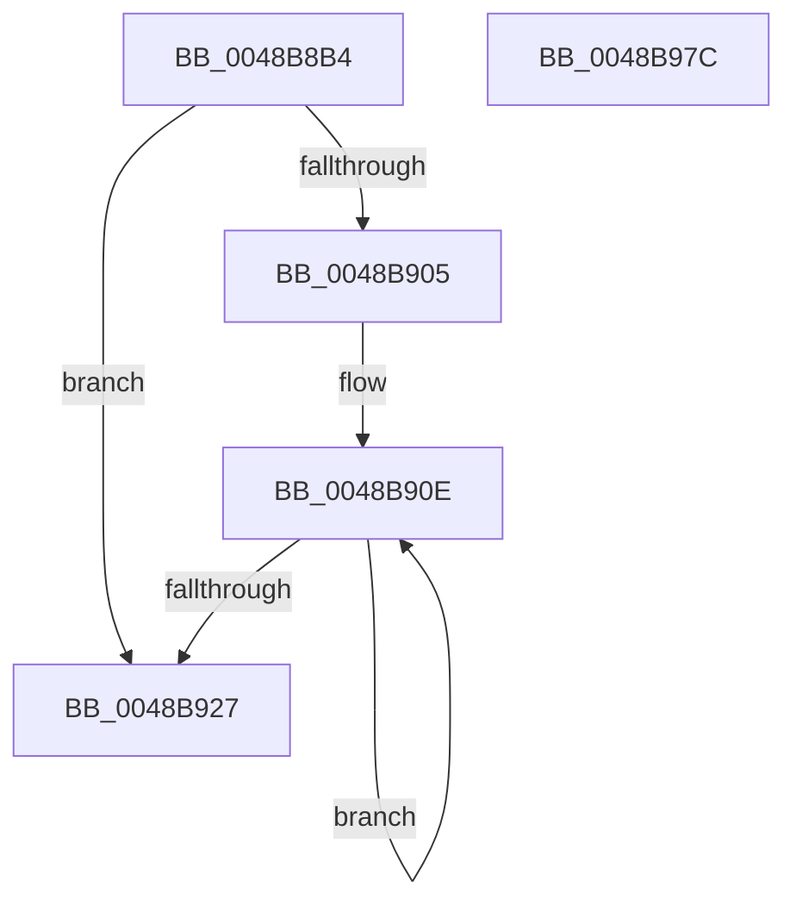

# KeQuerySchedulingGroupHistory

- RVA: `0x0048B8B4`–`0x0048B97D` (길이 `201` bytes)
- VA: `0x000000014048B8B4`
- 실행 섹션: `.text`
- PDB 이름 있음: `예`; PDB Function 태그: `아니요`
- unwind 정보 RVA: `0x000B09E4`
- 디코드: `57`개 명령, `201/201` bytes 표시
- 미해석 바이트: `0` (있으면 어셈블리에 `.byte`로 보존)

> 이 문서는 커널 이미지의 기계어와 PDB 기호를 분석해 생성했습니다. 4번과 5번은 함수 원형과 자료형을 바이너리 사용 방식에서 추정한 C 해석이며 원본 소스 복구 결과는 아닙니다.

## 1. Dependencies

- 직접 호출 지점: **3**; 고유 호출 대상: **3**
- 직접 호출자로 확인된 함수: **1**
- RIP 상대 이미지 참조: **3**

### Outgoing calls
- `0x0048B8F3` → [KeAcquireInStackQueuedSpinLock](../27/KeAcquireInStackQueuedSpinLock_function_002757A0.md) (function, `0x002757A0`)
- `0x0048B935` → [KeQueryPerformanceCounter](../37/KeQueryPerformanceCounter_function_0037E7E0.md) (function, `0x0037E7E0`)
- `0x0048B963` → [KeReleaseInStackQueuedSpinLock](../34/KeReleaseInStackQueuedSpinLock_function_00342CE0.md) (function, `0x00342CE0`)

### Direct callers
- [PspQueryRateControlHistory](../../page/91/PspQueryRateControlHistory_function_00918D1C.md) at `0x00918DF9`

### Static image references
- `0x0048B8D7` → RVA `0x00FCF180` (`CACHEALI`; read)
- `0x0048B8F8` → RVA `0x00FC6A80` (`ALMOSTRO`; read)
- `0x0048B927` → RVA `0x00FC5170` (`ALMOSTRO`; read)

## 2. Other-region calls and transfers

- 다른 실행 섹션으로 향하는 call: **0**
- 별도 외부 분기/꼬리 이동을 확인하지 못했습니다.

## 3. Assembly (complete function range)

```asm
0048B8B4  4C 8B DC                        mov r11, rsp
0048B8B7  49 89 5B 10                     mov qword ptr [r11 + 0x10], rbx
0048B8BB  49 89 73 18                     mov qword ptr [r11 + 0x18], rsi
0048B8BF  57                              push rdi
0048B8C0  41 56                           push r14
0048B8C2  41 57                           push r15
0048B8C4  48 83 EC 40                     sub rsp, 0x40
0048B8C8  0F 57 C0                        xorps xmm0, xmm0
0048B8CB  48 8B F2                        mov rsi, rdx
0048B8CE  48 8B F9                        mov rdi, rcx
0048B8D1  49 8D 53 C8                     lea rdx, [r11 - 0x38]
0048B8D5  33 C0                           xor eax, eax
0048B8D7  48 8D 0D A2 38 B4 00            lea rcx, [rip + 0xb438a2]
0048B8DE  0F 11 44 24 20                  movups xmmword ptr [rsp + 0x20], xmm0
0048B8E3  33 DB                           xor ebx, ebx
0048B8E5  49 89 43 D8                     mov qword ptr [r11 - 0x28], rax
0048B8E9  4D 8B F9                        mov r15, r9
0048B8EC  49 89 5B 08                     mov qword ptr [r11 + 8], rbx
0048B8F0  4D 8B F0                        mov r14, r8
0048B8F3  E8 A8 9E DE FF                  call 0x1402757a0
0048B8F8  8B 05 82 B1 B3 00               mov eax, dword ptr [rip + 0xb3b182]
0048B8FE  48 89 1E                        mov qword ptr [rsi], rbx
0048B901  85 C0                           test eax, eax
0048B903  74 22                           je 0x14048b927
0048B905  48 8D 8F B0 00 00 00            lea rcx, [rdi + 0xb0]
0048B90C  8B D0                           mov edx, eax
0048B90E  48 8B 01                        mov rax, qword ptr [rcx]
0048B911  48 8D 89 B8 01 00 00            lea rcx, [rcx + 0x1b8]
0048B918  48 0B C3                        or rax, rbx
0048B91B  48 89 06                        mov qword ptr [rsi], rax
0048B91E  48 8B D8                        mov rbx, rax
0048B921  48 83 EA 01                     sub rdx, 1
0048B925  75 E7                           jne 0x14048b90e
0048B927  8B 05 43 98 B3 00               mov eax, dword ptr [rip + 0xb39843]
0048B92D  48 8D 4C 24 60                  lea rcx, [rsp + 0x60]
0048B932  41 89 06                        mov dword ptr [r14], eax
0048B935  E8 A6 2E EF FF                  call 0x14037e7e0
0048B93A  45 8B 06                        mov r8d, dword ptr [r14]
0048B93D  48 8B C8                        mov rcx, rax
0048B940  48 2B 47 18                     sub rax, qword ptr [rdi + 0x18]
0048B944  33 D2                           xor edx, edx
0048B946  48 69 C0 E8 03 00 00            imul rax, rax, 0x3e8
0048B94D  48 89 4F 18                     mov qword ptr [rdi + 0x18], rcx
0048B951  48 8D 4C 24 20                  lea rcx, [rsp + 0x20]
0048B956  48 F7 74 24 60                  div qword ptr [rsp + 0x60]
0048B95B  33 D2                           xor edx, edx
0048B95D  49 F7 F0                        div r8
0048B960  41 89 07                        mov dword ptr [r15], eax
0048B963  E8 78 73 EB FF                  call 0x140342ce0
0048B968  48 8B 5C 24 68                  mov rbx, qword ptr [rsp + 0x68]
0048B96D  48 8B 74 24 70                  mov rsi, qword ptr [rsp + 0x70]
0048B972  48 83 C4 40                     add rsp, 0x40
0048B976  41 5F                           pop r15
0048B978  41 5E                           pop r14
0048B97A  5F                              pop rdi
0048B97B  C3                              ret
0048B97C  CC                              int3
```

## 4. C-style interpretation (structured pseudocode)

```c
__int64 __fastcall KeQuerySchedulingGroupHistory(__int64 a1, __int64 a2, __int64 a3, __int64 a4)
{
    __int64 result;
    __int64 v_rbx;
    __int64 v_rsp;
    unsigned __int64 v_stack_m38;
    unsigned __int64 v_stack_p10;
    unsigned __int64 v_stack_p18;
    unsigned __int64 v_stack_p8;

    *(unsigned __int64 *)(v_rsp + 16) = v_rbx;
    *(unsigned __int64 *)(v_rsp + 24) = v_rsi;
    v_rsp = (v_rsp) - (64);
    result = 0;
    v_stack_m38 = v_xmm0;
    v_rbx = 0;
    *(unsigned __int64 *)(v_rsp - 40) = 0;
    *(unsigned __int64 *)(v_rsp + 8) = 0;
    result = KeAcquireInStackQueuedSpinLock(v_rip + 11810978, v_rsp - 56, a3, a4);
    *(unsigned __int64 *)(a2) = 0;
    if ((unsigned int)((unsigned int)(*(unsigned int *)(v_rip + 11776386))) == 0) goto loc_0048B927;
loc_0048B90E:
    result = (*(unsigned __int64 *)(a1 + 176)) | (0);
    *(unsigned __int64 *)(a2) = result;
    a2 = ((unsigned int)((unsigned int)((unsigned int)(*(unsigned int *)(v_rip + 11776386))))) - (1);
    if (condition_is_not_equal) goto loc_0048B90E;
loc_0048B927:
    *(unsigned int *)(a3) = (unsigned int)((unsigned int)(*(unsigned int *)(v_rip + 11769923)));
    result = KeQueryPerformanceCounter(v_stack_p8, a2, a3, a4);
    result = (result) - (*(unsigned __int64 *)(a1 + 24));
    a2 = 0;
    result = (result) * (result);
    *(unsigned __int64 *)(a1 + 24) = result;
    a2 = 0;
    *(unsigned int *)(a4) = (unsigned int)(result);
    result = KeReleaseInStackQueuedSpinLock(v_stack_m38, a2, (unsigned int)(*(unsigned int *)(a3)), a4);
    v_rsp = (v_rsp) + (64);
    return result;
}
```

## 5. (Beta) C Style

```c
int64_t KeQuerySchedulingGroupHistory(void *Arg1, void *Arg2, void *Arg3, void *Arg4)
{
    uint8_t *arg1 = (uint8_t *)Arg1;
    uint8_t *arg2 = (uint8_t *)Arg2;
    uint8_t *arg3 = (uint8_t *)Arg3;
    uint8_t *arg4 = (uint8_t *)Arg4;

    int64_t result;
    int64_t local_rbx;
    int64_t local_rsp;
    uint64_t v_stack_m38;
    uint64_t v_stack_p10;
    uint64_t v_stack_p18;
    uint64_t v_stack_p8;

    *(uint64_t *)(local_rsp + 0x10) = local_rbx;
    *(uint64_t *)(local_rsp + 0x18) = local_rsi;
    local_rsp = (local_rsp) - (64);
    result = 0;
    v_stack_m38 = v_xmm0;
    local_rbx = 0;
    *(uint64_t *)(local_rsp - 0x28) = 0;
    *(uint64_t *)(local_rsp + 0x8) = 0;
    result = KeAcquireInStackQueuedSpinLock(v_rip + 11810978, local_rsp - 56, Arg3, Arg4);
    *(uint64_t *)(arg2) = 0;
    if ((uint32_t)((uint32_t)(*(uint32_t *)(v_rip + 0xB3B182))) == 0) goto loc_0048B927;
loc_0048B90E:
    result = (*(uint64_t *)(arg1 + 0xB0)) | (0);
    *(uint64_t *)(arg2) = result;
    Arg2 = ((uint32_t)((uint32_t)((uint32_t)(*(uint32_t *)(v_rip + 0xB3B182))))) - (1);
    if (condition_is_not_equal) goto loc_0048B90E;
loc_0048B927:
    *(uint32_t *)(arg3) = (uint32_t)((uint32_t)(*(uint32_t *)(v_rip + 0xB39843)));
    result = KeQueryPerformanceCounter(v_stack_p8, Arg2, Arg3, Arg4);
    result = (result) - (*(uint64_t *)(arg1 + 0x18));
    Arg2 = 0;
    result = (result) * (result);
    *(uint64_t *)(arg1 + 0x18) = result;
    Arg2 = 0;
    *(uint32_t *)(arg4) = (uint32_t)(result);
    result = KeReleaseInStackQueuedSpinLock(v_stack_m38, Arg2, (uint32_t)(*(uint32_t *)(arg3)), Arg4);
    local_rsp = (local_rsp) + (64);
    return result;
}
```

### 관측된 메모리 오프셋

구조체 형식이 확인되지 않은 접근은 인자 기준의 오프셋으로만 기록했습니다.

| 기준 인자 | 오프셋 표현 | 폭 (bit) | 접근 |
|---|---:|---:|---|
| `Arg1` | `+ 0x0` | `64` | `R` |
| `Arg1` | `+ 0x18` | `64` | `R` |
| `Arg1` | `+ 0x18` | `64` | `W` |
| `Arg1` | `+ 0xB0` | `64` | `R` |
| `Arg1` | `+ 0x1B8` | `64` | `R` |
| `Arg2` | `+ 0x0` | `64` | `W` |
| `Arg3` | `+ 0x0` | `32` | `R` |
| `Arg3` | `+ 0x0` | `32` | `W` |
| `Arg4` | `+ 0x0` | `32` | `W` |

## 6. Execution-region graph

[열기: 2D/3D 그래프와 함수 탐색 컨트롤 패널](../../../control-panel.html?section=text&rva=0x0048B8B4&view=graph)

- 2D 그래프는 위에서 아래로 흐르고, 3D 그래프는 빈 공간을 드래그해 회전합니다. Shift+드래그는 이동, 휠은 확대·축소, 함수 노드 선택은 대상 보고서 이동입니다.

### Static fallback


