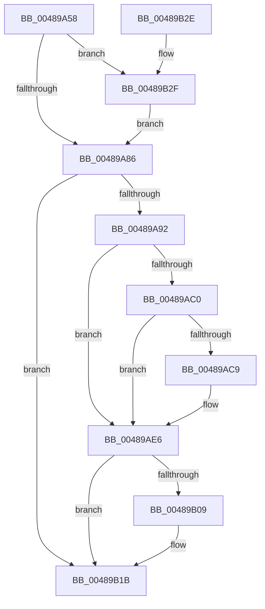

# KeRequestTerminationThread

- RVA: `0x00489A58`–`0x00489B39` (길이 `225` bytes)
- VA: `0x0000000140489A58`
- 실행 섹션: `.text`
- PDB 이름 있음: `예`; PDB Function 태그: `아니요`
- unwind 정보 RVA: `0x000B0050`
- 디코드: `57`개 명령, `225/225` bytes 표시
- 미해석 바이트: `0` (있으면 어셈블리에 `.byte`로 보존)

> 이 문서는 커널 이미지의 기계어와 PDB 기호를 분석해 생성했습니다. 4번과 5번은 함수 원형과 자료형을 바이너리 사용 방식에서 추정한 C 해석이며 원본 소스 복구 결과는 아닙니다.

## 1. Dependencies

- 직접 호출 지점: **7**; 고유 호출 대상: **7**
- 직접 호출자로 확인된 함수: **3**
- RIP 상대 이미지 참조: **0**

### Outgoing calls
- `0x00489AA4` → [KiAcquireThreadLockRaiseToDpc](../39/KiAcquireThreadLockRaiseToDpc_function_00396280.md) (function, `0x00396280`)
- `0x00489AD0` → [KiInsertQueueApc](../20/KiInsertQueueApc_function_002041F0.md) (function, `0x002041F0`)
- `0x00489AE1` → [KiSignalThreadForApc](../20/KiSignalThreadForApc_function_00204360.md) (function, `0x00204360`)
- `0x00489AFF` → [KiExitDispatcher](../25/KiExitDispatcher_function_00251CF0.md) (function, `0x00251CF0`)
- `0x00489B0E` → [KeAlertThread](KeAlertThread_function_00489B40.md) (function, `0x00489B40`)
- `0x00489B16` → [KeForceResumeThread](../20/KeForceResumeThread_function_0020292C.md) (function, `0x0020292C`)
- `0x00489B2F` → [VslRequestSecureThreadExit](../58/VslRequestSecureThreadExit_function_0058F438.md) (function, `0x0058F438`)

### Direct callers
- [KeRequestTerminationProcess](../../page/74/KeRequestTerminationProcess_function_00745D38.md) at `0x00745D6A`
- [PspTerminateThreadByPointer](../../page/90/PspTerminateThreadByPointer_function_00905E80.md) at `0x00905EF7`
- [PspInsertThread](../../page/9F/PspInsertThread_function_009F0314.md) at `0x009F0CBA`

### Static image references
- 디코드된 RIP-relative 메모리 참조가 없습니다.

## 2. Other-region calls and transfers

- 다른 실행 섹션으로 향하는 call: **0**
- 별도 외부 분기/꼬리 이동을 확인하지 못했습니다.

## 3. Assembly (complete function range)

```asm
00489A58  48 89 5C 24 10                  mov qword ptr [rsp + 0x10], rbx
00489A5D  48 89 6C 24 18                  mov qword ptr [rsp + 0x18], rbp
00489A62  56                              push rsi
00489A63  57                              push rdi
00489A64  41 56                           push r14
00489A66  48 83 EC 30                     sub rsp, 0x30
00489A6A  48 8B 81 20 02 00 00            mov rax, qword ptr [rcx + 0x220]
00489A71  48 8B D9                        mov rbx, rcx
00489A74  C6 44 24 50 00                  mov byte ptr [rsp + 0x50], 0
00489A79  F6 80 70 01 00 00 01            test byte ptr [rax + 0x170], 1
00489A80  0F 85 A9 00 00 00               jne 0x140489b2f
00489A86  F0 0F BA 6B 78 0F               lock bts dword ptr [rbx + 0x78], 0xf
00489A8C  0F 82 89 00 00 00               jb 0x140489b1b
00489A92  48 8D 54 24 50                  lea rdx, [rsp + 0x50]
00489A97  48 8B CB                        mov rcx, rbx
00489A9A  48 8D BB 88 02 00 00            lea rdi, [rbx + 0x288]
00489AA1  40 32 F6                        xor sil, sil
00489AA4  E8 D7 C7 F0 FF                  call 0x140396280
00489AA9  65 48 8B 2C 25 20 00 00 00      mov rbp, qword ptr gs:[0x20]
00489AB2  F7 43 74 00 40 00 00            test dword ptr [rbx + 0x74], 0x4000
00489AB9  44 8A 74 24 50                  mov r14b, byte ptr [rsp + 0x50]
00489ABE  74 26                           je 0x140489ae6
00489AC0  80 7F 52 00                     cmp byte ptr [rdi + 0x52], 0
00489AC4  40 B6 01                        mov sil, 1
00489AC7  75 1D                           jne 0x140489ae6
00489AC9  48 8B CF                        mov rcx, rdi
00489ACC  40 88 77 52                     mov byte ptr [rdi + 0x52], sil
00489AD0  E8 1B A7 D7 FF                  call 0x1402041f0
00489AD5  45 33 C9                        xor r9d, r9d
00489AD8  45 8A C6                        mov r8b, r14b
00489ADB  48 8B D7                        mov rdx, rdi
00489ADE  48 8B CD                        mov rcx, rbp
00489AE1  E8 7A A8 D7 FF                  call 0x140204360
00489AE6  45 33 C9                        xor r9d, r9d
00489AE9  48 C7 43 40 00 00 00 00         mov qword ptr [rbx + 0x40], 0
00489AF1  33 D2                           xor edx, edx
00489AF3  44 88 74 24 20                  mov byte ptr [rsp + 0x20], r14b
00489AF8  48 8B CD                        mov rcx, rbp
00489AFB  45 8D 41 01                     lea r8d, [r9 + 1]
00489AFF  E8 EC 81 DC FF                  call 0x140251cf0
00489B04  40 84 F6                        test sil, sil
00489B07  74 12                           je 0x140489b1b
00489B09  33 D2                           xor edx, edx
00489B0B  48 8B CB                        mov rcx, rbx
00489B0E  E8 2D 00 00 00                  call 0x140489b40
00489B13  48 8B CB                        mov rcx, rbx
00489B16  E8 11 8E D7 FF                  call 0x14020292c
00489B1B  48 8B 5C 24 58                  mov rbx, qword ptr [rsp + 0x58]
00489B20  48 8B 6C 24 60                  mov rbp, qword ptr [rsp + 0x60]
00489B25  48 83 C4 30                     add rsp, 0x30
00489B29  41 5E                           pop r14
00489B2B  5F                              pop rdi
00489B2C  5E                              pop rsi
00489B2D  C3                              ret
00489B2E  CC                              int3
00489B2F  E8 04 59 10 00                  call 0x14058f438
00489B34  E9 4D FF FF FF                  jmp 0x140489a86
```

## 4. C-style interpretation (structured pseudocode)

```c
__int64 __fastcall KeRequestTerminationThread(__int64 a1, __int64 a2, __int64 a3, int a4)
{
    __int64 result;
    __int64 v_rsi;
    __int64 v_rsp;
    unsigned __int8 v_stack_m28;
    unsigned __int64 v_stack_p10;
    unsigned __int64 v_stack_p18;
    unsigned __int8 v_stack_p8;

    v_stack_p10 = v_rbx;
    v_stack_p18 = v_rbp;
    v_rsp = (v_rsp) - (48);
    v_stack_p8 = 0;
    if (((*(unsigned __int8 *)(*(unsigned __int64 *)(a1 + 544) + 368)) & (1)) != 0) goto loc_00489B2F;
loc_00489A86:
    if (condition_is_below) goto loc_00489B1B;
    v_rsi = 0;
    result = KiAcquireThreadLockRaiseToDpc(a1, v_stack_p8, a3, a4);
    if (((*(unsigned int *)(a1 + 116)) & (0x4000ULL)) == 0) goto loc_00489AE6;
    if ((*(unsigned __int8 *)(a1 + 648 + 82)) == 0) {
        a1 = a1 + 648;
        *(unsigned __int8 *)(a1 + 648 + 82) = 1;
        result = KiInsertQueueApc(a1, v_stack_p8, a3, a4);
        a4 = 0;
        a3 = (unsigned __int8)(v_stack_p8);
        a2 = a1 + 648;
        a1 = *(unsigned __int64 *)(gs_base + (0 + 32));
        result = KiSignalThreadForApc(a1, a2, a3, a4);
    }
    a4 = 0;
    *(unsigned __int64 *)(a1 + 64) = 0;
    a2 = 0;
    v_stack_m28 = (unsigned __int8)(v_stack_p8);
    result = KiExitDispatcher(*(unsigned __int64 *)(gs_base + (0 + 32)), a2, a4 + 1, a4);
    if (1 != 0) {
        a2 = 0;
        a1 = a1;
        result = KeAlertThread(a1, a2, a4 + 1, a4);
        a1 = a1;
        result = KeForceResumeThread(a1, a2, a4 + 1, a4);
    }
    v_rsp = (v_rsp) + (48);
    return result;
loc_00489B2F:
    result = VslRequestSecureThreadExit(a1, a2, a4 + 1, a4);
    goto loc_00489A86;
}
```

## 5. (Beta) C Style

```c
int64_t KeRequestTerminationThread(void *Arg1, int64_t Arg2, int64_t Arg3, int32_t Arg4)
{
    uint8_t *arg1 = (uint8_t *)Arg1;

    int64_t result;
    int64_t local_rsi;
    int64_t local_rsp;
    uint8_t v_stack_m28;
    uint64_t v_stack_p10;
    uint64_t v_stack_p18;
    uint8_t v_stack_p8;

    v_stack_p10 = local_rbx;
    v_stack_p18 = local_rbp;
    local_rsp = (local_rsp) - (48);
    v_stack_p8 = 0;
    if (((*(uint8_t *)(*(uint64_t *)(arg1 + 0x220) + 0x170)) & (1)) != 0) goto loc_00489B2F;
loc_00489A86:
    if (condition_is_below) goto loc_00489B1B;
    local_rsi = 0;
    result = KiAcquireThreadLockRaiseToDpc(Arg1, v_stack_p8, Arg3, Arg4);
    if (((*(uint32_t *)(arg1 + 0x74)) & (0x4000ULL)) == 0) goto loc_00489AE6;
    if ((*(uint8_t *)(arg1 + 0x288 + 0x52)) == 0) {
        Arg1 = Arg1 + 648;
        *(uint8_t *)(arg1 + 0x288 + 0x52) = 1;
        result = KiInsertQueueApc(Arg1, v_stack_p8, Arg3, Arg4);
        Arg4 = 0;
        Arg3 = (uint8_t)(v_stack_p8);
        Arg2 = Arg1 + 648;
        Arg1 = *(uint64_t *)(gs_base + (0 + 0x20));
        result = KiSignalThreadForApc(Arg1, Arg2, Arg3, Arg4);
    }
    Arg4 = 0;
    *(uint64_t *)(arg1 + 0x40) = 0;
    Arg2 = 0;
    v_stack_m28 = (uint8_t)(v_stack_p8);
    result = KiExitDispatcher(*(uint64_t *)(gs_base + (0 + 0x20)), Arg2, Arg4 + 1, Arg4);
    if (1 != 0) {
        Arg2 = 0;
        Arg1 = Arg1;
        result = KeAlertThread(Arg1, Arg2, Arg4 + 1, Arg4);
        Arg1 = Arg1;
        result = KeForceResumeThread(Arg1, Arg2, Arg4 + 1, Arg4);
    }
    local_rsp = (local_rsp) + (48);
    return result;
loc_00489B2F:
    result = VslRequestSecureThreadExit(Arg1, Arg2, Arg4 + 1, Arg4);
    goto loc_00489A86;
}
```

### 관측된 메모리 오프셋

구조체 형식이 확인되지 않은 접근은 인자 기준의 오프셋으로만 기록했습니다.

| 기준 인자 | 오프셋 표현 | 폭 (bit) | 접근 |
|---|---:|---:|---|
| `Arg1` | `+ 0x40` | `64` | `W` |
| `Arg1` | `+ 0x52` | `8` | `R` |
| `Arg1` | `+ 0x52` | `8` | `W` |
| `Arg1` | `+ 0x74` | `32` | `R` |
| `Arg1` | `+ 0x78` | `32` | `R/W` |
| `Arg1` | `+ 0x220` | `64` | `R` |
| `Arg1` | `+ 0x288` | `64` | `R` |

## 6. Execution-region graph

[열기: 2D/3D 그래프와 함수 탐색 컨트롤 패널](../../../control-panel.html?section=text&rva=0x00489A58&view=graph)

- 2D 그래프는 위에서 아래로 흐르고, 3D 그래프는 빈 공간을 드래그해 회전합니다. Shift+드래그는 이동, 휠은 확대·축소, 함수 노드 선택은 대상 보고서 이동입니다.

### Static fallback


