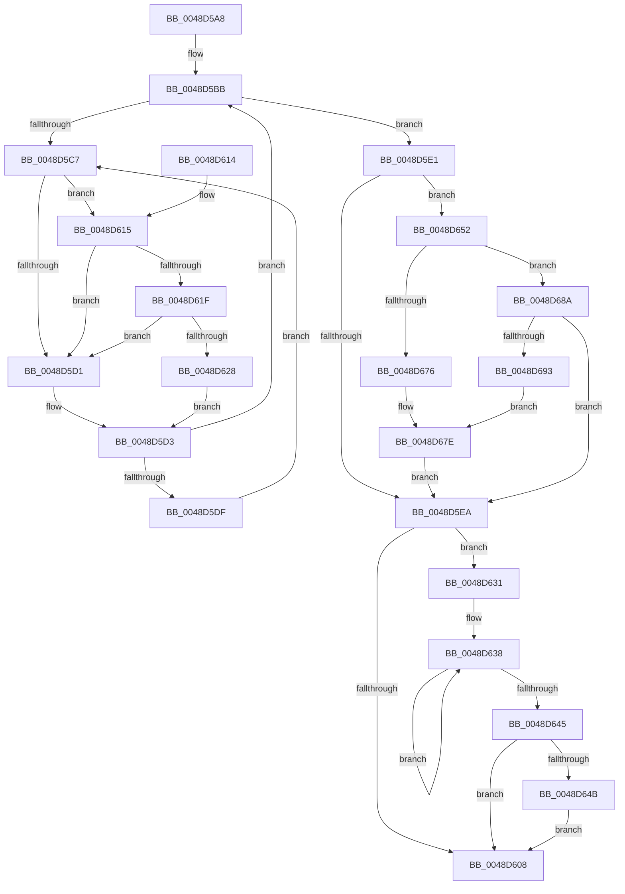

# KeSetForceIdle

- RVA: `0x0048D5A8`–`0x0048D695` (길이 `237` bytes)
- VA: `0x000000014048D5A8`
- 실행 섹션: `.text`
- PDB 이름 있음: `예`; PDB Function 태그: `아니요`
- unwind 정보 RVA: `0x000B1444`
- 디코드: `63`개 명령, `237/237` bytes 표시
- 미해석 바이트: `0` (있으면 어셈블리에 `.byte`로 보존)

> 이 문서는 커널 이미지의 기계어와 PDB 기호를 분석해 생성했습니다. 4번과 5번은 함수 원형과 자료형을 바이너리 사용 방식에서 추정한 C 해석이며 원본 소스 복구 결과는 아닙니다.

## 1. Dependencies

- 직접 호출 지점: **5**; 고유 호출 대상: **5**
- 직접 호출자로 확인된 함수: **1**
- RIP 상대 이미지 참조: **8**

### Outgoing calls
- `0x0048D61F` → [KiCheckVpBackingLongSpinWaitHypercall](../30/KiCheckVpBackingLongSpinWaitHypercall_function_0030F490.md) (function, `0x0030F490`)
- `0x0048D62A` → [HvlNotifyLongSpinWait](../30/HvlNotifyLongSpinWait_function_0030F460.md) (function, `0x0030F460`)
- `0x0048D64B` → [KiRemoveSystemWorkPriorityKick](../26/KiRemoveSystemWorkPriorityKick_function_002631D0.md) (function, `0x002631D0`)
- `0x0048D65D` → [RtlGetInterruptTimePrecise](../20/RtlGetInterruptTimePrecise_function_0020A4C0.md) (function, `0x0020A4C0`)
- `0x0048D679` → [KiSetForceIdleState](KiSetForceIdleState_function_0048DCC0.md) (function, `0x0048DCC0`)

### Direct callers
- [PopDeepSleepClearDisengageReason](../39/PopDeepSleepClearDisengageReason_function_0039010C.md) at `0x003901BC`

### Static image references
- `0x0048D5BB` → RVA `0x00F23140` (`.data`; read/write)
- `0x0048D5C9` → RVA `0x00FC52AC` (`ALMOSTRO`; reference)
- `0x0048D5D3` → RVA `0x00F23140` (`.data`; read)
- `0x0048D5E1` → RVA `0x00FC6FF0` (`ALMOSTRO`; read)
- `0x0048D615` → RVA `0x00FC6AB8` (`ALMOSTRO`; read)
- `0x0048D652` → RVA `0x00F233CC` (`.data`; read)
- `0x0048D662` → RVA `0x00FC51BC` (`ALMOSTRO`; read)
- `0x0048D67E` → RVA `0x00F23148` (`.data`; write)

## 2. Other-region calls and transfers

- 다른 실행 섹션으로 향하는 call: **0**
- 별도 외부 분기/꼬리 이동을 확인하지 못했습니다.

## 3. Assembly (complete function range)

```asm
0048D5A8  48 89 5C 24 10                  mov qword ptr [rsp + 0x10], rbx
0048D5AD  57                              push rdi
0048D5AE  48 83 EC 20                     sub rsp, 0x20
0048D5B2  48 83 64 24 30 00               and qword ptr [rsp + 0x30], 0
0048D5B8  FA                              cli
0048D5B9  33 DB                           xor ebx, ebx
0048D5BB  F0 48 0F BA 2D 7B 5B A9 00 00   lock bts qword ptr [rip + 0xa95b7b], 0
0048D5C5  73 1A                           jae 0x14048d5e1
0048D5C7  FF C3                           inc ebx
0048D5C9  85 1D DD 7C B3 00               test dword ptr [rip + 0xb37cdd], ebx
0048D5CF  74 44                           je 0x14048d615
0048D5D1  F3 90                           pause
0048D5D3  48 8B 05 66 5B A9 00            mov rax, qword ptr [rip + 0xa95b66]
0048D5DA  48 85 C0                        test rax, rax
0048D5DD  74 DC                           je 0x14048d5bb
0048D5DF  EB E6                           jmp 0x14048d5c7
0048D5E1  83 3D 08 9A B3 00 00            cmp dword ptr [rip + 0xb39a08], 0
0048D5E8  74 68                           je 0x14048d652
0048D5EA  F0 48 83 25 4D 5B A9 00 00      lock and qword ptr [rip + 0xa95b4d], 0
0048D5F3  65 48 8B 0C 25 20 00 00 00      mov rcx, qword ptr gs:[0x20]
0048D5FC  4C 8B 81 B8 8E 00 00            mov r8, qword ptr [rcx + 0x8eb8]
0048D603  4D 85 C0                        test r8, r8
0048D606  75 29                           jne 0x14048d631
0048D608  FB                              sti
0048D609  48 8B 5C 24 38                  mov rbx, qword ptr [rsp + 0x38]
0048D60E  48 83 C4 20                     add rsp, 0x20
0048D612  5F                              pop rdi
0048D613  C3                              ret
0048D614  CC                              int3
0048D615  8B 05 9D 94 B3 00               mov eax, dword ptr [rip + 0xb3949d]
0048D61B  A8 40                           test al, 0x40
0048D61D  74 B2                           je 0x14048d5d1
0048D61F  E8 6C 1E E8 FF                  call 0x14030f490
0048D624  84 C0                           test al, al
0048D626  74 A9                           je 0x14048d5d1
0048D628  8B CB                           mov ecx, ebx
0048D62A  E8 31 1E E8 FF                  call 0x14030f460
0048D62F  EB A2                           jmp 0x14048d5d3
0048D631  41 0F 0D 08                     prefetchw byte ptr [r8]
0048D635  41 8B 00                        mov eax, dword ptr [r8]
0048D638  8B D0                           mov edx, eax
0048D63A  0F BA F2 15                     btr edx, 0x15
0048D63E  F0 41 0F B1 10                  lock cmpxchg dword ptr [r8], edx
0048D643  75 F3                           jne 0x14048d638
0048D645  0F BA E0 15                     bt eax, 0x15
0048D649  73 BD                           jae 0x14048d608
0048D64B  E8 80 5B DD FF                  call 0x1402631d0
0048D650  EB B6                           jmp 0x14048d608
0048D652  8B 3D 74 5D A9 00               mov edi, dword ptr [rip + 0xa95d74]
0048D658  48 8D 4C 24 30                  lea rcx, [rsp + 0x30]
0048D65D  E8 5E CE D7 FF                  call 0x14020a4c0
0048D662  8B 0D 54 7B B3 00               mov ecx, dword ptr [rip + 0xb37b54]
0048D668  48 69 D9 80 96 98 00            imul rbx, rcx, 0x989680
0048D66F  48 03 D8                        add rbx, rax
0048D672  85 FF                           test edi, edi
0048D674  75 14                           jne 0x14048d68a
0048D676  8D 4F 02                        lea ecx, [rdi + 2]
0048D679  E8 42 06 00 00                  call 0x14048dcc0
0048D67E  48 89 1D C3 5A A9 00            mov qword ptr [rip + 0xa95ac3], rbx
0048D685  E9 60 FF FF FF                  jmp 0x14048d5ea
0048D68A  83 FF 03                        cmp edi, 3
0048D68D  0F 85 57 FF FF FF               jne 0x14048d5ea
0048D693  EB E9                           jmp 0x14048d67e
```

## 4. C-style interpretation (structured pseudocode)

```c
__int64 __fastcall KeSetForceIdle(void)
{
    __int64 result;
    __int64 v_rbx;
    __int64 v_rsp;
    unsigned __int64 v_stack_p10;
    unsigned __int64 v_stack_p30;
    unsigned __int64 v_stack_p8;

    v_stack_p10 = v_rbx;
    v_rsp = (v_rsp) - (32);
    v_rbx = 0;
loc_0048D5BB:
    if (condition_is_above_or_equal) goto loc_0048D5E1;
loc_0048D5C7:
    v_rbx = (unsigned int)((v_rbx) + 1);
    if (((*(unsigned int *)(v_rip + 11762909)) & ((unsigned int)(v_rbx))) == 0) goto loc_0048D615;
loc_0048D5D1:
loc_0048D5D3:
    if (*(unsigned __int64 *)(v_rip + 11098982) == 0) goto loc_0048D5BB;
    goto loc_0048D5C7;
loc_0048D5E1:
    if ((*(unsigned int *)(v_rip + 11770376)) == 0) goto loc_0048D652;
loc_0048D5EA:
    if (*(unsigned __int64 *)(*(unsigned __int64 *)(gs_base + (0 + 32)) + 36536) != 0) goto loc_0048D631;
loc_0048D608:
    v_rsp = (v_rsp) + (32);
    return *(unsigned __int64 *)(v_rip + 11098982);
loc_0048D615:
    if ((((unsigned __int8)((unsigned int)(*(unsigned int *)(v_rip + 11768989)))) & (64)) == 0) goto loc_0048D5D1;
    result = KiCheckVpBackingLongSpinWaitHypercall(*(unsigned __int64 *)(gs_base + (0 + 32)), a2, *(unsigned __int64 *)(*(unsigned __int64 *)(gs_base + (0 + 32)) + 36536), a4);
    if ((unsigned __int8)(result) == 0) goto loc_0048D5D1;
    result = HvlNotifyLongSpinWait((unsigned int)((unsigned int)(v_stack_p10)), a2, *(unsigned __int64 *)(*(unsigned __int64 *)(gs_base + (0 + 32)) + 36536), a4);
    goto loc_0048D5D3;
loc_0048D631:
loc_0048D638:
    if ((unsigned __int8)(result) != 0) goto loc_0048D638;
    if (condition_is_above_or_equal) goto loc_0048D608;
    result = KiRemoveSystemWorkPriorityKick((unsigned int)((unsigned int)(v_stack_p10)), (unsigned int)((unsigned int)((unsigned int)(*(unsigned int *)(*(unsigned __int64 *)(*(unsigned __int64 *)(gs_base + (0 + 32)) + 36536))))), *(unsigned __int64 *)(*(unsigned __int64 *)(gs_base + (0 + 32)) + 36536), a4);
    goto loc_0048D608;
loc_0048D652:
    result = RtlGetInterruptTimePrecise(v_stack_p30, (unsigned int)((unsigned int)((unsigned int)(*(unsigned int *)(*(unsigned __int64 *)(*(unsigned __int64 *)(gs_base + (0 + 32)) + 36536))))), *(unsigned __int64 *)(*(unsigned __int64 *)(gs_base + (0 + 32)) + 36536), a4);
    v_rbx = (v_stack_p10) * ((unsigned int)(*(unsigned int *)(v_rip + 11762516)));
    v_rbx = (v_rbx) + (result);
    if ((unsigned int)((unsigned int)(*(unsigned int *)(v_rip + 11099508))) != 0) goto loc_0048D68A;
    result = KiSetForceIdleState((unsigned int)(*(unsigned int *)(v_rip + 11099508)) + 2, (unsigned int)((unsigned int)((unsigned int)(*(unsigned int *)(*(unsigned __int64 *)(*(unsigned __int64 *)(gs_base + (0 + 32)) + 36536))))), *(unsigned __int64 *)(*(unsigned __int64 *)(gs_base + (0 + 32)) + 36536), a4);
loc_0048D67E:
    *(unsigned __int64 *)(v_rip + 11098819) = v_rbx;
    goto loc_0048D5EA;
loc_0048D68A:
    if (((unsigned int)((unsigned int)(*(unsigned int *)(v_rip + 11099508)))) != 3) goto loc_0048D5EA;
    goto loc_0048D67E;
}
```

## 5. (Beta) C Style

```c
void KeSetForceIdle(void)
{
    int64_t result;
    int64_t local_rbx;
    int64_t local_rsp;
    uint64_t v_stack_p10;
    uint64_t v_stack_p30;
    uint64_t v_stack_p8;

    v_stack_p10 = local_rbx;
    local_rsp = (local_rsp) - (32);
    local_rbx = 0;
loc_0048D5BB:
    if (condition_is_above_or_equal) goto loc_0048D5E1;
loc_0048D5C7:
    local_rbx = (uint32_t)((local_rbx) + 1);
    if (((*(uint32_t *)(v_rip + 0xB37CDD)) & ((uint32_t)(local_rbx))) == 0) goto loc_0048D615;
loc_0048D5D1:
loc_0048D5D3:
    if (*(uint64_t *)(v_rip + 0xA95B66) == 0) goto loc_0048D5BB;
    goto loc_0048D5C7;
loc_0048D5E1:
    if ((*(uint32_t *)(v_rip + 0xB39A08)) == 0) goto loc_0048D652;
loc_0048D5EA:
    if (*(uint64_t *)(*(uint64_t *)(gs_base + (0 + 0x20)) + 0x8EB8) != 0) goto loc_0048D631;
loc_0048D608:
    local_rsp = (local_rsp) + (32);
    return *(uint64_t *)(v_rip + 0xA95B66);
loc_0048D615:
    if ((((uint8_t)((uint32_t)(*(uint32_t *)(v_rip + 0xB3949D)))) & (64)) == 0) goto loc_0048D5D1;
    result = KiCheckVpBackingLongSpinWaitHypercall(*(uint64_t *)(gs_base + (0 + 0x20)), a2, *(uint64_t *)(*(uint64_t *)(gs_base + (0 + 0x20)) + 0x8EB8), a4);
    if ((uint8_t)(result) == 0) goto loc_0048D5D1;
    result = HvlNotifyLongSpinWait((uint32_t)((uint32_t)(v_stack_p10)), a2, *(uint64_t *)(*(uint64_t *)(gs_base + (0 + 0x20)) + 0x8EB8), a4);
    goto loc_0048D5D3;
loc_0048D631:
loc_0048D638:
    if ((uint8_t)(result) != 0) goto loc_0048D638;
    if (condition_is_above_or_equal) goto loc_0048D608;
    result = KiRemoveSystemWorkPriorityKick((uint32_t)((uint32_t)(v_stack_p10)), (uint32_t)((uint32_t)((uint32_t)(*(uint32_t *)(*(uint64_t *)(*(uint64_t *)(gs_base + (0 + 0x20)) + 0x8EB8))))), *(uint64_t *)(*(uint64_t *)(gs_base + (0 + 0x20)) + 0x8EB8), a4);
    goto loc_0048D608;
loc_0048D652:
    result = RtlGetInterruptTimePrecise(v_stack_p30, (uint32_t)((uint32_t)((uint32_t)(*(uint32_t *)(*(uint64_t *)(*(uint64_t *)(gs_base + (0 + 0x20)) + 0x8EB8))))), *(uint64_t *)(*(uint64_t *)(gs_base + (0 + 0x20)) + 0x8EB8), a4);
    local_rbx = (v_stack_p10) * ((uint32_t)(*(uint32_t *)(v_rip + 0xB37B54)));
    local_rbx = (local_rbx) + (result);
    if ((uint32_t)((uint32_t)(*(uint32_t *)(v_rip + 0xA95D74))) != 0) goto loc_0048D68A;
    result = KiSetForceIdleState((uint32_t)(*(uint32_t *)(v_rip + 0xA95D74)) + 2, (uint32_t)((uint32_t)((uint32_t)(*(uint32_t *)(*(uint64_t *)(*(uint64_t *)(gs_base + (0 + 0x20)) + 0x8EB8))))), *(uint64_t *)(*(uint64_t *)(gs_base + (0 + 0x20)) + 0x8EB8), a4);
loc_0048D67E:
    *(uint64_t *)(v_rip + 0xA95AC3) = local_rbx;
    goto loc_0048D5EA;
loc_0048D68A:
    if (((uint32_t)((uint32_t)(*(uint32_t *)(v_rip + 0xA95D74)))) != 3) goto loc_0048D5EA;
    goto loc_0048D67E;
}
```

## 6. Execution-region graph

[열기: 2D/3D 그래프와 함수 탐색 컨트롤 패널](../../../control-panel.html?section=text&rva=0x0048D5A8&view=graph)

- 2D 그래프는 위에서 아래로 흐르고, 3D 그래프는 빈 공간을 드래그해 회전합니다. Shift+드래그는 이동, 휠은 확대·축소, 함수 노드 선택은 대상 보고서 이동입니다.

### Static fallback


