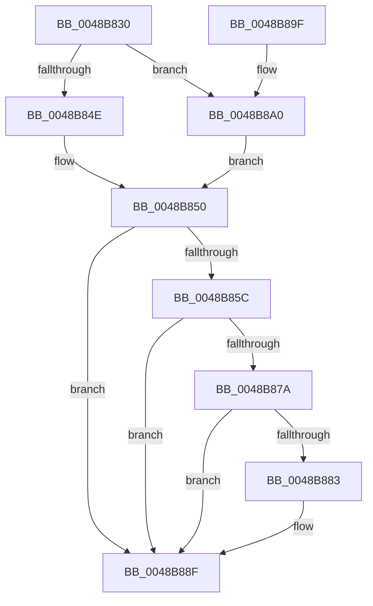

# KeSetTargetProcessorDpc

- RVA: `0x0048B830`–`0x0048B8AC` (길이 `124` bytes)
- VA: `0x000000014048B830`
- 실행 섹션: `.text`
- PDB 이름 있음: `예`; PDB Function 태그: `아니요`
- unwind 정보 RVA: `0x000B09D0`
- 디코드: `35`개 명령, `124/124` bytes 표시
- 미해석 바이트: `0` (있으면 어셈블리에 `.byte`로 보존)

> 이 문서는 커널 이미지의 기계어와 PDB 기호를 분석해 생성했습니다. 4번과 5번은 함수 원형과 자료형을 바이너리 사용 방식에서 추정한 C 해석이며 원본 소스 복구 결과는 아닙니다.

## 1. Dependencies

- 직접 호출 지점: **2**; 고유 호출 대상: **2**
- 직접 호출자로 확인된 함수: **0**
- RIP 상대 이미지 참조: **2**

### Outgoing calls
- `0x0048B853` → [KeQueryActiveProcessorCountEx](../24/KeQueryActiveProcessorCountEx_function_00249EF0.md) (function, `0x00249EF0`)
- `0x0048B870` → [KeGetProcessorIndexFromNumber](../2D/KeGetProcessorIndexFromNumber_function_002DD2D0.md) (function, `0x002DD2D0`)

### Direct callers
- 이 함수 시작 RVA로 연결되는 직접 call은 확인되지 않았습니다. 간접 호출은 완전히 역산할 수 없습니다.

### Static image references
- `0x0048B83F` → RVA `0x00FC6AF2` (`ALMOSTRO`; read)
- `0x0048B8A0` → RVA `0x00FC5018` (`ALMOSTRO`; read)

## 2. Other-region calls and transfers

- 다른 실행 섹션으로 향하는 call: **0**
- 별도 외부 분기/꼬리 이동을 확인하지 못했습니다.

## 3. Assembly (complete function range)

```asm
0048B830  48 89 5C 24 08                  mov qword ptr [rsp + 8], rbx
0048B835  48 89 74 24 18                  mov qword ptr [rsp + 0x18], rsi
0048B83A  57                              push rdi
0048B83B  48 83 EC 20                     sub rsp, 0x20
0048B83F  80 3D AC B2 B3 00 00            cmp byte ptr [rip + 0xb3b2ac], 0
0048B846  48 8B F9                        mov rdi, rcx
0048B849  0F BE F2                        movsx esi, dl
0048B84C  75 52                           jne 0x14048b8a0
0048B84E  33 DB                           xor ebx, ebx
0048B850  0F B7 CB                        movzx ecx, bx
0048B853  E8 98 E6 DB FF                  call 0x140249ef0
0048B858  3B F0                           cmp esi, eax
0048B85A  73 33                           jae 0x14048b88f
0048B85C  48 8D 4C 24 38                  lea rcx, [rsp + 0x38]
0048B861  66 89 5C 24 38                  mov word ptr [rsp + 0x38], bx
0048B866  40 88 74 24 3A                  mov byte ptr [rsp + 0x3a], sil
0048B86B  C6 44 24 3B 00                  mov byte ptr [rsp + 0x3b], 0
0048B870  E8 5B 1A E5 FF                  call 0x1402dd2d0
0048B875  83 F8 FF                        cmp eax, -1
0048B878  74 15                           je 0x14048b88f
0048B87A  48 8B 4F 38                     mov rcx, qword ptr [rdi + 0x38]
0048B87E  48 85 C9                        test rcx, rcx
0048B881  75 0C                           jne 0x14048b88f
0048B883  B9 00 08 00 00                  mov ecx, 0x800
0048B888  66 03 C1                        add ax, cx
0048B88B  66 89 47 02                     mov word ptr [rdi + 2], ax
0048B88F  48 8B 5C 24 30                  mov rbx, qword ptr [rsp + 0x30]
0048B894  48 8B 74 24 40                  mov rsi, qword ptr [rsp + 0x40]
0048B899  48 83 C4 20                     add rsp, 0x20
0048B89D  5F                              pop rdi
0048B89E  C3                              ret
0048B89F  CC                              int3
0048B8A0  0F B7 1D 71 97 B3 00            movzx ebx, word ptr [rip + 0xb39771]
0048B8A7  66 FF CB                        dec bx
0048B8AA  EB A4                           jmp 0x14048b850
```

## 4. C-style interpretation (structured pseudocode)

```c
__int64 __fastcall KeSetTargetProcessorDpc(__int64 a1, unsigned __int8 a2)
{
    __int64 result;
    __int64 v_rbx;
    __int64 v_rsp;
    unsigned __int64 v_stack_p10;
    unsigned __int8 v_stack_p12;
    unsigned __int8 v_stack_p13;
    unsigned __int64 v_stack_p18;
    unsigned __int64 v_stack_p8;

    v_stack_p8 = v_rbx;
    v_stack_p18 = v_rsi;
    v_rsp = (v_rsp) - (32);
    if ((*(unsigned __int8 *)(v_rip + 11776684)) != 0) goto loc_0048B8A0;
    v_rbx = 0;
loc_0048B850:
    result = KeQueryActiveProcessorCountEx(0, a2, a3, a4);
    if (((unsigned int)((__int8)(a2))) >= ((unsigned int)(result))) goto loc_0048B88F;
    v_stack_p10 = 0;
    v_stack_p12 = (unsigned __int8)((__int8)(a2));
    v_stack_p13 = 0;
    result = KeGetProcessorIndexFromNumber(v_stack_p10, a2, a3, a4);
    if (((unsigned int)(result)) == -1) goto loc_0048B88F;
    if (*(unsigned __int64 *)(a1 + 56) == 0) {
        a1 = 0x800ULL;
        result = (unsigned __int16)((result) + ((unsigned __int16)(a1)));
        *(unsigned __int16 *)(a1 + 2) = (unsigned __int16)(result);
    }
    v_rsp = (v_rsp) + (32);
    return result;
loc_0048B8A0:
    v_rbx = (unsigned __int16)((*(unsigned __int16 *)(v_rip + 11769713)) - 1);
    goto loc_0048B850;
}
```

## 5. (Beta) C Style

```c
int64_t KeSetTargetProcessorDpc(void *Arg1, uint8_t Arg2)
{
    uint8_t *arg1 = (uint8_t *)Arg1;

    int64_t result;
    int64_t local_rbx;
    int64_t local_rsp;
    uint64_t v_stack_p10;
    uint8_t v_stack_p12;
    uint8_t v_stack_p13;
    uint64_t v_stack_p18;
    uint64_t v_stack_p8;

    v_stack_p8 = local_rbx;
    v_stack_p18 = local_rsi;
    local_rsp = (local_rsp) - (32);
    if ((*(uint8_t *)(v_rip + 0xB3B2AC)) != 0) goto loc_0048B8A0;
    local_rbx = 0;
loc_0048B850:
    result = KeQueryActiveProcessorCountEx(0, Arg2, a3, a4);
    if (((uint32_t)((int8_t)(Arg2))) >= ((uint32_t)(result))) goto loc_0048B88F;
    v_stack_p10 = 0;
    v_stack_p12 = (uint8_t)((int8_t)(Arg2));
    v_stack_p13 = 0;
    result = KeGetProcessorIndexFromNumber(v_stack_p10, Arg2, a3, a4);
    if (((uint32_t)(result)) == -1) goto loc_0048B88F;
    if (*(uint64_t *)(arg1 + 0x38) == 0) {
        Arg1 = 0x800ULL;
        result = (uint16_t)((result) + ((uint16_t)(Arg1)));
        *(uint16_t *)(arg1 + 0x2) = (uint16_t)(result);
    }
    local_rsp = (local_rsp) + (32);
    return result;
loc_0048B8A0:
    local_rbx = (uint16_t)((*(uint16_t *)(v_rip + 0xB39771)) - 1);
    goto loc_0048B850;
}
```

### 관측된 메모리 오프셋

구조체 형식이 확인되지 않은 접근은 인자 기준의 오프셋으로만 기록했습니다.

| 기준 인자 | 오프셋 표현 | 폭 (bit) | 접근 |
|---|---:|---:|---|
| `Arg1` | `+ 0x2` | `16` | `W` |
| `Arg1` | `+ 0x38` | `64` | `R` |

## 6. Execution-region graph

[열기: 2D/3D 그래프와 함수 탐색 컨트롤 패널](../../../control-panel.html?section=text&rva=0x0048B830&view=graph)

- 2D 그래프는 위에서 아래로 흐르고, 3D 그래프는 빈 공간을 드래그해 회전합니다. Shift+드래그는 이동, 휠은 확대·축소, 함수 노드 선택은 대상 보고서 이동입니다.

### Static fallback


