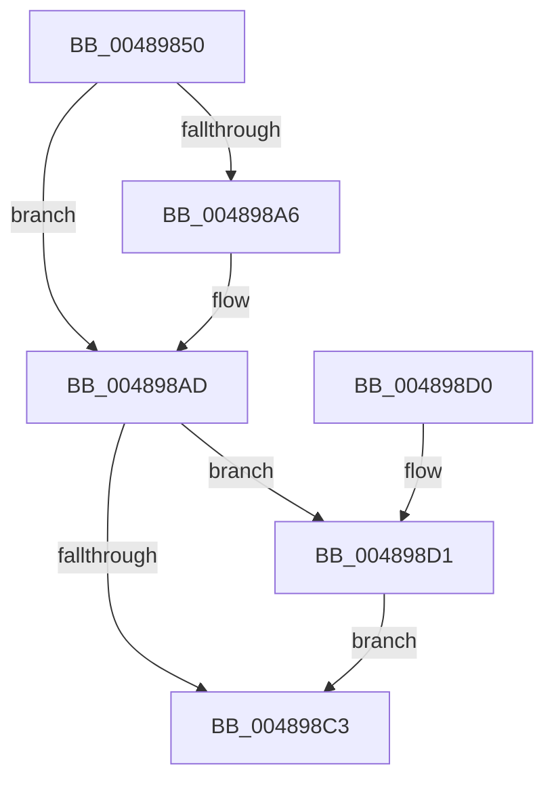

# KiAcquireInterruptConnectLock

- RVA: `0x00489850`–`0x004898DA` (길이 `138` bytes)
- VA: `0x0000000140489850`
- 실행 섹션: `.text`
- PDB 이름 있음: `예`; PDB Function 태그: `아니요`
- unwind 정보 RVA: `0x000B0024`
- 디코드: `35`개 명령, `138/138` bytes 표시
- 미해석 바이트: `0` (있으면 어셈블리에 `.byte`로 보존)

> 이 문서는 커널 이미지의 기계어와 PDB 기호를 분석해 생성했습니다. 4번과 5번은 함수 원형과 자료형을 바이너리 사용 방식에서 추정한 C 해석이며 원본 소스 복구 결과는 아닙니다.

## 1. Dependencies

- 직접 호출 지점: **2**; 고유 호출 대상: **2**
- 직접 호출자로 확인된 함수: **1**
- RIP 상대 이미지 참조: **2**

### Outgoing calls
- `0x00489893` → [KeSetSystemGroupAffinityThread](../39/KeSetSystemGroupAffinityThread_function_00399140.md) (function, `0x00399140`)
- `0x004898D3` → [KiRaiseIrqlProcessIrqlFlags](../4F/KiRaiseIrqlProcessIrqlFlags_function_004F56FC.md) (function, `0x004F56FC`)

### Direct callers
- [KeMaskInterrupt](../2D/KeMaskInterrupt_function_002D42FC.md) at `0x002D4477`

### Static image references
- `0x0048985C` → RVA `0x00FC8C40` (`ALMOSTRO`; read)
- `0x004898BA` → RVA `0x00FC6D20` (`ALMOSTRO`; read)

## 2. Other-region calls and transfers

- 다른 실행 섹션으로 향하는 call: **0**
- 별도 외부 분기/꼬리 이동을 확인하지 못했습니다.

## 3. Assembly (complete function range)

```asm
00489850  48 89 5C 24 08                  mov qword ptr [rsp + 8], rbx
00489855  57                              push rdi
00489856  48 83 EC 30                     sub rsp, 0x30
0048985A  8B D9                           mov ebx, ecx
0048985C  4C 8D 0D DD F3 B3 00            lea r9, [rip + 0xb3f3dd]
00489863  0F 57 C0                        xorps xmm0, xmm0
00489866  48 8D 4C 24 20                  lea rcx, [rsp + 0x20]
0048986B  0F 11 44 24 20                  movups xmmword ptr [rsp + 0x20], xmm0
00489870  48 8B FA                        mov rdi, rdx
00489873  49 8B D0                        mov rdx, r8
00489876  4D 8B 0C D9                     mov r9, qword ptr [r9 + rbx*8]
0048987A  41 0F B6 81 D0 00 00 00         movzx eax, byte ptr [r9 + 0xd0]
00489882  66 89 44 24 28                  mov word ptr [rsp + 0x28], ax
00489887  49 8B 81 C8 00 00 00            mov rax, qword ptr [r9 + 0xc8]
0048988E  48 89 44 24 20                  mov qword ptr [rsp + 0x20], rax
00489893  E8 A8 F8 F0 FF                  call 0x140399140
00489898  65 48 8B 04 25 20 00 00 00      mov rax, qword ptr gs:[0x20]
004898A1  3B 58 24                        cmp ebx, dword ptr [rax + 0x24]
004898A4  74 07                           je 0x1404898ad
004898A6  B9 28 00 00 00                  mov ecx, 0x28
004898AB  CD 29                           int 0x29
004898AD  44 0F 20 C3                     mov rbx, cr8
004898B1  BA 0F 00 00 00                  mov edx, 0xf
004898B6  44 0F 22 C2                     mov cr8, rdx
004898BA  83 3D 5F D4 B3 00 00            cmp dword ptr [rip + 0xb3d45f], 0
004898C1  75 0E                           jne 0x1404898d1
004898C3  88 1F                           mov byte ptr [rdi], bl
004898C5  48 8B 5C 24 40                  mov rbx, qword ptr [rsp + 0x40]
004898CA  48 83 C4 30                     add rsp, 0x30
004898CE  5F                              pop rdi
004898CF  C3                              ret
004898D0  CC                              int3
004898D1  8A CB                           mov cl, bl
004898D3  E8 24 BE 06 00                  call 0x1404f56fc
004898D8  EB E9                           jmp 0x1404898c3
```

## 4. C-style interpretation (structured pseudocode)

```c
__int64 __fastcall KiAcquireInterruptConnectLock(int a1, __int64 a2, __int64 a3)
{
    __int64 result;
    __int64 v_rsp;
    unsigned __int16 v_stack_m10;
    unsigned __int64 v_stack_m18;
    unsigned __int64 v_stack_p8;

    v_stack_p8 = v_rbx;
    v_rsp = (v_rsp) - (48);
    v_stack_m18 = v_xmm0;
    v_stack_m10 = (unsigned __int16)(*(unsigned __int8 *)(*(unsigned __int64 *)(v_rip + 11793373 + (unsigned int)(a1) * 8) + 208));
    v_stack_m18 = *(unsigned __int64 *)(*(unsigned __int64 *)(v_rip + 11793373 + (unsigned int)(a1) * 8) + 200);
    result = KeSetSystemGroupAffinityThread(v_stack_m18, a3, a3, *(unsigned __int64 *)(v_rip + 11793373 + (unsigned int)(a1) * 8));
    if (((unsigned int)((unsigned int)(a1))) != (*(unsigned int *)(*(unsigned __int64 *)(gs_base + (0 + 32)) + 36))) {
        a1 = 40;
    }
    if ((*(unsigned int *)(v_rip + 11785311)) != 0) goto loc_004898D1;
loc_004898C3:
    *(unsigned __int8 *)(a2) = (unsigned __int8)(v_cr8);
    v_rsp = (v_rsp) + (48);
    return *(unsigned __int64 *)(gs_base + (0 + 32));
loc_004898D1:
    result = KiRaiseIrqlProcessIrqlFlags((unsigned __int8)(v_stack_p8), 15, a3, *(unsigned __int64 *)(v_rip + 11793373 + (unsigned int)(a1) * 8));
    goto loc_004898C3;
}
```

## 5. (Beta) C Style

```c
int64_t KiAcquireInterruptConnectLock(int32_t Arg1, void *Arg2, int64_t Arg3)
{
    uint8_t *arg2 = (uint8_t *)Arg2;

    int64_t result;
    int64_t local_rsp;
    uint16_t v_stack_m10;
    uint64_t v_stack_m18;
    uint64_t v_stack_p8;

    v_stack_p8 = local_rbx;
    local_rsp = (local_rsp) - (48);
    v_stack_m18 = v_xmm0;
    v_stack_m10 = (uint16_t)(*(uint8_t *)(*(uint64_t *)(v_rip + 0xB3F3DD + (uint32_t)(Arg1) * 8) + 0xD0));
    v_stack_m18 = *(uint64_t *)(*(uint64_t *)(v_rip + 0xB3F3DD + (uint32_t)(Arg1) * 8) + 0xC8);
    result = KeSetSystemGroupAffinityThread(v_stack_m18, Arg3, Arg3, *(uint64_t *)(v_rip + 0xB3F3DD + (uint32_t)(Arg1) * 8));
    if (((uint32_t)((uint32_t)(Arg1))) != (*(uint32_t *)(*(uint64_t *)(gs_base + (0 + 0x20)) + 0x24))) {
        Arg1 = 40;
    }
    if ((*(uint32_t *)(v_rip + 0xB3D45F)) != 0) goto loc_004898D1;
loc_004898C3:
    *(uint8_t *)(arg2) = (uint8_t)(v_cr8);
    local_rsp = (local_rsp) + (48);
    return *(uint64_t *)(gs_base + (0 + 0x20));
loc_004898D1:
    result = KiRaiseIrqlProcessIrqlFlags((uint8_t)(v_stack_p8), 15, Arg3, *(uint64_t *)(v_rip + 0xB3F3DD + (uint32_t)(Arg1) * 8));
    goto loc_004898C3;
}
```

### 관측된 메모리 오프셋

구조체 형식이 확인되지 않은 접근은 인자 기준의 오프셋으로만 기록했습니다.

| 기준 인자 | 오프셋 표현 | 폭 (bit) | 접근 |
|---|---:|---:|---|
| `Arg2` | `+ 0x0` | `8` | `W` |

## 6. Execution-region graph

[열기: 2D/3D 그래프와 함수 탐색 컨트롤 패널](../../../control-panel.html?section=text&rva=0x00489850&view=graph)

- 2D 그래프는 위에서 아래로 흐르고, 3D 그래프는 빈 공간을 드래그해 회전합니다. Shift+드래그는 이동, 휠은 확대·축소, 함수 노드 선택은 대상 보고서 이동입니다.

### Static fallback


