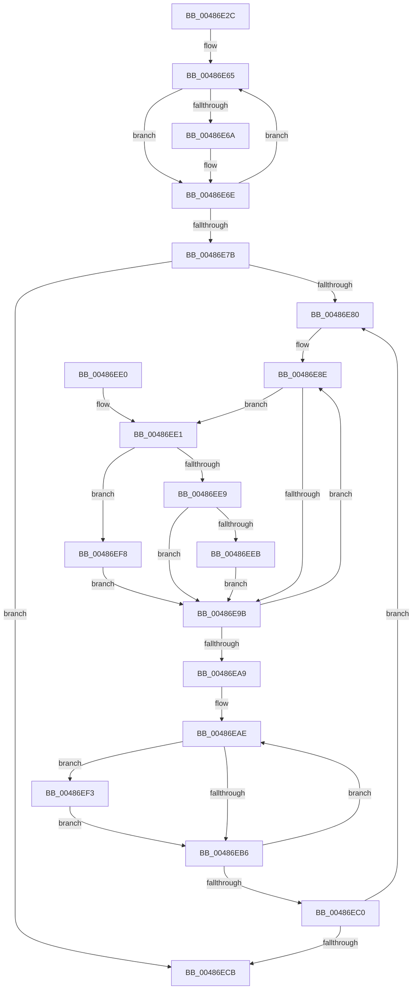

# KiCompressSoftParkRankList

- RVA: `0x00486E2C`–`0x00486EFE` (길이 `210` bytes)
- VA: `0x0000000140486E2C`
- 실행 섹션: `.text`
- PDB 이름 있음: `예`; PDB Function 태그: `아니요`
- unwind 정보 RVA: `0x0008EBC0`
- 디코드: `69`개 명령, `210/210` bytes 표시
- 미해석 바이트: `0` (있으면 어셈블리에 `.byte`로 보존)

> 이 문서는 커널 이미지의 기계어와 PDB 기호를 분석해 생성했습니다. 4번과 5번은 함수 원형과 자료형을 바이너리 사용 방식에서 추정한 C 해석이며 원본 소스 복구 결과는 아닙니다.

## 1. Dependencies

- 직접 호출 지점: **1**; 고유 호출 대상: **1**
- 직접 호출자로 확인된 함수: **1**
- RIP 상대 이미지 참조: **0**

### Outgoing calls
- `0x00486E56` → [memset](../6C/memset_function_006C6C40.md) (function, `0x006C6C40`)

### Direct callers
- [KeUpdateSoftParkRankList](../2D/KeUpdateSoftParkRankList_function_002D5998.md) at `0x002D5ADE`

### Static image references
- 디코드된 RIP-relative 메모리 참조가 없습니다.

## 2. Other-region calls and transfers

- 다른 실행 섹션으로 향하는 call: **0**
- 별도 외부 분기/꼬리 이동을 확인하지 못했습니다.

## 3. Assembly (complete function range)

```asm
00486E2C  48 89 5C 24 08                  mov qword ptr [rsp + 8], rbx
00486E31  48 89 6C 24 10                  mov qword ptr [rsp + 0x10], rbp
00486E36  48 89 74 24 18                  mov qword ptr [rsp + 0x18], rsi
00486E3B  57                              push rdi
00486E3C  48 83 EC 20                     sub rsp, 0x20
00486E40  48 8B F2                        mov rsi, rdx
00486E43  48 8B E9                        mov rbp, rcx
00486E46  48 83 CB FF                     or rbx, 0xffffffffffffffff
00486E4A  BA FF 00 00 00                  mov edx, 0xff
00486E4F  48 8B CE                        mov rcx, rsi
00486E52  44 8D 43 41                     lea r8d, [rbx + 0x41]
00486E56  E8 E5 FD 23 00                  call 0x1406c6c40
00486E5B  45 33 C0                        xor r8d, r8d
00486E5E  44 8D 4B 41                     lea r9d, [rbx + 0x41]
00486E62  48 8B C5                        mov rax, rbp
00486E65  83 38 FF                        cmp dword ptr [rax], -1
00486E68  75 04                           jne 0x140486e6e
00486E6A  4C 0F B3 C3                     btr rbx, r8
00486E6E  49 FF C0                        inc r8
00486E71  48 83 C0 04                     add rax, 4
00486E75  49 83 E9 01                     sub r9, 1
00486E79  75 EA                           jne 0x140486e65
00486E7B  48 85 DB                        test rbx, rbx
00486E7E  74 4B                           je 0x140486ecb
00486E80  41 83 CB FF                     or r11d, 0xffffffff
00486E84  33 D2                           xor edx, edx
00486E86  33 C9                           xor ecx, ecx
00486E88  4C 8B C5                        mov r8, rbp
00486E8B  45 33 D2                        xor r10d, r10d
00486E8E  BF 01 00 00 00                  mov edi, 1
00486E93  48 D3 E7                        shl rdi, cl
00486E96  48 85 FB                        test rbx, rdi
00486E99  75 46                           jne 0x140486ee1
00486E9B  FF C1                           inc ecx
00486E9D  49 FF C2                        inc r10
00486EA0  49 83 C0 04                     add r8, 4
00486EA4  83 F9 40                        cmp ecx, 0x40
00486EA7  72 E5                           jb 0x140486e8e
00486EA9  33 C9                           xor ecx, ecx
00486EAB  4C 8B C6                        mov r8, rsi
00486EAE  8B C1                           mov eax, ecx
00486EB0  48 0F A3 C2                     bt rdx, rax
00486EB4  72 3D                           jb 0x140486ef3
00486EB6  FF C1                           inc ecx
00486EB8  49 FF C0                        inc r8
00486EBB  83 F9 40                        cmp ecx, 0x40
00486EBE  72 EE                           jb 0x140486eae
00486EC0  48 F7 D2                        not rdx
00486EC3  41 FE C1                        inc r9b
00486EC6  48 23 DA                        and rbx, rdx
00486EC9  75 B5                           jne 0x140486e80
00486ECB  48 8B 5C 24 30                  mov rbx, qword ptr [rsp + 0x30]
00486ED0  48 8B 6C 24 38                  mov rbp, qword ptr [rsp + 0x38]
00486ED5  48 8B 74 24 40                  mov rsi, qword ptr [rsp + 0x40]
00486EDA  48 83 C4 20                     add rsp, 0x20
00486EDE  5F                              pop rdi
00486EDF  C3                              ret
00486EE0  CC                              int3
00486EE1  41 8B 00                        mov eax, dword ptr [r8]
00486EE4  41 3B C3                        cmp eax, r11d
00486EE7  74 0F                           je 0x140486ef8
00486EE9  73 B0                           jae 0x140486e9b
00486EEB  48 8B D7                        mov rdx, rdi
00486EEE  44 8B D8                        mov r11d, eax
00486EF1  EB A8                           jmp 0x140486e9b
00486EF3  45 88 08                        mov byte ptr [r8], r9b
00486EF6  EB BE                           jmp 0x140486eb6
00486EF8  4C 0F AB D2                     bts rdx, r10
00486EFC  EB 9D                           jmp 0x140486e9b
```

## 4. C-style interpretation (structured pseudocode)

```c
__int64 __fastcall KiCompressSoftParkRankList(__int64 a1, __int64 a2)
{
    __int64 result;
    __int64 v_r10;
    __int64 v_r11;
    __int64 v_rbx;
    __int64 v_rdi;
    __int64 v_rsp;
    unsigned __int64 v_stack_p10;
    unsigned __int64 v_stack_p18;
    unsigned __int64 v_stack_p8;

    v_stack_p8 = v_rbx;
    v_stack_p10 = v_rbp;
    v_stack_p18 = v_rsi;
    v_rsp = (v_rsp) - (32);
    v_rbx = (v_rbx) | (-1);
    result = memset(a2, 255, v_rbx + 65, a4);
    a3 = 0;
loc_00486E65:
    if ((*(unsigned int *)(a1)) == -1) {
    }
    a3 = (a3) + 1;
    result = (a1) + (4);
    a4 = (v_rbx + 65) - (1);
    if (condition_is_not_equal) goto loc_00486E65;
    if (v_rbx == 0) goto loc_00486ECB;
loc_00486E80:
    v_r11 = (unsigned int)((v_r11) | (0xFFFFFFFFULL));
    a2 = 0;
    a1 = 0;
    v_r10 = 0;
loc_00486E8E:
    v_rdi = (1) << (0);
    if (((v_rbx) & (v_rdi)) != 0) goto loc_00486EE1;
loc_00486E9B:
    a1 = (unsigned int)((a1) + 1);
    v_r10 = (v_r10) + 1;
    a3 = (0) + (4);
    if (((unsigned int)(a1)) < 64) goto loc_00486E8E;
    a1 = 0;
loc_00486EAE:
    if (condition_is_below) goto loc_00486EF3;
loc_00486EB6:
    a1 = (unsigned int)((a1) + 1);
    a3 = (0) + 1;
    if (((unsigned int)(a1)) < 64) goto loc_00486EAE;
    a2 = ~(a2);
    a4 = (unsigned __int8)((a4) + 1);
    v_rbx = (v_rbx) & (a2);
    if (condition_is_not_equal) goto loc_00486E80;
loc_00486ECB:
    v_rsp = (v_rsp) + (32);
    return 0;
loc_00486EE1:
    if (((unsigned int)((unsigned int)(*(unsigned int *)(a3)))) == ((unsigned int)(v_r11))) goto loc_00486EF8;
    if (((unsigned int)((unsigned int)(*(unsigned int *)(a3)))) >= ((unsigned int)(v_r11))) goto loc_00486E9B;
    goto loc_00486E9B;
loc_00486EF3:
    *(unsigned __int8 *)(a3) = (unsigned __int8)(a4);
    goto loc_00486EB6;
loc_00486EF8:
    goto loc_00486E9B;
}
```

## 5. (Beta) C Style

```c
int64_t KiCompressSoftParkRankList(void *Arg1, int64_t Arg2)
{
    uint8_t *arg1 = (uint8_t *)Arg1;

    int64_t result;
    int64_t local_r10;
    int64_t local_r11;
    int64_t local_rbx;
    int64_t local_rdi;
    int64_t local_rsp;
    uint64_t v_stack_p10;
    uint64_t v_stack_p18;
    uint64_t v_stack_p8;

    v_stack_p8 = local_rbx;
    v_stack_p10 = local_rbp;
    v_stack_p18 = local_rsi;
    local_rsp = (local_rsp) - (32);
    local_rbx = (local_rbx) | (-1);
    result = memset(Arg2, 255, local_rbx + 65, a4);
    a3 = 0;
loc_00486E65:
    if ((*(uint32_t *)(arg1)) == -1) {
    }
    a3 = (a3) + 1;
    result = (Arg1) + (4);
    a4 = (local_rbx + 65) - (1);
    if (condition_is_not_equal) goto loc_00486E65;
    if (local_rbx == 0) goto loc_00486ECB;
loc_00486E80:
    local_r11 = (uint32_t)((local_r11) | (0xFFFFFFFFULL));
    Arg2 = 0;
    Arg1 = 0;
    local_r10 = 0;
loc_00486E8E:
    local_rdi = (1) << (0);
    if (((local_rbx) & (local_rdi)) != 0) goto loc_00486EE1;
loc_00486E9B:
    Arg1 = (uint32_t)((Arg1) + 1);
    local_r10 = (local_r10) + 1;
    a3 = (0) + (4);
    if (((uint32_t)(Arg1)) < 64) goto loc_00486E8E;
    Arg1 = 0;
loc_00486EAE:
    if (condition_is_below) goto loc_00486EF3;
loc_00486EB6:
    Arg1 = (uint32_t)((Arg1) + 1);
    a3 = (0) + 1;
    if (((uint32_t)(Arg1)) < 64) goto loc_00486EAE;
    Arg2 = ~(Arg2);
    a4 = (uint8_t)((a4) + 1);
    local_rbx = (local_rbx) & (Arg2);
    if (condition_is_not_equal) goto loc_00486E80;
loc_00486ECB:
    local_rsp = (local_rsp) + (32);
    return 0;
loc_00486EE1:
    if (((uint32_t)((uint32_t)(*(uint32_t *)(a3)))) == ((uint32_t)(local_r11))) goto loc_00486EF8;
    if (((uint32_t)((uint32_t)(*(uint32_t *)(a3)))) >= ((uint32_t)(local_r11))) goto loc_00486E9B;
    goto loc_00486E9B;
loc_00486EF3:
    *(uint8_t *)(a3) = (uint8_t)(a4);
    goto loc_00486EB6;
loc_00486EF8:
    goto loc_00486E9B;
}
```

### 관측된 메모리 오프셋

구조체 형식이 확인되지 않은 접근은 인자 기준의 오프셋으로만 기록했습니다.

| 기준 인자 | 오프셋 표현 | 폭 (bit) | 접근 |
|---|---:|---:|---|
| `Arg1` | `+ 0x0` | `32` | `R` |

## 6. Execution-region graph

[열기: 2D/3D 그래프와 함수 탐색 컨트롤 패널](../../../control-panel.html?section=text&rva=0x00486E2C&view=graph)

- 2D 그래프는 위에서 아래로 흐르고, 3D 그래프는 빈 공간을 드래그해 회전합니다. Shift+드래그는 이동, 휠은 확대·축소, 함수 노드 선택은 대상 보고서 이동입니다.

### Static fallback


