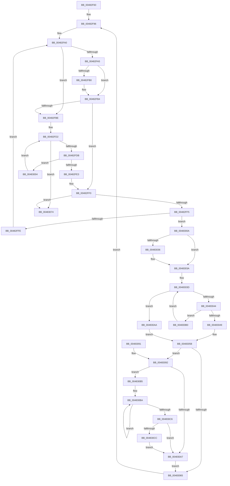

# KiDpcRuntimeHistoryHashTableCleanupDpcRoutine

- RVA: `0x00482F60`–`0x004830D6` (길이 `374` bytes)
- VA: `0x0000000140482F60`
- 실행 섹션: `.text`
- PDB 이름 있음: `예`; PDB Function 태그: `아니요`
- unwind 정보 RVA: `0x000AEEC0`
- 디코드: `109`개 명령, `374/374` bytes 표시
- 미해석 바이트: `0` (있으면 어셈블리에 `.byte`로 보존)

> 이 문서는 커널 이미지의 기계어와 PDB 기호를 분석해 생성했습니다. 4번과 5번은 함수 원형과 자료형을 바이너리 사용 방식에서 추정한 C 해석이며 원본 소스 복구 결과는 아닙니다.

## 1. Dependencies

- 직접 호출 지점: **5**; 고유 호출 대상: **5**
- 직접 호출자로 확인된 함수: **1**
- RIP 상대 이미지 참조: **0**

### Outgoing calls
- `0x0048300A` → [KeDisableInterrupts](../21/KeDisableInterrupts_function_00217BE0.md) (function, `0x00217BE0`)
- `0x0048301C` → [KeAcquireSpinLockAtDpcLevel](../20/KeAcquireSpinLockAtDpcLevel_function_00208430.md) (function, `0x00208430`)
- `0x0048305B` → [KxReleaseSpinLock](../20/KxReleaseSpinLock_function_00206670.md) (function, `0x00206670`)
- `0x0048306A` → [ExFreePoolWithTag](../../poolcode/B8/ExFreePoolWithTag_function_00B82870.md) (function, `0x00B82870`)
- `0x004830CF` → [KiRemoveSystemWorkPriorityKick](../26/KiRemoveSystemWorkPriorityKick_function_002631D0.md) (function, `0x002631D0`)

### Direct callers
- [KiDpcRuntimeHistoryHashTableCleanupTimerCallback](KiDpcRuntimeHistoryHashTableCleanupTimerCallback_function_00482EA0.md) at `0x00482F36`

### Static image references
- 디코드된 RIP-relative 메모리 참조가 없습니다.

## 2. Other-region calls and transfers

- 다른 실행 섹션으로 향하는 call: **1**
  - `0x0048306A` → [ExFreePoolWithTag](../../poolcode/B8/ExFreePoolWithTag_function_00B82870.md) (`.text` → `POOLCODE`)
- 별도 외부 분기/꼬리 이동을 확인하지 못했습니다.

## 3. Assembly (complete function range)

```asm
00482F60  48 89 5C 24 08                  mov qword ptr [rsp + 8], rbx
00482F65  48 89 6C 24 10                  mov qword ptr [rsp + 0x10], rbp
00482F6A  48 89 74 24 18                  mov qword ptr [rsp + 0x18], rsi
00482F6F  57                              push rdi
00482F70  41 54                           push r12
00482F72  41 55                           push r13
00482F74  41 56                           push r14
00482F76  41 57                           push r15
00482F78  48 83 EC 20                     sub rsp, 0x20
00482F7C  65 4C 8B 2C 25 20 00 00 00      mov r13, qword ptr gs:[0x20]
00482F85  45 33 E4                        xor r12d, r12d
00482F88  4D 8B B5 10 38 00 00            mov r14, qword ptr [r13 + 0x3810]
00482F8F  49 8B 7E 08                     mov rdi, qword ptr [r14 + 8]
00482F93  48 8B DF                        mov rbx, rdi
00482F96  48 B9 02 00 00 00 00 00 00 80   movabs rcx, 0x8000000000000002
00482FA0  48 85 DB                        test rbx, rbx
00482FA3  74 19                           je 0x140482fbe
00482FA5  48 8B 03                        mov rax, qword ptr [rbx]
00482FA8  48 23 C1                        and rax, rcx
00482FAB  48 3B C1                        cmp rax, rcx
00482FAE  75 04                           jne 0x140482fb4
00482FB0  49 8B 04 24                     mov rax, qword ptr [r12]
00482FB4  48 8B 03                        mov rax, qword ptr [rbx]
00482FB7  48 8B D8                        mov rbx, rax
00482FBA  A8 01                           test al, 1
00482FBC  74 32                           je 0x140482ff0
00482FBE  41 8B 4E 04                     mov ecx, dword ptr [r14 + 4]
00482FC2  48 83 C7 08                     add rdi, 8
00482FC6  49 8B 46 08                     mov rax, qword ptr [r14 + 8]
00482FCA  48 C1 E9 05                     shr rcx, 5
00482FCE  48 8D 14 C8                     lea rdx, [rax + rcx*8]
00482FD2  48 3B FA                        cmp rdi, rdx
00482FD5  0F 83 99 00 00 00               jae 0x140483074
00482FDB  48 8B 1F                        mov rbx, qword ptr [rdi]
00482FDE  F6 C3 01                        test bl, 1
00482FE1  75 21                           jne 0x140483004
00482FE3  48 8B C3                        mov rax, rbx
00482FE6  48 B9 02 00 00 00 00 00 00 80   movabs rcx, 0x8000000000000002
00482FF0  48 85 C0                        test rax, rax
00482FF3  74 7F                           je 0x140483074
00482FF5  4C 8B FB                        mov r15, rbx
00482FF8  44 38 63 18                     cmp byte ptr [rbx + 0x18], r12b
00482FFC  74 0C                           je 0x14048300a
00482FFE  44 88 63 18                     mov byte ptr [rbx + 0x18], r12b
00483002  EB 9C                           jmp 0x140482fa0
00483004  48 83 C7 08                     add rdi, 8
00483008  EB C8                           jmp 0x140482fd2
0048300A  E8 D1 4B D9 FF                  call 0x140217be0
0048300F  49 8D B5 50 38 00 00            lea rsi, [r13 + 0x3850]
00483016  40 8A E8                        mov bpl, al
00483019  48 8B CE                        mov rcx, rsi
0048301C  E8 0F 54 D8 FF                  call 0x140208430
00483021  48 8B 0B                        mov rcx, qword ptr [rbx]
00483024  48 BA 02 00 00 00 00 00 00 80   movabs rdx, 0x8000000000000002
0048302E  48 23 CA                        and rcx, rdx
00483031  48 3B CA                        cmp rcx, rdx
00483034  75 04                           jne 0x14048303a
00483036  49 8B 0C 24                     mov rcx, qword ptr [r12]
0048303A  48 8B CF                        mov rcx, rdi
0048303D  48 8B 01                        mov rax, qword ptr [rcx]
00483040  A8 01                           test al, 1
00483042  75 66                           jne 0x1404830aa
00483044  48 3B C3                        cmp rax, rbx
00483047  75 67                           jne 0x1404830b0
00483049  48 8B 03                        mov rax, qword ptr [rbx]
0048304C  48 89 01                        mov qword ptr [rcx], rax
0048304F  41 FF 0E                        dec dword ptr [r14]
00483052  48 09 13                        or qword ptr [rbx], rdx
00483055  48 8B D9                        mov rbx, rcx
00483058  48 8B CE                        mov rcx, rsi
0048305B  E8 10 36 D8 FF                  call 0x140206670
00483060  40 84 ED                        test bpl, bpl
00483063  75 2D                           jne 0x140483092
00483065  33 D2                           xor edx, edx
00483067  49 8B CF                        mov rcx, r15
0048306A  E8 01 F8 6F 00                  call 0x140b82870
0048306F  E9 22 FF FF FF                  jmp 0x140482f96
00483074  48 8B 5C 24 50                  mov rbx, qword ptr [rsp + 0x50]
00483079  48 8B 6C 24 58                  mov rbp, qword ptr [rsp + 0x58]
0048307E  48 8B 74 24 60                  mov rsi, qword ptr [rsp + 0x60]
00483083  48 83 C4 20                     add rsp, 0x20
00483087  41 5F                           pop r15
00483089  41 5E                           pop r14
0048308B  41 5D                           pop r13
0048308D  41 5C                           pop r12
0048308F  5F                              pop rdi
00483090  C3                              ret
00483091  CC                              int3
00483092  65 4C 8B 04 25 20 00 00 00      mov r8, qword ptr gs:[0x20]
0048309B  49 8B 90 B8 8E 00 00            mov rdx, qword ptr [r8 + 0x8eb8]
004830A2  48 85 D2                        test rdx, rdx
004830A5  75 0E                           jne 0x1404830b5
004830A7  FB                              sti
004830A8  EB BB                           jmp 0x140483065
004830AA  49 8B 04 24                     mov rax, qword ptr [r12]
004830AE  EB A8                           jmp 0x140483058
004830B0  48 8B C8                        mov rcx, rax
004830B3  EB 88                           jmp 0x14048303d
004830B5  0F 0D 0A                        prefetchw byte ptr [rdx]
004830B8  8B 02                           mov eax, dword ptr [rdx]
004830BA  8B C8                           mov ecx, eax
004830BC  0F BA F1 15                     btr ecx, 0x15
004830C0  F0 0F B1 0A                     lock cmpxchg dword ptr [rdx], ecx
004830C4  75 F4                           jne 0x1404830ba
004830C6  0F BA E0 15                     bt eax, 0x15
004830CA  73 DB                           jae 0x1404830a7
004830CC  49 8B C8                        mov rcx, r8
004830CF  E8 FC 00 DE FF                  call 0x1402631d0
004830D4  EB D1                           jmp 0x1404830a7
```

## 4. C-style interpretation (structured pseudocode)

```c
__int64 __fastcall KiDpcRuntimeHistoryHashTableCleanupDpcRoutine(void)
{
    __int64 result;
    __int64 v_r12;
    __int64 v_rdi;
    __int64 v_rsp;
    unsigned __int64 v_stack_p10;
    unsigned __int64 v_stack_p18;
    unsigned __int64 v_stack_p8;

    v_stack_p8 = v_rbx;
    v_stack_p10 = v_rbp;
    v_stack_p18 = v_rsi;
    v_rsp = (v_rsp) - (32);
    v_r12 = 0;
loc_00482F96:
loc_00482FA0:
    if (*(unsigned __int64 *)(*(unsigned __int64 *)(*(unsigned __int64 *)(gs_base + (0 + 32)) + 14352) + 8) == 0) goto loc_00482FBE;
    result = (*(unsigned __int64 *)(*(unsigned __int64 *)(*(unsigned __int64 *)(*(unsigned __int64 *)(gs_base + (0 + 32)) + 14352) + 8))) & (a1);
    if (result == a1) {
        result = *(unsigned __int64 *)(v_r12);
    }
    if ((((unsigned __int8)(*(unsigned __int64 *)(*(unsigned __int64 *)(*(unsigned __int64 *)(*(unsigned __int64 *)(gs_base + (0 + 32)) + 14352) + 8)))) & (1)) == 0) goto loc_00482FF0;
loc_00482FBE:
    v_rdi = (*(unsigned __int64 *)(*(unsigned __int64 *)(*(unsigned __int64 *)(gs_base + (0 + 32)) + 14352) + 8)) + (8);
    a1 = ((unsigned int)(*(unsigned int *)(*(unsigned __int64 *)(*(unsigned __int64 *)(gs_base + (0 + 32)) + 14352) + 4))) >> (5);
loc_00482FD2:
    if (v_rdi >= (*(unsigned __int64 *)(*(unsigned __int64 *)(*(unsigned __int64 *)(gs_base + (0 + 32)) + 14352) + 8) + a1 * 8)) goto loc_00483074;
    if ((((unsigned __int8)(*(unsigned __int64 *)(v_rdi))) & (1)) != 0) goto loc_00483004;
loc_00482FF0:
    if (*(unsigned __int64 *)(v_rdi) == 0) goto loc_00483074;
    if ((*(unsigned __int8 *)(*(unsigned __int64 *)(v_rdi) + 24)) == 0) goto loc_0048300A;
    *(unsigned __int8 *)(*(unsigned __int64 *)(v_rdi) + 24) = 0;
    goto loc_00482FA0;
loc_00483004:
    v_rdi = (v_rdi) + (8);
    goto loc_00482FD2;
loc_0048300A:
    result = KeDisableInterrupts(a1, *(unsigned __int64 *)(*(unsigned __int64 *)(*(unsigned __int64 *)(gs_base + (0 + 32)) + 14352) + 8) + a1 * 8, a3, a4);
    result = KeAcquireSpinLockAtDpcLevel(*(unsigned __int64 *)(gs_base + (0 + 32)) + 14416, *(unsigned __int64 *)(*(unsigned __int64 *)(*(unsigned __int64 *)(gs_base + (0 + 32)) + 14352) + 8) + a1 * 8, a3, a4);
    a1 = (*(unsigned __int64 *)(*(unsigned __int64 *)(v_rdi))) & (*(unsigned __int64 *)(*(unsigned __int64 *)(*(unsigned __int64 *)(gs_base + (0 + 32)) + 14352) + 8) + a1 * 8);
    if (a1 == (*(unsigned __int64 *)(*(unsigned __int64 *)(*(unsigned __int64 *)(gs_base + (0 + 32)) + 14352) + 8) + a1 * 8)) {
        a1 = *(unsigned __int64 *)(v_r12);
    }
loc_0048303D:
    if ((((unsigned __int8)(*(unsigned __int64 *)(v_rdi))) & (1)) != 0) goto loc_004830AA;
    if ((*(unsigned __int64 *)(v_rdi)) != (*(unsigned __int64 *)(v_rdi))) goto loc_004830B0;
    *(unsigned __int64 *)(v_rdi) = *(unsigned __int64 *)(*(unsigned __int64 *)(v_rdi));
loc_00483058:
    result = KxReleaseSpinLock(*(unsigned __int64 *)(gs_base + (0 + 32)) + 14416, *(unsigned __int64 *)(*(unsigned __int64 *)(*(unsigned __int64 *)(gs_base + (0 + 32)) + 14352) + 8) + a1 * 8, a3, a4);
    if ((unsigned __int8)((unsigned __int8)(result)) != 0) goto loc_00483092;
loc_00483065:
    a2 = 0;
    result = ExFreePoolWithTag(*(unsigned __int64 *)(v_rdi), a2, a3, a4);
    goto loc_00482F96;
loc_00483074:
    v_rsp = (v_rsp) + (32);
    return result;
loc_00483092:
    if (*(unsigned __int64 *)(*(unsigned __int64 *)(gs_base + (0 + 32)) + 36536) != 0) goto loc_004830B5;
loc_004830A7:
    goto loc_00483065;
loc_004830AA:
    goto loc_00483058;
loc_004830B0:
    goto loc_0048303D;
loc_004830B5:
loc_004830BA:
    if (*(unsigned __int64 *)(*(unsigned __int64 *)(gs_base + (0 + 32)) + 36536) != 0) goto loc_004830BA;
    if (condition_is_above_or_equal) goto loc_004830A7;
    result = KiRemoveSystemWorkPriorityKick(*(unsigned __int64 *)(gs_base + (0 + 32)), *(unsigned __int64 *)(*(unsigned __int64 *)(gs_base + (0 + 32)) + 36536), *(unsigned __int64 *)(gs_base + (0 + 32)), a4);
    goto loc_004830A7;
}
```

## 5. (Beta) C Style

```c
void KiDpcRuntimeHistoryHashTableCleanupDpcRoutine(void)
{
    int64_t result;
    int64_t local_r12;
    int64_t local_rdi;
    int64_t local_rsp;
    uint64_t v_stack_p10;
    uint64_t v_stack_p18;
    uint64_t v_stack_p8;

    v_stack_p8 = local_rbx;
    v_stack_p10 = local_rbp;
    v_stack_p18 = local_rsi;
    local_rsp = (local_rsp) - (32);
    local_r12 = 0;
loc_00482F96:
loc_00482FA0:
    if (*(uint64_t *)(*(uint64_t *)(*(uint64_t *)(gs_base + (0 + 0x20)) + 0x3810) + 0x8) == 0) goto loc_00482FBE;
    result = (*(uint64_t *)(*(uint64_t *)(*(uint64_t *)(*(uint64_t *)(gs_base + (0 + 0x20)) + 0x3810) + 0x8))) & (a1);
    if (result == a1) {
        result = *(uint64_t *)(local_r12);
    }
    if ((((uint8_t)(*(uint64_t *)(*(uint64_t *)(*(uint64_t *)(*(uint64_t *)(gs_base + (0 + 0x20)) + 0x3810) + 0x8)))) & (1)) == 0) goto loc_00482FF0;
loc_00482FBE:
    local_rdi = (*(uint64_t *)(*(uint64_t *)(*(uint64_t *)(gs_base + (0 + 0x20)) + 0x3810) + 0x8)) + (8);
    a1 = ((uint32_t)(*(uint32_t *)(*(uint64_t *)(*(uint64_t *)(gs_base + (0 + 0x20)) + 0x3810) + 0x4))) >> (5);
loc_00482FD2:
    if (local_rdi >= (*(uint64_t *)(*(uint64_t *)(*(uint64_t *)(gs_base + (0 + 0x20)) + 0x3810) + 0x8) + a1 * 8)) goto loc_00483074;
    if ((((uint8_t)(*(uint64_t *)(local_rdi))) & (1)) != 0) goto loc_00483004;
loc_00482FF0:
    if (*(uint64_t *)(local_rdi) == 0) goto loc_00483074;
    if ((*(uint8_t *)(*(uint64_t *)(local_rdi) + 0x18)) == 0) goto loc_0048300A;
    *(uint8_t *)(*(uint64_t *)(local_rdi) + 0x18) = 0;
    goto loc_00482FA0;
loc_00483004:
    local_rdi = (local_rdi) + (8);
    goto loc_00482FD2;
loc_0048300A:
    result = KeDisableInterrupts(a1, *(uint64_t *)(*(uint64_t *)(*(uint64_t *)(gs_base + (0 + 0x20)) + 0x3810) + 0x8) + a1 * 8, a3, a4);
    result = KeAcquireSpinLockAtDpcLevel(*(uint64_t *)(gs_base + (0 + 0x20)) + 14416, *(uint64_t *)(*(uint64_t *)(*(uint64_t *)(gs_base + (0 + 0x20)) + 0x3810) + 0x8) + a1 * 8, a3, a4);
    a1 = (*(uint64_t *)(*(uint64_t *)(local_rdi))) & (*(uint64_t *)(*(uint64_t *)(*(uint64_t *)(gs_base + (0 + 0x20)) + 0x3810) + 0x8) + a1 * 8);
    if (a1 == (*(uint64_t *)(*(uint64_t *)(*(uint64_t *)(gs_base + (0 + 0x20)) + 0x3810) + 0x8) + a1 * 8)) {
        a1 = *(uint64_t *)(local_r12);
    }
loc_0048303D:
    if ((((uint8_t)(*(uint64_t *)(local_rdi))) & (1)) != 0) goto loc_004830AA;
    if ((*(uint64_t *)(local_rdi)) != (*(uint64_t *)(local_rdi))) goto loc_004830B0;
    *(uint64_t *)(local_rdi) = *(uint64_t *)(*(uint64_t *)(local_rdi));
loc_00483058:
    result = KxReleaseSpinLock(*(uint64_t *)(gs_base + (0 + 0x20)) + 14416, *(uint64_t *)(*(uint64_t *)(*(uint64_t *)(gs_base + (0 + 0x20)) + 0x3810) + 0x8) + a1 * 8, a3, a4);
    if ((uint8_t)((uint8_t)(result)) != 0) goto loc_00483092;
loc_00483065:
    a2 = 0;
    result = ExFreePoolWithTag(*(uint64_t *)(local_rdi), a2, a3, a4);
    goto loc_00482F96;
loc_00483074:
    local_rsp = (local_rsp) + (32);
    return result;
loc_00483092:
    if (*(uint64_t *)(*(uint64_t *)(gs_base + (0 + 0x20)) + 0x8EB8) != 0) goto loc_004830B5;
loc_004830A7:
    goto loc_00483065;
loc_004830AA:
    goto loc_00483058;
loc_004830B0:
    goto loc_0048303D;
loc_004830B5:
loc_004830BA:
    if (*(uint64_t *)(*(uint64_t *)(gs_base + (0 + 0x20)) + 0x8EB8) != 0) goto loc_004830BA;
    if (condition_is_above_or_equal) goto loc_004830A7;
    result = KiRemoveSystemWorkPriorityKick(*(uint64_t *)(gs_base + (0 + 0x20)), *(uint64_t *)(*(uint64_t *)(gs_base + (0 + 0x20)) + 0x8EB8), *(uint64_t *)(gs_base + (0 + 0x20)), a4);
    goto loc_004830A7;
}
```

## 6. Execution-region graph

[열기: 2D/3D 그래프와 함수 탐색 컨트롤 패널](../../../control-panel.html?section=text&rva=0x00482F60&view=graph)

- 2D 그래프는 위에서 아래로 흐르고, 3D 그래프는 빈 공간을 드래그해 회전합니다. Shift+드래그는 이동, 휠은 확대·축소, 함수 노드 선택은 대상 보고서 이동입니다.

### Static fallback


