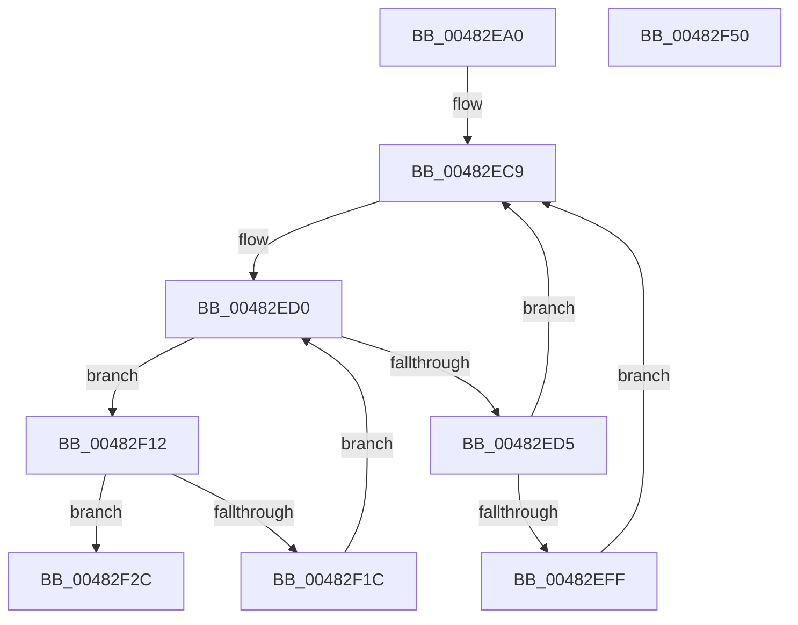

# KiDpcRuntimeHistoryHashTableCleanupTimerCallback

- RVA: `0x00482EA0`–`0x00482F51` (길이 `177` bytes)
- VA: `0x0000000140482EA0`
- 실행 섹션: `.text`
- PDB 이름 있음: `예`; PDB Function 태그: `아니요`
- unwind 정보 RVA: `0x000AEEA8`
- 디코드: `49`개 명령, `177/177` bytes 표시
- 미해석 바이트: `0` (있으면 어셈블리에 `.byte`로 보존)

> 이 문서는 커널 이미지의 기계어와 PDB 기호를 분석해 생성했습니다. 4번과 5번은 함수 원형과 자료형을 바이너리 사용 방식에서 추정한 C 해석이며 원본 소스 복구 결과는 아닙니다.

## 1. Dependencies

- 직접 호출 지점: **3**; 고유 호출 대상: **3**
- 직접 호출자로 확인된 함수: **0**
- RIP 상대 이미지 참조: **3**

### Outgoing calls
- `0x00482EF5` → [KeGetPrcb](../2D/KeGetPrcb_function_002D85D0.md) (function, `0x002D85D0`)
- `0x00482F0B` → [KeInsertQueueDpc](../20/KeInsertQueueDpc_function_00207C50.md) (function, `0x00207C50`)
- `0x00482F36` → [KiDpcRuntimeHistoryHashTableCleanupDpcRoutine](KiDpcRuntimeHistoryHashTableCleanupDpcRoutine_function_00482F60.md) (function, `0x00482F60`)

### Direct callers
- 이 함수 시작 RVA로 연결되는 직접 call은 확인되지 않았습니다. 간접 호출은 완전히 역산할 수 없습니다.

### Static image references
- `0x00482EBF` → RVA `0x00FC7128` (`ALMOSTRO`; read)
- `0x00482EC9` → RVA `0x00FC7120` (`ALMOSTRO`; read)
- `0x00482EEB` → RVA `0x00F231B8` (`.data`; read)

## 2. Other-region calls and transfers

- 다른 실행 섹션으로 향하는 call: **0**
- 별도 외부 분기/꼬리 이동을 확인하지 못했습니다.

## 3. Assembly (complete function range)

```asm
00482EA0  48 89 5C 24 08                  mov qword ptr [rsp + 8], rbx
00482EA5  48 89 6C 24 10                  mov qword ptr [rsp + 0x10], rbp
00482EAA  48 89 74 24 20                  mov qword ptr [rsp + 0x20], rsi
00482EAF  57                              push rdi
00482EB0  48 83 EC 20                     sub rsp, 0x20
00482EB4  65 48 8B 34 25 20 00 00 00      mov rsi, qword ptr gs:[0x20]
00482EBD  33 ED                           xor ebp, ebp
00482EBF  48 8B 3D 62 42 B4 00            mov rdi, qword ptr [rip + 0xb44262]
00482EC6  0F B7 DD                        movzx ebx, bp
00482EC9  0F B7 0D 50 42 B4 00            movzx ecx, word ptr [rip + 0xb44250]
00482ED0  48 85 FF                        test rdi, rdi
00482ED3  74 3D                           je 0x140482f12
00482ED5  48 0F BC D7                     bsf rdx, rdi
00482ED9  0F B7 CB                        movzx ecx, bx
00482EDC  0F B6 C2                        movzx eax, dl
00482EDF  48 0F B3 C7                     btr rdi, rax
00482EE3  C1 E1 06                        shl ecx, 6
00482EE6  0F B6 C2                        movzx eax, dl
00482EE9  03 C8                           add ecx, eax
00482EEB  48 8B 05 C6 02 AA 00            mov rax, qword ptr [rip + 0xaa02c6]
00482EF2  8B 0C 88                        mov ecx, dword ptr [rax + rcx*4]
00482EF5  E8 D6 56 E5 FF                  call 0x1402d85d0
00482EFA  48 3B C6                        cmp rax, rsi
00482EFD  74 CA                           je 0x140482ec9
00482EFF  48 8B 88 18 38 00 00            mov rcx, qword ptr [rax + 0x3818]
00482F06  45 33 C0                        xor r8d, r8d
00482F09  33 D2                           xor edx, edx
00482F0B  E8 40 4D D8 FF                  call 0x140207c50
00482F10  EB B7                           jmp 0x140482ec9
00482F12  66 FF C3                        inc bx
00482F15  0F B7 C3                        movzx eax, bx
00482F18  3B C1                           cmp eax, ecx
00482F1A  73 10                           jae 0x140482f2c
00482F1C  0F B7 C3                        movzx eax, bx
00482F1F  48 8D 3D 02 42 B4 00            lea rdi, [rip + 0xb44202]
00482F26  48 8B 3C C7                     mov rdi, qword ptr [rdi + rax*8]
00482F2A  EB A4                           jmp 0x140482ed0
00482F2C  45 33 C9                        xor r9d, r9d
00482F2F  45 33 C0                        xor r8d, r8d
00482F32  33 D2                           xor edx, edx
00482F34  33 C9                           xor ecx, ecx
00482F36  E8 25 00 00 00                  call 0x140482f60
00482F3B  48 8B 5C 24 30                  mov rbx, qword ptr [rsp + 0x30]
00482F40  48 8B 6C 24 38                  mov rbp, qword ptr [rsp + 0x38]
00482F45  48 8B 74 24 48                  mov rsi, qword ptr [rsp + 0x48]
00482F4A  48 83 C4 20                     add rsp, 0x20
00482F4E  5F                              pop rdi
00482F4F  C3                              ret
00482F50  CC                              int3
```

## 4. C-style interpretation (structured pseudocode)

```c
__int64 __fastcall KiDpcRuntimeHistoryHashTableCleanupTimerCallback(__int64 a1, __int64 a2, int a3, int a4)
{
    __int64 result;
    __int64 v_rbp;
    __int64 v_rbx;
    __int64 v_rsp;
    unsigned __int64 v_stack_p10;
    unsigned __int64 v_stack_p20;
    unsigned __int64 v_stack_p8;

    v_stack_p8 = v_rbx;
    v_stack_p10 = v_rbp;
    v_stack_p20 = v_rsi;
    v_rsp = (v_rsp) - (32);
    v_rbp = 0;
loc_00482EC9:
loc_00482ED0:
    if (*(unsigned __int64 *)(v_rip + 11813474) == 0) goto loc_00482F12;
    a1 = (unsigned int)((0) << (6));
    a1 = (unsigned int)((a1) + ((unsigned int)((unsigned __int8)(a2))));
    result = KeGetPrcb((unsigned int)(*(unsigned int *)(*(unsigned __int64 *)(v_rip + 11141830) + a1 * 4)), a2, a3, a4);
    if (result == (*(unsigned __int64 *)(gs_base + (0 + 32)))) goto loc_00482EC9;
    a3 = 0;
    a2 = 0;
    result = KeInsertQueueDpc(*(unsigned __int64 *)(result + 14360), a2, a3, a4);
    goto loc_00482EC9;
loc_00482F12:
    v_rbx = (unsigned __int16)((0) + 1);
    if (((unsigned int)((unsigned __int16)(v_rbx))) >= ((unsigned int)(*(unsigned __int64 *)(result + 14360)))) goto loc_00482F2C;
    goto loc_00482ED0;
loc_00482F2C:
    a4 = 0;
    a3 = 0;
    a2 = 0;
    a1 = 0;
    result = KiDpcRuntimeHistoryHashTableCleanupDpcRoutine(a1, a2, a3, a4);
    v_rsp = (v_rsp) + (32);
    return result;
}
```

## 5. (Beta) C Style

```c
int64_t KiDpcRuntimeHistoryHashTableCleanupTimerCallback(int64_t Arg1, int64_t Arg2, int32_t Arg3, int32_t Arg4)
{
    int64_t result;
    int64_t local_rbp;
    int64_t local_rbx;
    int64_t local_rsp;
    uint64_t v_stack_p10;
    uint64_t v_stack_p20;
    uint64_t v_stack_p8;

    v_stack_p8 = local_rbx;
    v_stack_p10 = local_rbp;
    v_stack_p20 = local_rsi;
    local_rsp = (local_rsp) - (32);
    local_rbp = 0;
loc_00482EC9:
loc_00482ED0:
    if (*(uint64_t *)(v_rip + 0xB44262) == 0) goto loc_00482F12;
    Arg1 = (uint32_t)((0) << (6));
    Arg1 = (uint32_t)((Arg1) + ((uint32_t)((uint8_t)(Arg2))));
    result = KeGetPrcb((uint32_t)(*(uint32_t *)(*(uint64_t *)(v_rip + 0xAA02C6) + Arg1 * 4)), Arg2, Arg3, Arg4);
    if (result == (*(uint64_t *)(gs_base + (0 + 0x20)))) goto loc_00482EC9;
    Arg3 = 0;
    Arg2 = 0;
    result = KeInsertQueueDpc(*(uint64_t *)(result + 0x3818), Arg2, Arg3, Arg4);
    goto loc_00482EC9;
loc_00482F12:
    local_rbx = (uint16_t)((0) + 1);
    if (((uint32_t)((uint16_t)(local_rbx))) >= ((uint32_t)(*(uint64_t *)(result + 0x3818)))) goto loc_00482F2C;
    goto loc_00482ED0;
loc_00482F2C:
    Arg4 = 0;
    Arg3 = 0;
    Arg2 = 0;
    Arg1 = 0;
    result = KiDpcRuntimeHistoryHashTableCleanupDpcRoutine(Arg1, Arg2, Arg3, Arg4);
    local_rsp = (local_rsp) + (32);
    return result;
}
```

## 6. Execution-region graph

[열기: 2D/3D 그래프와 함수 탐색 컨트롤 패널](../../../control-panel.html?section=text&rva=0x00482EA0&view=graph)

- 2D 그래프는 위에서 아래로 흐르고, 3D 그래프는 빈 공간을 드래그해 회전합니다. Shift+드래그는 이동, 휠은 확대·축소, 함수 노드 선택은 대상 보고서 이동입니다.

### Static fallback


