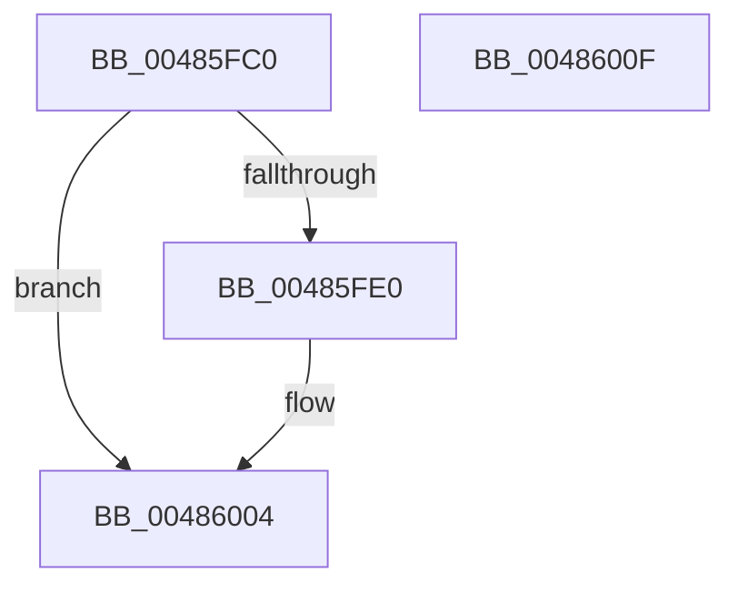

# KiEntropyDpcRoutine

- RVA: `0x00485FC0`–`0x00486010` (길이 `80` bytes)
- VA: `0x0000000140485FC0`
- 실행 섹션: `.text`
- PDB 이름 있음: `예`; PDB Function 태그: `아니요`
- unwind 정보 RVA: `0x0005CAAC`
- 디코드: `24`개 명령, `80/80` bytes 표시
- 미해석 바이트: `0` (있으면 어셈블리에 `.byte`로 보존)

> 이 문서는 커널 이미지의 기계어와 PDB 기호를 분석해 생성했습니다. 4번과 5번은 함수 원형과 자료형을 바이너리 사용 방식에서 추정한 C 해석이며 원본 소스 복구 결과는 아닙니다.

## 1. Dependencies

- 직접 호출 지점: **1**; 고유 호출 대상: **1**
- 직접 호출자로 확인된 함수: **0**
- RIP 상대 이미지 참조: **1**

### Outgoing calls
- `0x00485FF9` → [guard_dispatch_icall](../6B/guard_dispatch_icall_function_006BAAD0.md) (function, `0x006BAAD0`)

### Direct callers
- 이 함수 시작 RVA로 연결되는 직접 call은 확인되지 않았습니다. 간접 호출은 완전히 역산할 수 없습니다.

### Static image references
- `0x00485FE0` → RVA `0x00FC7060` (`ALMOSTRO`; read)

## 2. Other-region calls and transfers

- 다른 실행 섹션으로 향하는 call: **0**
- 별도 외부 분기/꼬리 이동을 확인하지 못했습니다.

## 3. Assembly (complete function range)

```asm
00485FC0  48 89 5C 24 08                  mov qword ptr [rsp + 8], rbx
00485FC5  57                              push rdi
00485FC6  48 83 EC 20                     sub rsp, 0x20
00485FCA  8B 1A                           mov ebx, dword ptr [rdx]
00485FCC  48 8B FA                        mov rdi, rdx
00485FCF  C1 EB 0A                        shr ebx, 0xa
00485FD2  90                              nop
00485FD3  FF CB                           dec ebx
00485FD5  83 E3 01                        and ebx, 1
00485FD8  3B 9A 48 01 00 00               cmp ebx, dword ptr [rdx + 0x148]
00485FDE  74 24                           je 0x140486004
00485FE0  48 8B 05 79 10 B4 00            mov rax, qword ptr [rip + 0xb41079]
00485FE7  8B CB                           mov ecx, ebx
00485FE9  48 C1 E1 07                     shl rcx, 7
00485FED  48 83 C1 04                     add rcx, 4
00485FF1  48 03 CA                        add rcx, rdx
00485FF4  BA 80 00 00 00                  mov edx, 0x80
00485FF9  E8 D2 4A 23 00                  call 0x1406baad0
00485FFE  89 9F 48 01 00 00               mov dword ptr [rdi + 0x148], ebx
00486004  48 8B 5C 24 30                  mov rbx, qword ptr [rsp + 0x30]
00486009  48 83 C4 20                     add rsp, 0x20
0048600D  5F                              pop rdi
0048600E  C3                              ret
0048600F  CC                              int3
```

## 4. C-style interpretation (structured pseudocode)

```c
__int64 __fastcall KiEntropyDpcRoutine(__int64 a1, __int64 a2)
{
    __int64 result;
    __int64 v_rbx;
    __int64 v_rsp;
    unsigned __int64 v_stack_p8;

    v_stack_p8 = v_rbx;
    v_rsp = (v_rsp) - (32);
    v_rbx = (unsigned int)(((unsigned int)(*(unsigned int *)(a2))) >> (10));
    v_rbx = (unsigned int)((v_rbx) - 1);
    v_rbx = (unsigned int)((v_rbx) & (1));
    if (((unsigned int)(v_rbx)) != (*(unsigned int *)(a2 + 328))) {
        result = *(unsigned __int64 *)(v_rip + 11800697);
        a1 = (unsigned int)(v_rbx);
        a1 = (a1) << (7);
        a1 = (a1) + (4);
        a1 = (a1) + (a2);
        a2 = 128;
        result = guard_dispatch_icall(a1, a2, a3, a4);
        *(unsigned int *)(a2 + 328) = (unsigned int)(v_rbx);
    }
    v_rsp = (v_rsp) + (32);
    return result;
}
```

## 5. (Beta) C Style

```c
int64_t KiEntropyDpcRoutine(int64_t Arg1, void *Arg2)
{
    uint8_t *arg2 = (uint8_t *)Arg2;

    int64_t result;
    int64_t local_rbx;
    int64_t local_rsp;
    uint64_t v_stack_p8;

    v_stack_p8 = local_rbx;
    local_rsp = (local_rsp) - (32);
    local_rbx = (uint32_t)(((uint32_t)(*(uint32_t *)(arg2))) >> (10));
    local_rbx = (uint32_t)((local_rbx) - 1);
    local_rbx = (uint32_t)((local_rbx) & (1));
    if (((uint32_t)(local_rbx)) != (*(uint32_t *)(arg2 + 0x148))) {
        result = *(uint64_t *)(v_rip + 0xB41079);
        Arg1 = (uint32_t)(local_rbx);
        Arg1 = (Arg1) << (7);
        Arg1 = (Arg1) + (4);
        Arg1 = (Arg1) + (Arg2);
        Arg2 = 128;
        result = guard_dispatch_icall(Arg1, Arg2, a3, a4);
        *(uint32_t *)(arg2 + 0x148) = (uint32_t)(local_rbx);
    }
    local_rsp = (local_rsp) + (32);
    return result;
}
```

### 관측된 메모리 오프셋

구조체 형식이 확인되지 않은 접근은 인자 기준의 오프셋으로만 기록했습니다.

| 기준 인자 | 오프셋 표현 | 폭 (bit) | 접근 |
|---|---:|---:|---|
| `Arg2` | `+ 0x0` | `32` | `R` |
| `Arg2` | `+ 0x148` | `32` | `R` |
| `Arg2` | `+ 0x148` | `32` | `W` |

## 6. Execution-region graph

[열기: 2D/3D 그래프와 함수 탐색 컨트롤 패널](../../../control-panel.html?section=text&rva=0x00485FC0&view=graph)

- 2D 그래프는 위에서 아래로 흐르고, 3D 그래프는 빈 공간을 드래그해 회전합니다. Shift+드래그는 이동, 휠은 확대·축소, 함수 노드 선택은 대상 보고서 이동입니다.

### Static fallback


