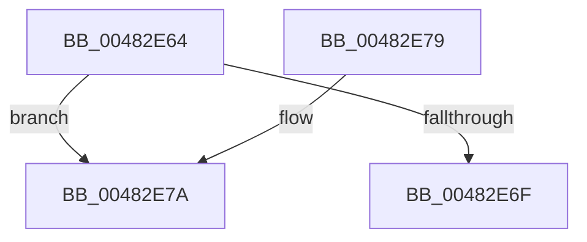

# KiExceptionStackSwitchHandler

- RVA: `0x00482E64`–`0x00482E99` (길이 `53` bytes)
- VA: `0x0000000140482E64`
- 실행 섹션: `.text`
- PDB 이름 있음: `예`; PDB Function 태그: `아니요`
- unwind 정보 RVA: `0x0007D698`
- 디코드: `16`개 명령, `53/53` bytes 표시
- 미해석 바이트: `0` (있으면 어셈블리에 `.byte`로 보존)

> 이 문서는 커널 이미지의 기계어와 PDB 기호를 분석해 생성했습니다. 4번과 5번은 함수 원형과 자료형을 바이너리 사용 방식에서 추정한 C 해석이며 원본 소스 복구 결과는 아닙니다.

## 1. Dependencies

- 직접 호출 지점: **1**; 고유 호출 대상: **1**
- 직접 호출자로 확인된 함수: **0**
- RIP 상대 이미지 참조: **0**

### Outgoing calls
- `0x00482E93` → [KeBugCheckEx](../4F/KeBugCheckEx_function_004FD660.md) (function, `0x004FD660`)

### Direct callers
- 이 함수 시작 RVA로 연결되는 직접 call은 확인되지 않았습니다. 간접 호출은 완전히 역산할 수 없습니다.

### Static image references
- 디코드된 RIP-relative 메모리 참조가 없습니다.

## 2. Other-region calls and transfers

- 다른 실행 섹션으로 향하는 call: **0**
- 별도 외부 분기/꼬리 이동을 확인하지 못했습니다.

## 3. Assembly (complete function range)

```asm
00482E64  48 83 EC 38                     sub rsp, 0x38
00482E68  8B 41 04                        mov eax, dword ptr [rcx + 4]
00482E6B  A8 76                           test al, 0x76
00482E6D  74 0B                           je 0x140482e7a
00482E6F  B8 01 00 00 00                  mov eax, 1
00482E74  48 83 C4 38                     add rsp, 0x38
00482E78  C3                              ret
00482E79  CC                              int3
00482E7A  48 8B 41 28                     mov rax, qword ptr [rcx + 0x28]
00482E7E  48 63 11                        movsxd rdx, dword ptr [rcx]
00482E81  4C 8B 49 20                     mov r9, qword ptr [rcx + 0x20]
00482E85  4C 8B 41 10                     mov r8, qword ptr [rcx + 0x10]
00482E89  B9 1E 00 00 00                  mov ecx, 0x1e
00482E8E  48 89 44 24 20                  mov qword ptr [rsp + 0x20], rax
00482E93  E8 C8 A7 07 00                  call 0x1404fd660
00482E98  CC                              int3
```

## 4. C-style interpretation (structured pseudocode)

```c
__int64 __fastcall KiExceptionStackSwitchHandler(__int64 a1)
{
    __int64 result;
    __int64 v_rsp;
    unsigned __int64 v_stack_p20;

    v_rsp = (v_rsp) - (56);
    if ((((unsigned __int8)((unsigned int)(*(unsigned int *)(a1 + 4)))) & (118)) == 0) goto loc_00482E7A;
    v_rsp = (v_rsp) + (56);
    return 1;
loc_00482E7A:
    v_stack_p20 = *(unsigned __int64 *)(a1 + 40);
    result = KeBugCheckEx(30, (int)(*(unsigned int *)(a1)), *(unsigned __int64 *)(a1 + 16), *(unsigned __int64 *)(a1 + 32));
    return result;
}
```

## 5. (Beta) C Style

```c
int64_t KiExceptionStackSwitchHandler(void *Arg1)
{
    uint8_t *arg1 = (uint8_t *)Arg1;

    int64_t result;
    int64_t local_rsp;
    uint64_t v_stack_p20;

    local_rsp = (local_rsp) - (56);
    if ((((uint8_t)((uint32_t)(*(uint32_t *)(arg1 + 0x4)))) & (118)) == 0) goto loc_00482E7A;
    local_rsp = (local_rsp) + (56);
    return 1;
loc_00482E7A:
    v_stack_p20 = *(uint64_t *)(arg1 + 0x28);
    result = KeBugCheckEx(30, (int32_t)(*(uint32_t *)(arg1)), *(uint64_t *)(arg1 + 0x10), *(uint64_t *)(arg1 + 0x20));
    return result;
}
```

### 관측된 메모리 오프셋

구조체 형식이 확인되지 않은 접근은 인자 기준의 오프셋으로만 기록했습니다.

| 기준 인자 | 오프셋 표현 | 폭 (bit) | 접근 |
|---|---:|---:|---|
| `Arg1` | `+ 0x0` | `32` | `R` |
| `Arg1` | `+ 0x4` | `32` | `R` |
| `Arg1` | `+ 0x10` | `64` | `R` |
| `Arg1` | `+ 0x20` | `64` | `R` |
| `Arg1` | `+ 0x28` | `64` | `R` |

## 6. Execution-region graph

[열기: 2D/3D 그래프와 함수 탐색 컨트롤 패널](../../../control-panel.html?section=text&rva=0x00482E64&view=graph)

- 2D 그래프는 위에서 아래로 흐르고, 3D 그래프는 빈 공간을 드래그해 회전합니다. Shift+드래그는 이동, 휠은 확대·축소, 함수 노드 선택은 대상 보고서 이동입니다.

### Static fallback


