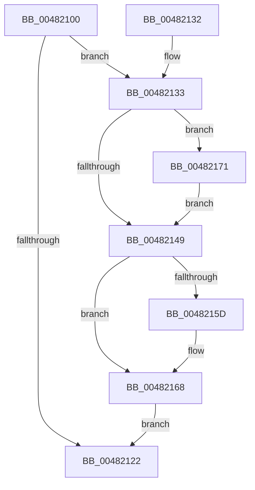

# KiFlushQueuedDpcsWorker

- RVA: `0x00482100`–`0x0048217D` (길이 `125` bytes)
- VA: `0x0000000140482100`
- 실행 섹션: `.text`
- PDB 이름 있음: `예`; PDB Function 태그: `아니요`
- unwind 정보 RVA: `0x0008CCD8`
- 디코드: `35`개 명령, `125/125` bytes 표시
- 미해석 바이트: `0` (있으면 어셈블리에 `.byte`로 보존)

> 이 문서는 커널 이미지의 기계어와 PDB 기호를 분석해 생성했습니다. 4번과 5번은 함수 원형과 자료형을 바이너리 사용 방식에서 추정한 C 해석이며 원본 소스 복구 결과는 아닙니다.

## 1. Dependencies

- 직접 호출 지점: **3**; 고유 호출 대상: **3**
- 직접 호출자로 확인된 함수: **0**
- RIP 상대 이미지 참조: **1**

### Outgoing calls
- `0x0048214F` → [KiRequestSoftwareInterrupt](../25/KiRequestSoftwareInterrupt_function_00250950.md) (function, `0x00250950`)
- `0x00482163` → [KiLowerIrqlProcessIrqlFlags](../4F/KiLowerIrqlProcessIrqlFlags_function_004F5698.md) (function, `0x004F5698`)
- `0x00482176` → [KiRaiseIrqlProcessIrqlFlags](../4F/KiRaiseIrqlProcessIrqlFlags_function_004F56FC.md) (function, `0x004F56FC`)

### Direct callers
- 이 함수 시작 RVA로 연결되는 직접 call은 확인되지 않았습니다. 간접 호출은 완전히 역산할 수 없습니다.

### Static image references
- `0x00482140` → RVA `0x00FC6D20` (`ALMOSTRO`; read)

## 2. Other-region calls and transfers

- 다른 실행 섹션으로 향하는 call: **0**
- 별도 외부 분기/꼬리 이동을 확인하지 못했습니다.

## 3. Assembly (complete function range)

```asm
00482100  48 89 5C 24 08                  mov qword ptr [rsp + 8], rbx
00482105  48 89 74 24 10                  mov qword ptr [rsp + 0x10], rsi
0048210A  57                              push rdi
0048210B  48 83 EC 20                     sub rsp, 0x20
0048210F  8B 91 58 38 00 00               mov edx, dword ptr [rcx + 0x3858]
00482115  48 8B F9                        mov rdi, rcx
00482118  8B 81 88 38 00 00               mov eax, dword ptr [rcx + 0x3888]
0048211E  0B C2                           or eax, edx
00482120  75 11                           jne 0x140482133
00482122  48 8B 5C 24 30                  mov rbx, qword ptr [rsp + 0x30]
00482127  48 8B 74 24 38                  mov rsi, qword ptr [rsp + 0x38]
0048212C  48 83 C4 20                     add rsp, 0x20
00482130  5F                              pop rdi
00482131  C3                              ret
00482132  CC                              int3
00482133  44 0F 20 C3                     mov rbx, cr8
00482137  BE 02 00 00 00                  mov esi, 2
0048213C  44 0F 22 C6                     mov cr8, rsi
00482140  83 3D D9 4B B4 00 00            cmp dword ptr [rip + 0xb44bd9], 0
00482147  75 28                           jne 0x140482171
00482149  40 8A D6                        mov dl, sil
0048214C  48 8B CF                        mov rcx, rdi
0048214F  E8 FC E7 DC FF                  call 0x140250950
00482154  83 3D C5 4B B4 00 00            cmp dword ptr [rip + 0xb44bc5], 0
0048215B  74 0B                           je 0x140482168
0048215D  44 0F 20 C1                     mov rcx, cr8
00482161  8A D3                           mov dl, bl
00482163  E8 30 35 07 00                  call 0x1404f5698
00482168  0F B6 C3                        movzx eax, bl
0048216B  44 0F 22 C0                     mov cr8, rax
0048216F  EB B1                           jmp 0x140482122
00482171  40 8A D6                        mov dl, sil
00482174  8A CB                           mov cl, bl
00482176  E8 81 35 07 00                  call 0x1404f56fc
0048217B  EB CC                           jmp 0x140482149
```

## 4. C-style interpretation (structured pseudocode)

```c
__int64 __fastcall KiFlushQueuedDpcsWorker(__int64 a1)
{
    __int64 result;
    __int64 v_rsp;
    unsigned __int64 v_stack_p10;
    unsigned __int64 v_stack_p8;

    v_stack_p8 = v_rbx;
    v_stack_p10 = v_rsi;
    v_rsp = (v_rsp) - (32);
    result = (unsigned int)(((unsigned int)(*(unsigned int *)(a1 + 14472))) | ((unsigned int)((unsigned int)(*(unsigned int *)(a1 + 14424)))));
    if (condition_is_not_equal) goto loc_00482133;
loc_00482122:
    v_rsp = (v_rsp) + (32);
    return result;
loc_00482133:
    if ((*(unsigned int *)(v_rip + 11815897)) != 0) goto loc_00482171;
loc_00482149:
    result = KiRequestSoftwareInterrupt(a1, 2, a3, a4);
    if ((*(unsigned int *)(v_rip + 11815877)) != 0) {
        a1 = 2;
        a2 = (unsigned __int8)(v_cr8);
        result = KiLowerIrqlProcessIrqlFlags(a1, a2, a3, a4);
    }
    goto loc_00482122;
loc_00482171:
    result = KiRaiseIrqlProcessIrqlFlags((unsigned __int8)(v_cr8), 2, a3, a4);
    goto loc_00482149;
}
```

## 5. (Beta) C Style

```c
int64_t KiFlushQueuedDpcsWorker(void *Arg1)
{
    uint8_t *arg1 = (uint8_t *)Arg1;

    int64_t result;
    int64_t local_rsp;
    uint64_t v_stack_p10;
    uint64_t v_stack_p8;

    v_stack_p8 = local_rbx;
    v_stack_p10 = local_rsi;
    local_rsp = (local_rsp) - (32);
    result = (uint32_t)(((uint32_t)(*(uint32_t *)(arg1 + 0x3888))) | ((uint32_t)((uint32_t)(*(uint32_t *)(arg1 + 0x3858)))));
    if (condition_is_not_equal) goto loc_00482133;
loc_00482122:
    local_rsp = (local_rsp) + (32);
    return result;
loc_00482133:
    if ((*(uint32_t *)(v_rip + 0xB44BD9)) != 0) goto loc_00482171;
loc_00482149:
    result = KiRequestSoftwareInterrupt(Arg1, 2, a3, a4);
    if ((*(uint32_t *)(v_rip + 0xB44BC5)) != 0) {
        Arg1 = 2;
        a2 = (uint8_t)(v_cr8);
        result = KiLowerIrqlProcessIrqlFlags(Arg1, a2, a3, a4);
    }
    goto loc_00482122;
loc_00482171:
    result = KiRaiseIrqlProcessIrqlFlags((uint8_t)(v_cr8), 2, a3, a4);
    goto loc_00482149;
}
```

### 관측된 메모리 오프셋

구조체 형식이 확인되지 않은 접근은 인자 기준의 오프셋으로만 기록했습니다.

| 기준 인자 | 오프셋 표현 | 폭 (bit) | 접근 |
|---|---:|---:|---|
| `Arg1` | `+ 0x3858` | `32` | `R` |
| `Arg1` | `+ 0x3888` | `32` | `R` |

## 6. Execution-region graph

[열기: 2D/3D 그래프와 함수 탐색 컨트롤 패널](../../../control-panel.html?section=text&rva=0x00482100&view=graph)

- 2D 그래프는 위에서 아래로 흐르고, 3D 그래프는 빈 공간을 드래그해 회전합니다. Shift+드래그는 이동, 휠은 확대·축소, 함수 노드 선택은 대상 보고서 이동입니다.

### Static fallback


