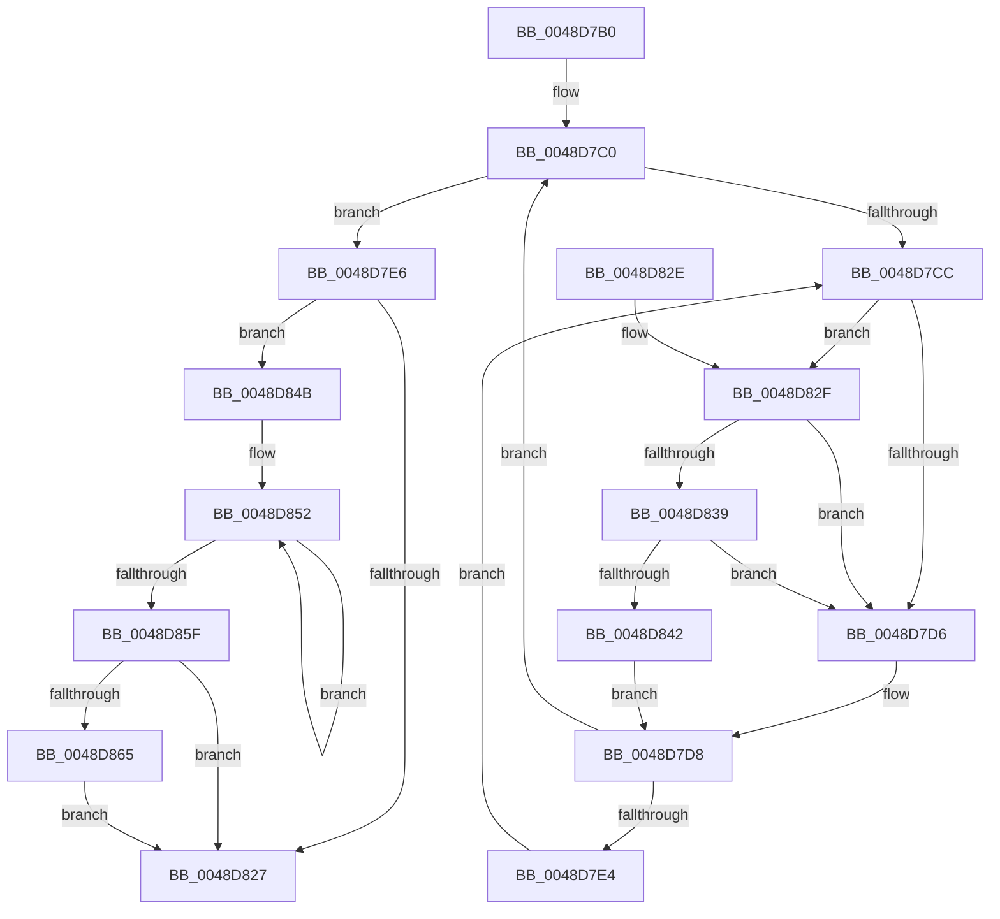

# KiForceIdleStopDpcRoutine

- RVA: `0x0048D7B0`–`0x0048D86C` (길이 `188` bytes)
- VA: `0x000000014048D7B0`
- 실행 섹션: `.text`
- PDB 이름 있음: `예`; PDB Function 태그: `아니요`
- unwind 정보 RVA: `0x000B1460`
- 디코드: `52`개 명령, `188/188` bytes 표시
- 미해석 바이트: `0` (있으면 어셈블리에 `.byte`로 보존)

> 이 문서는 커널 이미지의 기계어와 PDB 기호를 분석해 생성했습니다. 4번과 5번은 함수 원형과 자료형을 바이너리 사용 방식에서 추정한 C 해석이며 원본 소스 복구 결과는 아닙니다.

## 1. Dependencies

- 직접 호출 지점: **5**; 고유 호출 대상: **5**
- 직접 호출자로 확인된 함수: **0**
- RIP 상대 이미지 참조: **7**

### Outgoing calls
- `0x0048D7B8` → [KiForceIdleUpdateSchedulerParkState](KiForceIdleUpdateSchedulerParkState_function_0048D874.md) (function, `0x0048D874`)
- `0x0048D804` → [KiSetForceIdleState](KiSetForceIdleState_function_0048DCC0.md) (function, `0x0048DCC0`)
- `0x0048D839` → [KiCheckVpBackingLongSpinWaitHypercall](../30/KiCheckVpBackingLongSpinWaitHypercall_function_0030F490.md) (function, `0x0030F490`)
- `0x0048D844` → [HvlNotifyLongSpinWait](../30/HvlNotifyLongSpinWait_function_0030F460.md) (function, `0x0030F460`)
- `0x0048D865` → [KiRemoveSystemWorkPriorityKick](../26/KiRemoveSystemWorkPriorityKick_function_002631D0.md) (function, `0x002631D0`)

### Direct callers
- 이 함수 시작 RVA로 연결되는 직접 call은 확인되지 않았습니다. 간접 호출은 완전히 역산할 수 없습니다.

### Static image references
- `0x0048D7C0` → RVA `0x00F23140` (`.data`; read/write)
- `0x0048D7CE` → RVA `0x00FC52AC` (`ALMOSTRO`; reference)
- `0x0048D7D8` → RVA `0x00F23140` (`.data`; read)
- `0x0048D7E6` → RVA `0x00F233C8` (`.data`; read/write)
- `0x0048D7ED` → RVA `0x00F232F0` (`.data`; read/write)
- `0x0048D7F5` → RVA `0x00F23148` (`.data`; read)
- `0x0048D82F` → RVA `0x00FC6AB8` (`ALMOSTRO`; read)

## 2. Other-region calls and transfers

- 다른 실행 섹션으로 향하는 call: **0**
- 별도 외부 분기/꼬리 이동을 확인하지 못했습니다.

## 3. Assembly (complete function range)

```asm
0048D7B0  40 53                           push rbx
0048D7B2  48 83 EC 20                     sub rsp, 0x20
0048D7B6  33 C9                           xor ecx, ecx
0048D7B8  E8 B7 00 00 00                  call 0x14048d874
0048D7BD  FA                              cli
0048D7BE  33 DB                           xor ebx, ebx
0048D7C0  F0 48 0F BA 2D 76 59 A9 00 00   lock bts qword ptr [rip + 0xa95976], 0
0048D7CA  73 1A                           jae 0x14048d7e6
0048D7CC  FF C3                           inc ebx
0048D7CE  85 1D D8 7A B3 00               test dword ptr [rip + 0xb37ad8], ebx
0048D7D4  74 59                           je 0x14048d82f
0048D7D6  F3 90                           pause
0048D7D8  48 8B 05 61 59 A9 00            mov rax, qword ptr [rip + 0xa95961]
0048D7DF  48 85 C0                        test rax, rax
0048D7E2  74 DC                           je 0x14048d7c0
0048D7E4  EB E6                           jmp 0x14048d7cc
0048D7E6  83 25 DB 5B A9 00 00            and dword ptr [rip + 0xa95bdb], 0
0048D7ED  48 83 25 FB 5A A9 00 00         and qword ptr [rip + 0xa95afb], 0
0048D7F5  48 8B 05 4C 59 A9 00            mov rax, qword ptr [rip + 0xa9594c]
0048D7FC  48 F7 D8                        neg rax
0048D7FF  1B C9                           sbb ecx, ecx
0048D801  83 E1 02                        and ecx, 2
0048D804  E8 B7 04 00 00                  call 0x14048dcc0
0048D809  F0 48 83 25 2E 59 A9 00 00      lock and qword ptr [rip + 0xa9592e], 0
0048D812  65 48 8B 0C 25 20 00 00 00      mov rcx, qword ptr gs:[0x20]
0048D81B  4C 8B 81 B8 8E 00 00            mov r8, qword ptr [rcx + 0x8eb8]
0048D822  4D 85 C0                        test r8, r8
0048D825  75 24                           jne 0x14048d84b
0048D827  FB                              sti
0048D828  48 83 C4 20                     add rsp, 0x20
0048D82C  5B                              pop rbx
0048D82D  C3                              ret
0048D82E  CC                              int3
0048D82F  8B 05 83 92 B3 00               mov eax, dword ptr [rip + 0xb39283]
0048D835  A8 40                           test al, 0x40
0048D837  74 9D                           je 0x14048d7d6
0048D839  E8 52 1C E8 FF                  call 0x14030f490
0048D83E  84 C0                           test al, al
0048D840  74 94                           je 0x14048d7d6
0048D842  8B CB                           mov ecx, ebx
0048D844  E8 17 1C E8 FF                  call 0x14030f460
0048D849  EB 8D                           jmp 0x14048d7d8
0048D84B  41 0F 0D 08                     prefetchw byte ptr [r8]
0048D84F  41 8B 00                        mov eax, dword ptr [r8]
0048D852  8B D0                           mov edx, eax
0048D854  0F BA F2 15                     btr edx, 0x15
0048D858  F0 41 0F B1 10                  lock cmpxchg dword ptr [r8], edx
0048D85D  75 F3                           jne 0x14048d852
0048D85F  0F BA E0 15                     bt eax, 0x15
0048D863  73 C2                           jae 0x14048d827
0048D865  E8 66 59 DD FF                  call 0x1402631d0
0048D86A  EB BB                           jmp 0x14048d827
```

## 4. C-style interpretation (structured pseudocode)

```c
__int64 __fastcall KiForceIdleStopDpcRoutine(int a1)
{
    __int64 result;
    __int64 v_rbx;
    __int64 v_rsp;

    v_rsp = (v_rsp) - (32);
    a1 = 0;
    result = KiForceIdleUpdateSchedulerParkState(a1, a2, a3, a4);
    v_rbx = 0;
loc_0048D7C0:
    if (condition_is_above_or_equal) goto loc_0048D7E6;
loc_0048D7CC:
    v_rbx = (unsigned int)((v_rbx) + 1);
    if (((*(unsigned int *)(v_rip + 11762392)) & ((unsigned int)(v_rbx))) == 0) goto loc_0048D82F;
loc_0048D7D6:
loc_0048D7D8:
    if (*(unsigned __int64 *)(v_rip + 11098465) == 0) goto loc_0048D7C0;
    goto loc_0048D7CC;
loc_0048D7E6:
    result = -(*(unsigned __int64 *)(v_rip + 11098444));
    a1 = (unsigned int)((a1) & (2));
    result = KiSetForceIdleState(a1, a2, a3, a4);
    if (*(unsigned __int64 *)(*(unsigned __int64 *)(gs_base + (0 + 32)) + 36536) != 0) goto loc_0048D84B;
loc_0048D827:
    v_rsp = (v_rsp) + (32);
    return result;
loc_0048D82F:
    if ((((unsigned __int8)((unsigned int)(*(unsigned int *)(v_rip + 11768451)))) & (64)) == 0) goto loc_0048D7D6;
    result = KiCheckVpBackingLongSpinWaitHypercall(*(unsigned __int64 *)(gs_base + (0 + 32)), a2, *(unsigned __int64 *)(*(unsigned __int64 *)(gs_base + (0 + 32)) + 36536), a4);
    if ((unsigned __int8)(result) == 0) goto loc_0048D7D6;
    result = HvlNotifyLongSpinWait((unsigned int)((unsigned int)(v_rbx)), a2, *(unsigned __int64 *)(*(unsigned __int64 *)(gs_base + (0 + 32)) + 36536), a4);
    goto loc_0048D7D8;
loc_0048D84B:
loc_0048D852:
    if ((unsigned __int8)(result) != 0) goto loc_0048D852;
    if (condition_is_above_or_equal) goto loc_0048D827;
    result = KiRemoveSystemWorkPriorityKick((unsigned int)((unsigned int)(v_rbx)), (unsigned int)((unsigned int)((unsigned int)(*(unsigned int *)(*(unsigned __int64 *)(*(unsigned __int64 *)(gs_base + (0 + 32)) + 36536))))), *(unsigned __int64 *)(*(unsigned __int64 *)(gs_base + (0 + 32)) + 36536), a4);
    goto loc_0048D827;
}
```

## 5. (Beta) C Style

```c
int64_t KiForceIdleStopDpcRoutine(int32_t Arg1)
{
    int64_t result;
    int64_t local_rbx;
    int64_t local_rsp;

    local_rsp = (local_rsp) - (32);
    Arg1 = 0;
    result = KiForceIdleUpdateSchedulerParkState(Arg1, a2, a3, a4);
    local_rbx = 0;
loc_0048D7C0:
    if (condition_is_above_or_equal) goto loc_0048D7E6;
loc_0048D7CC:
    local_rbx = (uint32_t)((local_rbx) + 1);
    if (((*(uint32_t *)(v_rip + 0xB37AD8)) & ((uint32_t)(local_rbx))) == 0) goto loc_0048D82F;
loc_0048D7D6:
loc_0048D7D8:
    if (*(uint64_t *)(v_rip + 0xA95961) == 0) goto loc_0048D7C0;
    goto loc_0048D7CC;
loc_0048D7E6:
    result = -(*(uint64_t *)(v_rip + 0xA9594C));
    Arg1 = (uint32_t)((Arg1) & (2));
    result = KiSetForceIdleState(Arg1, a2, a3, a4);
    if (*(uint64_t *)(*(uint64_t *)(gs_base + (0 + 0x20)) + 0x8EB8) != 0) goto loc_0048D84B;
loc_0048D827:
    local_rsp = (local_rsp) + (32);
    return result;
loc_0048D82F:
    if ((((uint8_t)((uint32_t)(*(uint32_t *)(v_rip + 0xB39283)))) & (64)) == 0) goto loc_0048D7D6;
    result = KiCheckVpBackingLongSpinWaitHypercall(*(uint64_t *)(gs_base + (0 + 0x20)), a2, *(uint64_t *)(*(uint64_t *)(gs_base + (0 + 0x20)) + 0x8EB8), a4);
    if ((uint8_t)(result) == 0) goto loc_0048D7D6;
    result = HvlNotifyLongSpinWait((uint32_t)((uint32_t)(local_rbx)), a2, *(uint64_t *)(*(uint64_t *)(gs_base + (0 + 0x20)) + 0x8EB8), a4);
    goto loc_0048D7D8;
loc_0048D84B:
loc_0048D852:
    if ((uint8_t)(result) != 0) goto loc_0048D852;
    if (condition_is_above_or_equal) goto loc_0048D827;
    result = KiRemoveSystemWorkPriorityKick((uint32_t)((uint32_t)(local_rbx)), (uint32_t)((uint32_t)((uint32_t)(*(uint32_t *)(*(uint64_t *)(*(uint64_t *)(gs_base + (0 + 0x20)) + 0x8EB8))))), *(uint64_t *)(*(uint64_t *)(gs_base + (0 + 0x20)) + 0x8EB8), a4);
    goto loc_0048D827;
}
```

## 6. Execution-region graph

[열기: 2D/3D 그래프와 함수 탐색 컨트롤 패널](../../../control-panel.html?section=text&rva=0x0048D7B0&view=graph)

- 2D 그래프는 위에서 아래로 흐르고, 3D 그래프는 빈 공간을 드래그해 회전합니다. Shift+드래그는 이동, 휠은 확대·축소, 함수 노드 선택은 대상 보고서 이동입니다.

### Static fallback


