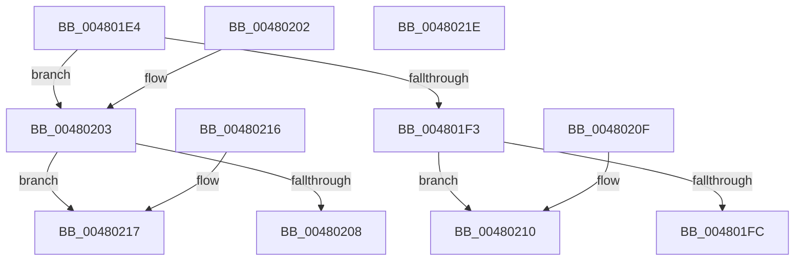

# KiGetProcessorClassForPolicy

- RVA: `0x004801E4`–`0x0048021F` (길이 `59` bytes)
- VA: `0x00000001404801E4`
- 실행 섹션: `.text`
- PDB 이름 있음: `예`; PDB Function 태그: `아니요`
- unwind 정보 RVA: `0x000DB714`
- 디코드: `21`개 명령, `59/59` bytes 표시
- 미해석 바이트: `0` (있으면 어셈블리에 `.byte`로 보존)

> 이 문서는 커널 이미지의 기계어와 PDB 기호를 분석해 생성했습니다. 4번과 5번은 함수 원형과 자료형을 바이너리 사용 방식에서 추정한 C 해석이며 원본 소스 복구 결과는 아닙니다.

## 1. Dependencies

- 직접 호출 지점: **0**; 고유 호출 대상: **0**
- 직접 호출자로 확인된 함수: **2**
- RIP 상대 이미지 참조: **0**

### Outgoing calls
- 직접 디코드된 call 명령이 없습니다.

### Direct callers
- [KiMayStealStandbyThread](../30/KiMayStealStandbyThread_function_0030D704.md) at `0x0030D760`
- [KiMayStealStandbyThread](../30/KiMayStealStandbyThread_function_0030D704.md) at `0x0030D76B`
- [KiCheckPreferredHeteroProcessor](../39/KiCheckPreferredHeteroProcessor_function_0039D72C.md) at `0x0039D8E9`
- [KiCheckPreferredHeteroProcessor](../39/KiCheckPreferredHeteroProcessor_function_0039D72C.md) at `0x0039DACA`

### Static image references
- 디코드된 RIP-relative 메모리 참조가 없습니다.

## 2. Other-region calls and transfers

- 다른 실행 섹션으로 향하는 call: **0**
- 별도 외부 분기/꼬리 이동을 확인하지 못했습니다.

## 3. Assembly (complete function range)

```asm
004801E4  4C 8B 89 50 8A 00 00            mov r9, qword ptr [rcx + 0x8a50]
004801EB  8D 42 FD                        lea eax, [rdx - 3]
004801EE  4D 85 C9                        test r9, r9
004801F1  74 10                           je 0x140480203
004801F3  41 0F B6 C8                     movzx ecx, r8b
004801F7  83 F8 01                        cmp eax, 1
004801FA  77 14                           ja 0x140480210
004801FC  41 8A 44 89 05                  mov al, byte ptr [r9 + rcx*4 + 5]
00480201  C3                              ret
00480202  CC                              int3
00480203  83 F8 01                        cmp eax, 1
00480206  76 0F                           jbe 0x140480217
00480208  8A 81 09 8A 00 00               mov al, byte ptr [rcx + 0x8a09]
0048020E  C3                              ret
0048020F  CC                              int3
00480210  41 8A 44 89 04                  mov al, byte ptr [r9 + rcx*4 + 4]
00480215  C3                              ret
00480216  CC                              int3
00480217  8A 81 0A 8A 00 00               mov al, byte ptr [rcx + 0x8a0a]
0048021D  C3                              ret
0048021E  CC                              int3
```

## 4. C-style interpretation (structured pseudocode)

```c
__int64 __fastcall KiGetProcessorClassForPolicy(__int64 a1, __int64 a2, unsigned __int8 a3)
{
    if (*(unsigned __int64 *)(a1 + 35408) == 0) goto loc_00480203;
    if (((unsigned int)(a2 - 3)) > 1) goto loc_00480210;
    return *(unsigned __int8 *)(*(unsigned __int64 *)(a1 + 35408) + a3 * 4 + 5);
loc_00480203:
    if (((unsigned int)(*(unsigned __int8 *)(*(unsigned __int64 *)(a1 + 35408) + a3 * 4 + 5))) <= 1) goto loc_00480217;
    return *(unsigned __int8 *)(a3 + 35337);
loc_00480210:
    return *(unsigned __int8 *)(*(unsigned __int64 *)(a1 + 35408) + a3 * 4 + 4);
loc_00480217:
    return *(unsigned __int8 *)(a3 + 35338);
}
```

## 5. (Beta) C Style

```c
int64_t KiGetProcessorClassForPolicy(void *Arg1, void *Arg2, uint8_t Arg3)
{
    uint8_t *arg1 = (uint8_t *)Arg1;
    uint8_t *arg2 = (uint8_t *)Arg2;

    if (*(uint64_t *)(arg1 + 0x8A50) == 0) goto loc_00480203;
    if (((uint32_t)(Arg2 - 3)) > 1) goto loc_00480210;
    return *(uint8_t *)(*(uint64_t *)(arg1 + 0x8A50) + Arg3 * 4 + 0x5);
loc_00480203:
    if (((uint32_t)(*(uint8_t *)(*(uint64_t *)(arg1 + 0x8A50) + Arg3 * 4 + 0x5))) <= 1) goto loc_00480217;
    return *(uint8_t *)(Arg3 + 0x8A09);
loc_00480210:
    return *(uint8_t *)(*(uint64_t *)(arg1 + 0x8A50) + Arg3 * 4 + 0x4);
loc_00480217:
    return *(uint8_t *)(Arg3 + 0x8A0A);
}
```

### 관측된 메모리 오프셋

구조체 형식이 확인되지 않은 접근은 인자 기준의 오프셋으로만 기록했습니다.

| 기준 인자 | 오프셋 표현 | 폭 (bit) | 접근 |
|---|---:|---:|---|
| `Arg1` | `+ 0x8A09` | `8` | `R` |
| `Arg1` | `+ 0x8A0A` | `8` | `R` |
| `Arg1` | `+ 0x8A50` | `64` | `R` |
| `Arg2` | `- 0x3` | `32` | `R` |

## 6. Execution-region graph

[열기: 2D/3D 그래프와 함수 탐색 컨트롤 패널](../../../control-panel.html?section=text&rva=0x004801E4&view=graph)

- 2D 그래프는 위에서 아래로 흐르고, 3D 그래프는 빈 공간을 드래그해 회전합니다. Shift+드래그는 이동, 휠은 확대·축소, 함수 노드 선택은 대상 보고서 이동입니다.

### Static fallback


