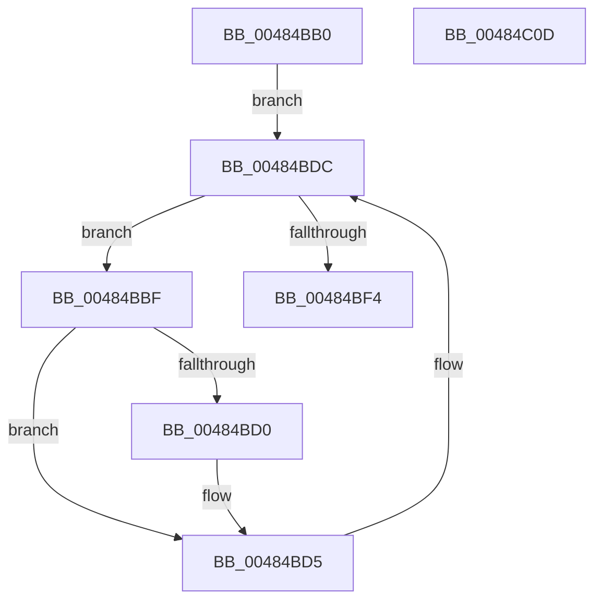

# KiIdealProcessorRebalancerWorker

- RVA: `0x00484BB0`–`0x00484C0E` (길이 `94` bytes)
- VA: `0x0000000140484BB0`
- 실행 섹션: `.text`
- PDB 이름 있음: `예`; PDB Function 태그: `아니요`
- unwind 정보 RVA: `0x0005CF00`
- 디코드: `23`개 명령, `94/94` bytes 표시
- 미해석 바이트: `0` (있으면 어셈블리에 `.byte`로 보존)

> 이 문서는 커널 이미지의 기계어와 PDB 기호를 분석해 생성했습니다. 4번과 5번은 함수 원형과 자료형을 바이너리 사용 방식에서 추정한 C 해석이며 원본 소스 복구 결과는 아닙니다.

## 1. Dependencies

- 직접 호출 지점: **4**; 고유 호출 대상: **3**
- 직접 호출자로 확인된 함수: **0**
- RIP 상대 이미지 참조: **4**

### Outgoing calls
- `0x00484BC6` → [KeReleaseSpinLock](../39/KeReleaseSpinLock_function_00392BA0.md) (function, `0x00392BA0`)
- `0x00484BD0` → [KiUpdateProcessConcurrencyCounts](../24/KiUpdateProcessConcurrencyCounts_function_00249C40.md) (function, `0x00249C40`)
- `0x00484BDC` → [KeAcquireSpinLockRaiseToDpc](../20/KeAcquireSpinLockRaiseToDpc_function_00208470.md) (function, `0x00208470`)
- `0x00484C02` → [KeReleaseSpinLock](../39/KeReleaseSpinLock_function_00392BA0.md) (function, `0x00392BA0`)

### Direct callers
- 이 함수 시작 RVA로 연결되는 직접 call은 확인되지 않았습니다. 간접 호출은 완전히 역산할 수 없습니다.

### Static image references
- `0x00484BB6` → RVA `0x00E170A8` (`.data`; read)
- `0x00484BE1` → RVA `0x00E170B1` (`.data`; read)
- `0x00484BE9` → RVA `0x00E170B1` (`.data`; write)
- `0x00484BFB` → RVA `0x00E170B0` (`.data`; write)

## 2. Other-region calls and transfers

- 다른 실행 섹션으로 향하는 call: **0**
- 별도 외부 분기/꼬리 이동을 확인하지 못했습니다.

## 3. Assembly (complete function range)

```asm
00484BB0  40 53                           push rbx
00484BB2  48 83 EC 20                     sub rsp, 0x20
00484BB6  48 8D 0D EB 24 99 00            lea rcx, [rip + 0x9924eb]
00484BBD  EB 1D                           jmp 0x140484bdc
00484BBF  48 8D 0D E2 24 99 00            lea rcx, [rip + 0x9924e2]
00484BC6  E8 D5 DF F0 FF                  call 0x140392ba0
00484BCB  F6 C3 01                        test bl, 1
00484BCE  74 05                           je 0x140484bd5
00484BD0  E8 6B 50 DC FF                  call 0x140249c40
00484BD5  48 8D 0D CC 24 99 00            lea rcx, [rip + 0x9924cc]
00484BDC  E8 8F 38 D8 FF                  call 0x140208470
00484BE1  8A 1D CA 24 99 00               mov bl, byte ptr [rip + 0x9924ca]
00484BE7  8A D0                           mov dl, al
00484BE9  C6 05 C1 24 99 00 00            mov byte ptr [rip + 0x9924c1], 0
00484BF0  84 DB                           test bl, bl
00484BF2  75 CB                           jne 0x140484bbf
00484BF4  48 8D 0D AD 24 99 00            lea rcx, [rip + 0x9924ad]
00484BFB  C6 05 AE 24 99 00 00            mov byte ptr [rip + 0x9924ae], 0
00484C02  E8 99 DF F0 FF                  call 0x140392ba0
00484C07  48 83 C4 20                     add rsp, 0x20
00484C0B  5B                              pop rbx
00484C0C  C3                              ret
00484C0D  CC                              int3
```

## 4. C-style interpretation (structured pseudocode)

```c
__int64 __fastcall KiIdealProcessorRebalancerWorker(void)
{
    __int64 result;
    __int64 v_rsp;

    v_rsp = (v_rsp) - (32);
    goto loc_00484BDC;
loc_00484BBF:
    result = KeReleaseSpinLock(v_rip + 10036450, a2, a3, a4);
    if ((((unsigned __int8)(v_rbx)) & (1)) != 0) {
        result = KiUpdateProcessConcurrencyCounts(v_rip + 10036450, a2, a3, a4);
    }
loc_00484BDC:
    result = KeAcquireSpinLockRaiseToDpc(v_rip + 10036428, a2, a3, a4);
    *(unsigned __int8 *)(v_rip + 10036417) = 0;
    if ((unsigned __int8)(*(unsigned __int8 *)(v_rip + 10036426)) != 0) goto loc_00484BBF;
    *(unsigned __int8 *)(v_rip + 10036398) = 0;
    result = KeReleaseSpinLock(v_rip + 10036397, (unsigned __int8)(result), a3, a4);
    v_rsp = (v_rsp) + (32);
    return result;
}
```

## 5. (Beta) C Style

```c
void KiIdealProcessorRebalancerWorker(void)
{
    int64_t result;
    int64_t local_rsp;

    local_rsp = (local_rsp) - (32);
    goto loc_00484BDC;
loc_00484BBF:
    result = KeReleaseSpinLock(v_rip + 10036450, a2, a3, a4);
    if ((((uint8_t)(local_rbx)) & (1)) != 0) {
        result = KiUpdateProcessConcurrencyCounts(v_rip + 10036450, a2, a3, a4);
    }
loc_00484BDC:
    result = KeAcquireSpinLockRaiseToDpc(v_rip + 10036428, a2, a3, a4);
    *(uint8_t *)(v_rip + 0x9924C1) = 0;
    if ((uint8_t)(*(uint8_t *)(v_rip + 0x9924CA)) != 0) goto loc_00484BBF;
    *(uint8_t *)(v_rip + 0x9924AE) = 0;
    result = KeReleaseSpinLock(v_rip + 10036397, (uint8_t)(result), a3, a4);
    local_rsp = (local_rsp) + (32);
    return result;
}
```

## 6. Execution-region graph

[열기: 2D/3D 그래프와 함수 탐색 컨트롤 패널](../../../control-panel.html?section=text&rva=0x00484BB0&view=graph)

- 2D 그래프는 위에서 아래로 흐르고, 3D 그래프는 빈 공간을 드래그해 회전합니다. Shift+드래그는 이동, 휠은 확대·축소, 함수 노드 선택은 대상 보고서 이동입니다.

### Static fallback


