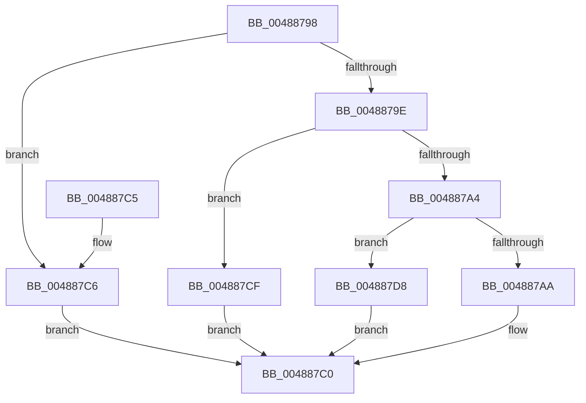

# KiInitializeInterrupt

- RVA: `0x00488798`–`0x004887E1` (길이 `73` bytes)
- VA: `0x0000000140488798`
- 실행 섹션: `.text`
- PDB 이름 있음: `예`; PDB Function 태그: `아니요`
- unwind 정보 RVA: `0x000DB714`
- 디코드: `19`개 명령, `73/73` bytes 표시
- 미해석 바이트: `0` (있으면 어셈블리에 `.byte`로 보존)

> 이 문서는 커널 이미지의 기계어와 PDB 기호를 분석해 생성했습니다. 4번과 5번은 함수 원형과 자료형을 바이너리 사용 방식에서 추정한 C 해석이며 원본 소스 복구 결과는 아닙니다.

## 1. Dependencies

- 직접 호출 지점: **0**; 고유 호출 대상: **0**
- 직접 호출자로 확인된 함수: **1**
- RIP 상대 이미지 참조: **5**

### Outgoing calls
- 직접 디코드된 call 명령이 없습니다.

### Direct callers
- [KeInitializeInterruptEx](KeInitializeInterruptEx_function_00488664.md) at `0x0048871D`

### Static image references
- `0x004887AE` → RVA `0x006B3B30` (`KiInterruptDispatch`; read)
- `0x004887B5` → RVA `0x006B4AA0` (`KiSpuriousDispatchNoEOI`; read)
- `0x004887C6` → RVA `0x006B3F10` (`KiInterruptDispatchNoLock`; read)
- `0x004887CF` → RVA `0x006B42F0` (`KiInterruptDispatchNoLockNoEtw`; read)
- `0x004887D8` → RVA `0x006B46D0` (`KiInterruptDispatchNoEOI`; read)

## 2. Other-region calls and transfers

- 다른 실행 섹션으로 향하는 call: **0**
- 별도 외부 분기/꼬리 이동을 확인하지 못했습니다.

## 3. Assembly (complete function range)

```asm
00488798  48 83 FA FF                     cmp rdx, -1
0048879C  74 28                           je 0x1404887c6
0048879E  48 83 FA FD                     cmp rdx, -3
004887A2  74 2B                           je 0x1404887cf
004887A4  48 83 FA FC                     cmp rdx, -4
004887A8  74 2E                           je 0x1404887d8
004887AA  48 83 FA FE                     cmp rdx, -2
004887AE  48 8D 05 7B B3 22 00            lea rax, [rip + 0x22b37b]
004887B5  4C 8D 05 E4 C2 22 00            lea r8, [rip + 0x22c2e4]
004887BC  49 0F 44 C0                     cmove rax, r8
004887C0  48 89 41 50                     mov qword ptr [rcx + 0x50], rax
004887C4  C3                              ret
004887C5  CC                              int3
004887C6  48 8D 05 43 B7 22 00            lea rax, [rip + 0x22b743]
004887CD  EB F1                           jmp 0x1404887c0
004887CF  48 8D 05 1A BB 22 00            lea rax, [rip + 0x22bb1a]
004887D6  EB E8                           jmp 0x1404887c0
004887D8  48 8D 05 F1 BE 22 00            lea rax, [rip + 0x22bef1]
004887DF  EB DF                           jmp 0x1404887c0
```

## 4. C-style interpretation (structured pseudocode)

```c
__int64 __fastcall KiInitializeInterrupt(__int64 a1, __int64 a2)
{
    __int64 result;

    if (a2 == -1) goto loc_004887C6;
    if (a2 == -3) goto loc_004887CF;
    if (a2 == -4) goto loc_004887D8;
    result = v_rip + 2274171;
    if (a2 == -2) { result = v_rip + 2278116; }
loc_004887C0:
    *(unsigned __int64 *)(a1 + 80) = result;
    return result;
loc_004887C6:
    goto loc_004887C0;
loc_004887CF:
    goto loc_004887C0;
loc_004887D8:
    goto loc_004887C0;
}
```

## 5. (Beta) C Style

```c
int64_t KiInitializeInterrupt(void *Arg1, int64_t Arg2)
{
    uint8_t *arg1 = (uint8_t *)Arg1;

    int64_t result;

    if (Arg2 == -1) goto loc_004887C6;
    if (Arg2 == -3) goto loc_004887CF;
    if (Arg2 == -4) goto loc_004887D8;
    result = v_rip + 2274171;
    if (Arg2 == -2) { result = v_rip + 2278116; }
loc_004887C0:
    *(uint64_t *)(arg1 + 0x50) = result;
    return result;
loc_004887C6:
    goto loc_004887C0;
loc_004887CF:
    goto loc_004887C0;
loc_004887D8:
    goto loc_004887C0;
}
```

### 관측된 메모리 오프셋

구조체 형식이 확인되지 않은 접근은 인자 기준의 오프셋으로만 기록했습니다.

| 기준 인자 | 오프셋 표현 | 폭 (bit) | 접근 |
|---|---:|---:|---|
| `Arg1` | `+ 0x50` | `64` | `W` |

## 6. Execution-region graph

[열기: 2D/3D 그래프와 함수 탐색 컨트롤 패널](../../../control-panel.html?section=text&rva=0x00488798&view=graph)

- 2D 그래프는 위에서 아래로 흐르고, 3D 그래프는 빈 공간을 드래그해 회전합니다. Shift+드래그는 이동, 휠은 확대·축소, 함수 노드 선택은 대상 보고서 이동입니다.

### Static fallback


