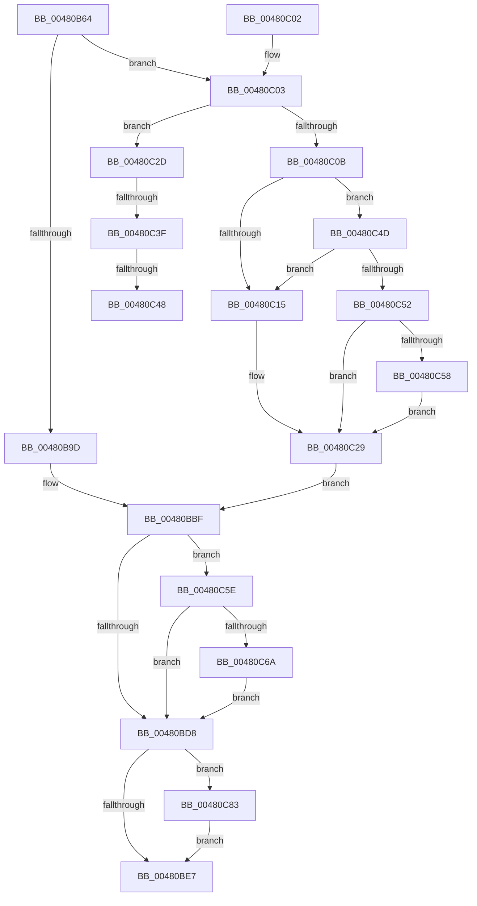

# KiOpRetrieveRegMemAddress

- RVA: `0x00480B64`–`0x00480C8A` (길이 `294` bytes)
- VA: `0x0000000140480B64`
- 실행 섹션: `.text`
- PDB 이름 있음: `예`; PDB Function 태그: `예`
- unwind 정보 RVA: `0x000AEB80`
- 디코드: `89`개 명령, `294/294` bytes 표시
- 미해석 바이트: `0` (있으면 어셈블리에 `.byte`로 보존)

> 이 문서는 커널 이미지의 기계어와 PDB 기호를 분석해 생성했습니다. 4번과 5번은 함수 원형과 자료형을 바이너리 사용 방식에서 추정한 C 해석이며 원본 소스 복구 결과는 아닙니다.

## 1. Dependencies

- 직접 호출 지점: **1**; 고유 호출 대상: **1**
- 직접 호출자로 확인된 함수: **3**
- RIP 상대 이미지 참조: **0**

### Outgoing calls
- `0x00480C72` → [KiOpComputeLinearAddress](../5C/KiOpComputeLinearAddress_function_005C67C4.md) (function, `0x005C67C4`)

### Direct callers
- [KiOp_SLDTSTRSMSW](KiOp_SLDTSTRSMSW_function_004808B0.md) at `0x00480956`
- [KiOp_Div](KiOp_Div_function_00480A50.md) at `0x00480A88`
- [KiOp_SGDTSIDT](../4B/KiOp_SGDTSIDT_function_004BF6A0.md) at `0x004BF796`

### Static image references
- 디코드된 RIP-relative 메모리 참조가 없습니다.

## 2. Other-region calls and transfers

- 다른 실행 섹션으로 향하는 call: **0**
- call이 아닌 외부 분기/꼬리 이동: **3**
  - `0x00480C39` → [sub_006F4FD6](../6F/Unknown_function_006F4FD6.md) (`tail-transfer`)
  - `0x00480C42` → [sub_006F4FD6](../6F/Unknown_function_006F4FD6.md) (`tail-transfer`)
  - `0x00480C48` → [sub_006F4FD6 + 0x1C](../6F/Unknown_function_006F4FD6.md) (`tail-transfer`)

## 3. Assembly (complete function range)

```asm
00480B64  48 89 5C 24 10                  mov qword ptr [rsp + 0x10], rbx
00480B69  48 89 6C 24 18                  mov qword ptr [rsp + 0x18], rbp
00480B6E  48 89 74 24 20                  mov qword ptr [rsp + 0x20], rsi
00480B73  57                              push rdi
00480B74  41 56                           push r14
00480B76  41 57                           push r15
00480B78  48 83 EC 20                     sub rsp, 0x20
00480B7C  40 8A 69 51                     mov bpl, byte ptr [rcx + 0x51]
00480B80  4C 8B D1                        mov r10, rcx
00480B83  0F B6 49 41                     movzx ecx, byte ptr [rcx + 0x41]
00480B87  45 33 DB                        xor r11d, r11d
00480B8A  8A C1                           mov al, cl
00480B8C  33 FF                           xor edi, edi
00480B8E  24 C0                           and al, 0xc0
00480B90  49 8B F1                        mov rsi, r9
00480B93  4D 8B F0                        mov r14, r8
00480B96  4C 8B FA                        mov r15, rdx
00480B99  3C C0                           cmp al, 0xc0
00480B9B  75 66                           jne 0x140480c03
00480B9D  49 8B 42 18                     mov rax, qword ptr [r10 + 0x18]
00480BA1  8D 5F 01                        lea ebx, [rdi + 1]
00480BA4  83 E1 07                        and ecx, 7
00480BA7  41 F6 42 40 01                  test byte ptr [r10 + 0x40], 1
00480BAC  44 8D 59 08                     lea r11d, [rcx + 8]
00480BB0  44 0F 44 D9                     cmove r11d, ecx
00480BB4  48 83 C0 78                     add rax, 0x78
00480BB8  40 32 ED                        xor bpl, bpl
00480BBB  4E 8D 1C D8                     lea r11, [rax + r11*8]
00480BBF  49 63 4A 44                     movsxd rcx, dword ptr [r10 + 0x44]
00480BC3  33 D2                           xor edx, edx
00480BC5  48 03 CF                        add rcx, rdi
00480BC8  49 03 CB                        add rcx, r11
00480BCB  48 89 4C 24 40                  mov qword ptr [rsp + 0x40], rcx
00480BD0  85 DB                           test ebx, ebx
00480BD2  0F 84 86 00 00 00               je 0x140480c5e
00480BD8  49 89 0F                        mov qword ptr [r15], rcx
00480BDB  41 88 2E                        mov byte ptr [r14], bpl
00480BDE  48 85 F6                        test rsi, rsi
00480BE1  0F 85 9C 00 00 00               jne 0x140480c83
00480BE7  48 8B 5C 24 48                  mov rbx, qword ptr [rsp + 0x48]
00480BEC  8B C2                           mov eax, edx
00480BEE  48 8B 6C 24 50                  mov rbp, qword ptr [rsp + 0x50]
00480BF3  48 8B 74 24 58                  mov rsi, qword ptr [rsp + 0x58]
00480BF8  48 83 C4 20                     add rsp, 0x20
00480BFC  41 5F                           pop r15
00480BFE  41 5E                           pop r14
00480C00  5F                              pop rdi
00480C01  C3                              ret
00480C02  CC                              int3
00480C03  8A C1                           mov al, cl
00480C05  24 07                           and al, 7
00480C07  3C 04                           cmp al, 4
00480C09  74 22                           je 0x140480c2d
00480C0B  8B D1                           mov edx, ecx
00480C0D  83 E2 07                        and edx, 7
00480C10  80 F9 40                        cmp cl, 0x40
00480C13  72 38                           jb 0x140480c4d
00480C15  41 F6 42 40 01                  test byte ptr [r10 + 0x40], 1
00480C1A  8D 4A 08                        lea ecx, [rdx + 8]
00480C1D  49 8B 42 18                     mov rax, qword ptr [r10 + 0x18]
00480C21  0F 44 CA                        cmove ecx, edx
00480C24  4C 8B 5C C8 78                  mov r11, qword ptr [rax + rcx*8 + 0x78]
00480C29  33 DB                           xor ebx, ebx
00480C2B  EB 92                           jmp 0x140480bbf
00480C2D  45 0F B6 42 42                  movzx r8d, byte ptr [r10 + 0x42]
00480C32  41 8A C0                        mov al, r8b
00480C35  24 07                           and al, 7
00480C37  3C 05                           cmp al, 5
00480C39  0F 85 97 43 27 00               jne 0x1406f4fd6
00480C3F  80 F9 40                        cmp cl, 0x40
00480C42  0F 83 8E 43 27 00               jae 0x1406f4fd6
00480C48  E9 A5 43 27 00                  jmp 0x1406f4ff2
00480C4D  83 FA 05                        cmp edx, 5
00480C50  75 C3                           jne 0x140480c15
00480C52  41 38 7A 3A                     cmp byte ptr [r10 + 0x3a], dil
00480C56  75 D1                           jne 0x140480c29
00480C58  4D 8B 5A 10                     mov r11, qword ptr [r10 + 0x10]
00480C5C  EB CB                           jmp 0x140480c29
00480C5E  41 8B 42 34                     mov eax, dword ptr [r10 + 0x34]
00480C62  A8 01                           test al, 1
00480C64  0F 84 6E FF FF FF               je 0x140480bd8
00480C6A  48 8D 54 24 40                  lea rdx, [rsp + 0x40]
00480C6F  49 8B CA                        mov rcx, r10
00480C72  E8 4D 5B 14 00                  call 0x1405c67c4
00480C77  48 8B 4C 24 40                  mov rcx, qword ptr [rsp + 0x40]
00480C7C  8B D0                           mov edx, eax
00480C7E  E9 55 FF FF FF                  jmp 0x140480bd8
00480C83  89 1E                           mov dword ptr [rsi], ebx
00480C85  E9 5D FF FF FF                  jmp 0x140480be7
```

## 4. C-style interpretation (structured pseudocode)

```c
__int64 __fastcall KiOpRetrieveRegMemAddress(__int64 a1, __int64 a2, __int64 a3, __int64 a4)
{
    __int64 result;
    __int64 v_r11;
    __int64 v_rbp;
    __int64 v_rbx;
    __int64 v_rdi;
    __int64 v_rsp;
    unsigned __int64 v_stack_p10;
    unsigned __int64 v_stack_p18;
    unsigned __int64 v_stack_p20;
    unsigned __int64 v_stack_p40;
    unsigned __int64 v_stack_p8;

    v_stack_p10 = v_rbx;
    v_stack_p18 = v_rbp;
    v_stack_p20 = v_rsi;
    v_rsp = (v_rsp) - (32);
    v_r11 = 0;
    v_rdi = 0;
    result = (unsigned __int8)(((unsigned __int8)(*(unsigned __int8 *)(a1 + 65))) & (192));
    if (((unsigned __int8)(result)) != 192) goto loc_00480C03;
    a1 = (unsigned int)((*(unsigned __int8 *)(a1 + 65)) & (7));
    v_r11 = a1 + 8;
    if (((*(unsigned __int8 *)(a1 + 64)) & (1)) == 0) { v_r11 = (unsigned int)(a1); }
    result = (*(unsigned __int64 *)(a1 + 24)) + (120);
    v_rbp = 0;
loc_00480BBF:
    a2 = 0;
    a1 = ((int)(*(unsigned int *)(a1 + 68))) + (0);
    a1 = (a1) + (result + v_r11 * 8);
    v_stack_p8 = a1;
    if ((unsigned int)(v_rdi + 1) == 0) goto loc_00480C5E;
loc_00480BD8:
    *(unsigned __int64 *)(a2) = a1;
    *(unsigned __int8 *)(a3) = 0;
    if (a4 != 0) goto loc_00480C83;
loc_00480BE7:
    v_rsp = (v_rsp) + (32);
    return 0;
loc_00480C03:
    result = (unsigned __int8)(((unsigned __int8)(a1)) & (7));
    if (((unsigned __int8)(result)) == 4) goto loc_00480C2D;
    a2 = (unsigned int)(((unsigned int)((unsigned int)(a1))) & (7));
    if (((unsigned __int8)(a1)) < 64) goto loc_00480C4D;
loc_00480C15:
    a1 = a2 + 8;
    if (((*(unsigned __int8 *)(a1 + 64)) & (1)) == 0) { a1 = (unsigned int)(a2); }
loc_00480C29:
    v_rbx = 0;
    goto loc_00480BBF;
loc_00480C2D:
    result = (unsigned __int8)(((unsigned __int8)(*(unsigned __int8 *)(a1 + 66))) & (7));
loc_00480C4D:
    if (((unsigned int)(a2)) != 5) goto loc_00480C15;
    if ((*(unsigned __int8 *)(a1 + 58)) != 0) goto loc_00480C29;
    goto loc_00480C29;
loc_00480C5E:
    if ((((unsigned __int8)((unsigned int)(*(unsigned int *)(a1 + 52)))) & (1)) == 0) goto loc_00480BD8;
    result = KiOpComputeLinearAddress(a1, v_stack_p40, *(unsigned __int8 *)(a1 + 66), a4);
    goto loc_00480BD8;
loc_00480C83:
    *(unsigned int *)(v_stack_p20) = 0;
    goto loc_00480BE7;
}
```

## 5. (Beta) C Style

```c
int64_t KiOpRetrieveRegMemAddress(void *Arg1, void *Arg2, void *Arg3, int64_t Arg4)
{
    uint8_t *arg1 = (uint8_t *)Arg1;
    uint8_t *arg2 = (uint8_t *)Arg2;
    uint8_t *arg3 = (uint8_t *)Arg3;

    int64_t result;
    int64_t local_r11;
    int64_t local_rbp;
    int64_t local_rbx;
    int64_t local_rdi;
    int64_t local_rsp;
    uint64_t v_stack_p10;
    uint64_t v_stack_p18;
    uint64_t v_stack_p20;
    uint64_t v_stack_p40;
    uint64_t v_stack_p8;

    v_stack_p10 = local_rbx;
    v_stack_p18 = local_rbp;
    v_stack_p20 = local_rsi;
    local_rsp = (local_rsp) - (32);
    local_r11 = 0;
    local_rdi = 0;
    result = (uint8_t)(((uint8_t)(*(uint8_t *)(arg1 + 0x41))) & (192));
    if (((uint8_t)(result)) != 192) goto loc_00480C03;
    Arg1 = (uint32_t)((*(uint8_t *)(arg1 + 0x41)) & (7));
    local_r11 = Arg1 + 8;
    if (((*(uint8_t *)(arg1 + 0x40)) & (1)) == 0) { local_r11 = (uint32_t)(Arg1); }
    result = (*(uint64_t *)(arg1 + 0x18)) + (120);
    local_rbp = 0;
loc_00480BBF:
    Arg2 = 0;
    Arg1 = ((int32_t)(*(uint32_t *)(arg1 + 0x44))) + (0);
    Arg1 = (Arg1) + (result + local_r11 * 8);
    v_stack_p8 = Arg1;
    if ((uint32_t)(local_rdi + 1) == 0) goto loc_00480C5E;
loc_00480BD8:
    *(void **)(arg2) = Arg1;
    *(uint8_t *)(arg3) = 0;
    if (Arg4 != 0) goto loc_00480C83;
loc_00480BE7:
    local_rsp = (local_rsp) + (32);
    return 0;
loc_00480C03:
    result = (uint8_t)(((uint8_t)(Arg1)) & (7));
    if (((uint8_t)(result)) == 4) goto loc_00480C2D;
    Arg2 = (uint32_t)(((uint32_t)((uint32_t)(Arg1))) & (7));
    if (((uint8_t)(Arg1)) < 64) goto loc_00480C4D;
loc_00480C15:
    Arg1 = Arg2 + 8;
    if (((*(uint8_t *)(arg1 + 0x40)) & (1)) == 0) { Arg1 = (uint32_t)(Arg2); }
loc_00480C29:
    local_rbx = 0;
    goto loc_00480BBF;
loc_00480C2D:
    result = (uint8_t)(((uint8_t)(*(uint8_t *)(arg1 + 0x42))) & (7));
loc_00480C4D:
    if (((uint32_t)(Arg2)) != 5) goto loc_00480C15;
    if ((*(uint8_t *)(arg1 + 0x3A)) != 0) goto loc_00480C29;
    goto loc_00480C29;
loc_00480C5E:
    if ((((uint8_t)((uint32_t)(*(uint32_t *)(arg1 + 0x34)))) & (1)) == 0) goto loc_00480BD8;
    result = KiOpComputeLinearAddress(Arg1, v_stack_p40, *(uint8_t *)(arg1 + 0x42), Arg4);
    goto loc_00480BD8;
loc_00480C83:
    *(uint32_t *)(v_stack_p20) = 0;
    goto loc_00480BE7;
}
```

### 관측된 메모리 오프셋

구조체 형식이 확인되지 않은 접근은 인자 기준의 오프셋으로만 기록했습니다.

| 기준 인자 | 오프셋 표현 | 폭 (bit) | 접근 |
|---|---:|---:|---|
| `Arg1` | `+ 0x10` | `64` | `R` |
| `Arg1` | `+ 0x18` | `64` | `R` |
| `Arg1` | `+ 0x34` | `32` | `R` |
| `Arg1` | `+ 0x3A` | `8` | `R` |
| `Arg1` | `+ 0x40` | `8` | `R` |
| `Arg1` | `+ 0x41` | `8` | `R` |
| `Arg1` | `+ 0x42` | `8` | `R` |
| `Arg1` | `+ 0x44` | `32` | `R` |
| `Arg1` | `+ 0x51` | `8` | `R` |
| `Arg2` | `+ 0x0` | `64` | `W` |
| `Arg3` | `+ 0x0` | `8` | `W` |

## 6. Execution-region graph

[열기: 2D/3D 그래프와 함수 탐색 컨트롤 패널](../../../control-panel.html?section=text&rva=0x00480B64&view=graph)

- 2D 그래프는 위에서 아래로 흐르고, 3D 그래프는 빈 공간을 드래그해 회전합니다. Shift+드래그는 이동, 휠은 확대·축소, 함수 노드 선택은 대상 보고서 이동입니다.

### Static fallback


