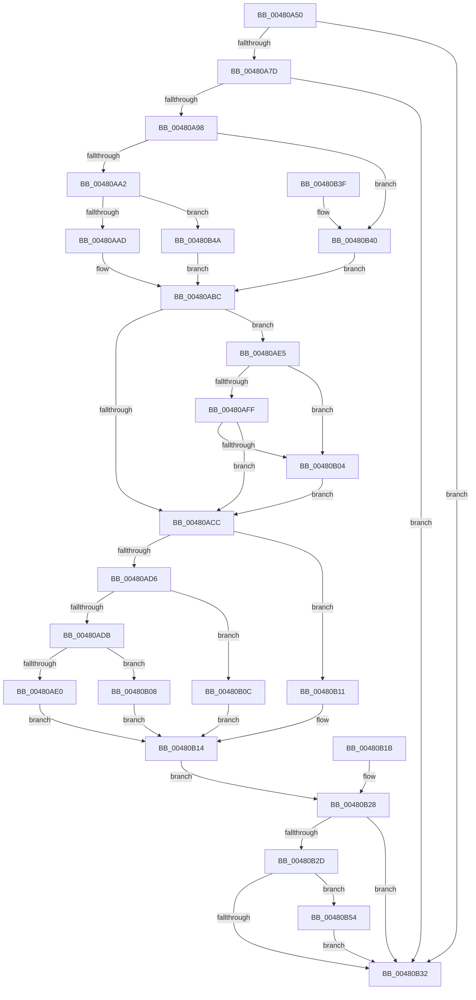

# KiOp_Div

- RVA: `0x00480A50`–`0x00480B5C` (길이 `268` bytes)
- VA: `0x0000000140480A50`
- 실행 섹션: `.text`
- PDB 이름 있음: `예`; PDB Function 태그: `아니요`
- unwind 정보 RVA: `0x000AEB58`
- 디코드: `77`개 명령, `268/268` bytes 표시
- 미해석 바이트: `0` (있으면 어셈블리에 `.byte`로 보존)

> 이 문서는 커널 이미지의 기계어와 PDB 기호를 분석해 생성했습니다. 4번과 5번은 함수 원형과 자료형을 바이너리 사용 방식에서 추정한 C 해석이며 원본 소스 복구 결과는 아닙니다.

## 1. Dependencies

- 직접 호출 지점: **1**; 고유 호출 대상: **1**
- 직접 호출자로 확인된 함수: **0**
- RIP 상대 이미지 참조: **0**

### Outgoing calls
- `0x00480A88` → [KiOpRetrieveRegMemAddress](KiOpRetrieveRegMemAddress_function_00480B64.md) (function, `0x00480B64`)

### Direct callers
- 이 함수 시작 RVA로 연결되는 직접 call은 확인되지 않았습니다. 간접 호출은 완전히 역산할 수 없습니다.

### Static image references
- 디코드된 RIP-relative 메모리 참조가 없습니다.

## 2. Other-region calls and transfers

- 다른 실행 섹션으로 향하는 call: **0**
- 별도 외부 분기/꼬리 이동을 확인하지 못했습니다.

## 3. Assembly (complete function range)

```asm
00480A50  48 8B C4                        mov rax, rsp
00480A53  48 89 58 20                     mov qword ptr [rax + 0x20], rbx
00480A57  57                              push rdi
00480A58  48 83 EC 30                     sub rsp, 0x30
00480A5C  48 8B D9                        mov rbx, rcx
00480A5F  C6 40 08 00                     mov byte ptr [rax + 8], 0
00480A63  48 83 60 10 00                  and qword ptr [rax + 0x10], 0
00480A68  48 8B 79 20                     mov rdi, qword ptr [rcx + 0x20]
00480A6C  48 89 7C 24 50                  mov qword ptr [rsp + 0x50], rdi
00480A71  81 3F 94 00 00 C0               cmp dword ptr [rdi], 0xc0000094
00480A77  0F 85 B5 00 00 00               jne 0x140480b32
00480A7D  45 33 C9                        xor r9d, r9d
00480A80  4C 8D 40 08                     lea r8, [rax + 8]
00480A84  48 8D 50 10                     lea rdx, [rax + 0x10]
00480A88  E8 D7 00 00 00                  call 0x140480b64
00480A8D  44 8B C8                        mov r9d, eax
00480A90  85 C0                           test eax, eax
00480A92  0F 88 9A 00 00 00               js 0x140480b32
00480A98  80 7B 38 F6                     cmp byte ptr [rbx + 0x38], 0xf6
00480A9C  0F 84 9E 00 00 00               je 0x140480b40
00480AA2  8B 43 30                        mov eax, dword ptr [rbx + 0x30]
00480AA5  A8 40                           test al, 0x40
00480AA7  0F 85 9D 00 00 00               jne 0x140480b4a
00480AAD  8A 43 40                        mov al, byte ptr [rbx + 0x40]
00480AB0  24 08                           and al, 8
00480AB2  F6 D8                           neg al
00480AB4  1B C9                           sbb ecx, ecx
00480AB6  83 E1 04                        and ecx, 4
00480AB9  83 C1 04                        add ecx, 4
00480ABC  48 C7 44 24 20 00 00 00 00      mov qword ptr [rsp + 0x20], 0
00480AC5  80 7C 24 40 01                  cmp byte ptr [rsp + 0x40], 1
00480ACA  74 19                           je 0x140480ae5
00480ACC  83 E9 01                        sub ecx, 1
00480ACF  48 8B 44 24 48                  mov rax, qword ptr [rsp + 0x48]
00480AD4  74 3B                           je 0x140480b11
00480AD6  83 E9 01                        sub ecx, 1
00480AD9  74 31                           je 0x140480b0c
00480ADB  83 F9 02                        cmp ecx, 2
00480ADE  74 28                           je 0x140480b08
00480AE0  48 8B 08                        mov rcx, qword ptr [rax]
00480AE3  EB 2F                           jmp 0x140480b14
00480AE5  44 8B C1                        mov r8d, ecx
00480AE8  48 8B 54 24 48                  mov rdx, qword ptr [rsp + 0x48]
00480AED  4C 03 C2                        add r8, rdx
00480AF0  48 B8 00 00 FF FF FF 7F 00 00   movabs rax, 0x7fffffff0000
00480AFA  4C 3B C0                        cmp r8, rax
00480AFD  77 05                           ja 0x140480b04
00480AFF  4C 3B C2                        cmp r8, rdx
00480B02  73 C8                           jae 0x140480acc
00480B04  8A 00                           mov al, byte ptr [rax]
00480B06  EB C4                           jmp 0x140480acc
00480B08  8B 08                           mov ecx, dword ptr [rax]
00480B0A  EB 08                           jmp 0x140480b14
00480B0C  0F B7 08                        movzx ecx, word ptr [rax]
00480B0F  EB 03                           jmp 0x140480b14
00480B11  0F B6 08                        movzx ecx, byte ptr [rax]
00480B14  48 89 4C 24 20                  mov qword ptr [rsp + 0x20], rcx
00480B19  EB 0D                           jmp 0x140480b28
00480B1B  44 8B C8                        mov r9d, eax
00480B1E  48 8B 4C 24 20                  mov rcx, qword ptr [rsp + 0x20]
00480B23  48 8B 7C 24 50                  mov rdi, qword ptr [rsp + 0x50]
00480B28  45 85 C9                        test r9d, r9d
00480B2B  78 05                           js 0x140480b32
00480B2D  48 85 C9                        test rcx, rcx
00480B30  75 22                           jne 0x140480b54
00480B32  33 C0                           xor eax, eax
00480B34  48 8B 5C 24 58                  mov rbx, qword ptr [rsp + 0x58]
00480B39  48 83 C4 30                     add rsp, 0x30
00480B3D  5F                              pop rdi
00480B3E  C3                              ret
00480B3F  CC                              int3
00480B40  B9 01 00 00 00                  mov ecx, 1
00480B45  E9 72 FF FF FF                  jmp 0x140480abc
00480B4A  B9 02 00 00 00                  mov ecx, 2
00480B4F  E9 68 FF FF FF                  jmp 0x140480abc
00480B54  C7 07 95 00 00 C0               mov dword ptr [rdi], 0xc0000095
00480B5A  EB D6                           jmp 0x140480b32
```

## 4. C-style interpretation (structured pseudocode)

```c
__int64 __fastcall KiOp_Div(__int64 a1, __int64 a2, __int64 a3, int a4)
{
    __int64 result;
    __int64 v_rsp;
    unsigned __int64 v_stack_m18;
    unsigned __int64 v_stack_p10;
    unsigned __int64 v_stack_p18;
    unsigned __int64 v_stack_p20;
    unsigned __int8 v_stack_p8;

    *(unsigned __int64 *)(v_rsp + 32) = v_rbx;
    v_rsp = (v_rsp) - (48);
    *(unsigned __int8 *)(v_rsp + 8) = 0;
    v_stack_p18 = *(unsigned __int64 *)(a1 + 32);
    if ((*(unsigned int *)(*(unsigned __int64 *)(a1 + 32))) != 0xC0000094ULL) goto loc_00480B32;
    a4 = 0;
    result = KiOpRetrieveRegMemAddress(a1, v_rsp + 16, v_rsp + 8, a4);
    if (sign_flag) goto loc_00480B32;
    if ((*(unsigned __int8 *)(a1 + 56)) == 246) goto loc_00480B40;
    if ((((unsigned __int8)((unsigned int)(*(unsigned int *)(a1 + 48)))) & (64)) != 0) goto loc_00480B4A;
    result = (unsigned __int8)((*(unsigned __int8 *)(a1 + 64)) & (8));
    result = (unsigned __int8)(-(result));
    a1 = (unsigned int)((a1) & (4));
    a1 = (unsigned int)((a1) + (4));
loc_00480ABC:
    v_stack_m18 = 0;
    if (v_stack_p8 == 1) goto loc_00480AE5;
loc_00480ACC:
    a1 = (unsigned int)((a1) - (1));
    if (condition_is_equal) goto loc_00480B11;
    a1 = (unsigned int)((a1) - (1));
    if (condition_is_equal) goto loc_00480B0C;
    if (((unsigned int)(a1)) == 2) goto loc_00480B08;
    goto loc_00480B14;
loc_00480AE5:
    a3 = ((unsigned int)((unsigned int)(*(unsigned __int64 *)(v_stack_p10)))) + (v_stack_p10);
    if (a3 > v_stack_p10) goto loc_00480B04;
    if (a3 >= v_stack_p10) goto loc_00480ACC;
loc_00480B04:
    goto loc_00480ACC;
loc_00480B08:
    goto loc_00480B14;
loc_00480B0C:
    goto loc_00480B14;
loc_00480B11:
loc_00480B14:
    v_stack_m18 = *(unsigned __int8 *)(*(unsigned __int8 *)(v_stack_p10));
    goto loc_00480B28;
loc_00480B28:
    if (sign_flag) goto loc_00480B32;
    if (*(unsigned __int8 *)(*(unsigned __int8 *)(v_stack_p10)) != 0) goto loc_00480B54;
loc_00480B32:
    result = 0;
    v_rsp = (v_rsp) + (48);
    return result;
loc_00480B40:
    goto loc_00480ABC;
loc_00480B4A:
    goto loc_00480ABC;
loc_00480B54:
    *(unsigned int *)(*(unsigned __int64 *)(a1 + 32)) = 0xC0000095ULL;
    goto loc_00480B32;
}
```

## 5. (Beta) C Style

```c
int64_t KiOp_Div(void *Arg1, int64_t Arg2, int64_t Arg3, int32_t Arg4)
{
    uint8_t *arg1 = (uint8_t *)Arg1;

    int64_t result;
    int64_t local_rsp;
    uint64_t v_stack_m18;
    uint64_t v_stack_p10;
    uint64_t v_stack_p18;
    uint64_t v_stack_p20;
    uint8_t v_stack_p8;

    *(uint64_t *)(local_rsp + 0x20) = local_rbx;
    local_rsp = (local_rsp) - (48);
    *(uint8_t *)(local_rsp + 0x8) = 0;
    v_stack_p18 = *(uint64_t *)(arg1 + 0x20);
    if ((*(uint32_t *)(*(uint64_t *)(arg1 + 0x20))) != 0xC0000094ULL) goto loc_00480B32;
    Arg4 = 0;
    result = KiOpRetrieveRegMemAddress(Arg1, local_rsp + 16, local_rsp + 8, Arg4);
    if (sign_flag) goto loc_00480B32;
    if ((*(uint8_t *)(arg1 + 0x38)) == 246) goto loc_00480B40;
    if ((((uint8_t)((uint32_t)(*(uint32_t *)(arg1 + 0x30)))) & (64)) != 0) goto loc_00480B4A;
    result = (uint8_t)((*(uint8_t *)(arg1 + 0x40)) & (8));
    result = (uint8_t)(-(result));
    Arg1 = (uint32_t)((Arg1) & (4));
    Arg1 = (uint32_t)((Arg1) + (4));
loc_00480ABC:
    v_stack_m18 = 0;
    if (v_stack_p8 == 1) goto loc_00480AE5;
loc_00480ACC:
    Arg1 = (uint32_t)((Arg1) - (1));
    if (condition_is_equal) goto loc_00480B11;
    Arg1 = (uint32_t)((Arg1) - (1));
    if (condition_is_equal) goto loc_00480B0C;
    if (((uint32_t)(Arg1)) == 2) goto loc_00480B08;
    goto loc_00480B14;
loc_00480AE5:
    Arg3 = ((uint32_t)((uint32_t)(*(uint64_t *)(v_stack_p10)))) + (v_stack_p10);
    if (Arg3 > v_stack_p10) goto loc_00480B04;
    if (Arg3 >= v_stack_p10) goto loc_00480ACC;
loc_00480B04:
    goto loc_00480ACC;
loc_00480B08:
    goto loc_00480B14;
loc_00480B0C:
    goto loc_00480B14;
loc_00480B11:
loc_00480B14:
    v_stack_m18 = *(uint8_t *)(*(uint8_t *)(v_stack_p10));
    goto loc_00480B28;
loc_00480B28:
    if (sign_flag) goto loc_00480B32;
    if (*(uint8_t *)(*(uint8_t *)(v_stack_p10)) != 0) goto loc_00480B54;
loc_00480B32:
    result = 0;
    local_rsp = (local_rsp) + (48);
    return result;
loc_00480B40:
    goto loc_00480ABC;
loc_00480B4A:
    goto loc_00480ABC;
loc_00480B54:
    *(uint32_t *)(*(uint64_t *)(arg1 + 0x20)) = 0xC0000095ULL;
    goto loc_00480B32;
}
```

### 관측된 메모리 오프셋

구조체 형식이 확인되지 않은 접근은 인자 기준의 오프셋으로만 기록했습니다.

| 기준 인자 | 오프셋 표현 | 폭 (bit) | 접근 |
|---|---:|---:|---|
| `Arg1` | `+ 0x20` | `64` | `R` |
| `Arg1` | `+ 0x30` | `32` | `R` |
| `Arg1` | `+ 0x38` | `8` | `R` |
| `Arg1` | `+ 0x40` | `8` | `R` |

## 6. Execution-region graph

[열기: 2D/3D 그래프와 함수 탐색 컨트롤 패널](../../../control-panel.html?section=text&rva=0x00480A50&view=graph)

- 2D 그래프는 위에서 아래로 흐르고, 3D 그래프는 빈 공간을 드래그해 회전합니다. Shift+드래그는 이동, 휠은 확대·축소, 함수 노드 선택은 대상 보고서 이동입니다.

### Static fallback


