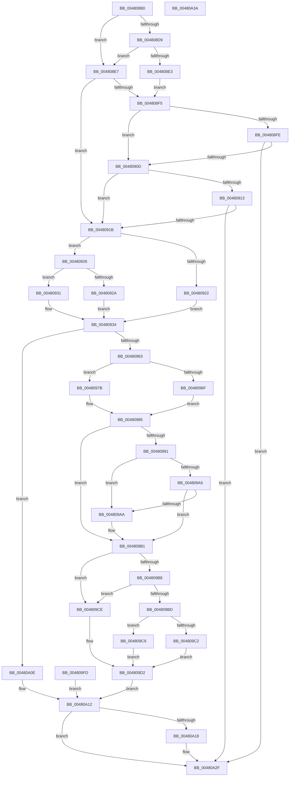

# KiOp_SLDTSTRSMSW

- RVA: `0x004808B0`–`0x00480A3B` (길이 `395` bytes)
- VA: `0x00000001404808B0`
- 실행 섹션: `.text`
- PDB 이름 있음: `예`; PDB Function 태그: `아니요`
- unwind 정보 RVA: `0x000AEB30`
- 디코드: `115`개 명령, `395/395` bytes 표시
- 미해석 바이트: `0` (있으면 어셈블리에 `.byte`로 보존)

> 이 문서는 커널 이미지의 기계어와 PDB 기호를 분석해 생성했습니다. 4번과 5번은 함수 원형과 자료형을 바이너리 사용 방식에서 추정한 C 해석이며 원본 소스 복구 결과는 아닙니다.

## 1. Dependencies

- 직접 호출 지점: **1**; 고유 호출 대상: **1**
- 직접 호출자로 확인된 함수: **0**
- RIP 상대 이미지 참조: **7**

### Outgoing calls
- `0x00480956` → [KiOpRetrieveRegMemAddress](KiOpRetrieveRegMemAddress_function_00480B64.md) (function, `0x00480B64`)

### Direct callers
- 이 함수 시작 RVA로 연결되는 직접 call은 확인되지 않았습니다. 간접 호출은 완전히 역산할 수 없습니다.

### Static image references
- `0x004808CF` → RVA `0x00F4754C` (`.data`; read)
- `0x004808D9` → RVA `0x00F0DE5C` (`.data`; read)
- `0x004808EC` → RVA `0x00FC6A84` (`ALMOSTRO`; read)
- `0x004808F5` → RVA `0x00FC6DC0` (`ALMOSTRO`; read)
- `0x004808FE` → RVA `0x00FC6B60` (`ALMOSTRO`; read)
- `0x004809E9` → RVA `0x00F10A38` (`.data`; read)
- `0x004809F1` → RVA `0x00F10A38` (`.data`; write)

## 2. Other-region calls and transfers

- 다른 실행 섹션으로 향하는 call: **0**
- 별도 외부 분기/꼬리 이동을 확인하지 못했습니다.

## 3. Assembly (complete function range)

```asm
004808B0  48 8B C4                        mov rax, rsp
004808B3  48 89 48 08                     mov qword ptr [rax + 8], rcx
004808B7  56                              push rsi
004808B8  57                              push rdi
004808B9  41 56                           push r14
004808BB  48 83 EC 30                     sub rsp, 0x30
004808BF  48 8B F9                        mov rdi, rcx
004808C2  48 83 60 20 00                  and qword ptr [rax + 0x20], 0
004808C7  C6 40 10 00                     mov byte ptr [rax + 0x10], 0
004808CB  83 60 18 00                     and dword ptr [rax + 0x18], 0
004808CF  8B 05 77 6C AC 00               mov eax, dword ptr [rip + 0xac6c77]
004808D5  A8 03                           test al, 3
004808D7  75 0E                           jne 0x1404808e7
004808D9  8B 05 7D D5 A8 00               mov eax, dword ptr [rip + 0xa8d57d]
004808DF  85 C0                           test eax, eax
004808E1  75 04                           jne 0x1404808e7
004808E3  33 C9                           xor ecx, ecx
004808E5  EB 0E                           jmp 0x1404808f5
004808E7  B9 01 00 00 00                  mov ecx, 1
004808EC  80 3D 91 61 B4 00 00            cmp byte ptr [rip + 0xb46191], 0
004808F3  75 26                           jne 0x14048091b
004808F5  83 3D C4 64 B4 00 00            cmp dword ptr [rip + 0xb464c4], 0
004808FC  75 0F                           jne 0x14048090d
004808FE  48 8B 05 5B 62 B4 00            mov rax, qword ptr [rip + 0xb4625b]
00480905  A8 04                           test al, 4
00480907  0F 84 22 01 00 00               je 0x140480a2f
0048090D  80 7F 51 01                     cmp byte ptr [rdi + 0x51], 1
00480911  74 08                           je 0x14048091b
00480913  85 C9                           test ecx, ecx
00480915  0F 84 14 01 00 00               je 0x140480a2f
0048091B  8A 47 41                        mov al, byte ptr [rdi + 0x41]
0048091E  24 38                           and al, 0x38
00480920  75 04                           jne 0x140480926
00480922  33 F6                           xor esi, esi
00480924  EB 0E                           jmp 0x140480934
00480926  3C 08                           cmp al, 8
00480928  75 07                           jne 0x140480931
0048092A  BE 40 00 00 00                  mov esi, 0x40
0048092F  EB 03                           jmp 0x140480934
00480931  0F 20 C6                        mov rsi, cr0
00480934  4C 8B 77 20                     mov r14, qword ptr [rdi + 0x20]
00480938  4C 89 74 24 28                  mov qword ptr [rsp + 0x28], r14
0048093D  41 C7 06 05 00 00 C0            mov dword ptr [r14], 0xc0000005
00480944  4C 8D 4C 24 60                  lea r9, [rsp + 0x60]
00480949  4C 8D 44 24 58                  lea r8, [rsp + 0x58]
0048094E  48 8D 54 24 68                  lea rdx, [rsp + 0x68]
00480953  48 8B CF                        mov rcx, rdi
00480956  E8 09 02 00 00                  call 0x140480b64
0048095B  85 C0                           test eax, eax
0048095D  0F 88 AB 00 00 00               js 0x140480a0e
00480963  8B 47 30                        mov eax, dword ptr [rdi + 0x30]
00480966  83 E0 40                        and eax, 0x40
00480969  80 7F 3A 00                     cmp byte ptr [rdi + 0x3a], 0
0048096D  74 0C                           je 0x14048097b
0048096F  F7 D8                           neg eax
00480971  1B C9                           sbb ecx, ecx
00480973  83 E1 FE                        and ecx, 0xfffffffe
00480976  83 C1 04                        add ecx, 4
00480979  EB 0A                           jmp 0x140480985
0048097B  F7 D8                           neg eax
0048097D  1B C9                           sbb ecx, ecx
0048097F  83 E1 FA                        and ecx, 0xfffffffa
00480982  83 C1 08                        add ecx, 8
00480985  4C 8B 44 24 68                  mov r8, qword ptr [rsp + 0x68]
0048098A  80 7C 24 58 01                  cmp byte ptr [rsp + 0x58], 1
0048098F  75 20                           jne 0x1404809b1
00480991  8B D1                           mov edx, ecx
00480993  49 03 D0                        add rdx, r8
00480996  48 B8 00 00 FF FF FF 7F 00 00   movabs rax, 0x7fffffff0000
004809A0  48 3B D0                        cmp rdx, rax
004809A3  77 05                           ja 0x1404809aa
004809A5  49 3B D0                        cmp rdx, r8
004809A8  73 07                           jae 0x1404809b1
004809AA  8A 00                           mov al, byte ptr [rax]
004809AC  4C 8B 44 24 68                  mov r8, qword ptr [rsp + 0x68]
004809B1  83 7C 24 60 00                  cmp dword ptr [rsp + 0x60], 0
004809B6  74 16                           je 0x1404809ce
004809B8  83 F9 02                        cmp ecx, 2
004809BB  74 11                           je 0x1404809ce
004809BD  83 F9 04                        cmp ecx, 4
004809C0  74 07                           je 0x1404809c9
004809C2  8B C6                           mov eax, esi
004809C4  49 89 00                        mov qword ptr [r8], rax
004809C7  EB 09                           jmp 0x1404809d2
004809C9  41 89 30                        mov dword ptr [r8], esi
004809CC  EB 04                           jmp 0x1404809d2
004809CE  66 41 89 30                     mov word ptr [r8], si
004809D2  8B 47 10                        mov eax, dword ptr [rdi + 0x10]
004809D5  2B 07                           sub eax, dword ptr [rdi]
004809D7  48 8B 4F 18                     mov rcx, qword ptr [rdi + 0x18]
004809DB  48 03 81 F8 00 00 00            add rax, qword ptr [rcx + 0xf8]
004809E2  48 89 81 F8 00 00 00            mov qword ptr [rcx + 0xf8], rax
004809E9  8B 05 49 00 A9 00               mov eax, dword ptr [rip + 0xa90049]
004809EF  FF C0                           inc eax
004809F1  89 05 41 00 A9 00               mov dword ptr [rip + 0xa90041], eax
004809F7  C6 47 60 01                     mov byte ptr [rdi + 0x60], 1
004809FB  EB 15                           jmp 0x140480a12
004809FD  48 8B 7C 24 50                  mov rdi, qword ptr [rsp + 0x50]
00480A02  4C 8B 44 24 68                  mov r8, qword ptr [rsp + 0x68]
00480A07  4C 8B 74 24 28                  mov r14, qword ptr [rsp + 0x28]
00480A0C  EB 04                           jmp 0x140480a12
00480A0E  49 83 C8 FF                     or r8, 0xffffffffffffffff
00480A12  80 7F 60 00                     cmp byte ptr [rdi + 0x60], 0
00480A16  75 17                           jne 0x140480a2f
00480A18  41 C7 06 05 00 00 C0            mov dword ptr [r14], 0xc0000005
00480A1F  49 C7 46 20 01 00 00 00         mov qword ptr [r14 + 0x20], 1
00480A27  4D 89 46 28                     mov qword ptr [r14 + 0x28], r8
00480A2B  C6 47 61 01                     mov byte ptr [rdi + 0x61], 1
00480A2F  33 C0                           xor eax, eax
00480A31  48 83 C4 30                     add rsp, 0x30
00480A35  41 5E                           pop r14
00480A37  5F                              pop rdi
00480A38  5E                              pop rsi
00480A39  C3                              ret
00480A3A  CC                              int3
```

## 4. C-style interpretation (structured pseudocode)

```c
__int64 __fastcall KiOp_SLDTSTRSMSW(__int64 a1)
{
    __int64 result;
    __int64 v_rsi;
    __int64 v_rsp;
    unsigned __int64 v_stack_m20;
    unsigned __int64 v_stack_p10;
    unsigned __int64 v_stack_p18;
    unsigned __int64 v_stack_p20;
    unsigned __int64 v_stack_p8;

    *(unsigned __int64 *)(v_rsp + 8) = a1;
    v_rsp = (v_rsp) - (48);
    *(unsigned __int8 *)(v_rsp + 16) = 0;
    if ((((unsigned __int8)((unsigned int)(*(unsigned int *)(v_rip + 11299959)))) & (3)) != 0) goto loc_004808E7;
    if ((unsigned int)((unsigned int)(*(unsigned int *)(v_rip + 11064701))) != 0) goto loc_004808E7;
    a1 = 0;
    goto loc_004808F5;
loc_004808E7:
    if ((*(unsigned __int8 *)(v_rip + 11821457)) != 0) goto loc_0048091B;
loc_004808F5:
    if ((*(unsigned int *)(v_rip + 11822276)) != 0) goto loc_0048090D;
    if ((((unsigned __int8)(*(unsigned __int64 *)(v_rip + 11821659))) & (4)) == 0) goto loc_00480A2F;
loc_0048090D:
    if ((*(unsigned __int8 *)(a1 + 81)) == 1) goto loc_0048091B;
    if (1 == 0) goto loc_00480A2F;
loc_0048091B:
    result = (unsigned __int8)((*(unsigned __int8 *)(a1 + 65)) & (56));
    if (condition_is_not_equal) goto loc_00480926;
    v_rsi = 0;
    goto loc_00480934;
loc_00480926:
    if (((unsigned __int8)(result)) != 8) goto loc_00480931;
    goto loc_00480934;
loc_00480931:
loc_00480934:
    v_stack_m20 = *(unsigned __int64 *)(a1 + 32);
    *(unsigned int *)(*(unsigned __int64 *)(a1 + 32)) = 0xC0000005ULL;
    result = KiOpRetrieveRegMemAddress(0, v_stack_p20, v_stack_p10, v_stack_p18);
    if (sign_flag) goto loc_00480A0E;
    result = (unsigned int)(((unsigned int)(*(unsigned int *)(a1 + 48))) & (64));
    if ((*(unsigned __int8 *)(a1 + 58)) == 0) goto loc_0048097B;
    result = (unsigned int)(-(result));
    a1 = (unsigned int)((0) & (0xFFFFFFFEULL));
    a1 = (unsigned int)((a1) + (4));
    goto loc_00480985;
loc_0048097B:
    result = (unsigned int)(-(result));
    a1 = (unsigned int)((a1) & (0xFFFFFFFAULL));
    a1 = (unsigned int)((a1) + (8));
loc_00480985:
    if (v_stack_p10 != 1) goto loc_004809B1;
    a2 = ((unsigned int)((unsigned int)(a1))) + (v_stack_p20);
    if (a2 > result) goto loc_004809AA;
    if (a2 < v_stack_p20) {
        result = *(unsigned __int8 *)(result);
        a3 = v_stack_p20;
    }
    if (v_stack_p18 == 0) goto loc_004809CE;
    if (((unsigned int)(a1)) == 2) goto loc_004809CE;
    if (((unsigned int)(a1)) == 4) goto loc_004809C9;
    *(unsigned __int64 *)(a3) = (unsigned int)((unsigned int)(v_cr0));
    goto loc_004809D2;
loc_004809C9:
    *(unsigned int *)(a3) = (unsigned int)(v_cr0);
    goto loc_004809D2;
loc_004809CE:
    *(unsigned __int16 *)(a3) = (unsigned __int16)(v_cr0);
loc_004809D2:
    result = (unsigned int)(((unsigned int)(*(unsigned int *)(a1 + 16))) - (*(unsigned int *)(a1)));
    result = (result) + (*(unsigned __int64 *)(*(unsigned __int64 *)(a1 + 24) + 248));
    *(unsigned __int64 *)(*(unsigned __int64 *)(a1 + 24) + 248) = result;
    result = (unsigned int)(((unsigned int)(*(unsigned int *)(v_rip + 11075657))) + 1);
    *(unsigned int *)(v_rip + 11075649) = (unsigned int)(result);
    *(unsigned __int8 *)(a1 + 96) = 1;
    goto loc_00480A12;
loc_00480A0E:
    a3 = (a3) | (-1);
loc_00480A12:
    if ((*(unsigned __int8 *)(a1 + 96)) == 0) {
        *(unsigned int *)(*(unsigned __int64 *)(a1 + 32)) = 0xC0000005ULL;
        *(unsigned __int64 *)(*(unsigned __int64 *)(a1 + 32) + 32) = 1;
        *(unsigned __int64 *)(*(unsigned __int64 *)(a1 + 32) + 40) = a3;
        *(unsigned __int8 *)(a1 + 97) = 1;
    }
    result = 0;
    v_rsp = (v_rsp) + (48);
    return result;
}
```

## 5. (Beta) C Style

```c
int64_t KiOp_SLDTSTRSMSW(void *Arg1)
{
    uint8_t *arg1 = (uint8_t *)Arg1;

    int64_t result;
    int64_t local_rsi;
    int64_t local_rsp;
    uint64_t v_stack_m20;
    uint64_t v_stack_p10;
    uint64_t v_stack_p18;
    uint64_t v_stack_p20;
    uint64_t v_stack_p8;

    *(void **)(local_rsp + 0x8) = Arg1;
    local_rsp = (local_rsp) - (48);
    *(uint8_t *)(local_rsp + 0x10) = 0;
    if ((((uint8_t)((uint32_t)(*(uint32_t *)(v_rip + 0xAC6C77)))) & (3)) != 0) goto loc_004808E7;
    if ((uint32_t)((uint32_t)(*(uint32_t *)(v_rip + 0xA8D57D))) != 0) goto loc_004808E7;
    Arg1 = 0;
    goto loc_004808F5;
loc_004808E7:
    if ((*(uint8_t *)(v_rip + 0xB46191)) != 0) goto loc_0048091B;
loc_004808F5:
    if ((*(uint32_t *)(v_rip + 0xB464C4)) != 0) goto loc_0048090D;
    if ((((uint8_t)(*(uint64_t *)(v_rip + 0xB4625B))) & (4)) == 0) goto loc_00480A2F;
loc_0048090D:
    if ((*(uint8_t *)(arg1 + 0x51)) == 1) goto loc_0048091B;
    if (1 == 0) goto loc_00480A2F;
loc_0048091B:
    result = (uint8_t)((*(uint8_t *)(arg1 + 0x41)) & (56));
    if (condition_is_not_equal) goto loc_00480926;
    local_rsi = 0;
    goto loc_00480934;
loc_00480926:
    if (((uint8_t)(result)) != 8) goto loc_00480931;
    goto loc_00480934;
loc_00480931:
loc_00480934:
    v_stack_m20 = *(uint64_t *)(arg1 + 0x20);
    *(uint32_t *)(*(uint64_t *)(arg1 + 0x20)) = 0xC0000005ULL;
    result = KiOpRetrieveRegMemAddress(0, v_stack_p20, v_stack_p10, v_stack_p18);
    if (sign_flag) goto loc_00480A0E;
    result = (uint32_t)(((uint32_t)(*(uint32_t *)(arg1 + 0x30))) & (64));
    if ((*(uint8_t *)(arg1 + 0x3A)) == 0) goto loc_0048097B;
    result = (uint32_t)(-(result));
    Arg1 = (uint32_t)((0) & (0xFFFFFFFEULL));
    Arg1 = (uint32_t)((Arg1) + (4));
    goto loc_00480985;
loc_0048097B:
    result = (uint32_t)(-(result));
    Arg1 = (uint32_t)((Arg1) & (0xFFFFFFFAULL));
    Arg1 = (uint32_t)((Arg1) + (8));
loc_00480985:
    if (v_stack_p10 != 1) goto loc_004809B1;
    a2 = ((uint32_t)((uint32_t)(Arg1))) + (v_stack_p20);
    if (a2 > result) goto loc_004809AA;
    if (a2 < v_stack_p20) {
        result = *(uint8_t *)(result);
        a3 = v_stack_p20;
    }
    if (v_stack_p18 == 0) goto loc_004809CE;
    if (((uint32_t)(Arg1)) == 2) goto loc_004809CE;
    if (((uint32_t)(Arg1)) == 4) goto loc_004809C9;
    *(uint64_t *)(a3) = (uint32_t)((uint32_t)(v_cr0));
    goto loc_004809D2;
loc_004809C9:
    *(uint32_t *)(a3) = (uint32_t)(v_cr0);
    goto loc_004809D2;
loc_004809CE:
    *(uint16_t *)(a3) = (uint16_t)(v_cr0);
loc_004809D2:
    result = (uint32_t)(((uint32_t)(*(uint32_t *)(arg1 + 0x10))) - (*(uint32_t *)(arg1)));
    result = (result) + (*(uint64_t *)(*(uint64_t *)(arg1 + 0x18) + 0xF8));
    *(uint64_t *)(*(uint64_t *)(arg1 + 0x18) + 0xF8) = result;
    result = (uint32_t)(((uint32_t)(*(uint32_t *)(v_rip + 0xA90049))) + 1);
    *(uint32_t *)(v_rip + 0xA90041) = (uint32_t)(result);
    *(uint8_t *)(arg1 + 0x60) = 1;
    goto loc_00480A12;
loc_00480A0E:
    a3 = (a3) | (-1);
loc_00480A12:
    if ((*(uint8_t *)(arg1 + 0x60)) == 0) {
        *(uint32_t *)(*(uint64_t *)(arg1 + 0x20)) = 0xC0000005ULL;
        *(uint64_t *)(*(uint64_t *)(arg1 + 0x20) + 0x20) = 1;
        *(uint64_t *)(*(uint64_t *)(arg1 + 0x20) + 0x28) = a3;
        *(uint8_t *)(arg1 + 0x61) = 1;
    }
    result = 0;
    local_rsp = (local_rsp) + (48);
    return result;
}
```

### 관측된 메모리 오프셋

구조체 형식이 확인되지 않은 접근은 인자 기준의 오프셋으로만 기록했습니다.

| 기준 인자 | 오프셋 표현 | 폭 (bit) | 접근 |
|---|---:|---:|---|
| `Arg1` | `+ 0x0` | `32` | `R` |
| `Arg1` | `+ 0x10` | `32` | `R` |
| `Arg1` | `+ 0x18` | `64` | `R` |
| `Arg1` | `+ 0x20` | `64` | `R` |
| `Arg1` | `+ 0x30` | `32` | `R` |
| `Arg1` | `+ 0x3A` | `8` | `R` |
| `Arg1` | `+ 0x41` | `8` | `R` |
| `Arg1` | `+ 0x51` | `8` | `R` |
| `Arg1` | `+ 0x60` | `8` | `R` |
| `Arg1` | `+ 0x60` | `8` | `W` |
| `Arg1` | `+ 0x61` | `8` | `W` |

## 6. Execution-region graph

[열기: 2D/3D 그래프와 함수 탐색 컨트롤 패널](../../../control-panel.html?section=text&rva=0x004808B0&view=graph)

- 2D 그래프는 위에서 아래로 흐르고, 3D 그래프는 빈 공간을 드래그해 회전합니다. Shift+드래그는 이동, 휠은 확대·축소, 함수 노드 선택은 대상 보고서 이동입니다.

### Static fallback


