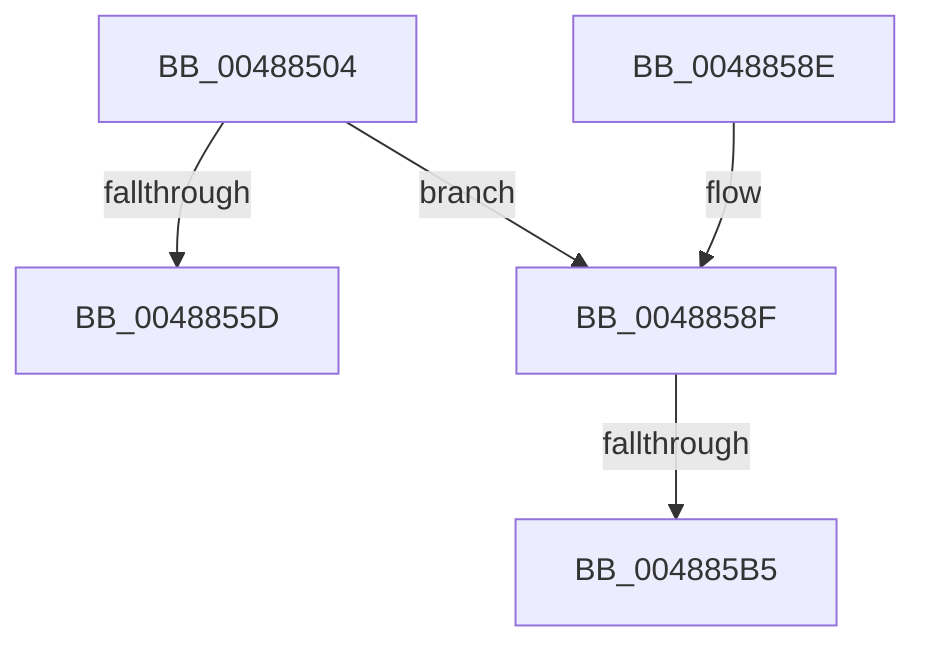

# KiRundownMutants

- RVA: `0x00488504`–`0x004885BC` (길이 `184` bytes)
- VA: `0x0000000140488504`
- 실행 섹션: `.text`
- PDB 이름 있음: `예`; PDB Function 태그: `예`
- unwind 정보 RVA: `0x000AFD5C`
- 디코드: `47`개 명령, `184/184` bytes 표시
- 미해석 바이트: `0` (있으면 어셈블리에 `.byte`로 보존)

> 이 문서는 커널 이미지의 기계어와 PDB 기호를 분석해 생성했습니다. 4번과 5번은 함수 원형과 자료형을 바이너리 사용 방식에서 추정한 C 해석이며 원본 소스 복구 결과는 아닙니다.

## 1. Dependencies

- 직접 호출 지점: **2**; 고유 호출 대상: **2**
- 직접 호출자로 확인된 함수: **1**
- RIP 상대 이미지 참조: **2**

### Outgoing calls
- `0x00488545` → [memset](../6C/memset_function_006C6C40.md) (function, `0x006C6C40`)
- `0x00488568` → [_security_check_cookie](../6A/_security_check_cookie_function_006AC640.md) (function, `0x006AC640`)

### Direct callers
- [PspExitThread](../../page/90/PspExitThread_function_00905F60.md) at `0x009062BB`

### Static image references
- `0x00488523` → RVA `0x00E0A740` (`.data`; read)
- `0x004885A9` → RVA `0x00FC6D20` (`ALMOSTRO`; read)

## 2. Other-region calls and transfers

- 다른 실행 섹션으로 향하는 call: **0**
- call이 아닌 외부 분기/꼬리 이동: **2**
  - `0x004885AF` → [sub_006F59B4 + 0x8](../6F/Unknown_function_006F59B4.md) (`tail-transfer`)
  - `0x004885B7` → [sub_006F59B4](../6F/Unknown_function_006F59B4.md) (`tail-transfer`)

## 3. Assembly (complete function range)

```asm
00488504  48 89 5C 24 10                  mov qword ptr [rsp + 0x10], rbx
00488509  48 89 6C 24 18                  mov qword ptr [rsp + 0x18], rbp
0048850E  48 89 74 24 20                  mov qword ptr [rsp + 0x20], rsi
00488513  57                              push rdi
00488514  41 54                           push r12
00488516  41 55                           push r13
00488518  41 56                           push r14
0048851A  41 57                           push r15
0048851C  48 81 EC 60 01 00 00            sub rsp, 0x160
00488523  48 8B 05 16 22 98 00            mov rax, qword ptr [rip + 0x982216]
0048852A  48 33 C4                        xor rax, rsp
0048852D  48 89 84 24 50 01 00 00         mov qword ptr [rsp + 0x150], rax
00488535  48 8B F1                        mov rsi, rcx
00488538  33 D2                           xor edx, edx
0048853A  48 8D 4C 24 50                  lea rcx, [rsp + 0x50]
0048853F  41 B8 00 01 00 00               mov r8d, 0x100
00488545  E8 F6 E6 23 00                  call 0x1406c6c40
0048854A  48 83 64 24 48 00               and qword ptr [rsp + 0x48], 0
00488550  4C 8D AE 08 03 00 00            lea r13, [rsi + 0x308]
00488557  4D 39 6D 00                     cmp qword ptr [r13], r13
0048855B  75 32                           jne 0x14048858f
0048855D  48 8B 8C 24 50 01 00 00         mov rcx, qword ptr [rsp + 0x150]
00488565  48 33 CC                        xor rcx, rsp
00488568  E8 D3 40 22 00                  call 0x1406ac640
0048856D  4C 8D 9C 24 60 01 00 00         lea r11, [rsp + 0x160]
00488575  49 8B 5B 38                     mov rbx, qword ptr [r11 + 0x38]
00488579  49 8B 6B 40                     mov rbp, qword ptr [r11 + 0x40]
0048857D  49 8B 73 48                     mov rsi, qword ptr [r11 + 0x48]
00488581  49 8B E3                        mov rsp, r11
00488584  41 5F                           pop r15
00488586  41 5E                           pop r14
00488588  41 5D                           pop r13
0048858A  41 5C                           pop r12
0048858C  5F                              pop rdi
0048858D  C3                              ret
0048858E  CC                              int3
0048858F  45 33 F6                        xor r14d, r14d
00488592  33 ED                           xor ebp, ebp
00488594  89 6C 24 30                     mov dword ptr [rsp + 0x30], ebp
00488598  44 0F 20 C0                     mov rax, cr8
0048859C  48 89 44 24 40                  mov qword ptr [rsp + 0x40], rax
004885A1  45 8D 7E 02                     lea r15d, [r14 + 2]
004885A5  45 0F 22 C7                     mov cr8, r15
004885A9  39 2D 71 E7 B3 00               cmp dword ptr [rip + 0xb3e771], ebp
004885AF  0F 84 07 D4 26 00               je 0x1406f59bc
004885B5  8A C8                           mov cl, al
004885B7  E9 F8 D3 26 00                  jmp 0x1406f59b4
```

## 4. C-style interpretation (structured pseudocode)

```c
__int64 __fastcall KiRundownMutants(__int64 a1, int a2)
{
    __int64 result;
    __int64 v_r14;
    __int64 v_rbp;
    __int64 v_rsp;
    unsigned __int64 v_stack_m120;
    unsigned int v_stack_m130;
    unsigned __int64 v_stack_m138;
    unsigned __int64 v_stack_m140;
    unsigned __int64 v_stack_m28;
    unsigned __int64 v_stack_m38;
    unsigned __int64 v_stack_p10;
    unsigned __int64 v_stack_p18;
    unsigned __int64 v_stack_p20;

    v_stack_p10 = v_rbx;
    v_stack_p18 = v_rbp;
    v_stack_p20 = v_rsi;
    v_rsp = (v_rsp) - (352);
    result = (*(unsigned __int64 *)(v_rip + 9970198)) ^ (v_rsp);
    v_stack_m38 = result;
    a2 = 0;
    result = memset(v_stack_m138, a2, 256, a4);
    if ((*(unsigned __int64 *)(a1 + 776)) != (a1 + 776)) goto loc_0048858F;
    a1 = (v_stack_m38) ^ (v_rsp);
    result = _security_check_cookie(a1, a2, 256, a4);
    return result;
loc_0048858F:
    v_r14 = 0;
    v_rbp = 0;
    v_stack_m130 = 0;
    v_stack_m120 = v_cr8;
}
```

## 5. (Beta) C Style

```c
int64_t KiRundownMutants(void *Arg1, int32_t Arg2)
{
    uint8_t *arg1 = (uint8_t *)Arg1;

    int64_t result;
    int64_t local_r14;
    int64_t local_rbp;
    int64_t local_rsp;
    uint64_t v_stack_m120;
    uint32_t v_stack_m130;
    uint64_t v_stack_m138;
    uint64_t v_stack_m140;
    uint64_t v_stack_m28;
    uint64_t v_stack_m38;
    uint64_t v_stack_p10;
    uint64_t v_stack_p18;
    uint64_t v_stack_p20;

    v_stack_p10 = local_rbx;
    v_stack_p18 = local_rbp;
    v_stack_p20 = local_rsi;
    local_rsp = (local_rsp) - (352);
    result = (*(uint64_t *)(v_rip + 0x982216)) ^ (local_rsp);
    v_stack_m38 = result;
    Arg2 = 0;
    result = memset(v_stack_m138, Arg2, 256, a4);
    if ((*(uint64_t *)(arg1 + 0x308)) != (Arg1 + 776)) goto loc_0048858F;
    Arg1 = (v_stack_m38) ^ (local_rsp);
    result = _security_check_cookie(Arg1, Arg2, 256, a4);
    return result;
loc_0048858F:
    local_r14 = 0;
    local_rbp = 0;
    v_stack_m130 = 0;
    v_stack_m120 = v_cr8;
}
```

### 관측된 메모리 오프셋

구조체 형식이 확인되지 않은 접근은 인자 기준의 오프셋으로만 기록했습니다.

| 기준 인자 | 오프셋 표현 | 폭 (bit) | 접근 |
|---|---:|---:|---|
| `Arg1` | `+ 0x0` | `64` | `R` |
| `Arg1` | `+ 0x308` | `64` | `R` |

## 6. Execution-region graph

[열기: 2D/3D 그래프와 함수 탐색 컨트롤 패널](../../../control-panel.html?section=text&rva=0x00488504&view=graph)

- 2D 그래프는 위에서 아래로 흐르고, 3D 그래프는 빈 공간을 드래그해 회전합니다. Shift+드래그는 이동, 휠은 확대·축소, 함수 노드 선택은 대상 보고서 이동입니다.

### Static fallback


