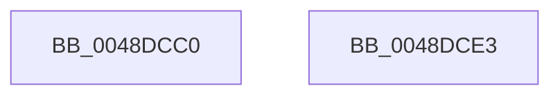

# KiSetForceIdleState

- RVA: `0x0048DCC0`–`0x0048DCE4` (길이 `36` bytes)
- VA: `0x000000014048DCC0`
- 실행 섹션: `.text`
- PDB 이름 있음: `예`; PDB Function 태그: `아니요`
- unwind 정보 RVA: `0x0005CF00`
- 디코드: `12`개 명령, `36/36` bytes 표시
- 미해석 바이트: `0` (있으면 어셈블리에 `.byte`로 보존)

> 이 문서는 커널 이미지의 기계어와 PDB 기호를 분석해 생성했습니다. 4번과 5번은 함수 원형과 자료형을 바이너리 사용 방식에서 추정한 C 해석이며 원본 소스 복구 결과는 아닙니다.

## 1. Dependencies

- 직접 호출 지점: **1**; 고유 호출 대상: **1**
- 직접 호출자로 확인된 함수: **9**
- RIP 상대 이미지 참조: **2**

### Outgoing calls
- `0x0048DCD6` → [PoTraceForceIdleStateChange](PoTraceForceIdleStateChange_function_0048DCEC.md) (function, `0x0048DCEC`)

### Direct callers
- [KiUpdateTime](../39/KiUpdateTime_function_0039B530.md) at `0x0039BADB`
- [KiCheckAndRearmForceIdle](../3A/KiCheckAndRearmForceIdle_function_003A1C58.md) at `0x003A1D27`
- [KiResetForceIdle](../3A/KiResetForceIdle_function_003A4160.md) at `0x003A41B5`
- [KeSetForceIdle](KeSetForceIdle_function_0048D5A8.md) at `0x0048D679`
- [KeClearForceIdle](KeClearForceIdle_function_0048D69C.md) at `0x0048D726`
- [KeClearForceIdle](KeClearForceIdle_function_0048D69C.md) at `0x0048D78C`
- [KiForceIdleStopDpcRoutine](KiForceIdleStopDpcRoutine_function_0048D7B0.md) at `0x0048D804`
- [KiForceIdleStartDpcRoutine](../4C/KiForceIdleStartDpcRoutine_function_004C3F40.md) at `0x004C3FA7`
- [sub_006D6552](../6D/Unknown_function_006D6552.md) at `0x006D6575`
- [sub_006E638A](../6E/Unknown_function_006E638A.md) at `0x006E63AA`

### Static image references
- `0x0048DCC6` → RVA `0x00F233CC` (`.data`; read)
- `0x0048DCCE` → RVA `0x00F233CC` (`.data`; write)

## 2. Other-region calls and transfers

- 다른 실행 섹션으로 향하는 call: **0**
- 별도 외부 분기/꼬리 이동을 확인하지 못했습니다.

## 3. Assembly (complete function range)

```asm
0048DCC0  40 53                           push rbx
0048DCC2  48 83 EC 20                     sub rsp, 0x20
0048DCC6  8B 1D 00 57 A9 00               mov ebx, dword ptr [rip + 0xa95700]
0048DCCC  8B D1                           mov edx, ecx
0048DCCE  89 0D F8 56 A9 00               mov dword ptr [rip + 0xa956f8], ecx
0048DCD4  8B CB                           mov ecx, ebx
0048DCD6  E8 11 00 00 00                  call 0x14048dcec
0048DCDB  8B C3                           mov eax, ebx
0048DCDD  48 83 C4 20                     add rsp, 0x20
0048DCE1  5B                              pop rbx
0048DCE2  C3                              ret
0048DCE3  CC                              int3
```

## 4. C-style interpretation (structured pseudocode)

```c
__int64 __fastcall KiSetForceIdleState(int a1)
{
    __int64 result;
    __int64 v_rsp;

    v_rsp = (v_rsp) - (32);
    *(unsigned int *)(v_rip + 11097848) = a1;
    result = PoTraceForceIdleStateChange((unsigned int)((unsigned int)((unsigned int)(*(unsigned int *)(v_rip + 11097856)))), (unsigned int)(a1), a3, a4);
    v_rsp = (v_rsp) + (32);
    return (unsigned int)((unsigned int)((unsigned int)(*(unsigned int *)(v_rip + 11097856))));
}
```

## 5. (Beta) C Style

```c
int64_t KiSetForceIdleState(int32_t Arg1)
{
    int64_t result;
    int64_t local_rsp;

    local_rsp = (local_rsp) - (32);
    *(uint32_t *)(v_rip + 0xA956F8) = Arg1;
    result = PoTraceForceIdleStateChange((uint32_t)((uint32_t)((uint32_t)(*(uint32_t *)(v_rip + 0xA95700)))), (uint32_t)(Arg1), a3, a4);
    local_rsp = (local_rsp) + (32);
    return (uint32_t)((uint32_t)((uint32_t)(*(uint32_t *)(v_rip + 0xA95700))));
}
```

## 6. Execution-region graph

[열기: 2D/3D 그래프와 함수 탐색 컨트롤 패널](../../../control-panel.html?section=text&rva=0x0048DCC0&view=graph)

- 2D 그래프는 위에서 아래로 흐르고, 3D 그래프는 빈 공간을 드래그해 회전합니다. Shift+드래그는 이동, 휠은 확대·축소, 함수 노드 선택은 대상 보고서 이동입니다.

### Static fallback


