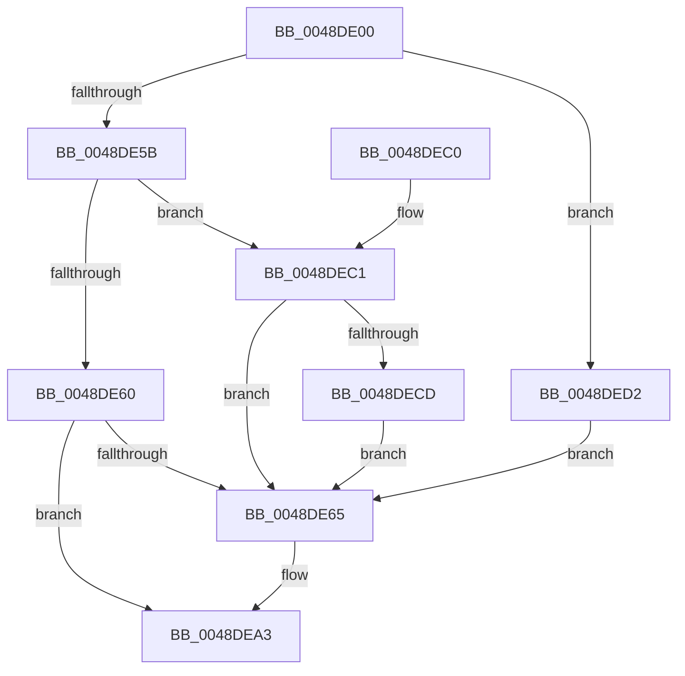

# MiAgeWorkingSetVpabCallback

- RVA: `0x0048DE00`–`0x0048DEF2` (길이 `242` bytes)
- VA: `0x000000014048DE00`
- 실행 섹션: `.text`
- PDB 이름 있음: `예`; PDB Function 태그: `아니요`
- unwind 정보 RVA: `0x000AA494`
- 디코드: `65`개 명령, `242/242` bytes 표시
- 미해석 바이트: `0` (있으면 어셈블리에 `.byte`로 보존)

> 이 문서는 커널 이미지의 기계어와 PDB 기호를 분석해 생성했습니다. 4번과 5번은 함수 원형과 자료형을 바이너리 사용 방식에서 추정한 C 해석이며 원본 소스 복구 결과는 아닙니다.

## 1. Dependencies

- 직접 호출 지점: **2**; 고유 호출 대상: **2**
- 직접 호출자로 확인된 함수: **0**
- RIP 상대 이미지 참조: **1**

### Outgoing calls
- `0x0048DE28` → [MI_READ_PTE_LOCK_FREE](../28/MI_READ_PTE_LOCK_FREE_function_002828A0.md) (function, `0x002828A0`)
- `0x0048DE9E` → [MiAgePteWorker](../28/MiAgePteWorker_function_0028FB20.md) (function, `0x0028FB20`)

### Direct callers
- 이 함수 시작 RVA로 연결되는 직접 call은 확인되지 않았습니다. 간접 호출은 완전히 역산할 수 없습니다.

### Static image references
- `0x0048DE34` → RVA `0x004ACD40` (`MiSimpleAgePte`; read)

## 2. Other-region calls and transfers

- 다른 실행 섹션으로 향하는 call: **0**
- 별도 외부 분기/꼬리 이동을 확인하지 못했습니다.

## 3. Assembly (complete function range)

```asm
0048DE00  48 8B C4                        mov rax, rsp
0048DE03  48 89 58 08                     mov qword ptr [rax + 8], rbx
0048DE07  48 89 68 10                     mov qword ptr [rax + 0x10], rbp
0048DE0B  48 89 70 18                     mov qword ptr [rax + 0x18], rsi
0048DE0F  48 89 78 20                     mov qword ptr [rax + 0x20], rdi
0048DE13  41 56                           push r14
0048DE15  48 83 EC 30                     sub rsp, 0x30
0048DE19  48 8B F1                        mov rsi, rcx
0048DE1C  49 8B E9                        mov rbp, r9
0048DE1F  49 8B C8                        mov rcx, r8
0048DE22  49 8B F8                        mov rdi, r8
0048DE25  48 8B DA                        mov rbx, rdx
0048DE28  E8 73 4A DF FF                  call 0x1402828a0
0048DE2D  48 8B 96 A8 00 00 00            mov rdx, qword ptr [rsi + 0xa8]
0048DE34  4C 8D 1D 05 EF 01 00            lea r11, [rip + 0x1ef05]
0048DE3B  48 8B 0B                        mov rcx, qword ptr [rbx]
0048DE3E  45 33 F6                        xor r14d, r14d
0048DE41  4C 8B 44 24 60                  mov r8, qword ptr [rsp + 0x60]
0048DE46  49 3B D3                        cmp rdx, r11
0048DE49  41 B9 05 00 00 00               mov r9d, 5
0048DE4F  45 8B D1                        mov r10d, r9d
0048DE52  45 0F 45 D6                     cmovne r10d, r14d
0048DE56  F6 C1 02                        test cl, 2
0048DE59  75 77                           jne 0x14048ded2
0048DE5B  F6 C1 01                        test cl, 1
0048DE5E  75 61                           jne 0x14048dec1
0048DE60  49 3B D3                        cmp rdx, r11
0048DE63  74 3E                           je 0x14048dea3
0048DE65  48 C1 E8 0C                     shr rax, 0xc
0048DE69  48 B9 FF FF FF FF FF 00 00 00   movabs rcx, 0xffffffffff
0048DE73  48 23 C1                        and rax, rcx
0048DE76  4C 8D 0C 40                     lea r9, [rax + rax*2]
0048DE7A  49 C1 E1 04                     shl r9, 4
0048DE7E  48 B8 00 00 00 00 00 DE FF FF   movabs rax, 0xffffde0000000000
0048DE88  44 89 54 24 28                  mov dword ptr [rsp + 0x28], r10d
0048DE8D  4C 03 C8                        add r9, rax
0048DE90  4C 89 44 24 20                  mov qword ptr [rsp + 0x20], r8
0048DE95  48 8B D7                        mov rdx, rdi
0048DE98  4C 8B C5                        mov r8, rbp
0048DE9B  48 8B CE                        mov rcx, rsi
0048DE9E  E8 7D 1C E0 FF                  call 0x14028fb20
0048DEA3  48 8B 5C 24 40                  mov rbx, qword ptr [rsp + 0x40]
0048DEA8  33 C0                           xor eax, eax
0048DEAA  48 8B 6C 24 48                  mov rbp, qword ptr [rsp + 0x48]
0048DEAF  48 8B 74 24 50                  mov rsi, qword ptr [rsp + 0x50]
0048DEB4  48 8B 7C 24 58                  mov rdi, qword ptr [rsp + 0x58]
0048DEB9  48 83 C4 30                     add rsp, 0x30
0048DEBD  41 5E                           pop r14
0048DEBF  C3                              ret
0048DEC0  CC                              int3
0048DEC1  41 8B 08                        mov ecx, dword ptr [r8]
0048DEC4  41 83 CA 01                     or r10d, 1
0048DEC8  F6 C1 03                        test cl, 3
0048DECB  74 98                           je 0x14048de65
0048DECD  45 8B D1                        mov r10d, r9d
0048DED0  EB 93                           jmp 0x14048de65
0048DED2  41 8B D2                        mov edx, r10d
0048DED5  83 CA 01                        or edx, 1
0048DED8  A8 20                           test al, 0x20
0048DEDA  41 0F 44 D2                     cmove edx, r10d
0048DEDE  44 8B D2                        mov r10d, edx
0048DEE1  41 83 CA 02                     or r10d, 2
0048DEE5  41 F6 00 03                     test byte ptr [r8], 3
0048DEE9  44 0F 44 D2                     cmove r10d, edx
0048DEED  E9 73 FF FF FF                  jmp 0x14048de65
```

## 4. C-style interpretation (structured pseudocode)

```c
__int64 __fastcall MiAgeWorkingSetVpabCallback(__int64 a1, __int64 a2, __int64 a3, __int64 a4, __int64 a5)
{
    __int64 result;
    __int64 v_r10;
    __int64 v_r14;
    __int64 v_rsp;
    unsigned int v_stack_m10;
    unsigned __int64 v_stack_m18;
    unsigned __int64 v_stack_p10;
    unsigned __int64 v_stack_p18;
    unsigned __int64 v_stack_p20;
    unsigned __int64 v_stack_p8;

    *(unsigned __int64 *)(v_rsp + 8) = v_rbx;
    *(unsigned __int64 *)(v_rsp + 16) = v_rbp;
    *(unsigned __int64 *)(v_rsp + 24) = v_rsi;
    *(unsigned __int64 *)(v_rsp + 32) = v_rdi;
    v_rsp = (v_rsp) - (48);
    result = MI_READ_PTE_LOCK_FREE(a3, a2, a3, a4);
    v_r14 = 0;
    v_r10 = 5;
    if ((*(unsigned __int64 *)(a1 + 168)) != (v_rip + 126725)) { v_r10 = 0; }
    if ((((unsigned __int8)(*(unsigned __int64 *)(a2))) & (2)) != 0) goto loc_0048DED2;
    if ((((unsigned __int8)(*(unsigned __int64 *)(a2))) & (1)) != 0) goto loc_0048DEC1;
    if ((*(unsigned __int64 *)(a1 + 168)) != (v_rip + 126725)) {
        result = (result) >> (12);
        result = (result) & (*(unsigned __int64 *)(a2));
        a4 = result + result * 2;
        a4 = (a4) << (4);
        v_stack_m10 = (unsigned int)(v_r10);
        a4 = (a4) + (result);
        v_stack_m18 = a5;
        a2 = a3;
        a3 = a4;
        a1 = a1;
        result = MiAgePteWorker(a1, a2, a3, a4);
    }
    result = 0;
    v_rsp = (v_rsp) + (48);
    return result;
loc_0048DEC1:
    v_r10 = (unsigned int)((v_r10) | (1));
    if ((((unsigned __int8)((unsigned int)(*(unsigned int *)(a3)))) & (3)) == 0) goto loc_0048DE65;
    goto loc_0048DE65;
loc_0048DED2:
    a2 = (unsigned int)(((unsigned int)((unsigned int)((unsigned int)((unsigned int)(a4))))) | (1));
    if (((0) & (32)) == 0) { a2 = (unsigned int)((unsigned int)((unsigned int)(a4))); }
    v_r10 = (unsigned int)(((unsigned int)((unsigned int)(a2))) | (2));
    if (((*(unsigned __int8 *)(a3)) & (3)) == 0) { v_r10 = (unsigned int)(a2); }
    goto loc_0048DE65;
}
```

## 5. (Beta) C Style

```c
int64_t MiAgeWorkingSetVpabCallback(void *Arg1, void *Arg2, int64_t Arg3, int64_t Arg4, void *Arg5)
{
    uint8_t *arg1 = (uint8_t *)Arg1;
    uint8_t *arg2 = (uint8_t *)Arg2;
    uint8_t *arg5 = (uint8_t *)Arg5;

    int64_t result;
    int64_t local_r10;
    int64_t local_r14;
    int64_t local_rsp;
    uint32_t v_stack_m10;
    uint64_t v_stack_m18;
    uint64_t v_stack_p10;
    uint64_t v_stack_p18;
    uint64_t v_stack_p20;
    uint64_t v_stack_p8;

    *(uint64_t *)(local_rsp + 0x8) = local_rbx;
    *(uint64_t *)(local_rsp + 0x10) = local_rbp;
    *(uint64_t *)(local_rsp + 0x18) = local_rsi;
    *(uint64_t *)(local_rsp + 0x20) = local_rdi;
    local_rsp = (local_rsp) - (48);
    result = MI_READ_PTE_LOCK_FREE(Arg3, Arg2, Arg3, Arg4);
    local_r14 = 0;
    local_r10 = 5;
    if ((*(uint64_t *)(arg1 + 0xA8)) != (v_rip + 126725)) { local_r10 = 0; }
    if ((((uint8_t)(*(uint64_t *)(arg2))) & (2)) != 0) goto loc_0048DED2;
    if ((((uint8_t)(*(uint64_t *)(arg2))) & (1)) != 0) goto loc_0048DEC1;
    if ((*(uint64_t *)(arg1 + 0xA8)) != (v_rip + 126725)) {
        result = (result) >> (12);
        result = (result) & (*(uint64_t *)(arg2));
        Arg4 = result + result * 2;
        Arg4 = (Arg4) << (4);
        v_stack_m10 = (uint32_t)(local_r10);
        Arg4 = (Arg4) + (result);
        v_stack_m18 = Arg5;
        Arg2 = Arg3;
        Arg3 = Arg4;
        Arg1 = Arg1;
        result = MiAgePteWorker(Arg1, Arg2, Arg3, Arg4);
    }
    result = 0;
    local_rsp = (local_rsp) + (48);
    return result;
loc_0048DEC1:
    local_r10 = (uint32_t)((local_r10) | (1));
    if ((((uint8_t)((uint32_t)(*(uint32_t *)(Arg3)))) & (3)) == 0) goto loc_0048DE65;
    goto loc_0048DE65;
loc_0048DED2:
    Arg2 = (uint32_t)(((uint32_t)((uint32_t)((uint32_t)((uint32_t)(Arg4))))) | (1));
    if (((0) & (32)) == 0) { Arg2 = (uint32_t)((uint32_t)((uint32_t)(Arg4))); }
    local_r10 = (uint32_t)(((uint32_t)((uint32_t)(Arg2))) | (2));
    if (((*(uint8_t *)(Arg3)) & (3)) == 0) { local_r10 = (uint32_t)(Arg2); }
    goto loc_0048DE65;
}
```

### 관측된 메모리 오프셋

구조체 형식이 확인되지 않은 접근은 인자 기준의 오프셋으로만 기록했습니다.

| 기준 인자 | 오프셋 표현 | 폭 (bit) | 접근 |
|---|---:|---:|---|
| `Arg1` | `+ 0xA8` | `64` | `R` |
| `Arg2` | `+ 0x0` | `64` | `R` |
| `Arg5` | `+ 0x0` | `8` | `R` |
| `Arg5` | `+ 0x0` | `32` | `R` |

## 6. Execution-region graph

[열기: 2D/3D 그래프와 함수 탐색 컨트롤 패널](../../../control-panel.html?section=text&rva=0x0048DE00&view=graph)

- 2D 그래프는 위에서 아래로 흐르고, 3D 그래프는 빈 공간을 드래그해 회전합니다. Shift+드래그는 이동, 휠은 확대·축소, 함수 노드 선택은 대상 보고서 이동입니다.

### Static fallback


