# MiAllocatePfnRepurposeLogDispatch

- RVA: `0x00488BD0`–`0x00488E2B` (길이 `603` bytes)
- VA: `0x0000000140488BD0`
- 실행 섹션: `.text`
- PDB 이름 있음: `예`; PDB Function 태그: `아니요`
- unwind 정보 RVA: `0x000AFDF0`
- 디코드: `151`개 명령, `603/603` bytes 표시
- 미해석 바이트: `0` (있으면 어셈블리에 `.byte`로 보존)

> 이 문서는 커널 이미지의 기계어와 PDB 기호를 분석해 생성했습니다. 4번과 5번은 함수 원형과 자료형을 바이너리 사용 방식에서 추정한 C 해석이며 원본 소스 복구 결과는 아닙니다.

## 1. Dependencies

- 직접 호출 지점: **14**; 고유 호출 대상: **10**
- 직접 호출자로 확인된 함수: **0**
- RIP 상대 이미지 참조: **0**

### Outgoing calls
- `0x00488C0E` → [MiAllocatePool](../35/MiAllocatePool_function_0035B540.md) (function, `0x0035B540`)
- `0x00488C47` → [ExAcquireSpinLockExclusiveAtDpcLevel](../24/ExAcquireSpinLockExclusiveAtDpcLevel_function_00248E80.md) (function, `0x00248E80`)
- `0x00488C7B` → [ExReleaseSpinLockExclusiveFromDpcLevel](../24/ExReleaseSpinLockExclusiveFromDpcLevel_function_002497E0.md) (function, `0x002497E0`)
- `0x00488CDB` → [ExAcquireRundownProtection](../21/ExAcquireRundownProtection_function_00216620.md) (function, `0x00216620`)
- `0x00488CFC` → [Feature_PrefetchQueueWorkerProactivelyForProcessExit__private_IsEnabledDeviceUsageNoInline](../34/Feature_PrefetchQueueWorkerProactivelyForProcessExit__private_IsEnabledDeviceUsageNoInline_function_0034A690.md) (function, `0x0034A690`)
- `0x00488D1B` → [PfIsProcessExitingInNonSystemPartition](PfIsProcessExitingInNonSystemPartition_function_00488E34.md) (function, `0x00488E34`)
- `0x00488D30` → [ExpInterlockedPushEntrySList](../6B/ExpInterlockedPushEntrySList_function_006BA5B0.md) (function, `0x006BA5B0`)
- `0x00488D3E` → [Feature_PrefetchQueueWorkerProactivelyForProcessExit__private_IsEnabledDeviceUsageNoInline](../34/Feature_PrefetchQueueWorkerProactivelyForProcessExit__private_IsEnabledDeviceUsageNoInline_function_0034A690.md) (function, `0x0034A690`)
- `0x00488D4F` → [ExReleaseRundownProtection](../34/ExReleaseRundownProtection_function_00349E80.md) (function, `0x00349E80`)
- `0x00488D5D` → [ExFreePoolWithTag](../../poolcode/B8/ExFreePoolWithTag_function_00B82870.md) (function, `0x00B82870`)
- `0x00488DA1` → [KeSetEvent](../33/KeSetEvent_function_0033F310.md) (function, `0x0033F310`)
- `0x00488DBC` → [KeSetEvent](../33/KeSetEvent_function_0033F310.md) (function, `0x0033F310`)
- `0x00488DEF` → [ExFreePoolWithTag](../../poolcode/B8/ExFreePoolWithTag_function_00B82870.md) (function, `0x00B82870`)
- `0x00488E22` → [PfIsProcessExitingInNonSystemPartition](PfIsProcessExitingInNonSystemPartition_function_00488E34.md) (function, `0x00488E34`)

### Direct callers
- 이 함수 시작 RVA로 연결되는 직접 call은 확인되지 않았습니다. 간접 호출은 완전히 역산할 수 없습니다.

### Static image references
- 디코드된 RIP-relative 메모리 참조가 없습니다.

## 2. Other-region calls and transfers

- 다른 실행 섹션으로 향하는 call: **2**
  - `0x00488D5D` → [ExFreePoolWithTag](../../poolcode/B8/ExFreePoolWithTag_function_00B82870.md) (`.text` → `POOLCODE`)
  - `0x00488DEF` → [ExFreePoolWithTag](../../poolcode/B8/ExFreePoolWithTag_function_00B82870.md) (`.text` → `POOLCODE`)
- 별도 외부 분기/꼬리 이동을 확인하지 못했습니다.

## 3. Assembly (complete function range)

```asm
00488BD0  48 8B C4                        mov rax, rsp
00488BD3  48 89 58 08                     mov qword ptr [rax + 8], rbx
00488BD7  48 89 68 10                     mov qword ptr [rax + 0x10], rbp
00488BDB  48 89 70 18                     mov qword ptr [rax + 0x18], rsi
00488BDF  48 89 78 20                     mov qword ptr [rax + 0x20], rdi
00488BE3  41 54                           push r12
00488BE5  41 56                           push r14
00488BE7  41 57                           push r15
00488BE9  48 83 EC 20                     sub rsp, 0x20
00488BED  48 8B F2                        mov rsi, rdx
00488BF0  49 BC 20 03 00 00 80 F7 FF FF   movabs r12, 0xfffff78000000320
00488BFA  BA 00 10 00 00                  mov edx, 0x1000
00488BFF  B9 40 00 00 00                  mov ecx, 0x40
00488C04  41 B8 4D 6D 52 70               mov r8d, 0x70526d4d
00488C0A  49 8B 2C 24                     mov rbp, qword ptr [r12]
00488C0E  E8 2D 29 ED FF                  call 0x14035b540
00488C13  48 8B F8                        mov rdi, rax
00488C16  48 85 C0                        test rax, rax
00488C19  74 22                           je 0x140488c3d
00488C1B  48 83 20 00                     and qword ptr [rax], 0
00488C1F  48 8D 48 40                     lea rcx, [rax + 0x40]
00488C23  48 89 48 20                     mov qword ptr [rax + 0x20], rcx
00488C27  48 8D 88 F8 0F 00 00            lea rcx, [rax + 0xff8]
00488C2E  48 89 48 28                     mov qword ptr [rax + 0x28], rcx
00488C32  C7 40 08 02 00 00 00            mov dword ptr [rax + 8], 2
00488C39  48 89 68 10                     mov qword ptr [rax + 0x10], rbp
00488C3D  4C 8D B6 80 44 00 00            lea r14, [rsi + 0x4480]
00488C44  49 8B CE                        mov rcx, r14
00488C47  E8 34 02 DC FF                  call 0x140248e80
00488C4C  83 BE 2C 44 00 00 00            cmp dword ptr [rsi + 0x442c], 0
00488C53  41 BF FF 0F 00 00               mov r15d, 0xfff
00488C59  48 8B 9E 38 44 00 00            mov rbx, qword ptr [rsi + 0x4438]
00488C60  0F 84 1C 01 00 00               je 0x140488d82
00488C66  48 85 FF                        test rdi, rdi
00488C69  0F 84 63 01 00 00               je 0x140488dd2
00488C6F  48 89 BE 38 44 00 00            mov qword ptr [rsi + 0x4438], rdi
00488C76  33 FF                           xor edi, edi
00488C78  49 8B CE                        mov rcx, r14
00488C7B  E8 60 0B DC FF                  call 0x1402497e0
00488C80  48 85 FF                        test rdi, rdi
00488C83  0F 85 61 01 00 00               jne 0x140488dea
00488C89  48 85 DB                        test rbx, rbx
00488C8C  0F 84 D0 00 00 00               je 0x140488d62
00488C92  48 8B 43 20                     mov rax, qword ptr [rbx + 0x20]
00488C96  48 8D 4B 40                     lea rcx, [rbx + 0x40]
00488C9A  48 3B C1                        cmp rax, rcx
00488C9D  0F 84 B5 00 00 00               je 0x140488d58
00488CA3  49 85 C7                        test r15, rax
00488CA6  74 1A                           je 0x140488cc2
00488CA8  48 3B 6B 10                     cmp rbp, qword ptr [rbx + 0x10]
00488CAC  0F 82 47 01 00 00               jb 0x140488df9
00488CB2  48 8B 43 20                     mov rax, qword ptr [rbx + 0x20]
00488CB6  48 83 E8 08                     sub rax, 8
00488CBA  48 89 6B 18                     mov qword ptr [rbx + 0x18], rbp
00488CBE  48 89 43 28                     mov qword ptr [rbx + 0x28], rax
00488CC2  48 89 4B 20                     mov qword ptr [rbx + 0x20], rcx
00488CC6  48 8B 86 B8 00 00 00            mov rax, qword ptr [rsi + 0xb8]
00488CCD  48 8B 78 20                     mov rdi, qword ptr [rax + 0x20]
00488CD1  4C 8D A7 D8 02 00 00            lea r12, [rdi + 0x2d8]
00488CD8  49 8B CC                        mov rcx, r12
00488CDB  E8 40 D9 D8 FF                  call 0x140216620
00488CE0  84 C0                           test al, al
00488CE2  74 74                           je 0x140488d58
00488CE4  4C 8D BF 00 03 00 00            lea r15, [rdi + 0x300]
00488CEB  45 0F B7 37                     movzx r14d, word ptr [r15]
00488CEF  44 3B B7 F8 02 00 00            cmp r14d, dword ptr [rdi + 0x2f8]
00488CF6  0F 83 C7 00 00 00               jae 0x140488dc3
00488CFC  E8 8F 19 EC FF                  call 0x14034a690
00488D01  BE 01 00 00 00                  mov esi, 1
00488D06  85 C0                           test eax, eax
00488D08  74 1E                           je 0x140488d28
00488D0A  39 73 08                        cmp dword ptr [rbx + 8], esi
00488D0D  7F 19                           jg 0x140488d28
00488D0F  48 8B 53 38                     mov rdx, qword ptr [rbx + 0x38]
00488D13  48 85 D2                        test rdx, rdx
00488D16  74 10                           je 0x140488d28
00488D18  48 8B CF                        mov rcx, rdi
00488D1B  E8 14 01 00 00                  call 0x140488e34
00488D20  84 C0                           test al, al
00488D22  0F 85 DA 00 00 00               jne 0x140488e02
00488D28  33 ED                           xor ebp, ebp
00488D2A  48 8B D3                        mov rdx, rbx
00488D2D  49 8B CF                        mov rcx, r15
00488D30  E8 7B 18 23 00                  call 0x1406ba5b0
00488D35  83 BF E4 02 00 00 00            cmp dword ptr [rdi + 0x2e4], 0
00488D3C  74 51                           je 0x140488d8f
00488D3E  E8 4D 19 EC FF                  call 0x14034a690
00488D43  83 BF E4 02 00 00 00            cmp dword ptr [rdi + 0x2e4], 0
00488D4A  74 5C                           je 0x140488da8
00488D4C  49 8B CC                        mov rcx, r12
00488D4F  E8 2C 11 EC FF                  call 0x140349e80
00488D54  85 F6                           test esi, esi
00488D56  75 0A                           jne 0x140488d62
00488D58  33 D2                           xor edx, edx
00488D5A  48 8B CB                        mov rcx, rbx
00488D5D  E8 0E 9B 6F 00                  call 0x140b82870
00488D62  48 8B 5C 24 40                  mov rbx, qword ptr [rsp + 0x40]
00488D67  48 8B 6C 24 48                  mov rbp, qword ptr [rsp + 0x48]
00488D6C  48 8B 74 24 50                  mov rsi, qword ptr [rsp + 0x50]
00488D71  48 8B 7C 24 58                  mov rdi, qword ptr [rsp + 0x58]
00488D76  48 83 C4 20                     add rsp, 0x20
00488D7A  41 5F                           pop r15
00488D7C  41 5E                           pop r14
00488D7E  41 5C                           pop r12
00488D80  C3                              ret
00488D81  CC                              int3
00488D82  48 83 A6 38 44 00 00 00         and qword ptr [rsi + 0x4438], 0
00488D8A  E9 E9 FE FF FF                  jmp 0x140488c78
00488D8F  41 83 FE 08                     cmp r14d, 8
00488D93  72 A9                           jb 0x140488d3e
00488D95  48 8D 8F E0 02 00 00            lea rcx, [rdi + 0x2e0]
00488D9C  45 33 C0                        xor r8d, r8d
00488D9F  33 D2                           xor edx, edx
00488DA1  E8 6A 65 EB FF                  call 0x14033f310
00488DA6  EB 96                           jmp 0x140488d3e
00488DA8  85 C0                           test eax, eax
00488DAA  74 5D                           je 0x140488e09
00488DAC  85 ED                           test ebp, ebp
00488DAE  74 9C                           je 0x140488d4c
00488DB0  45 33 C0                        xor r8d, r8d
00488DB3  48 8D 8F E0 02 00 00            lea rcx, [rdi + 0x2e0]
00488DBA  33 D2                           xor edx, edx
00488DBC  E8 4F 65 EB FF                  call 0x14033f310
00488DC1  EB 89                           jmp 0x140488d4c
00488DC3  F0 83 87 B0 02 00 00 64         lock add dword ptr [rdi + 0x2b0], 0x64
00488DCB  33 F6                           xor esi, esi
00488DCD  E9 7A FF FF FF                  jmp 0x140488d4c
00488DD2  48 85 DB                        test rbx, rbx
00488DD5  0F 84 9D FE FF FF               je 0x140488c78
00488DDB  8B 43 20                        mov eax, dword ptr [rbx + 0x20]
00488DDE  49 85 C7                        test r15, rax
00488DE1  74 9F                           je 0x140488d82
00488DE3  33 DB                           xor ebx, ebx
00488DE5  E9 8E FE FF FF                  jmp 0x140488c78
00488DEA  33 D2                           xor edx, edx
00488DEC  48 8B CF                        mov rcx, rdi
00488DEF  E8 7C 9A 6F 00                  call 0x140b82870
00488DF4  E9 90 FE FF FF                  jmp 0x140488c89
00488DF9  49 8B 2C 24                     mov rbp, qword ptr [r12]
00488DFD  E9 B0 FE FF FF                  jmp 0x140488cb2
00488E02  8B EE                           mov ebp, esi
00488E04  E9 21 FF FF FF                  jmp 0x140488d2a
00488E09  39 73 08                        cmp dword ptr [rbx + 8], esi
00488E0C  0F 8F 3A FF FF FF               jg 0x140488d4c
00488E12  48 8B 53 38                     mov rdx, qword ptr [rbx + 0x38]
00488E16  48 85 D2                        test rdx, rdx
00488E19  0F 84 2D FF FF FF               je 0x140488d4c
00488E1F  48 8B CF                        mov rcx, rdi
00488E22  E8 0D 00 00 00                  call 0x140488e34
00488E27  84 C0                           test al, al
00488E29  EB 83                           jmp 0x140488dae
```

## 4. C-style interpretation (structured pseudocode)

```c
__int64 __fastcall MiAllocatePfnRepurposeLogDispatch(__int64 a1, __int64 a2)
{
    __int64 result;
    __int64 v_rbp;
    __int64 v_rbx;
    __int64 v_rdi;
    __int64 v_rsi;
    __int64 v_rsp;
    unsigned __int64 v_stack_p10;
    unsigned __int64 v_stack_p18;
    unsigned __int64 v_stack_p20;
    unsigned __int64 v_stack_p8;

    *(unsigned __int64 *)(v_rsp + 8) = v_rbx;
    *(unsigned __int64 *)(v_rsp + 16) = v_rbp;
    *(unsigned __int64 *)(v_rsp + 24) = v_rsi;
    *(unsigned __int64 *)(v_rsp + 32) = v_rdi;
    v_rsp = (v_rsp) - (32);
    result = MiAllocatePool(64, (unsigned int)(0x1000ULL), (unsigned int)(0x70526D4DULL), a4);
    if (result != 0) {
        a1 = result + 64;
        *(unsigned __int64 *)(result + 32) = a1;
        a1 = result + 4088;
        *(unsigned __int64 *)(result + 40) = a1;
        *(unsigned int *)(result + 8) = 2;
        *(unsigned __int64 *)(result + 16) = *(unsigned __int64 *)(v_r12);
    }
    result = ExAcquireSpinLockExclusiveAtDpcLevel(a2 + 17536, (unsigned int)(0x1000ULL), (unsigned int)(0x70526D4DULL), a4);
    if ((*(unsigned int *)(a2 + 17452)) == 0) goto loc_00488D82;
    if (result == 0) goto loc_00488DD2;
    *(unsigned __int64 *)(a2 + 17464) = result;
    v_rdi = 0;
loc_00488C78:
    result = ExReleaseSpinLockExclusiveFromDpcLevel(a2 + 17536, (unsigned int)(0x1000ULL), (unsigned int)(0x70526D4DULL), a4);
    if (0 != 0) goto loc_00488DEA;
loc_00488C89:
    if (*(unsigned __int64 *)(a2 + 17464) == 0) goto loc_00488D62;
    if ((*(unsigned __int64 *)(*(unsigned __int64 *)(a2 + 17464) + 32)) == (*(unsigned __int64 *)(a2 + 17464) + 64)) goto loc_00488D58;
    if ((((unsigned int)(0xFFFULL)) & (*(unsigned __int64 *)(*(unsigned __int64 *)(a2 + 17464) + 32))) == 0) goto loc_00488CC2;
    if ((*(unsigned __int64 *)(v_r12)) < (*(unsigned __int64 *)(*(unsigned __int64 *)(a2 + 17464) + 16))) goto loc_00488DF9;
loc_00488CB2:
    result = (*(unsigned __int64 *)(*(unsigned __int64 *)(a2 + 17464) + 32)) - (8);
    *(unsigned __int64 *)(*(unsigned __int64 *)(a2 + 17464) + 24) = *(unsigned __int64 *)(v_r12);
    *(unsigned __int64 *)(*(unsigned __int64 *)(a2 + 17464) + 40) = result;
loc_00488CC2:
    *(unsigned __int64 *)(*(unsigned __int64 *)(a2 + 17464) + 32) = *(unsigned __int64 *)(a2 + 17464) + 64;
    result = ExAcquireRundownProtection(*(unsigned __int64 *)(*(unsigned __int64 *)(a2 + 184) + 32) + 728, (unsigned int)(0x1000ULL), (unsigned int)(0x70526D4DULL), a4);
    if ((unsigned __int8)(result) == 0) goto loc_00488D58;
    if (((unsigned int)(*(unsigned __int16 *)(*(unsigned __int64 *)(*(unsigned __int64 *)(a2 + 184) + 32) + 768))) >= (*(unsigned int *)(*(unsigned __int64 *)(*(unsigned __int64 *)(a2 + 184) + 32) + 760))) goto loc_00488DC3;
    result = Feature_PrefetchQueueWorkerProactivelyForProcessExit__private_IsEnabledDeviceUsageNoInline(*(unsigned __int64 *)(*(unsigned __int64 *)(a2 + 184) + 32) + 728, (unsigned int)(0x1000ULL), (unsigned int)(0x70526D4DULL), a4);
    if ((unsigned int)(result) == 0) goto loc_00488D28;
    if ((*(unsigned int *)(*(unsigned __int64 *)(a2 + 17464) + 8)) > 1) goto loc_00488D28;
    if (*(unsigned __int64 *)(*(unsigned __int64 *)(a2 + 17464) + 56) == 0) goto loc_00488D28;
    result = PfIsProcessExitingInNonSystemPartition(*(unsigned __int64 *)(*(unsigned __int64 *)(a2 + 184) + 32), *(unsigned __int64 *)(*(unsigned __int64 *)(a2 + 17464) + 56), (unsigned int)(0x70526D4DULL), a4);
    if ((unsigned __int8)(result) != 0) goto loc_00488E02;
loc_00488D28:
    v_rbp = 0;
loc_00488D2A:
    result = ExpInterlockedPushEntrySList(*(unsigned __int64 *)(*(unsigned __int64 *)(a2 + 184) + 32) + 768, *(unsigned __int64 *)(a2 + 17464), (unsigned int)(0x70526D4DULL), a4);
    if ((*(unsigned int *)(*(unsigned __int64 *)(*(unsigned __int64 *)(a2 + 184) + 32) + 740)) == 0) goto loc_00488D8F;
loc_00488D3E:
    result = Feature_PrefetchQueueWorkerProactivelyForProcessExit__private_IsEnabledDeviceUsageNoInline(*(unsigned __int64 *)(*(unsigned __int64 *)(a2 + 184) + 32) + 768, *(unsigned __int64 *)(a2 + 17464), (unsigned int)(0x70526D4DULL), a4);
    if ((*(unsigned int *)(*(unsigned __int64 *)(*(unsigned __int64 *)(a2 + 184) + 32) + 740)) == 0) goto loc_00488DA8;
loc_00488D4C:
    result = ExReleaseRundownProtection(*(unsigned __int64 *)(*(unsigned __int64 *)(a2 + 184) + 32) + 728, *(unsigned __int64 *)(a2 + 17464), (unsigned int)(0x70526D4DULL), a4);
    if (1 == 0) {
        a2 = 0;
        a1 = *(unsigned __int64 *)(a2 + 17464);
        result = ExFreePoolWithTag(a1, a2, (unsigned int)(0x70526D4DULL), a4);
    }
    v_rsp = (v_rsp) + (32);
    return result;
loc_00488D82:
    goto loc_00488C78;
loc_00488D8F:
    if (((unsigned int)(*(unsigned __int16 *)(*(unsigned __int64 *)(*(unsigned __int64 *)(a2 + 184) + 32) + 768))) < 8) goto loc_00488D3E;
    a3 = 0;
    a2 = 0;
    result = KeSetEvent(v_stack_p20 + 736, a2, a3, a4);
    goto loc_00488D3E;
loc_00488DA8:
    if ((unsigned int)(result) == 0) goto loc_00488E09;
loc_00488DAE:
    if ((unsigned int)(v_stack_p10) == 0) goto loc_00488D4C;
    a3 = 0;
    a2 = 0;
    result = KeSetEvent(v_stack_p20 + 736, a2, a3, a4);
    goto loc_00488D4C;
loc_00488DC3:
    v_rsi = 0;
    goto loc_00488D4C;
loc_00488DD2:
    if (v_stack_p8 == 0) goto loc_00488C78;
    if (((*(unsigned __int64 *)(*(unsigned __int64 *)(a2 + 184) + 32) + 768) & ((unsigned int)(*(unsigned int *)(v_stack_p8 + 32)))) == 0) goto loc_00488D82;
    v_rbx = 0;
    goto loc_00488C78;
loc_00488DEA:
    a2 = 0;
    result = ExFreePoolWithTag(v_stack_p20, a2, a3, a4);
    goto loc_00488C89;
loc_00488DF9:
    goto loc_00488CB2;
loc_00488E02:
    goto loc_00488D2A;
loc_00488E09:
    if ((*(unsigned int *)(v_rbx + 8)) > 0) goto loc_00488D4C;
    if (*(unsigned __int64 *)(v_rbx + 56) == 0) goto loc_00488D4C;
    result = PfIsProcessExitingInNonSystemPartition(v_stack_p20, *(unsigned __int64 *)(v_rbx + 56), a3, a4);
    goto loc_00488DAE;
}
```

## 5. (Beta) C Style

```c
int64_t MiAllocatePfnRepurposeLogDispatch(int64_t Arg1, void *Arg2)
{
    uint8_t *arg2 = (uint8_t *)Arg2;

    int64_t result;
    int64_t local_rbp;
    int64_t local_rbx;
    int64_t local_rdi;
    int64_t local_rsi;
    int64_t local_rsp;
    uint64_t v_stack_p10;
    uint64_t v_stack_p18;
    uint64_t v_stack_p20;
    uint64_t v_stack_p8;

    *(uint64_t *)(local_rsp + 0x8) = local_rbx;
    *(uint64_t *)(local_rsp + 0x10) = local_rbp;
    *(uint64_t *)(local_rsp + 0x18) = local_rsi;
    *(uint64_t *)(local_rsp + 0x20) = local_rdi;
    local_rsp = (local_rsp) - (32);
    result = MiAllocatePool(64, (uint32_t)(0x1000ULL), (uint32_t)(0x70526D4DULL), a4);
    if (result != 0) {
        Arg1 = result + 64;
        *(uint64_t *)(result + 0x20) = Arg1;
        Arg1 = result + 4088;
        *(uint64_t *)(result + 0x28) = Arg1;
        *(uint32_t *)(result + 0x8) = 2;
        *(uint64_t *)(result + 0x10) = *(uint64_t *)(local_r12);
    }
    result = ExAcquireSpinLockExclusiveAtDpcLevel(Arg2 + 17536, (uint32_t)(0x1000ULL), (uint32_t)(0x70526D4DULL), a4);
    if ((*(uint32_t *)(arg2 + 0x442C)) == 0) goto loc_00488D82;
    if (result == 0) goto loc_00488DD2;
    *(uint64_t *)(arg2 + 0x4438) = result;
    local_rdi = 0;
loc_00488C78:
    result = ExReleaseSpinLockExclusiveFromDpcLevel(Arg2 + 17536, (uint32_t)(0x1000ULL), (uint32_t)(0x70526D4DULL), a4);
    if (0 != 0) goto loc_00488DEA;
loc_00488C89:
    if (*(uint64_t *)(arg2 + 0x4438) == 0) goto loc_00488D62;
    if ((*(uint64_t *)(*(uint64_t *)(arg2 + 0x4438) + 0x20)) == (*(uint64_t *)(arg2 + 0x4438) + 64)) goto loc_00488D58;
    if ((((uint32_t)(0xFFFULL)) & (*(uint64_t *)(*(uint64_t *)(arg2 + 0x4438) + 0x20))) == 0) goto loc_00488CC2;
    if ((*(uint64_t *)(local_r12)) < (*(uint64_t *)(*(uint64_t *)(arg2 + 0x4438) + 0x10))) goto loc_00488DF9;
loc_00488CB2:
    result = (*(uint64_t *)(*(uint64_t *)(arg2 + 0x4438) + 0x20)) - (8);
    *(uint64_t *)(*(uint64_t *)(arg2 + 0x4438) + 0x18) = *(uint64_t *)(local_r12);
    *(uint64_t *)(*(uint64_t *)(arg2 + 0x4438) + 0x28) = result;
loc_00488CC2:
    *(uint64_t *)(*(uint64_t *)(arg2 + 0x4438) + 0x20) = *(uint64_t *)(arg2 + 0x4438) + 64;
    result = ExAcquireRundownProtection(*(uint64_t *)(*(uint64_t *)(arg2 + 0xB8) + 0x20) + 728, (uint32_t)(0x1000ULL), (uint32_t)(0x70526D4DULL), a4);
    if ((uint8_t)(result) == 0) goto loc_00488D58;
    if (((uint32_t)(*(uint16_t *)(*(uint64_t *)(*(uint64_t *)(arg2 + 0xB8) + 0x20) + 0x300))) >= (*(uint32_t *)(*(uint64_t *)(*(uint64_t *)(arg2 + 0xB8) + 0x20) + 0x2F8))) goto loc_00488DC3;
    result = Feature_PrefetchQueueWorkerProactivelyForProcessExit__private_IsEnabledDeviceUsageNoInline(*(uint64_t *)(*(uint64_t *)(arg2 + 0xB8) + 0x20) + 728, (uint32_t)(0x1000ULL), (uint32_t)(0x70526D4DULL), a4);
    if ((uint32_t)(result) == 0) goto loc_00488D28;
    if ((*(uint32_t *)(*(uint64_t *)(arg2 + 0x4438) + 0x8)) > 1) goto loc_00488D28;
    if (*(uint64_t *)(*(uint64_t *)(arg2 + 0x4438) + 0x38) == 0) goto loc_00488D28;
    result = PfIsProcessExitingInNonSystemPartition(*(uint64_t *)(*(uint64_t *)(arg2 + 0xB8) + 0x20), *(uint64_t *)(*(uint64_t *)(arg2 + 0x4438) + 0x38), (uint32_t)(0x70526D4DULL), a4);
    if ((uint8_t)(result) != 0) goto loc_00488E02;
loc_00488D28:
    local_rbp = 0;
loc_00488D2A:
    result = ExpInterlockedPushEntrySList(*(uint64_t *)(*(uint64_t *)(arg2 + 0xB8) + 0x20) + 768, *(uint64_t *)(arg2 + 0x4438), (uint32_t)(0x70526D4DULL), a4);
    if ((*(uint32_t *)(*(uint64_t *)(*(uint64_t *)(arg2 + 0xB8) + 0x20) + 0x2E4)) == 0) goto loc_00488D8F;
loc_00488D3E:
    result = Feature_PrefetchQueueWorkerProactivelyForProcessExit__private_IsEnabledDeviceUsageNoInline(*(uint64_t *)(*(uint64_t *)(arg2 + 0xB8) + 0x20) + 768, *(uint64_t *)(arg2 + 0x4438), (uint32_t)(0x70526D4DULL), a4);
    if ((*(uint32_t *)(*(uint64_t *)(*(uint64_t *)(arg2 + 0xB8) + 0x20) + 0x2E4)) == 0) goto loc_00488DA8;
loc_00488D4C:
    result = ExReleaseRundownProtection(*(uint64_t *)(*(uint64_t *)(arg2 + 0xB8) + 0x20) + 728, *(uint64_t *)(arg2 + 0x4438), (uint32_t)(0x70526D4DULL), a4);
    if (1 == 0) {
        Arg2 = 0;
        Arg1 = *(uint64_t *)(arg2 + 0x4438);
        result = ExFreePoolWithTag(Arg1, Arg2, (uint32_t)(0x70526D4DULL), a4);
    }
    local_rsp = (local_rsp) + (32);
    return result;
loc_00488D82:
    goto loc_00488C78;
loc_00488D8F:
    if (((uint32_t)(*(uint16_t *)(*(uint64_t *)(*(uint64_t *)(arg2 + 0xB8) + 0x20) + 0x300))) < 8) goto loc_00488D3E;
    a3 = 0;
    Arg2 = 0;
    result = KeSetEvent(v_stack_p20 + 736, Arg2, a3, a4);
    goto loc_00488D3E;
loc_00488DA8:
    if ((uint32_t)(result) == 0) goto loc_00488E09;
loc_00488DAE:
    if ((uint32_t)(v_stack_p10) == 0) goto loc_00488D4C;
    a3 = 0;
    Arg2 = 0;
    result = KeSetEvent(v_stack_p20 + 736, Arg2, a3, a4);
    goto loc_00488D4C;
loc_00488DC3:
    local_rsi = 0;
    goto loc_00488D4C;
loc_00488DD2:
    if (v_stack_p8 == 0) goto loc_00488C78;
    if (((*(uint64_t *)(*(uint64_t *)(arg2 + 0xB8) + 0x20) + 768) & ((uint32_t)(*(uint32_t *)(v_stack_p8 + 0x20)))) == 0) goto loc_00488D82;
    local_rbx = 0;
    goto loc_00488C78;
loc_00488DEA:
    Arg2 = 0;
    result = ExFreePoolWithTag(v_stack_p20, Arg2, a3, a4);
    goto loc_00488C89;
loc_00488DF9:
    goto loc_00488CB2;
loc_00488E02:
    goto loc_00488D2A;
loc_00488E09:
    if ((*(uint32_t *)(local_rbx + 0x8)) > 0) goto loc_00488D4C;
    if (*(uint64_t *)(local_rbx + 0x38) == 0) goto loc_00488D4C;
    result = PfIsProcessExitingInNonSystemPartition(v_stack_p20, *(uint64_t *)(local_rbx + 0x38), a3, a4);
    goto loc_00488DAE;
}
```

### 관측된 메모리 오프셋

구조체 형식이 확인되지 않은 접근은 인자 기준의 오프셋으로만 기록했습니다.

| 기준 인자 | 오프셋 표현 | 폭 (bit) | 접근 |
|---|---:|---:|---|
| `Arg2` | `+ 0xB8` | `64` | `R` |
| `Arg2` | `+ 0x442C` | `32` | `R` |
| `Arg2` | `+ 0x4438` | `64` | `R` |
| `Arg2` | `+ 0x4438` | `64` | `R/W` |
| `Arg2` | `+ 0x4438` | `64` | `W` |
| `Arg2` | `+ 0x4480` | `64` | `R` |

## 6. Execution-region graph

[열기: 2D/3D 그래프와 함수 탐색 컨트롤 패널](../../../control-panel.html?section=text&rva=0x00488BD0&view=graph)

- 2D 그래프는 위에서 아래로 흐르고, 3D 그래프는 빈 공간을 드래그해 회전합니다. Shift+드래그는 이동, 휠은 확대·축소, 함수 노드 선택은 대상 보고서 이동입니다.

### Static fallback

```mermaid
flowchart TD
  bb_00488BD0[BB_00488BD0]
  bb_00488C1B[BB_00488C1B]
  bb_00488C3D[BB_00488C3D]
  bb_00488C66[BB_00488C66]
  bb_00488C6F[BB_00488C6F]
  bb_00488C78[BB_00488C78]
  bb_00488C89[BB_00488C89]
  bb_00488C92[BB_00488C92]
  bb_00488CA3[BB_00488CA3]
  bb_00488CA8[BB_00488CA8]
  bb_00488CB2[BB_00488CB2]
  bb_00488CC2[BB_00488CC2]
  bb_00488CE4[BB_00488CE4]
  bb_00488CFC[BB_00488CFC]
  bb_00488D0A[BB_00488D0A]
  bb_00488D0F[BB_00488D0F]
  bb_00488D18[BB_00488D18]
  bb_00488D28[BB_00488D28]
  bb_00488D2A[BB_00488D2A]
  bb_00488D3E[BB_00488D3E]
  bb_00488D4C[BB_00488D4C]
  bb_00488D58[BB_00488D58]
  bb_00488D62[BB_00488D62]
  bb_00488D81[BB_00488D81]
  bb_00488D82[BB_00488D82]
  bb_00488D8F[BB_00488D8F]
  bb_00488D95[BB_00488D95]
  bb_00488DA8[BB_00488DA8]
  bb_00488DAC[BB_00488DAC]
  bb_00488DAE[BB_00488DAE]
  bb_00488DB0[BB_00488DB0]
  bb_00488DC3[BB_00488DC3]
  bb_00488DD2[BB_00488DD2]
  bb_00488DDB[BB_00488DDB]
  bb_00488DE3[BB_00488DE3]
  bb_00488DEA[BB_00488DEA]
  bb_00488DF9[BB_00488DF9]
  bb_00488E02[BB_00488E02]
  bb_00488E09[BB_00488E09]
  bb_00488E12[BB_00488E12]
  bb_00488E1F[BB_00488E1F]
  bb_00488BD0 -->|branch| bb_00488C3D
  bb_00488BD0 -->|fallthrough| bb_00488C1B
  bb_00488C1B -->|flow| bb_00488C3D
  bb_00488C3D -->|branch| bb_00488D82
  bb_00488C3D -->|fallthrough| bb_00488C66
  bb_00488C66 -->|branch| bb_00488DD2
  bb_00488C66 -->|fallthrough| bb_00488C6F
  bb_00488C6F -->|flow| bb_00488C78
  bb_00488C78 -->|branch| bb_00488DEA
  bb_00488C78 -->|fallthrough| bb_00488C89
  bb_00488C89 -->|branch| bb_00488D62
  bb_00488C89 -->|fallthrough| bb_00488C92
  bb_00488C92 -->|branch| bb_00488D58
  bb_00488C92 -->|fallthrough| bb_00488CA3
  bb_00488CA3 -->|branch| bb_00488CC2
  bb_00488CA3 -->|fallthrough| bb_00488CA8
  bb_00488CA8 -->|branch| bb_00488DF9
  bb_00488CA8 -->|fallthrough| bb_00488CB2
  bb_00488CB2 -->|flow| bb_00488CC2
  bb_00488CC2 -->|branch| bb_00488D58
  bb_00488CC2 -->|fallthrough| bb_00488CE4
  bb_00488CE4 -->|branch| bb_00488DC3
  bb_00488CE4 -->|fallthrough| bb_00488CFC
  bb_00488CFC -->|branch| bb_00488D28
  bb_00488CFC -->|fallthrough| bb_00488D0A
  bb_00488D0A -->|branch| bb_00488D28
  bb_00488D0A -->|fallthrough| bb_00488D0F
  bb_00488D0F -->|branch| bb_00488D28
  bb_00488D0F -->|fallthrough| bb_00488D18
  bb_00488D18 -->|branch| bb_00488E02
  bb_00488D18 -->|fallthrough| bb_00488D28
  bb_00488D28 -->|flow| bb_00488D2A
  bb_00488D2A -->|branch| bb_00488D8F
  bb_00488D2A -->|fallthrough| bb_00488D3E
  bb_00488D3E -->|branch| bb_00488DA8
  bb_00488D3E -->|fallthrough| bb_00488D4C
  bb_00488D4C -->|branch| bb_00488D62
  bb_00488D4C -->|fallthrough| bb_00488D58
  bb_00488D58 -->|flow| bb_00488D62
  bb_00488D81 -->|flow| bb_00488D82
  bb_00488D82 -->|branch| bb_00488C78
  bb_00488D8F -->|branch| bb_00488D3E
  bb_00488D8F -->|fallthrough| bb_00488D95
  bb_00488D95 -->|branch| bb_00488D3E
  bb_00488DA8 -->|branch| bb_00488E09
  bb_00488DA8 -->|fallthrough| bb_00488DAC
  bb_00488DAC -->|flow| bb_00488DAE
  bb_00488DAE -->|branch| bb_00488D4C
  bb_00488DAE -->|fallthrough| bb_00488DB0
  bb_00488DB0 -->|branch| bb_00488D4C
  bb_00488DC3 -->|branch| bb_00488D4C
  bb_00488DD2 -->|branch| bb_00488C78
  bb_00488DD2 -->|fallthrough| bb_00488DDB
  bb_00488DDB -->|branch| bb_00488D82
  bb_00488DDB -->|fallthrough| bb_00488DE3
  bb_00488DE3 -->|branch| bb_00488C78
  bb_00488DEA -->|branch| bb_00488C89
  bb_00488DF9 -->|branch| bb_00488CB2
  bb_00488E02 -->|branch| bb_00488D2A
  bb_00488E09 -->|branch| bb_00488D4C
  bb_00488E09 -->|fallthrough| bb_00488E12
  bb_00488E12 -->|branch| bb_00488D4C
  bb_00488E12 -->|fallthrough| bb_00488E1F
  bb_00488E1F -->|branch| bb_00488DAE
```


