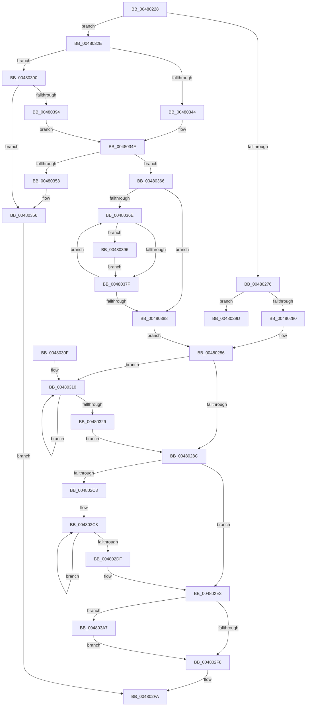

# MiAppendSubsectionChain

- RVA: `0x00480228`–`0x004803CE` (길이 `422` bytes)
- VA: `0x0000000140480228`
- 실행 섹션: `.text`
- PDB 이름 있음: `예`; PDB Function 태그: `예`
- unwind 정보 RVA: `0x000AE460`
- 디코드: `120`개 명령, `422/422` bytes 표시
- 미해석 바이트: `0` (있으면 어셈블리에 `.byte`로 보존)

> 이 문서는 커널 이미지의 기계어와 PDB 기호를 분석해 생성했습니다. 4번과 5번은 함수 원형과 자료형을 바이너리 사용 방식에서 추정한 C 해석이며 원본 소스 복구 결과는 아닙니다.

## 1. Dependencies

- 직접 호출 지점: **6**; 고유 호출 대상: **5**
- 직접 호출자로 확인된 함수: **1**
- RIP 상대 이미지 참조: **1**

### Outgoing calls
- `0x0048025F` → [ExAcquireSpinLockExclusive](../24/ExAcquireSpinLockExclusive_function_00248690.md) (function, `0x00248690`)
- `0x004802D1` → [MiInsertSubsectionNode](../26/MiInsertSubsectionNode_function_00265C7C.md) (function, `0x00265C7C`)
- `0x004802EA` → [MiReleaseSpinLockExclusive](../24/MiReleaseSpinLockExclusive_function_002482C0.md) (function, `0x002482C0`)
- `0x00480318` → [MiDecrementSubsectionViewCount](../29/MiDecrementSubsectionViewCount_function_00298E90.md) (function, `0x00298E90`)
- `0x0048035D` → [MiReleaseSpinLockExclusive](../24/MiReleaseSpinLockExclusive_function_002482C0.md) (function, `0x002482C0`)
- `0x004803C4` → [MiReturnCrossPartitionSectionCharges](../4B/MiReturnCrossPartitionSectionCharges_function_004BA61C.md) (function, `0x004BA61C`)

### Direct callers
- [MiExtendSection](../../page/98/MiExtendSection_function_00982FDC.md) at `0x0098321E`

### Static image references
- `0x004803AF` → RVA `0x00E30088` (`.data`; read)

## 2. Other-region calls and transfers

- 다른 실행 섹션으로 향하는 call: **0**
- call이 아닌 외부 분기/꼬리 이동: **1**
  - `0x004803A2` → [sub_006F4EF0](../6F/Unknown_function_006F4EF0.md) (`tail-transfer`)

## 3. Assembly (complete function range)

```asm
00480228  48 89 5C 24 18                  mov qword ptr [rsp + 0x18], rbx
0048022D  48 89 54 24 10                  mov qword ptr [rsp + 0x10], rdx
00480232  55                              push rbp
00480233  56                              push rsi
00480234  57                              push rdi
00480235  41 54                           push r12
00480237  41 55                           push r13
00480239  41 56                           push r14
0048023B  41 57                           push r15
0048023D  48 83 EC 20                     sub rsp, 0x20
00480241  4C 8B 29                        mov r13, qword ptr [rcx]
00480244  4C 8B E1                        mov r12, rcx
00480247  48 8B 5A 10                     mov rbx, qword ptr [rdx + 0x10]
0048024B  45 8B F8                        mov r15d, r8d
0048024E  45 32 F6                        xor r14b, r14b
00480251  33 ED                           xor ebp, ebp
00480253  49 8D 7D 48                     lea rdi, [r13 + 0x48]
00480257  48 8B CF                        mov rcx, rdi
0048025A  48 89 7C 24 78                  mov qword ptr [rsp + 0x78], rdi
0048025F  E8 2C 84 DC FF                  call 0x140248690
00480264  44 8D 45 01                     lea r8d, [rbp + 1]
00480268  88 44 24 60                     mov byte ptr [rsp + 0x60], al
0048026C  49 39 6D 30                     cmp qword ptr [r13 + 0x30], rbp
00480270  0F 85 B8 00 00 00               jne 0x14048032e
00480276  48 39 6B 08                     cmp qword ptr [rbx + 8], rbp
0048027A  0F 85 1D 01 00 00               jne 0x14048039d
00480280  8D 7D 02                        lea edi, [rbp + 2]
00480283  44 84 FF                        test dil, r15b
00480286  0F 85 84 00 00 00               jne 0x140480310
0048028C  49 8D 7D 48                     lea rdi, [r13 + 0x48]
00480290  41 8B 44 24 20                  mov eax, dword ptr [r12 + 0x20]
00480295  48 8B 5C 24 68                  mov rbx, qword ptr [rsp + 0x68]
0048029A  25 FF FF 0F 00                  and eax, 0xfffff
0048029F  41 89 44 24 20                  mov dword ptr [r12 + 0x20], eax
004802A4  8B 43 28                        mov eax, dword ptr [rbx + 0x28]
004802A7  41 81 64 24 34 00 00 00 C0      and dword ptr [r12 + 0x34], 0xc0000000
004802B0  41 89 44 24 28                  mov dword ptr [r12 + 0x28], eax
004802B5  48 8B 5B 10                     mov rbx, qword ptr [rbx + 0x10]
004802B9  49 89 5C 24 10                  mov qword ptr [r12 + 0x10], rbx
004802BE  48 85 DB                        test rbx, rbx
004802C1  74 20                           je 0x1404802e3
004802C3  BF 01 00 00 00                  mov edi, 1
004802C8  44 8B C7                        mov r8d, edi
004802CB  48 8B D3                        mov rdx, rbx
004802CE  49 8B CD                        mov rcx, r13
004802D1  E8 A6 59 DE FF                  call 0x140265c7c
004802D6  48 8B 5B 10                     mov rbx, qword ptr [rbx + 0x10]
004802DA  48 85 DB                        test rbx, rbx
004802DD  75 E9                           jne 0x1404802c8
004802DF  49 8D 7D 48                     lea rdi, [r13 + 0x48]
004802E3  8A 54 24 60                     mov dl, byte ptr [rsp + 0x60]
004802E7  48 8B CF                        mov rcx, rdi
004802EA  E8 D1 7F DC FF                  call 0x1402482c0
004802EF  48 85 ED                        test rbp, rbp
004802F2  0F 85 AF 00 00 00               jne 0x1404803a7
004802F8  33 C0                           xor eax, eax
004802FA  48 8B 5C 24 70                  mov rbx, qword ptr [rsp + 0x70]
004802FF  48 83 C4 20                     add rsp, 0x20
00480303  41 5F                           pop r15
00480305  41 5E                           pop r14
00480307  41 5D                           pop r13
00480309  41 5C                           pop r12
0048030B  5F                              pop rdi
0048030C  5E                              pop rsi
0048030D  5D                              pop rbp
0048030E  C3                              ret
0048030F  CC                              int3
00480310  BA 18 00 00 00                  mov edx, 0x18
00480315  48 8B CB                        mov rcx, rbx
00480318  E8 73 8B E1 FF                  call 0x140298e90
0048031D  48 8B 5B 10                     mov rbx, qword ptr [rbx + 0x10]
00480321  48 03 E8                        add rbp, rax
00480324  48 85 DB                        test rbx, rbx
00480327  75 E7                           jne 0x140480310
00480329  E9 5E FF FF FF                  jmp 0x14048028c
0048032E  41 8B D7                        mov edx, r15d
00480331  BF 02 00 00 00                  mov edi, 2
00480336  23 D7                           and edx, edi
00480338  BE FF FF FF 3F                  mov esi, 0x3fffffff
0048033D  41 85 74 24 30                  test dword ptr [r12 + 0x30], esi
00480342  75 4C                           jne 0x140480390
00480344  85 D2                           test edx, edx
00480346  45 0F B6 F6                     movzx r14d, r14b
0048034A  45 0F 45 F0                     cmovne r14d, r8d
0048034E  45 84 F8                        test r8b, r15b
00480351  75 13                           jne 0x140480366
00480353  41 8B F8                        mov edi, r8d
00480356  48 8B 4C 24 78                  mov rcx, qword ptr [rsp + 0x78]
0048035B  8A D0                           mov dl, al
0048035D  E8 5E 7F DC FF                  call 0x1402482c0
00480362  8B C7                           mov eax, edi
00480364  EB 94                           jmp 0x1404802fa
00480366  48 8B CB                        mov rcx, rbx
00480369  48 85 DB                        test rbx, rbx
0048036C  74 1A                           je 0x140480388
0048036E  8B 41 20                        mov eax, dword ptr [rcx + 0x20]
00480371  0F BA E8 10                     bts eax, 0x10
00480375  89 41 20                        mov dword ptr [rcx + 0x20], eax
00480378  41 F6 45 3E 0C                  test byte ptr [r13 + 0x3e], 0xc
0048037D  75 17                           jne 0x140480396
0048037F  48 8B 49 10                     mov rcx, qword ptr [rcx + 0x10]
00480383  48 85 C9                        test rcx, rcx
00480386  75 E6                           jne 0x14048036e
00480388  45 84 F6                        test r14b, r14b
0048038B  E9 F6 FE FF FF                  jmp 0x140480286
00480390  85 D2                           test edx, edx
00480392  74 C2                           je 0x140480356
00480394  EB B8                           jmp 0x14048034e
00480396  0F BA 69 34 1E                  bts dword ptr [rcx + 0x34], 0x1e
0048039B  EB E2                           jmp 0x14048037f
0048039D  BE FF FF FF 3F                  mov esi, 0x3fffffff
004803A2  E9 49 4B 27 00                  jmp 0x1406f4ef0
004803A7  41 0F B7 45 3C                  movzx eax, word ptr [r13 + 0x3c]
004803AC  4C 8B C5                        mov r8, rbp
004803AF  48 8B 0D D2 FC 9A 00            mov rcx, qword ptr [rip + 0x9afcd2]
004803B6  25 FF 03 00 00                  and eax, 0x3ff
004803BB  BA 01 00 00 00                  mov edx, 1
004803C0  48 8B 0C C1                     mov rcx, qword ptr [rcx + rax*8]
004803C4  E8 53 A2 03 00                  call 0x1404ba61c
004803C9  E9 2A FF FF FF                  jmp 0x1404802f8
```

## 4. C-style interpretation (structured pseudocode)

```c
__int64 __fastcall MiAppendSubsectionChain(__int64 a1, __int64 a2, int a3)
{
    __int64 result;
    __int64 v_r14;
    __int64 v_rbp;
    __int64 v_rsp;
    unsigned __int64 v_stack_p10;
    unsigned __int64 v_stack_p18;
    unsigned __int64 v_stack_p20;
    unsigned __int64 v_stack_p78;
    unsigned __int8 v_stack_p8;

    v_stack_p18 = v_rbx;
    v_stack_p10 = a2;
    v_rsp = (v_rsp) - (32);
    v_r14 = 0;
    v_rbp = 0;
    v_stack_p20 = *(unsigned __int64 *)(a1) + 72;
    result = ExAcquireSpinLockExclusive(*(unsigned __int64 *)(a1) + 72, a2, a3, a4);
    v_stack_p8 = (unsigned __int8)(result);
    if ((*(unsigned __int64 *)(*(unsigned __int64 *)(a1) + 48)) != 0) goto loc_0048032E;
    if ((*(unsigned __int64 *)(*(unsigned __int64 *)(a2 + 16) + 8)) != 0) goto loc_0048039D;
loc_00480286:
    if ((((unsigned __int8)(v_rbp + 2)) & ((unsigned __int8)((unsigned int)(a3)))) != 0) goto loc_00480310;
loc_0048028C:
    result = (unsigned int)(((unsigned int)(*(unsigned int *)(a1 + 32))) & (0xFFFFFULL));
    *(unsigned int *)(a1 + 32) = (unsigned int)(result);
    *(unsigned int *)(a1 + 40) = (unsigned int)((unsigned int)(*(unsigned int *)(v_stack_p10 + 40)));
    *(unsigned __int64 *)(a1 + 16) = *(unsigned __int64 *)(v_stack_p10 + 16);
    if (*(unsigned __int64 *)(v_stack_p10 + 16) == 0) goto loc_004802E3;
loc_004802C8:
    result = MiInsertSubsectionNode(*(unsigned __int64 *)(a1), *(unsigned __int64 *)(v_stack_p10 + 16), 1, a4);
    if (*(unsigned __int64 *)(*(unsigned __int64 *)(v_stack_p10 + 16) + 16) != 0) goto loc_004802C8;
loc_004802E3:
    result = MiReleaseSpinLockExclusive(*(unsigned __int64 *)(a1) + 72, v_stack_p8, 1, a4);
    if (0 != 0) goto loc_004803A7;
loc_004802F8:
    result = 0;
loc_004802FA:
    v_rsp = (v_rsp) + (32);
    return result;
loc_00480310:
    result = MiDecrementSubsectionViewCount(v_stack_p18, 24, 1, a4);
    v_rbp = (v_rbp) + (result);
    if (*(unsigned __int64 *)(v_stack_p18 + 16) != 0) goto loc_00480310;
    goto loc_0048028C;
loc_0048032E:
    a2 = (unsigned int)(((unsigned int)((unsigned int)((unsigned int)(a3)))) & (2));
    if (((*(unsigned int *)(a1 + 48)) & ((unsigned int)((unsigned int)(0x3FFFFFFFULL)))) != 0) goto loc_00480390;
    v_r14 = 0;
    if ((unsigned int)(a2) != 0) { v_r14 = 1; }
loc_0048034E:
    if (((1) & ((unsigned __int8)((unsigned int)(a3)))) != 0) goto loc_00480366;
loc_00480356:
    result = MiReleaseSpinLockExclusive(v_stack_p78, (unsigned __int8)(result), 1, a4);
    goto loc_004802FA;
loc_00480366:
    if (*(unsigned __int64 *)(v_stack_p18 + 16) == 0) goto loc_00480388;
loc_0048036E:
    *(unsigned int *)(*(unsigned __int64 *)(v_stack_p18 + 16) + 32) = (unsigned int)((unsigned int)(*(unsigned int *)(*(unsigned __int64 *)(v_stack_p18 + 16) + 32)));
    if (((*(unsigned __int8 *)(*(unsigned __int64 *)(a1) + 62)) & (12)) != 0) goto loc_00480396;
loc_0048037F:
    if (*(unsigned __int64 *)(*(unsigned __int64 *)(v_stack_p18 + 16) + 16) != 0) goto loc_0048036E;
loc_00480388:
    goto loc_00480286;
loc_00480390:
    if ((unsigned int)((unsigned __int8)(result)) == 0) goto loc_00480356;
    goto loc_0048034E;
loc_00480396:
    goto loc_0048037F;
loc_0048039D:
loc_004803A7:
    result = (unsigned int)((*(unsigned __int16 *)(*(unsigned __int64 *)(a1) + 60)) & (0x3FFULL));
    result = MiReturnCrossPartitionSectionCharges(*(unsigned __int64 *)(*(unsigned __int64 *)(v_rip + 10157266) + result * 8), 1, v_rbp, a4);
    goto loc_004802F8;
}
```

## 5. (Beta) C Style

```c
int64_t MiAppendSubsectionChain(void *Arg1, void *Arg2, int32_t Arg3)
{
    uint8_t *arg1 = (uint8_t *)Arg1;
    uint8_t *arg2 = (uint8_t *)Arg2;

    int64_t result;
    int64_t local_r14;
    int64_t local_rbp;
    int64_t local_rsp;
    uint64_t v_stack_p10;
    uint64_t v_stack_p18;
    uint64_t v_stack_p20;
    uint64_t v_stack_p78;
    uint8_t v_stack_p8;

    v_stack_p18 = local_rbx;
    v_stack_p10 = Arg2;
    local_rsp = (local_rsp) - (32);
    local_r14 = 0;
    local_rbp = 0;
    v_stack_p20 = *(uint64_t *)(arg1) + 72;
    result = ExAcquireSpinLockExclusive(*(uint64_t *)(arg1) + 72, Arg2, Arg3, a4);
    v_stack_p8 = (uint8_t)(result);
    if ((*(uint64_t *)(*(uint64_t *)(arg1) + 0x30)) != 0) goto loc_0048032E;
    if ((*(uint64_t *)(*(uint64_t *)(arg2 + 0x10) + 0x8)) != 0) goto loc_0048039D;
loc_00480286:
    if ((((uint8_t)(local_rbp + 2)) & ((uint8_t)((uint32_t)(Arg3)))) != 0) goto loc_00480310;
loc_0048028C:
    result = (uint32_t)(((uint32_t)(*(uint32_t *)(arg1 + 0x20))) & (0xFFFFFULL));
    *(uint32_t *)(arg1 + 0x20) = (uint32_t)(result);
    *(uint32_t *)(arg1 + 0x28) = (uint32_t)((uint32_t)(*(uint32_t *)(v_stack_p10 + 0x28)));
    *(uint64_t *)(arg1 + 0x10) = *(uint64_t *)(v_stack_p10 + 0x10);
    if (*(uint64_t *)(v_stack_p10 + 0x10) == 0) goto loc_004802E3;
loc_004802C8:
    result = MiInsertSubsectionNode(*(uint64_t *)(arg1), *(uint64_t *)(v_stack_p10 + 0x10), 1, a4);
    if (*(uint64_t *)(*(uint64_t *)(v_stack_p10 + 0x10) + 0x10) != 0) goto loc_004802C8;
loc_004802E3:
    result = MiReleaseSpinLockExclusive(*(uint64_t *)(arg1) + 72, v_stack_p8, 1, a4);
    if (0 != 0) goto loc_004803A7;
loc_004802F8:
    result = 0;
loc_004802FA:
    local_rsp = (local_rsp) + (32);
    return result;
loc_00480310:
    result = MiDecrementSubsectionViewCount(v_stack_p18, 24, 1, a4);
    local_rbp = (local_rbp) + (result);
    if (*(uint64_t *)(v_stack_p18 + 0x10) != 0) goto loc_00480310;
    goto loc_0048028C;
loc_0048032E:
    Arg2 = (uint32_t)(((uint32_t)((uint32_t)((uint32_t)(Arg3)))) & (2));
    if (((*(uint32_t *)(arg1 + 0x30)) & ((uint32_t)((uint32_t)(0x3FFFFFFFULL)))) != 0) goto loc_00480390;
    local_r14 = 0;
    if ((uint32_t)(Arg2) != 0) { local_r14 = 1; }
loc_0048034E:
    if (((1) & ((uint8_t)((uint32_t)(Arg3)))) != 0) goto loc_00480366;
loc_00480356:
    result = MiReleaseSpinLockExclusive(v_stack_p78, (uint8_t)(result), 1, a4);
    goto loc_004802FA;
loc_00480366:
    if (*(uint64_t *)(v_stack_p18 + 0x10) == 0) goto loc_00480388;
loc_0048036E:
    *(uint32_t *)(*(uint64_t *)(v_stack_p18 + 0x10) + 0x20) = (uint32_t)((uint32_t)(*(uint32_t *)(*(uint64_t *)(v_stack_p18 + 0x10) + 0x20)));
    if (((*(uint8_t *)(*(uint64_t *)(arg1) + 0x3E)) & (12)) != 0) goto loc_00480396;
loc_0048037F:
    if (*(uint64_t *)(*(uint64_t *)(v_stack_p18 + 0x10) + 0x10) != 0) goto loc_0048036E;
loc_00480388:
    goto loc_00480286;
loc_00480390:
    if ((uint32_t)((uint8_t)(result)) == 0) goto loc_00480356;
    goto loc_0048034E;
loc_00480396:
    goto loc_0048037F;
loc_0048039D:
loc_004803A7:
    result = (uint32_t)((*(uint16_t *)(*(uint64_t *)(arg1) + 0x3C)) & (0x3FFULL));
    result = MiReturnCrossPartitionSectionCharges(*(uint64_t *)(*(uint64_t *)(v_rip + 0x9AFCD2) + result * 8), 1, local_rbp, a4);
    goto loc_004802F8;
}
```

### 관측된 메모리 오프셋

구조체 형식이 확인되지 않은 접근은 인자 기준의 오프셋으로만 기록했습니다.

| 기준 인자 | 오프셋 표현 | 폭 (bit) | 접근 |
|---|---:|---:|---|
| `Arg1` | `+ 0x0` | `64` | `R` |
| `Arg1` | `+ 0x10` | `64` | `W` |
| `Arg1` | `+ 0x20` | `32` | `R` |
| `Arg1` | `+ 0x20` | `32` | `W` |
| `Arg1` | `+ 0x28` | `32` | `W` |
| `Arg1` | `+ 0x30` | `32` | `R` |
| `Arg1` | `+ 0x34` | `32` | `R/W` |
| `Arg2` | `+ 0x10` | `64` | `R` |

## 6. Execution-region graph

[열기: 2D/3D 그래프와 함수 탐색 컨트롤 패널](../../../control-panel.html?section=text&rva=0x00480228&view=graph)

- 2D 그래프는 위에서 아래로 흐르고, 3D 그래프는 빈 공간을 드래그해 회전합니다. Shift+드래그는 이동, 휠은 확대·축소, 함수 노드 선택은 대상 보고서 이동입니다.

### Static fallback


