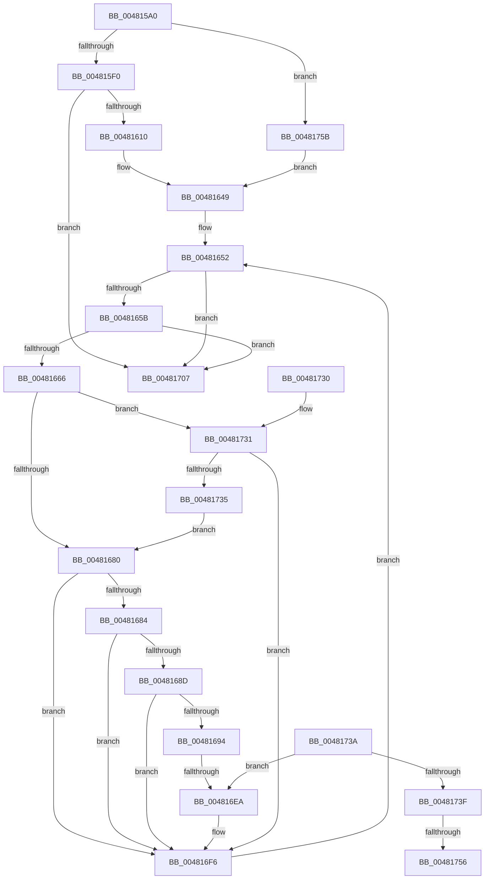

# MiAttemptPageFileReductionApc

- RVA: `0x004815A0`–`0x00481775` (길이 `469` bytes)
- VA: `0x00000001404815A0`
- 실행 섹션: `.text`
- PDB 이름 있음: `예`; PDB Function 태그: `예`
- unwind 정보 RVA: `0x000AECA4`
- 디코드: `125`개 명령, `469/469` bytes 표시
- 미해석 바이트: `0` (있으면 어셈블리에 `.byte`로 보존)

> 이 문서는 커널 이미지의 기계어와 PDB 기호를 분석해 생성했습니다. 4번과 5번은 함수 원형과 자료형을 바이너리 사용 방식에서 추정한 C 해석이며 원본 소스 복구 결과는 아닙니다.

## 1. Dependencies

- 직접 호출 지점: **4**; 고유 호출 대상: **4**
- 직접 호출자로 확인된 함수: **0**
- RIP 상대 이미지 참조: **0**

### Outgoing calls
- `0x00481603` → [MiOkToShrinkPageFiles](MiOkToShrinkPageFiles_function_0048184C.md) (function, `0x0048184C`)
- `0x004816A9` → [ExAcquireSpinLockExclusive](../24/ExAcquireSpinLockExclusive_function_00248690.md) (function, `0x00248690`)
- `0x004816F1` → [MiReleaseSpinLockExclusive](../24/MiReleaseSpinLockExclusive_function_002482C0.md) (function, `0x002482C0`)
- `0x00481710` → [KeSetEvent](../33/KeSetEvent_function_0033F310.md) (function, `0x0033F310`)

### Direct callers
- 이 함수 시작 RVA로 연결되는 직접 call은 확인되지 않았습니다. 간접 호출은 완전히 역산할 수 없습니다.

### Static image references
- 디코드된 RIP-relative 메모리 참조가 없습니다.

## 2. Other-region calls and transfers

- 다른 실행 섹션으로 향하는 call: **0**
- call이 아닌 외부 분기/꼬리 이동: **3**
  - `0x004816E4` → [sub_006F503A](../6F/Unknown_function_006F503A.md) (`tail-transfer`)
  - `0x00481750` → [sub_006F503A + 0x98](../6F/Unknown_function_006F503A.md) (`tail-transfer`)
  - `0x00481756` → [sub_006F503A + 0xDF](../6F/Unknown_function_006F503A.md) (`tail-transfer`)

## 3. Assembly (complete function range)

```asm
004815A0  48 89 5C 24 10                  mov qword ptr [rsp + 0x10], rbx
004815A5  48 89 4C 24 08                  mov qword ptr [rsp + 8], rcx
004815AA  55                              push rbp
004815AB  56                              push rsi
004815AC  57                              push rdi
004815AD  41 54                           push r12
004815AF  41 55                           push r13
004815B1  41 56                           push r14
004815B3  41 57                           push r15
004815B5  48 8D 6C 24 D9                  lea rbp, [rsp - 0x27]
004815BA  48 81 EC 90 00 00 00            sub rsp, 0x90
004815C1  83 65 D3 00                     and dword ptr [rbp - 0x2d], 0
004815C5  48 8B C1                        mov rax, rcx
004815C8  83 65 D7 00                     and dword ptr [rbp - 0x29], 0
004815CC  33 C9                           xor ecx, ecx
004815CE  48 89 4D F3                     mov qword ptr [rbp - 0xd], rcx
004815D2  48 89 4D 03                     mov qword ptr [rbp + 3], rcx
004815D6  44 8B 68 20                     mov r13d, dword ptr [rax + 0x20]
004815DA  4C 8B 60 18                     mov r12, qword ptr [rax + 0x18]
004815DE  48 89 4D EF                     mov qword ptr [rbp - 0x11], rcx
004815E2  48 89 4D FF                     mov qword ptr [rbp - 1], rcx
004815E6  41 83 FD 10                     cmp r13d, 0x10
004815EA  0F 82 6B 01 00 00               jb 0x14048175b
004815F0  49 8B 8C 24 40 4B 00 00         mov rcx, qword ptr [r12 + 0x4b40]
004815F8  4D 8B 8C 24 98 4C 00 00         mov r9, qword ptr [r12 + 0x4c98]
00481600  49 8B D1                        mov rdx, r9
00481603  E8 44 02 00 00                  call 0x14048184c
00481608  85 C0                           test eax, eax
0048160A  0F 84 F7 00 00 00               je 0x140481707
00481610  41 B8 00 80 00 00               mov r8d, 0x8000
00481616  48 B8 CD CC CC CC CC CC CC CC   movabs rax, 0xcccccccccccccccd
00481620  49 F7 E1                        mul r9
00481623  41 8B 84 24 58 48 00 00         mov eax, dword ptr [r12 + 0x4858]
0048162B  BB 00 40 00 00                  mov ebx, 0x4000
00481630  4C 8B FA                        mov r15, rdx
00481633  4C 89 45 DF                     mov qword ptr [rbp - 0x21], r8
00481637  49 83 E7 F8                     and r15, 0xfffffffffffffff8
0048163B  4C 2B F9                        sub r15, rcx
0048163E  B9 01 00 00 00                  mov ecx, 1
00481643  4D 2B F8                        sub r15, r8
00481646  45 33 ED                        xor r13d, r13d
00481649  89 45 CF                        mov dword ptr [rbp - 0x31], eax
0048164C  89 4D CB                        mov dword ptr [rbp - 0x35], ecx
0048164F  89 5D C7                        mov dword ptr [rbp - 0x39], ebx
00481652  44 3B E8                        cmp r13d, eax
00481655  0F 83 AC 00 00 00               jae 0x140481707
0048165B  8B C3                           mov eax, ebx
0048165D  49 3B C7                        cmp rax, r15
00481660  0F 87 A1 00 00 00               ja 0x140481707
00481666  41 8B C5                        mov eax, r13d
00481669  49 8B B4 C4 60 48 00 00         mov rsi, qword ptr [r12 + rax*8 + 0x4860]
00481671  0F B7 86 AC 00 00 00            movzx eax, word ptr [rsi + 0xac]
00481678  A8 10                           test al, 0x10
0048167A  0F 85 B1 00 00 00               jne 0x140481731
00481680  A8 40                           test al, 0x40
00481682  75 72                           jne 0x1404816f6
00481684  8B 0E                           mov ecx, dword ptr [rsi]
00481686  8B 46 08                        mov eax, dword ptr [rsi + 8]
00481689  3B C8                           cmp ecx, eax
0048168B  74 69                           je 0x1404816f6
0048168D  8B 46 0C                        mov eax, dword ptr [rsi + 0xc]
00481690  3B C3                           cmp eax, ebx
00481692  72 62                           jb 0x1404816f6
00481694  4C 8B A6 D8 00 00 00            mov r12, qword ptr [rsi + 0xd8]
0048169B  48 8D 86 C8 00 00 00            lea rax, [rsi + 0xc8]
004816A2  48 8B C8                        mov rcx, rax
004816A5  48 89 45 E7                     mov qword ptr [rbp - 0x19], rax
004816A9  E8 E2 6F DC FF                  call 0x140248690
004816AE  48 8B 4E 50                     mov rcx, qword ptr [rsi + 0x50]
004816B2  44 8B 0E                        mov r9d, dword ptr [rsi]
004816B5  88 45 7F                        mov byte ptr [rbp + 0x7f], al
004816B8  48 8D 41 08                     lea rax, [rcx + 8]
004816BC  4C 8B 58 08                     mov r11, qword ptr [rax + 8]
004816C0  41 8D 51 FF                     lea edx, [r9 - 1]
004816C4  44 8B C2                        mov r8d, edx
004816C7  4C 8D 51 18                     lea r10, [rcx + 0x18]
004816CB  49 C1 E8 03                     shr r8, 3
004816CF  80 E2 07                        and dl, 7
004816D2  48 89 45 0F                     mov qword ptr [rbp + 0xf], rax
004816D6  8A CA                           mov cl, dl
004816D8  4C 89 55 17                     mov qword ptr [rbp + 0x17], r10
004816DC  43 8A 04 18                     mov al, byte ptr [r8 + r11]
004816E0  D2 F8                           sar al, cl
004816E2  A8 01                           test al, 1
004816E4  0F 84 50 39 27 00               je 0x1406f503a
004816EA  8A 55 7F                        mov dl, byte ptr [rbp + 0x7f]
004816ED  48 8B 4D E7                     mov rcx, qword ptr [rbp - 0x19]
004816F1  E8 CA 6B DC FF                  call 0x1402482c0
004816F6  8B 5D C7                        mov ebx, dword ptr [rbp - 0x39]
004816F9  41 FF C5                        inc r13d
004816FC  8B 4D CB                        mov ecx, dword ptr [rbp - 0x35]
004816FF  8B 45 CF                        mov eax, dword ptr [rbp - 0x31]
00481702  E9 4B FF FF FF                  jmp 0x140481652
00481707  48 8B 4D 67                     mov rcx, qword ptr [rbp + 0x67]
0048170B  45 33 C0                        xor r8d, r8d
0048170E  33 D2                           xor edx, edx
00481710  E8 FB DB EB FF                  call 0x14033f310
00481715  48 8B 9C 24 D8 00 00 00         mov rbx, qword ptr [rsp + 0xd8]
0048171D  48 81 C4 90 00 00 00            add rsp, 0x90
00481724  41 5F                           pop r15
00481726  41 5E                           pop r14
00481728  41 5D                           pop r13
0048172A  41 5C                           pop r12
0048172C  5F                              pop rdi
0048172D  5E                              pop rsi
0048172E  5D                              pop rbp
0048172F  C3                              ret
00481730  CC                              int3
00481731  85 C9                           test ecx, ecx
00481733  75 C1                           jne 0x1404816f6
00481735  E9 46 FF FF FF                  jmp 0x140481680
0048173A  45 85 F6                        test r14d, r14d
0048173D  74 AB                           je 0x1404816ea
0048173F  8B 0E                           mov ecx, dword ptr [rsi]
00481741  8B F9                           mov edi, ecx
00481743  48 8B 86 D0 00 00 00            mov rax, qword ptr [rsi + 0xd0]
0048174A  41 2B FE                        sub edi, r14d
0048174D  48 85 C0                        test rax, rax
00481750  0F 85 7C 39 27 00               jne 0x1406f50d2
00481756  E9 BE 39 27 00                  jmp 0x1406f5119
0048175B  8B 58 24                        mov ebx, dword ptr [rax + 0x24]
0048175E  49 BF FF FF FF FF FF FF FF 7F   movabs r15, 0x7fffffffffffffff
00481768  48 21 4D DF                     and qword ptr [rbp - 0x21], rcx
0048176C  41 8D 45 01                     lea eax, [r13 + 1]
00481770  E9 D4 FE FF FF                  jmp 0x140481649
```

## 4. C-style interpretation (structured pseudocode)

```c
__int64 __fastcall MiAttemptPageFileReductionApc(__int64 a1)
{
    __int64 result;
    __int64 v_r13;
    __int64 v_r15;
    __int64 v_rsp;
    unsigned __int64 v_stack_m48;
    unsigned __int64 v_stack_m50;
    unsigned __int64 v_stack_m5C;
    unsigned __int64 v_stack_m5F;
    unsigned __int64 v_stack_m60;
    unsigned __int64 v_stack_m6C;
    unsigned __int64 v_stack_m70;
    unsigned __int64 v_stack_m78;
    unsigned __int64 v_stack_m80;
    unsigned int v_stack_m88;
    unsigned int v_stack_m8C;
    unsigned int v_stack_m90;
    unsigned int v_stack_m94;
    unsigned int v_stack_m98;
    unsigned __int64 v_stack_p10;
    unsigned __int8 v_stack_p20;
    unsigned __int64 v_stack_p8;

    v_stack_p10 = v_rbx;
    v_stack_p8 = a1;
    v_rsp = (v_rsp) - (144);
    a1 = 0;
    v_stack_m6C = 0;
    v_stack_m5C = 0;
    v_stack_m70 = 0;
    v_stack_m60 = 0;
    if (((unsigned int)((unsigned int)(*(unsigned int *)(a1 + 32)))) < 16) goto loc_0048175B;
    result = MiOkToShrinkPageFiles(*(unsigned __int64 *)(*(unsigned __int64 *)(a1 + 24) + 19264), *(unsigned __int64 *)(*(unsigned __int64 *)(a1 + 24) + 19608), a3, *(unsigned __int64 *)(*(unsigned __int64 *)(a1 + 24) + 19608));
    if ((unsigned int)(result) == 0) goto loc_00481707;
    v_stack_m80 = (unsigned int)(0x8000ULL);
    v_r15 = (*(unsigned __int64 *)(*(unsigned __int64 *)(a1 + 24) + 19608)) & (-8);
    v_r15 = (v_r15) - (*(unsigned __int64 *)(*(unsigned __int64 *)(a1 + 24) + 19264));
    v_r15 = (v_r15) - ((unsigned int)(0x8000ULL));
    v_r13 = 0;
loc_00481649:
    v_stack_m90 = (unsigned int)((unsigned int)(*(unsigned int *)(*(unsigned __int64 *)(a1 + 24) + 18520)));
    v_stack_m94 = 1;
    v_stack_m98 = (unsigned int)((unsigned int)(0x4000ULL));
loc_00481652:
    if (0 >= ((unsigned int)((unsigned int)(*(unsigned int *)(*(unsigned __int64 *)(a1 + 24) + 18520))))) goto loc_00481707;
    if (((unsigned int)((unsigned int)((unsigned int)(0x4000ULL)))) > v_r15) goto loc_00481707;
    if ((((unsigned __int8)(*(unsigned __int16 *)(*(unsigned __int64 *)(*(unsigned __int64 *)(a1 + 24) + 0 * 8 + 18528) + 172))) & (16)) != 0) goto loc_00481731;
loc_00481680:
    if ((((unsigned __int8)(*(unsigned __int16 *)(*(unsigned __int64 *)(*(unsigned __int64 *)(a1 + 24) + 0 * 8 + 18528) + 172))) & (64)) != 0) goto loc_004816F6;
    if (((unsigned int)((unsigned int)(*(unsigned int *)(*(unsigned __int64 *)(*(unsigned __int64 *)(a1 + 24) + 0 * 8 + 18528))))) == ((unsigned int)((unsigned int)(*(unsigned int *)(*(unsigned __int64 *)(*(unsigned __int64 *)(a1 + 24) + 0 * 8 + 18528) + 8))))) goto loc_004816F6;
    if (((unsigned int)((unsigned int)(*(unsigned int *)(*(unsigned __int64 *)(*(unsigned __int64 *)(a1 + 24) + 0 * 8 + 18528) + 12)))) < ((unsigned int)((unsigned int)(0x4000ULL)))) goto loc_004816F6;
    v_stack_m78 = *(unsigned __int64 *)(*(unsigned __int64 *)(a1 + 24) + 0 * 8 + 18528) + 200;
    result = ExAcquireSpinLockExclusive(*(unsigned __int64 *)(*(unsigned __int64 *)(a1 + 24) + 0 * 8 + 18528) + 200, *(unsigned __int64 *)(*(unsigned __int64 *)(a1 + 24) + 19608), (unsigned int)(0x8000ULL), *(unsigned __int64 *)(*(unsigned __int64 *)(a1 + 24) + 19608));
    v_stack_p20 = (unsigned __int8)(result);
    a3 = ((unsigned int)((unsigned int)((unsigned int)(*(unsigned int *)(*(unsigned __int64 *)(*(unsigned __int64 *)(a1 + 24) + 0 * 8 + 18528))) - 1))) >> (3);
    a2 = (unsigned __int8)(((unsigned int)(*(unsigned int *)(*(unsigned __int64 *)(*(unsigned __int64 *)(a1 + 24) + 0 * 8 + 18528))) - 1) & (7));
    v_stack_m50 = *(unsigned __int64 *)(*(unsigned __int64 *)(*(unsigned __int64 *)(a1 + 24) + 0 * 8 + 18528) + 80) + 8;
    v_stack_m48 = *(unsigned __int64 *)(*(unsigned __int64 *)(*(unsigned __int64 *)(a1 + 24) + 0 * 8 + 18528) + 80) + 24;
    result = (unsigned __int8)((*(unsigned __int8 *)(a3 + *(unsigned __int64 *)(*(unsigned __int64 *)(*(unsigned __int64 *)(*(unsigned __int64 *)(a1 + 24) + 0 * 8 + 18528) + 80) + 8 + 8) * 1)) >> ((unsigned __int8)((unsigned __int8)(a2))));
loc_004816EA:
    result = MiReleaseSpinLockExclusive(v_stack_m78, v_stack_p20, a3, (unsigned int)(*(unsigned int *)(*(unsigned __int64 *)(*(unsigned __int64 *)(a1 + 24) + 0 * 8 + 18528))));
loc_004816F6:
    v_r13 = (unsigned int)((v_r13) + 1);
    goto loc_00481652;
loc_00481707:
    a3 = 0;
    a2 = 0;
    result = KeSetEvent(v_stack_p8, a2, a3, (unsigned int)(*(unsigned int *)(*(unsigned __int64 *)(*(unsigned __int64 *)(a1 + 24) + 0 * 8 + 18528))));
    v_rsp = (v_rsp) + (144);
    return result;
loc_00481731:
    if ((unsigned int)(v_stack_p8) != 0) goto loc_004816F6;
    goto loc_00481680;
loc_0048175B:
    goto loc_00481649;
}
```

## 5. (Beta) C Style

```c
int64_t MiAttemptPageFileReductionApc(void *Arg1)
{
    uint8_t *arg1 = (uint8_t *)Arg1;

    int64_t result;
    int64_t local_r13;
    int64_t local_r15;
    int64_t local_rsp;
    uint64_t v_stack_m48;
    uint64_t v_stack_m50;
    uint64_t v_stack_m5C;
    uint64_t v_stack_m5F;
    uint64_t v_stack_m60;
    uint64_t v_stack_m6C;
    uint64_t v_stack_m70;
    uint64_t v_stack_m78;
    uint64_t v_stack_m80;
    uint32_t v_stack_m88;
    uint32_t v_stack_m8C;
    uint32_t v_stack_m90;
    uint32_t v_stack_m94;
    uint32_t v_stack_m98;
    uint64_t v_stack_p10;
    uint8_t v_stack_p20;
    uint64_t v_stack_p8;

    v_stack_p10 = local_rbx;
    v_stack_p8 = Arg1;
    local_rsp = (local_rsp) - (144);
    Arg1 = 0;
    v_stack_m6C = 0;
    v_stack_m5C = 0;
    v_stack_m70 = 0;
    v_stack_m60 = 0;
    if (((uint32_t)((uint32_t)(*(uint32_t *)(arg1 + 0x20)))) < 16) goto loc_0048175B;
    result = MiOkToShrinkPageFiles(*(uint64_t *)(*(uint64_t *)(arg1 + 0x18) + 0x4B40), *(uint64_t *)(*(uint64_t *)(arg1 + 0x18) + 0x4C98), a3, *(uint64_t *)(*(uint64_t *)(arg1 + 0x18) + 0x4C98));
    if ((uint32_t)(result) == 0) goto loc_00481707;
    v_stack_m80 = (uint32_t)(0x8000ULL);
    local_r15 = (*(uint64_t *)(*(uint64_t *)(arg1 + 0x18) + 0x4C98)) & (-8);
    local_r15 = (local_r15) - (*(uint64_t *)(*(uint64_t *)(arg1 + 0x18) + 0x4B40));
    local_r15 = (local_r15) - ((uint32_t)(0x8000ULL));
    local_r13 = 0;
loc_00481649:
    v_stack_m90 = (uint32_t)((uint32_t)(*(uint32_t *)(*(uint64_t *)(arg1 + 0x18) + 0x4858)));
    v_stack_m94 = 1;
    v_stack_m98 = (uint32_t)((uint32_t)(0x4000ULL));
loc_00481652:
    if (0 >= ((uint32_t)((uint32_t)(*(uint32_t *)(*(uint64_t *)(arg1 + 0x18) + 0x4858))))) goto loc_00481707;
    if (((uint32_t)((uint32_t)((uint32_t)(0x4000ULL)))) > local_r15) goto loc_00481707;
    if ((((uint8_t)(*(uint16_t *)(*(uint64_t *)(*(uint64_t *)(arg1 + 0x18) + 0x0 * 8 + 0x4860) + 0xAC))) & (16)) != 0) goto loc_00481731;
loc_00481680:
    if ((((uint8_t)(*(uint16_t *)(*(uint64_t *)(*(uint64_t *)(arg1 + 0x18) + 0x0 * 8 + 0x4860) + 0xAC))) & (64)) != 0) goto loc_004816F6;
    if (((uint32_t)((uint32_t)(*(uint32_t *)(*(uint64_t *)(*(uint64_t *)(arg1 + 0x18) + 0x0 * 8 + 0x4860))))) == ((uint32_t)((uint32_t)(*(uint32_t *)(*(uint64_t *)(*(uint64_t *)(arg1 + 0x18) + 0x0 * 8 + 0x4860) + 0x8))))) goto loc_004816F6;
    if (((uint32_t)((uint32_t)(*(uint32_t *)(*(uint64_t *)(*(uint64_t *)(arg1 + 0x18) + 0x0 * 8 + 0x4860) + 0xC)))) < ((uint32_t)((uint32_t)(0x4000ULL)))) goto loc_004816F6;
    v_stack_m78 = *(uint64_t *)(*(uint64_t *)(arg1 + 0x18) + 0x0 * 8 + 0x4860) + 200;
    result = ExAcquireSpinLockExclusive(*(uint64_t *)(*(uint64_t *)(arg1 + 0x18) + 0x0 * 8 + 0x4860) + 200, *(uint64_t *)(*(uint64_t *)(arg1 + 0x18) + 0x4C98), (uint32_t)(0x8000ULL), *(uint64_t *)(*(uint64_t *)(arg1 + 0x18) + 0x4C98));
    v_stack_p20 = (uint8_t)(result);
    a3 = ((uint32_t)((uint32_t)((uint32_t)(*(uint32_t *)(*(uint64_t *)(*(uint64_t *)(arg1 + 0x18) + 0x0 * 8 + 0x4860))) - 1))) >> (3);
    a2 = (uint8_t)(((uint32_t)(*(uint32_t *)(*(uint64_t *)(*(uint64_t *)(arg1 + 0x18) + 0x0 * 8 + 0x4860))) - 1) & (7));
    v_stack_m50 = *(uint64_t *)(*(uint64_t *)(*(uint64_t *)(arg1 + 0x18) + 0x0 * 8 + 0x4860) + 0x50) + 8;
    v_stack_m48 = *(uint64_t *)(*(uint64_t *)(*(uint64_t *)(arg1 + 0x18) + 0x0 * 8 + 0x4860) + 0x50) + 24;
    result = (uint8_t)((*(uint8_t *)(a3 + *(uint64_t *)(*(uint64_t *)(*(uint64_t *)(*(uint64_t *)(arg1 + 0x18) + 0x0 * 8 + 0x4860) + 0x50) + 0x8 + 0x8) * 1)) >> ((uint8_t)((uint8_t)(a2))));
loc_004816EA:
    result = MiReleaseSpinLockExclusive(v_stack_m78, v_stack_p20, a3, (uint32_t)(*(uint32_t *)(*(uint64_t *)(*(uint64_t *)(arg1 + 0x18) + 0x0 * 8 + 0x4860))));
loc_004816F6:
    local_r13 = (uint32_t)((local_r13) + 1);
    goto loc_00481652;
loc_00481707:
    a3 = 0;
    a2 = 0;
    result = KeSetEvent(v_stack_p8, a2, a3, (uint32_t)(*(uint32_t *)(*(uint64_t *)(*(uint64_t *)(arg1 + 0x18) + 0x0 * 8 + 0x4860))));
    local_rsp = (local_rsp) + (144);
    return result;
loc_00481731:
    if ((uint32_t)(v_stack_p8) != 0) goto loc_004816F6;
    goto loc_00481680;
loc_0048175B:
    goto loc_00481649;
}
```

### 관측된 메모리 오프셋

구조체 형식이 확인되지 않은 접근은 인자 기준의 오프셋으로만 기록했습니다.

| 기준 인자 | 오프셋 표현 | 폭 (bit) | 접근 |
|---|---:|---:|---|
| `Arg1` | `+ 0x18` | `64` | `R` |
| `Arg1` | `+ 0x20` | `32` | `R` |
| `Arg1` | `+ 0x24` | `32` | `R` |

## 6. Execution-region graph

[열기: 2D/3D 그래프와 함수 탐색 컨트롤 패널](../../../control-panel.html?section=text&rva=0x004815A0&view=graph)

- 2D 그래프는 위에서 아래로 흐르고, 3D 그래프는 빈 공간을 드래그해 회전합니다. Shift+드래그는 이동, 휠은 확대·축소, 함수 노드 선택은 대상 보고서 이동입니다.

### Static fallback


