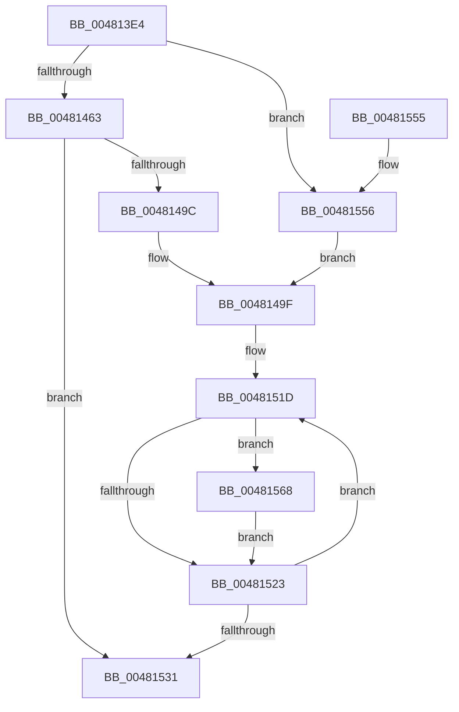

# MiAttemptPageFileReduction

- RVA: `0x004813E4`–`0x0048158D` (길이 `425` bytes)
- VA: `0x00000001404813E4`
- 실행 섹션: `.text`
- PDB 이름 있음: `예`; PDB Function 태그: `아니요`
- unwind 정보 RVA: `0x000AEC80`
- 디코드: `103`개 명령, `425/425` bytes 표시
- 미해석 바이트: `0` (있으면 어셈블리에 `.byte`로 보존)

> 이 문서는 커널 이미지의 기계어와 PDB 기호를 분석해 생성했습니다. 4번과 5번은 함수 원형과 자료형을 바이너리 사용 방식에서 추정한 C 해석이며 원본 소스 복구 결과는 아닙니다.

## 1. Dependencies

- 직접 호출 지점: **9**; 고유 호출 대상: **8**
- 직접 호출자로 확인된 함수: **1**
- RIP 상대 이미지 참조: **3**

### Outgoing calls
- `0x00481420` → [memset](../6C/memset_function_006C6C40.md) (function, `0x006C6C40`)
- `0x0048142F` → [memset](../6C/memset_function_006C6C40.md) (function, `0x006C6C40`)
- `0x0048146D` → [ExAcquireSpinLockExclusive](../24/ExAcquireSpinLockExclusive_function_00248690.md) (function, `0x00248690`)
- `0x0048147C` → [MiReleaseSpinLockExclusive](../24/MiReleaseSpinLockExclusive_function_002482C0.md) (function, `0x002482C0`)
- `0x0048148F` → [MiOkToShrinkPageFiles](MiOkToShrinkPageFiles_function_0048184C.md) (function, `0x0048184C`)
- `0x004814F6` → [KeInsertQueueApc](../20/KeInsertQueueApc_function_00203F10.md) (function, `0x00203F10`)
- `0x0048150D` → [KeWaitForSingleObject](../20/KeWaitForSingleObject_function_0020E6B0.md) (function, `0x0020E6B0`)
- `0x00481538` → [_security_check_cookie](../6A/_security_check_cookie_function_006AC640.md) (function, `0x006AC640`)
- `0x00481586` → [IoSetInformation](../../page/71/IoSetInformation_function_0071DBF0.md) (function, `0x0071DBF0`)

### Direct callers
- [MiHandlePageFileSizeChanges](MiHandlePageFileSizeChanges_function_004811D0.md) at `0x00481320`

### Static image references
- `0x004813FE` → RVA `0x00E0A740` (`.data`; read)
- `0x004814C5` → RVA `0x0049E550` (`EmpCheckErrataList`; read)
- `0x004814D8` → RVA `0x004815A0` (`MiAttemptPageFileReductionApc`; read)

## 2. Other-region calls and transfers

- 다른 실행 섹션으로 향하는 call: **1**
  - `0x00481586` → [IoSetInformation](../../page/71/IoSetInformation_function_0071DBF0.md) (`.text` → `PAGE`)
- 별도 외부 분기/꼬리 이동을 확인하지 못했습니다.

## 3. Assembly (complete function range)

```asm
004813E4  48 89 5C 24 10                  mov qword ptr [rsp + 0x10], rbx
004813E9  48 89 74 24 18                  mov qword ptr [rsp + 0x18], rsi
004813EE  55                              push rbp
004813EF  57                              push rdi
004813F0  41 56                           push r14
004813F2  48 8D 6C 24 E0                  lea rbp, [rsp - 0x20]
004813F7  48 81 EC 20 01 00 00            sub rsp, 0x120
004813FE  48 8B 05 3B 93 98 00            mov rax, qword ptr [rip + 0x98933b]
00481405  48 33 C4                        xor rax, rsp
00481408  48 89 45 10                     mov qword ptr [rbp + 0x10], rax
0048140C  48 83 64 24 30 00               and qword ptr [rsp + 0x30], 0
00481412  33 D2                           xor edx, edx
00481414  48 8B F1                        mov rsi, rcx
00481417  48 8D 4C 24 40                  lea rcx, [rsp + 0x40]
0048141C  44 8D 42 58                     lea r8d, [rdx + 0x58]
00481420  E8 1B 58 24 00                  call 0x1406c6c40
00481425  33 D2                           xor edx, edx
00481427  48 8D 4D A0                     lea rcx, [rbp - 0x60]
0048142B  44 8D 42 68                     lea r8d, [rdx + 0x68]
0048142F  E8 0C 58 24 00                  call 0x1406c6c40
00481434  83 65 A4 00                     and dword ptr [rbp - 0x5c], 0
00481438  48 8D 45 A8                     lea rax, [rbp - 0x58]
0048143C  4C 8B 76 18                     mov r14, qword ptr [rsi + 0x18]
00481440  BF 10 00 00 00                  mov edi, 0x10
00481445  48 89 45 B0                     mov qword ptr [rbp - 0x50], rax
00481449  48 8D 45 A8                     lea rax, [rbp - 0x58]
0048144D  48 89 45 A8                     mov qword ptr [rbp - 0x58], rax
00481451  C6 45 A2 06                     mov byte ptr [rbp - 0x5e], 6
00481455  4C 89 75 B8                     mov qword ptr [rbp - 0x48], r14
00481459  40 84 7E 4F                     test byte ptr [rsi + 0x4f], dil
0048145D  0F 84 F3 00 00 00               je 0x140481556
00481463  49 8D 9E C0 06 00 00            lea rbx, [r14 + 0x6c0]
0048146A  48 8B CB                        mov rcx, rbx
0048146D  E8 1E 72 DC FF                  call 0x140248690
00481472  48 83 66 20 00                  and qword ptr [rsi + 0x20], 0
00481477  8A D0                           mov dl, al
00481479  48 8B CB                        mov rcx, rbx
0048147C  E8 3F 6E DC FF                  call 0x1402482c0
00481481  49 8B 8E 40 4B 00 00            mov rcx, qword ptr [r14 + 0x4b40]
00481488  49 8B 96 98 4C 00 00            mov rdx, qword ptr [r14 + 0x4c98]
0048148F  E8 B8 03 00 00                  call 0x14048184c
00481494  85 C0                           test eax, eax
00481496  0F 84 95 00 00 00               je 0x140481531
0048149C  89 7D C0                        mov dword ptr [rbp - 0x40], edi
0048149F  49 8B 86 E0 03 00 00            mov rax, qword ptr [r14 + 0x3e0]
004814A6  48 8D 55 A0                     lea rdx, [rbp - 0x60]
004814AA  66 83 65 90 00                  and word ptr [rbp - 0x70], 0
004814AF  48 8D 4C 24 40                  lea rcx, [rsp + 0x40]
004814B4  48 83 64 24 68 00               and qword ptr [rsp + 0x68], 0
004814BA  45 33 C9                        xor r9d, r9d
004814BD  48 89 44 24 48                  mov qword ptr [rsp + 0x48], rax
004814C2  45 33 C0                        xor r8d, r8d
004814C5  48 8D 05 84 D0 01 00            lea rax, [rip + 0x1d084]
004814CC  66 C7 44 24 40 12 00            mov word ptr [rsp + 0x40], 0x12
004814D3  48 89 44 24 60                  mov qword ptr [rsp + 0x60], rax
004814D8  48 8D 05 C1 00 00 00            lea rax, [rip + 0xc1]
004814DF  48 89 44 24 70                  mov qword ptr [rsp + 0x70], rax
004814E4  48 8D 45 A0                     lea rax, [rbp - 0x60]
004814E8  48 89 44 24 78                  mov qword ptr [rsp + 0x78], rax
004814ED  C6 44 24 42 58                  mov byte ptr [rsp + 0x42], 0x58
004814F2  C6 45 92 00                     mov byte ptr [rbp - 0x6e], 0
004814F6  E8 15 2A D8 FF                  call 0x140203f10
004814FB  48 83 64 24 20 00               and qword ptr [rsp + 0x20], 0
00481501  48 8D 4D A0                     lea rcx, [rbp - 0x60]
00481505  45 33 C9                        xor r9d, r9d
00481508  45 33 C0                        xor r8d, r8d
0048150B  33 D2                           xor edx, edx
0048150D  E8 9E D1 D8 FF                  call 0x14020e6b0
00481512  48 8D 5D C8                     lea rbx, [rbp - 0x38]
00481516  49 8D B6 60 48 00 00            lea rsi, [r14 + 0x4860]
0048151D  8B 03                           mov eax, dword ptr [rbx]
0048151F  85 C0                           test eax, eax
00481521  75 45                           jne 0x140481568
00481523  48 83 C6 08                     add rsi, 8
00481527  48 83 C3 04                     add rbx, 4
0048152B  48 83 EF 01                     sub rdi, 1
0048152F  75 EC                           jne 0x14048151d
00481531  48 8B 4D 10                     mov rcx, qword ptr [rbp + 0x10]
00481535  48 33 CC                        xor rcx, rsp
00481538  E8 03 B1 22 00                  call 0x1406ac640
0048153D  4C 8D 9C 24 20 01 00 00         lea r11, [rsp + 0x120]
00481545  49 8B 5B 28                     mov rbx, qword ptr [r11 + 0x28]
00481549  49 8B 73 30                     mov rsi, qword ptr [r11 + 0x30]
0048154D  49 8B E3                        mov rsp, r11
00481550  41 5E                           pop r14
00481552  5F                              pop rdi
00481553  5D                              pop rbp
00481554  C3                              ret
00481555  CC                              int3
00481556  0F B6 46 4C                     movzx eax, byte ptr [rsi + 0x4c]
0048155A  89 45 C0                        mov dword ptr [rbp - 0x40], eax
0048155D  8B 46 28                        mov eax, dword ptr [rsi + 0x28]
00481560  89 45 C4                        mov dword ptr [rbp - 0x3c], eax
00481563  E9 37 FF FF FF                  jmp 0x14048149f
00481568  48 8B 0E                        mov rcx, qword ptr [rsi]
0048156B  4C 8D 4C 24 30                  lea r9, [rsp + 0x30]
00481570  BA 13 00 00 00                  mov edx, 0x13
00481575  48 C1 E0 0C                     shl rax, 0xc
00481579  48 89 44 24 30                  mov qword ptr [rsp + 0x30], rax
0048157E  48 8B 49 18                     mov rcx, qword ptr [rcx + 0x18]
00481582  44 8D 42 F5                     lea r8d, [rdx - 0xb]
00481586  E8 65 C6 29 00                  call 0x14071dbf0
0048158B  EB 96                           jmp 0x140481523
```

## 4. C-style interpretation (structured pseudocode)

```c
__int64 __fastcall MiAttemptPageFileReduction(__int64 a1, int a2, __int64 a3, int a4)
{
    __int64 result;
    __int64 v_rbx;
    __int64 v_rdi;
    __int64 v_rsi;
    __int64 v_rsp;
    unsigned __int64 v_stack_m108;
    unsigned __int64 v_stack_m118;
    unsigned __int64 v_stack_m18;
    unsigned __int64 v_stack_m28;
    unsigned __int64 v_stack_m38;
    unsigned __int64 v_stack_m70;
    unsigned int v_stack_m74;
    unsigned int v_stack_m78;
    unsigned __int64 v_stack_m80;
    unsigned __int64 v_stack_m88;
    unsigned __int64 v_stack_m90;
    unsigned int v_stack_m94;
    unsigned __int8 v_stack_m96;
    unsigned __int64 v_stack_m98;
    unsigned __int8 v_stack_mA6;
    unsigned __int16 v_stack_mA8;
    unsigned __int64 v_stack_mC0;
    unsigned __int64 v_stack_mC8;
    unsigned __int64 v_stack_mD0;
    unsigned __int64 v_stack_mD8;
    unsigned __int64 v_stack_mF0;
    unsigned __int8 v_stack_mF6;
    unsigned __int64 v_stack_mF8;
    unsigned __int64 v_stack_p10;
    unsigned __int64 v_stack_p18;

    v_stack_p10 = v_rbx;
    v_stack_p18 = v_rsi;
    v_rsp = (v_rsp) - (288);
    result = (*(unsigned __int64 *)(v_rip + 9999163)) ^ (v_rsp);
    v_stack_m28 = result;
    a2 = 0;
    result = memset(v_stack_mF8, a2, a2 + 88, a4);
    a2 = 0;
    result = memset(v_stack_m98, a2, a2 + 104, a4);
    v_stack_m88 = v_stack_m90;
    v_stack_m90 = v_stack_m90;
    v_stack_m96 = 6;
    v_stack_m80 = *(unsigned __int64 *)(a1 + 24);
    if (((*(unsigned __int8 *)(a1 + 79)) & (16)) == 0) goto loc_00481556;
    result = ExAcquireSpinLockExclusive(*(unsigned __int64 *)(a1 + 24) + 1728, a2, a2 + 104, a4);
    result = MiReleaseSpinLockExclusive(*(unsigned __int64 *)(a1 + 24) + 1728, (unsigned __int8)(result), a2 + 104, a4);
    result = MiOkToShrinkPageFiles(*(unsigned __int64 *)(*(unsigned __int64 *)(a1 + 24) + 19264), *(unsigned __int64 *)(*(unsigned __int64 *)(a1 + 24) + 19608), a2 + 104, a4);
    if ((unsigned int)(result) == 0) goto loc_00481531;
    v_stack_m78 = 16;
loc_0048149F:
    a4 = 0;
    v_stack_mF0 = *(unsigned __int64 *)(*(unsigned __int64 *)(a1 + 24) + 992);
    a3 = 0;
    v_stack_mF8 = 18;
    v_stack_mD8 = v_rip + 118916;
    v_stack_mC8 = v_rip + 193;
    v_stack_mC0 = v_stack_m98;
    v_stack_mF6 = 88;
    v_stack_mA6 = 0;
    result = KeInsertQueueApc(v_stack_mF8, v_stack_m98, a3, a4);
    a4 = 0;
    a3 = 0;
    a2 = 0;
    result = KeWaitForSingleObject(v_stack_m98, a2, a3, a4);
loc_0048151D:
    if ((unsigned int)((unsigned int)(*(unsigned int *)(v_stack_m70))) != 0) goto loc_00481568;
loc_00481523:
    v_rsi = (*(unsigned __int64 *)(a1 + 24) + 18528) + (8);
    v_rbx = (v_stack_m70) + (4);
    v_rdi = (16) - (1);
    if (condition_is_not_equal) goto loc_0048151D;
loc_00481531:
    a1 = (v_stack_m28) ^ (v_rsp);
    result = _security_check_cookie(a1, a2, a3, a4);
    return result;
loc_00481556:
    v_stack_m78 = (unsigned int)(*(unsigned __int8 *)(*(unsigned __int64 *)(v_stack_m18 + 48) + 76));
    v_stack_m74 = (unsigned int)((unsigned int)(*(unsigned int *)(*(unsigned __int64 *)(v_stack_m18 + 48) + 40)));
    goto loc_0048149F;
loc_00481568:
    result = ((unsigned int)(*(unsigned int *)(*(unsigned __int64 *)(v_stack_m18 + 48) + 40))) << (12);
    v_stack_mF0 = result;
    result = IoSetInformation(*(unsigned __int64 *)(*(unsigned __int64 *)(*(unsigned __int64 *)(v_stack_m18 + 48)) + 24), 19, 19 - 11, v_stack_mF0);
    goto loc_00481523;
}
```

## 5. (Beta) C Style

```c
int64_t MiAttemptPageFileReduction(void *Arg1, int32_t Arg2, int64_t Arg3, int32_t Arg4)
{
    uint8_t *arg1 = (uint8_t *)Arg1;

    int64_t result;
    int64_t local_rbx;
    int64_t local_rdi;
    int64_t local_rsi;
    int64_t local_rsp;
    uint64_t v_stack_m108;
    uint64_t v_stack_m118;
    uint64_t v_stack_m18;
    uint64_t v_stack_m28;
    uint64_t v_stack_m38;
    uint64_t v_stack_m70;
    uint32_t v_stack_m74;
    uint32_t v_stack_m78;
    uint64_t v_stack_m80;
    uint64_t v_stack_m88;
    uint64_t v_stack_m90;
    uint32_t v_stack_m94;
    uint8_t v_stack_m96;
    uint64_t v_stack_m98;
    uint8_t v_stack_mA6;
    uint16_t v_stack_mA8;
    uint64_t v_stack_mC0;
    uint64_t v_stack_mC8;
    uint64_t v_stack_mD0;
    uint64_t v_stack_mD8;
    uint64_t v_stack_mF0;
    uint8_t v_stack_mF6;
    uint64_t v_stack_mF8;
    uint64_t v_stack_p10;
    uint64_t v_stack_p18;

    v_stack_p10 = local_rbx;
    v_stack_p18 = local_rsi;
    local_rsp = (local_rsp) - (288);
    result = (*(uint64_t *)(v_rip + 0x98933B)) ^ (local_rsp);
    v_stack_m28 = result;
    Arg2 = 0;
    result = memset(v_stack_mF8, Arg2, Arg2 + 88, Arg4);
    Arg2 = 0;
    result = memset(v_stack_m98, Arg2, Arg2 + 104, Arg4);
    v_stack_m88 = v_stack_m90;
    v_stack_m90 = v_stack_m90;
    v_stack_m96 = 6;
    v_stack_m80 = *(uint64_t *)(arg1 + 0x18);
    if (((*(uint8_t *)(arg1 + 0x4F)) & (16)) == 0) goto loc_00481556;
    result = ExAcquireSpinLockExclusive(*(uint64_t *)(arg1 + 0x18) + 1728, Arg2, Arg2 + 104, Arg4);
    result = MiReleaseSpinLockExclusive(*(uint64_t *)(arg1 + 0x18) + 1728, (uint8_t)(result), Arg2 + 104, Arg4);
    result = MiOkToShrinkPageFiles(*(uint64_t *)(*(uint64_t *)(arg1 + 0x18) + 0x4B40), *(uint64_t *)(*(uint64_t *)(arg1 + 0x18) + 0x4C98), Arg2 + 104, Arg4);
    if ((uint32_t)(result) == 0) goto loc_00481531;
    v_stack_m78 = 16;
loc_0048149F:
    Arg4 = 0;
    v_stack_mF0 = *(uint64_t *)(*(uint64_t *)(arg1 + 0x18) + 0x3E0);
    Arg3 = 0;
    v_stack_mF8 = 18;
    v_stack_mD8 = v_rip + 118916;
    v_stack_mC8 = v_rip + 193;
    v_stack_mC0 = v_stack_m98;
    v_stack_mF6 = 88;
    v_stack_mA6 = 0;
    result = KeInsertQueueApc(v_stack_mF8, v_stack_m98, Arg3, Arg4);
    Arg4 = 0;
    Arg3 = 0;
    Arg2 = 0;
    result = KeWaitForSingleObject(v_stack_m98, Arg2, Arg3, Arg4);
loc_0048151D:
    if ((uint32_t)((uint32_t)(*(uint32_t *)(v_stack_m70))) != 0) goto loc_00481568;
loc_00481523:
    local_rsi = (*(uint64_t *)(arg1 + 0x18) + 18528) + (8);
    local_rbx = (v_stack_m70) + (4);
    local_rdi = (16) - (1);
    if (condition_is_not_equal) goto loc_0048151D;
loc_00481531:
    Arg1 = (v_stack_m28) ^ (local_rsp);
    result = _security_check_cookie(Arg1, Arg2, Arg3, Arg4);
    return result;
loc_00481556:
    v_stack_m78 = (uint32_t)(*(uint8_t *)(*(uint64_t *)(v_stack_m18 + 0x30) + 0x4C));
    v_stack_m74 = (uint32_t)((uint32_t)(*(uint32_t *)(*(uint64_t *)(v_stack_m18 + 0x30) + 0x28)));
    goto loc_0048149F;
loc_00481568:
    result = ((uint32_t)(*(uint32_t *)(*(uint64_t *)(v_stack_m18 + 0x30) + 0x28))) << (12);
    v_stack_mF0 = result;
    result = IoSetInformation(*(uint64_t *)(*(uint64_t *)(*(uint64_t *)(v_stack_m18 + 0x30)) + 0x18), 19, 19 - 11, v_stack_mF0);
    goto loc_00481523;
}
```

### 관측된 메모리 오프셋

구조체 형식이 확인되지 않은 접근은 인자 기준의 오프셋으로만 기록했습니다.

| 기준 인자 | 오프셋 표현 | 폭 (bit) | 접근 |
|---|---:|---:|---|
| `Arg1` | `+ 0x18` | `64` | `R` |
| `Arg1` | `+ 0x20` | `64` | `R/W` |
| `Arg1` | `+ 0x28` | `32` | `R` |
| `Arg1` | `+ 0x4C` | `8` | `R` |
| `Arg1` | `+ 0x4F` | `8` | `R` |

## 6. Execution-region graph

[열기: 2D/3D 그래프와 함수 탐색 컨트롤 패널](../../../control-panel.html?section=text&rva=0x004813E4&view=graph)

- 2D 그래프는 위에서 아래로 흐르고, 3D 그래프는 빈 공간을 드래그해 회전합니다. Shift+드래그는 이동, 휠은 확대·축소, 함수 노드 선택은 대상 보고서 이동입니다.

### Static fallback


