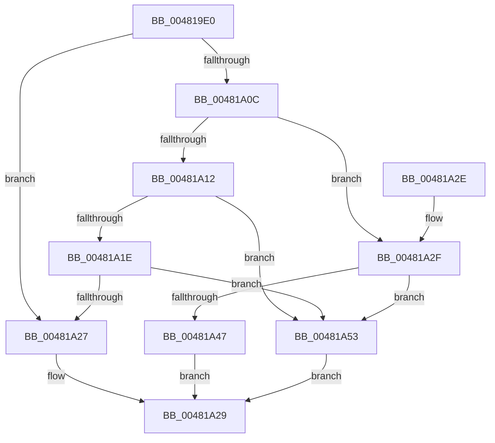

# MiBetterDriverPageNeeded

- RVA: `0x004819E0`–`0x00481A5A` (길이 `122` bytes)
- VA: `0x00000001404819E0`
- 실행 섹션: `.text`
- PDB 이름 있음: `예`; PDB Function 태그: `아니요`
- unwind 정보 RVA: `0x00066F5C`
- 디코드: `36`개 명령, `122/122` bytes 표시
- 미해석 바이트: `0` (있으면 어셈블리에 `.byte`로 보존)

> 이 문서는 커널 이미지의 기계어와 PDB 기호를 분석해 생성했습니다. 4번과 5번은 함수 원형과 자료형을 바이너리 사용 방식에서 추정한 C 해석이며 원본 소스 복구 결과는 아닙니다.

## 1. Dependencies

- 직접 호출 지점: **2**; 고유 호출 대상: **1**
- 직접 호출자로 확인된 함수: **1**
- RIP 상대 이미지 참조: **0**

### Outgoing calls
- `0x00481A02` → [MiGetPfnSlabType](../28/MiGetPfnSlabType_function_0028E2D0.md) (function, `0x0028E2D0`)
- `0x00481A3D` → [MiGetPfnSlabType](../28/MiGetPfnSlabType_function_0028E2D0.md) (function, `0x0028E2D0`)

### Direct callers
- [MiLockCode](../36/MiLockCode_function_0036F91C.md) at `0x0036FE42`

### Static image references
- 디코드된 RIP-relative 메모리 참조가 없습니다.

## 2. Other-region calls and transfers

- 다른 실행 섹션으로 향하는 call: **0**
- 별도 외부 분기/꼬리 이동을 확인하지 못했습니다.

## 3. Assembly (complete function range)

```asm
004819E0  48 83 EC 28                     sub rsp, 0x28
004819E4  4C 8B D1                        mov r10, rcx
004819E7  49 BB 00 00 00 00 00 DE FF FF   movabs r11, 0xffffde0000000000
004819F1  48 8D 0C 52                     lea rcx, [rdx + rdx*2]
004819F5  4C 8B CA                        mov r9, rdx
004819F8  48 C1 E1 04                     shl rcx, 4
004819FC  49 8B C3                        mov rax, r11
004819FF  48 03 C8                        add rcx, rax
00481A02  E8 C9 C8 E0 FF                  call 0x14028e2d0
00481A07  83 F8 09                        cmp eax, 9
00481A0A  75 1B                           jne 0x140481a27
00481A0C  49 83 F8 FF                     cmp r8, -1
00481A10  75 1D                           jne 0x140481a2f
00481A12  49 8B 82 38 41 00 00            mov rax, qword ptr [r10 + 0x4138]
00481A19  48 85 C0                        test rax, rax
00481A1C  74 35                           je 0x140481a53
00481A1E  4D 3B 8A 28 41 00 00            cmp r9, qword ptr [r10 + 0x4128]
00481A25  72 2C                           jb 0x140481a53
00481A27  33 C0                           xor eax, eax
00481A29  48 83 C4 28                     add rsp, 0x28
00481A2D  C3                              ret
00481A2E  CC                              int3
00481A2F  4B 8D 0C 40                     lea rcx, [r8 + r8*2]
00481A33  48 C1 E1 04                     shl rcx, 4
00481A37  49 8B C3                        mov rax, r11
00481A3A  48 03 C8                        add rcx, rax
00481A3D  E8 8E C8 E0 FF                  call 0x14028e2d0
00481A42  83 F8 09                        cmp eax, 9
00481A45  75 0C                           jne 0x140481a53
00481A47  33 C9                           xor ecx, ecx
00481A49  4D 3B C8                        cmp r9, r8
00481A4C  0F 92 C1                        setb cl
00481A4F  8B C1                           mov eax, ecx
00481A51  EB D6                           jmp 0x140481a29
00481A53  B8 01 00 00 00                  mov eax, 1
00481A58  EB CF                           jmp 0x140481a29
```

## 4. C-style interpretation (structured pseudocode)

```c
__int64 __fastcall MiBetterDriverPageNeeded(__int64 a1, __int64 a2, __int64 a3)
{
    __int64 result;
    __int64 v_rsp;

    v_rsp = (v_rsp) - (40);
    a1 = (a2 + a2 * 2) << (4);
    a1 = (a1) + (v_r11);
    result = MiGetPfnSlabType(a1, a2, a3, a2);
    if (((unsigned int)(result)) != 9) goto loc_00481A27;
    if (a3 != -1) goto loc_00481A2F;
    if (*(unsigned __int64 *)(a1 + 16696) == 0) goto loc_00481A53;
    if (a2 < (*(unsigned __int64 *)(a1 + 16680))) goto loc_00481A53;
loc_00481A27:
    result = 0;
loc_00481A29:
    v_rsp = (v_rsp) + (40);
    return result;
loc_00481A2F:
    a1 = (a3 + a3 * 2) << (4);
    a1 = (a1) + (v_r11);
    result = MiGetPfnSlabType(a1, a2, a3, a2);
    if (((unsigned int)(result)) != 9) goto loc_00481A53;
    a1 = 0;
    a1 = (a2 < a3) ? 1 : 0;
    goto loc_00481A29;
loc_00481A53:
    goto loc_00481A29;
}
```

## 5. (Beta) C Style

```c
int64_t MiBetterDriverPageNeeded(int64_t Arg1, void *Arg2, int64_t Arg3)
{
    uint8_t *arg2 = (uint8_t *)Arg2;

    int64_t result;
    int64_t local_rsp;

    local_rsp = (local_rsp) - (40);
    Arg1 = (Arg2 + Arg2 * 2) << (4);
    Arg1 = (Arg1) + (local_r11);
    result = MiGetPfnSlabType(Arg1, Arg2, Arg3, Arg2);
    if (((uint32_t)(result)) != 9) goto loc_00481A27;
    if (Arg3 != -1) goto loc_00481A2F;
    if (*(uint64_t *)(Arg1 + 0x4138) == 0) goto loc_00481A53;
    if (Arg2 < (*(uint64_t *)(Arg1 + 0x4128))) goto loc_00481A53;
loc_00481A27:
    result = 0;
loc_00481A29:
    local_rsp = (local_rsp) + (40);
    return result;
loc_00481A2F:
    Arg1 = (Arg3 + Arg3 * 2) << (4);
    Arg1 = (Arg1) + (local_r11);
    result = MiGetPfnSlabType(Arg1, Arg2, Arg3, Arg2);
    if (((uint32_t)(result)) != 9) goto loc_00481A53;
    Arg1 = 0;
    Arg1 = (Arg2 < Arg3) ? 1 : 0;
    goto loc_00481A29;
loc_00481A53:
    goto loc_00481A29;
}
```

### 관측된 메모리 오프셋

구조체 형식이 확인되지 않은 접근은 인자 기준의 오프셋으로만 기록했습니다.

| 기준 인자 | 오프셋 표현 | 폭 (bit) | 접근 |
|---|---:|---:|---|
| `Arg2` | `+ 0x0 + rdx*2` | `64` | `R` |

## 6. Execution-region graph

[열기: 2D/3D 그래프와 함수 탐색 컨트롤 패널](../../../control-panel.html?section=text&rva=0x004819E0&view=graph)

- 2D 그래프는 위에서 아래로 흐르고, 3D 그래프는 빈 공간을 드래그해 회전합니다. Shift+드래그는 이동, 휠은 확대·축소, 함수 노드 선택은 대상 보고서 이동입니다.

### Static fallback


