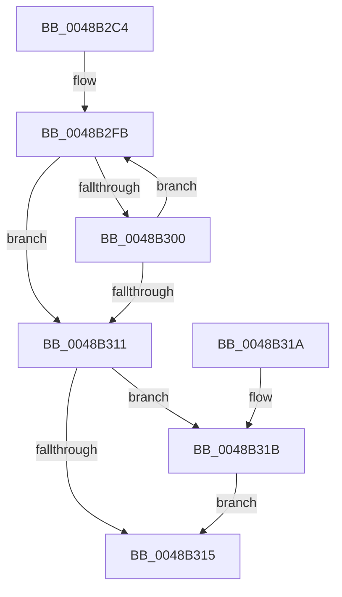

# MiCauseOverCommitPopup

- RVA: `0x0048B2C4`–`0x0048B32A` (길이 `102` bytes)
- VA: `0x000000014048B2C4`
- 실행 섹션: `.text`
- PDB 이름 있음: `예`; PDB Function 태그: `아니요`
- unwind 정보 RVA: `0x0005D35C`
- 디코드: `28`개 명령, `102/102` bytes 표시
- 미해석 바이트: `0` (있으면 어셈블리에 `.byte`로 보존)

> 이 문서는 커널 이미지의 기계어와 PDB 기호를 분석해 생성했습니다. 4번과 5번은 함수 원형과 자료형을 바이너리 사용 방식에서 추정한 C 해석이며 원본 소스 복구 결과는 아닙니다.

## 1. Dependencies

- 직접 호출 지점: **1**; 고유 호출 대상: **1**
- 직접 호출자로 확인된 함수: **2**
- RIP 상대 이미지 참조: **0**

### Outgoing calls
- `0x0048B323` → [IoRaiseInformationalHardError](../4B/IoRaiseInformationalHardError_function_004B82B0.md) (function, `0x004B82B0`)

### Direct callers
- [MiChargeCommit](../28/MiChargeCommit_function_00286EB0.md) at `0x0028735A`
- [MiChargeCommit](../28/MiChargeCommit_function_00286EB0.md) at `0x00287459`
- [MiChargeCommit](../28/MiChargeCommit_function_00286EB0.md) at `0x00287526`
- [MiPageFileNoFreeSpace](../47/MiPageFileNoFreeSpace_function_0047E45C.md) at `0x0047E53B`

### Static image references
- 디코드된 RIP-relative 메모리 참조가 없습니다.

## 2. Other-region calls and transfers

- 다른 실행 섹션으로 향하는 call: **0**
- 별도 외부 분기/꼬리 이동을 확인하지 못했습니다.

## 3. Assembly (complete function range)

```asm
0048B2C4  48 83 EC 28                     sub rsp, 0x28
0048B2C8  48 8B 91 98 4C 00 00            mov rdx, qword ptr [rcx + 0x4c98]
0048B2CF  41 B9 D0 41 00 00               mov r9d, 0x41d0
0048B2D5  48 8B 81 C8 41 00 00            mov rax, qword ptr [rcx + 0x41c8]
0048B2DC  41 BA 2D 01 00 C0               mov r10d, 0xc000012d
0048B2E2  48 3B D0                        cmp rdx, rax
0048B2E5  45 8D 41 04                     lea r8d, [r9 + 4]
0048B2E9  45 0F 45 C8                     cmovne r9d, r8d
0048B2ED  41 B8 C8 02 00 C0               mov r8d, 0xc00002c8
0048B2F3  45 0F 45 D0                     cmovne r10d, r8d
0048B2F7  41 8B 04 09                     mov eax, dword ptr [r9 + rcx]
0048B2FB  83 F8 FF                        cmp eax, -1
0048B2FE  74 11                           je 0x14048b311
0048B300  44 8B C0                        mov r8d, eax
0048B303  8D 50 01                        lea edx, [rax + 1]
0048B306  F0 41 0F B1 14 09               lock cmpxchg dword ptr [r9 + rcx], edx
0048B30C  44 3B C0                        cmp r8d, eax
0048B30F  75 EA                           jne 0x14048b2fb
0048B311  85 C0                           test eax, eax
0048B313  74 06                           je 0x14048b31b
0048B315  48 83 C4 28                     add rsp, 0x28
0048B319  C3                              ret
0048B31A  CC                              int3
0048B31B  45 33 C0                        xor r8d, r8d
0048B31E  33 D2                           xor edx, edx
0048B320  41 8B CA                        mov ecx, r10d
0048B323  E8 88 CF 02 00                  call 0x1404b82b0
0048B328  EB EB                           jmp 0x14048b315
```

## 4. C-style interpretation (structured pseudocode)

```c
__int64 __fastcall MiCauseOverCommitPopup(__int64 a1)
{
    __int64 result;
    __int64 v_r10;
    __int64 v_rsp;

    v_rsp = (v_rsp) - (40);
    a4 = (unsigned int)(0x41D0ULL);
    if ((*(unsigned __int64 *)(a1 + 19608)) != (*(unsigned __int64 *)(a1 + 16840))) { a4 = (unsigned int)((unsigned int)(0x41D0ULL) + 4); }
    v_r10 = (unsigned int)(0xC000012DULL);
    if ((*(unsigned __int64 *)(a1 + 19608)) != (*(unsigned __int64 *)(a1 + 16840))) { v_r10 = (unsigned int)((unsigned int)(0xC00002C8ULL)); }
loc_0048B2FB:
    if (((unsigned int)((unsigned int)(*(unsigned int *)(a4 + a1 * 1)))) == -1) goto loc_0048B311;
    if (((unsigned int)((unsigned int)((unsigned int)((unsigned int)(*(unsigned int *)(a4 + a1 * 1)))))) != ((unsigned int)((unsigned int)(*(unsigned int *)(a4 + a1 * 1))))) goto loc_0048B2FB;
loc_0048B311:
    if ((unsigned int)((unsigned int)(*(unsigned int *)(a4 + a1 * 1))) == 0) goto loc_0048B31B;
loc_0048B315:
    v_rsp = (v_rsp) + (40);
    return (unsigned int)(*(unsigned int *)(a4 + a1 * 1));
loc_0048B31B:
    a3 = 0;
    a2 = 0;
    result = IoRaiseInformationalHardError((unsigned int)((unsigned int)(v_r10)), a2, a3, a4);
    goto loc_0048B315;
}
```

## 5. (Beta) C Style

```c
int64_t MiCauseOverCommitPopup(void *Arg1)
{
    uint8_t *arg1 = (uint8_t *)Arg1;

    int64_t result;
    int64_t local_r10;
    int64_t local_rsp;

    local_rsp = (local_rsp) - (40);
    a4 = (uint32_t)(0x41D0ULL);
    if ((*(uint64_t *)(arg1 + 0x4C98)) != (*(uint64_t *)(arg1 + 0x41C8))) { a4 = (uint32_t)((uint32_t)(0x41D0ULL) + 4); }
    local_r10 = (uint32_t)(0xC000012DULL);
    if ((*(uint64_t *)(arg1 + 0x4C98)) != (*(uint64_t *)(arg1 + 0x41C8))) { local_r10 = (uint32_t)((uint32_t)(0xC00002C8ULL)); }
loc_0048B2FB:
    if (((uint32_t)((uint32_t)(*(uint32_t *)(a4 + arg1 * 1)))) == -1) goto loc_0048B311;
    if (((uint32_t)((uint32_t)((uint32_t)((uint32_t)(*(uint32_t *)(a4 + arg1 * 1)))))) != ((uint32_t)((uint32_t)(*(uint32_t *)(a4 + arg1 * 1))))) goto loc_0048B2FB;
loc_0048B311:
    if ((uint32_t)((uint32_t)(*(uint32_t *)(a4 + arg1 * 1))) == 0) goto loc_0048B31B;
loc_0048B315:
    local_rsp = (local_rsp) + (40);
    return (uint32_t)(*(uint32_t *)(a4 + arg1 * 1));
loc_0048B31B:
    a3 = 0;
    a2 = 0;
    result = IoRaiseInformationalHardError((uint32_t)((uint32_t)(local_r10)), a2, a3, a4);
    goto loc_0048B315;
}
```

### 관측된 메모리 오프셋

구조체 형식이 확인되지 않은 접근은 인자 기준의 오프셋으로만 기록했습니다.

| 기준 인자 | 오프셋 표현 | 폭 (bit) | 접근 |
|---|---:|---:|---|
| `Arg1` | `+ 0x41C8` | `64` | `R` |
| `Arg1` | `+ 0x4C98` | `64` | `R` |

## 6. Execution-region graph

[열기: 2D/3D 그래프와 함수 탐색 컨트롤 패널](../../../control-panel.html?section=text&rva=0x0048B2C4&view=graph)

- 2D 그래프는 위에서 아래로 흐르고, 3D 그래프는 빈 공간을 드래그해 회전합니다. Shift+드래그는 이동, 휠은 확대·축소, 함수 노드 선택은 대상 보고서 이동입니다.

### Static fallback


