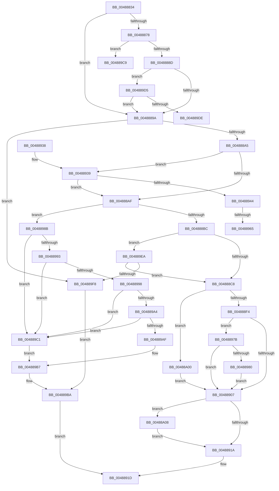

# MiCheckUserVirtualAddress

- RVA: `0x00488834`–`0x00488A10` (길이 `476` bytes)
- VA: `0x0000000140488834`
- 실행 섹션: `.text`
- PDB 이름 있음: `예`; PDB Function 태그: `예`
- unwind 정보 RVA: `0x000AFDA4`
- 디코드: `121`개 명령, `476/476` bytes 표시
- 미해석 바이트: `0` (있으면 어셈블리에 `.byte`로 보존)

> 이 문서는 커널 이미지의 기계어와 PDB 기호를 분석해 생성했습니다. 4번과 5번은 함수 원형과 자료형을 바이너리 사용 방식에서 추정한 C 해석이며 원본 소스 복구 결과는 아닙니다.

## 1. Dependencies

- 직접 호출 지점: **5**; 고유 호출 대상: **5**
- 직접 호출자로 확인된 함수: **2**
- RIP 상대 이미지 참조: **3**

### Outgoing calls
- `0x004888DD` → [MiGetProtoPteAddress](../32/MiGetProtoPteAddress_function_0032E970.md) (function, `0x0032E970`)
- `0x0048890D` → [MiVadExtentCommitted](../32/MiVadExtentCommitted_function_0032E930.md) (function, `0x0032E930`)
- `0x0048894C` → [MiLockVadCore](../29/MiLockVadCore_function_00297170.md) (function, `0x00297170`)
- `0x00488957` → [MiLocateLockedVadEvent](../2A/MiLocateLockedVadEvent_function_002A7A0C.md) (function, `0x002A7A0C`)
- `0x0048899B` → [MiIsVadLargePrivate](../32/MiIsVadLargePrivate_function_0032F720.md) (function, `0x0032F720`)

### Direct callers
- [MiActOnPte](../24/MiActOnPte_function_00244C90.md) at `0x002454EA`
- [sub_002B5FA0](../2B/Unknown_function_002B5FA0.md) at `0x002B608F`

### Static image references
- `0x0048888D` → RVA `0x00E2DB78` (`.data`; read)
- `0x004889C9` → RVA `0x00E2DB68` (`.data`; read)
- `0x004889DE` → RVA `0x00E2DB70` (`.data`; read)

## 2. Other-region calls and transfers

- 다른 실행 섹션으로 향하는 call: **0**
- call이 아닌 외부 분기/꼬리 이동: **4**
  - `0x0048895F` → [sub_006F5C7C + 0x8](../6F/Unknown_function_006F5C7C.md) (`tail-transfer`)
  - `0x00488976` → [sub_006F5C7C + 0x8](../6F/Unknown_function_006F5C7C.md) (`tail-transfer`)
  - `0x004889D0` → [sub_006F5C7C](../6F/Unknown_function_006F5C7C.md) (`tail-transfer`)
  - `0x004889E5` → [sub_006F5C7C](../6F/Unknown_function_006F5C7C.md) (`tail-transfer`)

## 3. Assembly (complete function range)

```asm
00488834  48 8B C4                        mov rax, rsp
00488837  48 89 58 08                     mov qword ptr [rax + 8], rbx
0048883B  48 89 68 10                     mov qword ptr [rax + 0x10], rbp
0048883F  48 89 70 18                     mov qword ptr [rax + 0x18], rsi
00488843  48 89 78 20                     mov qword ptr [rax + 0x20], rdi
00488847  41 56                           push r14
00488849  48 83 EC 30                     sub rsp, 0x30
0048884D  65 48 8B 04 25 88 01 00 00      mov rax, qword ptr gs:[0x188]
00488856  41 BE 01 00 00 00               mov r14d, 1
0048885C  49 8B F9                        mov rdi, r9
0048885F  48 8B DA                        mov rbx, rdx
00488862  48 8B E9                        mov rbp, rcx
00488865  4C 8B 80 B8 00 00 00            mov r8, qword ptr [rax + 0xb8]
0048886C  41 8B 80 FC 05 00 00            mov eax, dword ptr [r8 + 0x5fc]
00488873  41 84 C6                        test r14b, al
00488876  75 22                           jne 0x14048889a
00488878  48 8B C1                        mov rax, rcx
0048887B  48 25 00 F0 FF FF               and rax, 0xfffffffffffff000
00488881  48 3D 00 00 FE 7F               cmp rax, 0x7ffe0000
00488887  0F 84 3C 01 00 00               je 0x1404889c9
0048888D  48 3B 05 E4 52 9A 00            cmp rax, qword ptr [rip + 0x9a52e4]
00488894  0F 84 3B 01 00 00               je 0x1404889d5
0048889A  8B 42 30                        mov eax, dword ptr [rdx + 0x30]
0048889D  A8 04                           test al, 4
0048889F  0F 85 53 01 00 00               jne 0x1404889f8
004888A5  24 70                           and al, 0x70
004888A7  3C 20                           cmp al, 0x20
004888A9  0F 84 8A 00 00 00               je 0x140488939
004888AF  8B 43 30                        mov eax, dword ptr [rbx + 0x30]
004888B2  0F BA E0 15                     bt eax, 0x15
004888B6  0F 82 CF 00 00 00               jb 0x14048898b
004888BC  8B 43 40                        mov eax, dword ptr [rbx + 0x40]
004888BF  41 84 C6                        test r14b, al
004888C2  0F 85 22 01 00 00               jne 0x1404889ea
004888C8  48 8B D5                        mov rdx, rbp
004888CB  4C 8D 4C 24 20                  lea r9, [rsp + 0x20]
004888D0  48 C1 EA 0C                     shr rdx, 0xc
004888D4  41 B8 0C 00 00 00               mov r8d, 0xc
004888DA  48 8B CB                        mov rcx, rbx
004888DD  E8 8E 60 EA FF                  call 0x14032e970
004888E2  4C 8B D8                        mov r11, rax
004888E5  41 BA 18 00 00 00               mov r10d, 0x18
004888EB  48 85 C0                        test rax, rax
004888EE  0F 84 0C 01 00 00               je 0x140488a00
004888F4  8B 43 30                        mov eax, dword ptr [rbx + 0x30]
004888F7  8B C8                           mov ecx, eax
004888F9  C1 E9 07                        shr ecx, 7
004888FC  24 70                           and al, 0x70
004888FE  83 E1 1F                        and ecx, 0x1f
00488901  89 0F                           mov dword ptr [rdi], ecx
00488903  3C 20                           cmp al, 0x20
00488905  74 74                           je 0x14048897b
00488907  48 8B D5                        mov rdx, rbp
0048890A  48 8B CB                        mov rcx, rbx
0048890D  E8 1E 60 EA FF                  call 0x14032e930
00488912  85 C0                           test eax, eax
00488914  0F 84 EE 00 00 00               je 0x140488a08
0048891A  49 8B C3                        mov rax, r11
0048891D  48 8B 5C 24 40                  mov rbx, qword ptr [rsp + 0x40]
00488922  48 8B 6C 24 48                  mov rbp, qword ptr [rsp + 0x48]
00488927  48 8B 74 24 50                  mov rsi, qword ptr [rsp + 0x50]
0048892C  48 8B 7C 24 58                  mov rdi, qword ptr [rsp + 0x58]
00488931  48 83 C4 30                     add rsp, 0x30
00488935  41 5E                           pop r14
00488937  C3                              ret
00488938  CC                              int3
00488939  8B 42 40                        mov eax, dword ptr [rdx + 0x40]
0048893C  A8 10                           test al, 0x10
0048893E  0F 84 6B FF FF FF               je 0x1404888af
00488944  41 8B D6                        mov edx, r14d
00488947  48 8B CB                        mov rcx, rbx
0048894A  33 F6                           xor esi, esi
0048894C  E8 1F E8 E0 FF                  call 0x140297170
00488951  8D 56 20                        lea edx, [rsi + 0x20]
00488954  48 8B CB                        mov rcx, rbx
00488957  E8 B0 F0 E1 FF                  call 0x1402a7a0c
0048895C  48 85 C0                        test rax, rax
0048895F  0F 84 1F D3 26 00               je 0x1406f5c84
00488965  65 48 8B 0C 25 88 01 00 00      mov rcx, qword ptr gs:[0x188]
0048896E  48 39 48 08                     cmp qword ptr [rax + 8], rcx
00488972  41 0F 45 F6                     cmovne esi, r14d
00488976  E9 09 D3 26 00                  jmp 0x1406f5c84
0048897B  83 F9 07                        cmp ecx, 7
0048897E  75 87                           jne 0x140488907
00488980  C7 07 00 01 00 00               mov dword ptr [rdi], 0x100
00488986  E9 7C FF FF FF                  jmp 0x140488907
0048898B  83 E0 70                        and eax, 0x70
0048898E  83 F8 10                        cmp eax, 0x10
00488991  74 2E                           je 0x1404889c1
00488993  83 F8 30                        cmp eax, 0x30
00488996  74 29                           je 0x1404889c1
00488998  48 8B CB                        mov rcx, rbx
0048899B  E8 80 6D EA FF                  call 0x14032f720
004889A0  85 C0                           test eax, eax
004889A2  75 1D                           jne 0x1404889c1
004889A4  44 8B 53 30                     mov r10d, dword ptr [rbx + 0x30]
004889A8  41 0F BA E2 19                  bt r10d, 0x19
004889AD  73 12                           jae 0x1404889c1
004889AF  41 C1 EA 07                     shr r10d, 7
004889B3  41 83 E2 1F                     and r10d, 0x1f
004889B7  44 89 17                        mov dword ptr [rdi], r10d
004889BA  33 C0                           xor eax, eax
004889BC  E9 5C FF FF FF                  jmp 0x14048891d
004889C1  41 BA 18 00 00 00               mov r10d, 0x18
004889C7  EB EE                           jmp 0x1404889b7
004889C9  48 8B 05 98 51 9A 00            mov rax, qword ptr [rip + 0x9a5198]
004889D0  E9 A7 D2 26 00                  jmp 0x1406f5c7c
004889D5  48 85 C0                        test rax, rax
004889D8  0F 84 BC FE FF FF               je 0x14048889a
004889DE  48 8B 05 8B 51 9A 00            mov rax, qword ptr [rip + 0x9a518b]
004889E5  E9 92 D2 26 00                  jmp 0x1406f5c7c
004889EA  8B 43 30                        mov eax, dword ptr [rbx + 0x30]
004889ED  83 E0 70                        and eax, 0x70
004889F0  3C 50                           cmp al, 0x50
004889F2  0F 84 D0 FE FF FF               je 0x1404888c8
004889F8  C7 07 18 00 00 00               mov dword ptr [rdi], 0x18
004889FE  EB BA                           jmp 0x1404889ba
00488A00  44 89 17                        mov dword ptr [rdi], r10d
00488A03  E9 FF FE FF FF                  jmp 0x140488907
00488A08  44 89 17                        mov dword ptr [rdi], r10d
00488A0B  E9 0A FF FF FF                  jmp 0x14048891a
```

## 4. C-style interpretation (structured pseudocode)

```c
__int64 __fastcall MiCheckUserVirtualAddress(__int64 a1, __int64 a2, __int64 a3, __int64 a4)
{
    __int64 result;
    __int64 v_r10;
    __int64 v_rsi;
    __int64 v_rsp;
    unsigned __int64 v_stack_m18;
    unsigned __int64 v_stack_p10;
    unsigned __int64 v_stack_p18;
    unsigned __int64 v_stack_p20;
    unsigned __int64 v_stack_p8;

    *(unsigned __int64 *)(v_rsp + 8) = v_rbx;
    *(unsigned __int64 *)(v_rsp + 16) = v_rbp;
    *(unsigned __int64 *)(v_rsp + 24) = v_rsi;
    *(unsigned __int64 *)(v_rsp + 32) = v_rdi;
    v_rsp = (v_rsp) - (48);
    if (((1) & ((unsigned __int8)((unsigned int)(*(unsigned int *)(*(unsigned __int64 *)(*(unsigned __int64 *)(gs_base + (0 + 392)) + 184) + 1532))))) != 0) goto loc_0048889A;
    result = (a1) & (0xFFFFFFFFFFFFF000ULL);
    if (result == 0x7FFE0000ULL) goto loc_004889C9;
    if (result == (*(unsigned __int64 *)(v_rip + 10113764))) goto loc_004889D5;
loc_0048889A:
    if ((((unsigned __int8)((unsigned int)(*(unsigned int *)(a2 + 48)))) & (4)) != 0) goto loc_004889F8;
    result = (unsigned __int8)(((unsigned int)(*(unsigned int *)(a2 + 48))) & (112));
    if (((unsigned __int8)(result)) == 32) goto loc_00488939;
loc_004888AF:
    if (((unsigned __int8)(result)) < 32) goto loc_0048898B;
    if (((1) & ((unsigned __int8)((unsigned int)(*(unsigned int *)(a2 + 64))))) != 0) goto loc_004889EA;
loc_004888C8:
    a2 = (a1) >> (12);
    result = MiGetProtoPteAddress(a2, a2, 12, v_stack_m18);
    if (result == 0) goto loc_00488A00;
    a1 = (unsigned int)(((unsigned int)((unsigned int)((unsigned int)(*(unsigned int *)(a2 + 48))))) >> (7));
    result = (unsigned __int8)(((unsigned int)(*(unsigned int *)(a2 + 48))) & (112));
    a1 = (unsigned int)((a1) & (31));
    *(unsigned int *)(a4) = (unsigned int)(a1);
    if (((unsigned __int8)(result)) == 32) goto loc_0048897B;
loc_00488907:
    result = MiVadExtentCommitted(a2, a1, 12, v_stack_m18);
    if ((unsigned int)(result) == 0) goto loc_00488A08;
loc_0048891A:
loc_0048891D:
    v_rsp = (v_rsp) + (48);
    return result;
loc_00488939:
    if ((((unsigned __int8)((unsigned int)(*(unsigned int *)(a1 + 64)))) & (16)) == 0) goto loc_004888AF;
    v_rsi = 0;
    result = MiLockVadCore(v_stack_p8, 1, 12, v_stack_m18);
    result = MiLocateLockedVadEvent(v_stack_p8, v_rsi + 32, 12, v_stack_m18);
    if ((*(unsigned __int64 *)(result + 8)) != (*(unsigned __int64 *)(gs_base + (0 + 392)))) { v_rsi = 1; }
loc_0048897B:
    if (((unsigned int)(*(unsigned __int64 *)(gs_base + (0 + 392)))) != 7) goto loc_00488907;
    *(unsigned int *)(v_stack_p20) = 256;
    goto loc_00488907;
loc_0048898B:
    result = (unsigned int)((result) & (112));
    if (((unsigned int)(result)) == 16) goto loc_004889C1;
    if (((unsigned int)(result)) == 48) goto loc_004889C1;
    result = MiIsVadLargePrivate(v_stack_p8, v_rsi + 32, 12, v_stack_m18);
    if ((unsigned int)(result) != 0) goto loc_004889C1;
    if (condition_is_above_or_equal) goto loc_004889C1;
    v_r10 = (unsigned int)(((unsigned int)(*(unsigned int *)(v_stack_p8 + 48))) >> (7));
    v_r10 = (unsigned int)((v_r10) & (31));
loc_004889B7:
    *(unsigned int *)(v_stack_p20) = (unsigned int)(v_r10);
loc_004889BA:
    result = 0;
    goto loc_0048891D;
loc_004889C1:
    goto loc_004889B7;
loc_004889C9:
loc_004889D5:
    if (*(unsigned __int64 *)(v_rip + 10113432) == 0) goto loc_0048889A;
loc_004889EA:
    result = (unsigned int)(((unsigned int)(*(unsigned int *)(v_stack_p8 + 48))) & (112));
    if (((unsigned __int8)(result)) == 80) goto loc_004888C8;
loc_004889F8:
    *(unsigned int *)(v_stack_p20) = 24;
    goto loc_004889BA;
loc_00488A00:
    *(unsigned int *)(v_stack_p20) = 24;
    goto loc_00488907;
loc_00488A08:
    *(unsigned int *)(v_stack_p20) = 24;
    goto loc_0048891A;
}
```

## 5. (Beta) C Style

```c
int64_t MiCheckUserVirtualAddress(int64_t Arg1, void *Arg2, int64_t Arg3, void *Arg4)
{
    uint8_t *arg2 = (uint8_t *)Arg2;
    uint8_t *arg4 = (uint8_t *)Arg4;

    int64_t result;
    int64_t local_r10;
    int64_t local_rsi;
    int64_t local_rsp;
    uint64_t v_stack_m18;
    uint64_t v_stack_p10;
    uint64_t v_stack_p18;
    uint64_t v_stack_p20;
    uint64_t v_stack_p8;

    *(uint64_t *)(local_rsp + 0x8) = local_rbx;
    *(uint64_t *)(local_rsp + 0x10) = local_rbp;
    *(uint64_t *)(local_rsp + 0x18) = local_rsi;
    *(uint64_t *)(local_rsp + 0x20) = local_rdi;
    local_rsp = (local_rsp) - (48);
    if (((1) & ((uint8_t)((uint32_t)(*(uint32_t *)(*(uint64_t *)(*(uint64_t *)(gs_base + (0 + 0x188)) + 0xB8) + 0x5FC))))) != 0) goto loc_0048889A;
    result = (Arg1) & (0xFFFFFFFFFFFFF000ULL);
    if (result == 0x7FFE0000ULL) goto loc_004889C9;
    if (result == (*(uint64_t *)(v_rip + 0x9A52E4))) goto loc_004889D5;
loc_0048889A:
    if ((((uint8_t)((uint32_t)(*(uint32_t *)(arg2 + 0x30)))) & (4)) != 0) goto loc_004889F8;
    result = (uint8_t)(((uint32_t)(*(uint32_t *)(arg2 + 0x30))) & (112));
    if (((uint8_t)(result)) == 32) goto loc_00488939;
loc_004888AF:
    if (((uint8_t)(result)) < 32) goto loc_0048898B;
    if (((1) & ((uint8_t)((uint32_t)(*(uint32_t *)(arg2 + 0x40))))) != 0) goto loc_004889EA;
loc_004888C8:
    Arg2 = (Arg1) >> (12);
    result = MiGetProtoPteAddress(Arg2, Arg2, 12, v_stack_m18);
    if (result == 0) goto loc_00488A00;
    Arg1 = (uint32_t)(((uint32_t)((uint32_t)((uint32_t)(*(uint32_t *)(arg2 + 0x30))))) >> (7));
    result = (uint8_t)(((uint32_t)(*(uint32_t *)(arg2 + 0x30))) & (112));
    Arg1 = (uint32_t)((Arg1) & (31));
    *(uint32_t *)(arg4) = (uint32_t)(Arg1);
    if (((uint8_t)(result)) == 32) goto loc_0048897B;
loc_00488907:
    result = MiVadExtentCommitted(Arg2, Arg1, 12, v_stack_m18);
    if ((uint32_t)(result) == 0) goto loc_00488A08;
loc_0048891A:
loc_0048891D:
    local_rsp = (local_rsp) + (48);
    return result;
loc_00488939:
    if ((((uint8_t)((uint32_t)(*(uint32_t *)(Arg1 + 0x40)))) & (16)) == 0) goto loc_004888AF;
    local_rsi = 0;
    result = MiLockVadCore(v_stack_p8, 1, 12, v_stack_m18);
    result = MiLocateLockedVadEvent(v_stack_p8, local_rsi + 32, 12, v_stack_m18);
    if ((*(uint64_t *)(result + 0x8)) != (*(uint64_t *)(gs_base + (0 + 0x188)))) { local_rsi = 1; }
loc_0048897B:
    if (((uint32_t)(*(uint64_t *)(gs_base + (0 + 0x188)))) != 7) goto loc_00488907;
    *(uint32_t *)(v_stack_p20) = 256;
    goto loc_00488907;
loc_0048898B:
    result = (uint32_t)((result) & (112));
    if (((uint32_t)(result)) == 16) goto loc_004889C1;
    if (((uint32_t)(result)) == 48) goto loc_004889C1;
    result = MiIsVadLargePrivate(v_stack_p8, local_rsi + 32, 12, v_stack_m18);
    if ((uint32_t)(result) != 0) goto loc_004889C1;
    if (condition_is_above_or_equal) goto loc_004889C1;
    local_r10 = (uint32_t)(((uint32_t)(*(uint32_t *)(v_stack_p8 + 0x30))) >> (7));
    local_r10 = (uint32_t)((local_r10) & (31));
loc_004889B7:
    *(uint32_t *)(v_stack_p20) = (uint32_t)(local_r10);
loc_004889BA:
    result = 0;
    goto loc_0048891D;
loc_004889C1:
    goto loc_004889B7;
loc_004889C9:
loc_004889D5:
    if (*(uint64_t *)(v_rip + 0x9A5198) == 0) goto loc_0048889A;
loc_004889EA:
    result = (uint32_t)(((uint32_t)(*(uint32_t *)(v_stack_p8 + 0x30))) & (112));
    if (((uint8_t)(result)) == 80) goto loc_004888C8;
loc_004889F8:
    *(uint32_t *)(v_stack_p20) = 24;
    goto loc_004889BA;
loc_00488A00:
    *(uint32_t *)(v_stack_p20) = 24;
    goto loc_00488907;
loc_00488A08:
    *(uint32_t *)(v_stack_p20) = 24;
    goto loc_0048891A;
}
```

### 관측된 메모리 오프셋

구조체 형식이 확인되지 않은 접근은 인자 기준의 오프셋으로만 기록했습니다.

| 기준 인자 | 오프셋 표현 | 폭 (bit) | 접근 |
|---|---:|---:|---|
| `Arg2` | `+ 0x30` | `32` | `R` |
| `Arg2` | `+ 0x40` | `32` | `R` |
| `Arg4` | `+ 0x0` | `32` | `W` |

## 6. Execution-region graph

[열기: 2D/3D 그래프와 함수 탐색 컨트롤 패널](../../../control-panel.html?section=text&rva=0x00488834&view=graph)

- 2D 그래프는 위에서 아래로 흐르고, 3D 그래프는 빈 공간을 드래그해 회전합니다. Shift+드래그는 이동, 휠은 확대·축소, 함수 노드 선택은 대상 보고서 이동입니다.

### Static fallback


