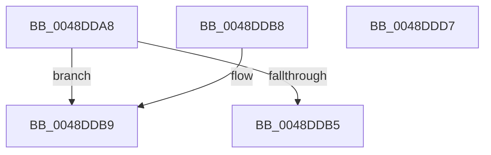

# MiCheckWriteInProgressFault

- RVA: `0x0048DDA8`–`0x0048DDD8` (길이 `48` bytes)
- VA: `0x000000014048DDA8`
- 실행 섹션: `.text`
- PDB 이름 있음: `예`; PDB Function 태그: `아니요`
- unwind 정보 RVA: `0x000DB714`
- 디코드: `17`개 명령, `48/48` bytes 표시
- 미해석 바이트: `0` (있으면 어셈블리에 `.byte`로 보존)

> 이 문서는 커널 이미지의 기계어와 PDB 기호를 분석해 생성했습니다. 4번과 5번은 함수 원형과 자료형을 바이너리 사용 방식에서 추정한 C 해석이며 원본 소스 복구 결과는 아닙니다.

## 1. Dependencies

- 직접 호출 지점: **0**; 고유 호출 대상: **0**
- 직접 호출자로 확인된 함수: **2**
- RIP 상대 이미지 참조: **1**

### Outgoing calls
- 직접 디코드된 call 명령이 없습니다.

### Direct callers
- [MiResolveTransitionFault](../28/MiResolveTransitionFault_function_00282940.md) at `0x00283536`
- [MiStandbyPageContentsIntact](../2A/MiStandbyPageContentsIntact_function_002AF0D4.md) at `0x002AF16E`

### Static image references
- `0x0048DDA8` → RVA `0x00FC6A88` (`ALMOSTRO`; read)

## 2. Other-region calls and transfers

- 다른 실행 섹션으로 향하는 call: **0**
- 별도 외부 분기/꼬리 이동을 확인하지 못했습니다.

## 3. Assembly (complete function range)

```asm
0048DDA8  48 F7 05 D5 8C B3 00 00 00 02 00  test qword ptr [rip + 0xb38cd5], 0x20000
0048DDB3  75 04                           jne 0x14048ddb9
0048DDB5  33 C0                           xor eax, eax
0048DDB7  C3                              ret
0048DDB8  CC                              int3
0048DDB9  8B 41 10                        mov eax, dword ptr [rcx + 0x10]
0048DDBC  48 C1 E8 05                     shr rax, 5
0048DDC0  83 E0 1F                        and eax, 0x1f
0048DDC3  0F 94 C1                        sete cl
0048DDC6  A8 02                           test al, 2
0048DDC8  0F 95 C0                        setne al
0048DDCB  22 C8                           and cl, al
0048DDCD  F6 D9                           neg cl
0048DDCF  1B C0                           sbb eax, eax
0048DDD1  25 17 00 00 C0                  and eax, 0xc0000017
0048DDD6  C3                              ret
0048DDD7  CC                              int3
```

## 4. C-style interpretation (structured pseudocode)

```c
__int64 __fastcall MiCheckWriteInProgressFault(__int64 a1)
{
    __int64 result;

    if (((*(unsigned __int64 *)(v_rip + 11766997)) & (0x20000ULL)) != 0) goto loc_0048DDB9;
    result = 0;
    return result;
loc_0048DDB9:
    result = ((unsigned int)(*(unsigned int *)(a1 + 16))) >> (5);
    result = (unsigned int)((result) & (31));
    a1 = (condition_is_equal) ? 1 : 0;
    result = ((((unsigned __int8)(result)) & (2)) != 0) ? 1 : 0;
    a1 = (unsigned __int8)((a1) & ((unsigned __int8)(result)));
    a1 = (unsigned __int8)(-(a1));
    result = (unsigned int)((result) & (0xC0000017ULL));
    return result;
}
```

## 5. (Beta) C Style

```c
int64_t MiCheckWriteInProgressFault(void *Arg1)
{
    uint8_t *arg1 = (uint8_t *)Arg1;

    int64_t result;

    if (((*(uint64_t *)(v_rip + 0xB38CD5)) & (0x20000ULL)) != 0) goto loc_0048DDB9;
    result = 0;
    return result;
loc_0048DDB9:
    result = ((uint32_t)(*(uint32_t *)(arg1 + 0x10))) >> (5);
    result = (uint32_t)((result) & (31));
    Arg1 = (condition_is_equal) ? 1 : 0;
    result = ((((uint8_t)(result)) & (2)) != 0) ? 1 : 0;
    Arg1 = (uint8_t)((Arg1) & ((uint8_t)(result)));
    Arg1 = (uint8_t)(-(Arg1));
    result = (uint32_t)((result) & (0xC0000017ULL));
    return result;
}
```

### 관측된 메모리 오프셋

구조체 형식이 확인되지 않은 접근은 인자 기준의 오프셋으로만 기록했습니다.

| 기준 인자 | 오프셋 표현 | 폭 (bit) | 접근 |
|---|---:|---:|---|
| `Arg1` | `+ 0x10` | `32` | `R` |

## 6. Execution-region graph

[열기: 2D/3D 그래프와 함수 탐색 컨트롤 패널](../../../control-panel.html?section=text&rva=0x0048DDA8&view=graph)

- 2D 그래프는 위에서 아래로 흐르고, 3D 그래프는 빈 공간을 드래그해 회전합니다. Shift+드래그는 이동, 휠은 확대·축소, 함수 노드 선택은 대상 보고서 이동입니다.

### Static fallback


