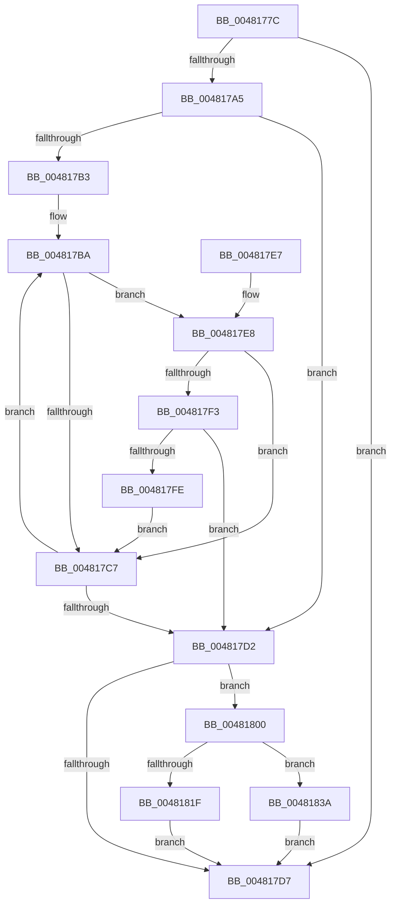

# MiContractPagingFiles

- RVA: `0x0048177C`–`0x00481844` (길이 `200` bytes)
- VA: `0x000000014048177C`
- 실행 섹션: `.text`
- PDB 이름 있음: `예`; PDB Function 태그: `아니요`
- unwind 정보 RVA: `0x0009CC80`
- 디코드: `55`개 명령, `200/200` bytes 표시
- 미해석 바이트: `0` (있으면 어셈블리에 `.byte`로 보존)

> 이 문서는 커널 이미지의 기계어와 PDB 기호를 분석해 생성했습니다. 4번과 5번은 함수 원형과 자료형을 바이너리 사용 방식에서 추정한 C 해석이며 원본 소스 복구 결과는 아닙니다.

## 1. Dependencies

- 직접 호출 지점: **4**; 고유 호출 대상: **4**
- 직접 호출자로 확인된 함수: **1**
- RIP 상대 이미지 참조: **0**

### Outgoing calls
- `0x0048179C` → [MiOkToShrinkPageFiles](MiOkToShrinkPageFiles_function_0048184C.md) (function, `0x0048184C`)
- `0x00481811` → [ExAcquireSpinLockExclusive](../24/ExAcquireSpinLockExclusive_function_00248690.md) (function, `0x00248690`)
- `0x00481833` → [MiQueuePageFileExtension](MiQueuePageFileExtension_function_0048187C.md) (function, `0x0048187C`)
- `0x0048183D` → [MiReleaseSpinLockExclusive](../24/MiReleaseSpinLockExclusive_function_002482C0.md) (function, `0x002482C0`)

### Direct callers
- [MmDeleteProcessAddressSpace](../../page/AC/MmDeleteProcessAddressSpace_function_00AC804C.md) at `0x00AC8226`

### Static image references
- 디코드된 RIP-relative 메모리 참조가 없습니다.

## 2. Other-region calls and transfers

- 다른 실행 섹션으로 향하는 call: **0**
- 별도 외부 분기/꼬리 이동을 확인하지 못했습니다.

## 3. Assembly (complete function range)

```asm
0048177C  48 89 5C 24 08                  mov qword ptr [rsp + 8], rbx
00481781  48 89 74 24 10                  mov qword ptr [rsp + 0x10], rsi
00481786  57                              push rdi
00481787  48 83 EC 20                     sub rsp, 0x20
0048178B  48 8B F9                        mov rdi, rcx
0048178E  48 8B 89 40 4B 00 00            mov rcx, qword ptr [rcx + 0x4b40]
00481795  48 8B 97 98 4C 00 00            mov rdx, qword ptr [rdi + 0x4c98]
0048179C  E8 AB 00 00 00                  call 0x14048184c
004817A1  85 C0                           test eax, eax
004817A3  74 32                           je 0x1404817d7
004817A5  44 8B 87 58 48 00 00            mov r8d, dword ptr [rdi + 0x4858]
004817AC  33 D2                           xor edx, edx
004817AE  45 85 C0                        test r8d, r8d
004817B1  74 1F                           je 0x1404817d2
004817B3  4C 8D 8F 60 48 00 00            lea r9, [rdi + 0x4860]
004817BA  4D 8B 11                        mov r10, qword ptr [r9]
004817BD  41 F6 82 AC 00 00 00 50         test byte ptr [r10 + 0xac], 0x50
004817C5  74 21                           je 0x1404817e8
004817C7  FF C2                           inc edx
004817C9  49 83 C1 08                     add r9, 8
004817CD  41 3B D0                        cmp edx, r8d
004817D0  72 E8                           jb 0x1404817ba
004817D2  41 3B D0                        cmp edx, r8d
004817D5  75 29                           jne 0x140481800
004817D7  48 8B 5C 24 30                  mov rbx, qword ptr [rsp + 0x30]
004817DC  48 8B 74 24 38                  mov rsi, qword ptr [rsp + 0x38]
004817E1  48 83 C4 20                     add rsp, 0x20
004817E5  5F                              pop rdi
004817E6  C3                              ret
004817E7  CC                              int3
004817E8  41 8B 0A                        mov ecx, dword ptr [r10]
004817EB  41 8B 42 08                     mov eax, dword ptr [r10 + 8]
004817EF  3B C8                           cmp ecx, eax
004817F1  74 D4                           je 0x1404817c7
004817F3  41 8B 42 0C                     mov eax, dword ptr [r10 + 0xc]
004817F7  3D 00 40 00 00                  cmp eax, 0x4000
004817FC  77 D4                           ja 0x1404817d2
004817FE  EB C7                           jmp 0x1404817c7
00481800  48 8D B7 C0 06 00 00            lea rsi, [rdi + 0x6c0]
00481807  48 8B CE                        mov rcx, rsi
0048180A  48 8D 9F 38 02 00 00            lea rbx, [rdi + 0x238]
00481811  E8 7A 6E DC FF                  call 0x140248690
00481816  48 83 7B 20 FF                  cmp qword ptr [rbx + 0x20], -1
0048181B  8A D0                           mov dl, al
0048181D  74 1B                           je 0x14048183a
0048181F  48 83 23 00                     and qword ptr [rbx], 0
00481823  48 8B CB                        mov rcx, rbx
00481826  80 4B 4F 10                     or byte ptr [rbx + 0x4f], 0x10
0048182A  48 83 4B 20 FF                  or qword ptr [rbx + 0x20], 0xffffffffffffffff
0048182F  48 89 7B 18                     mov qword ptr [rbx + 0x18], rdi
00481833  E8 44 00 00 00                  call 0x14048187c
00481838  EB 9D                           jmp 0x1404817d7
0048183A  48 8B CE                        mov rcx, rsi
0048183D  E8 7E 6A DC FF                  call 0x1402482c0
00481842  EB 93                           jmp 0x1404817d7
```

## 4. C-style interpretation (structured pseudocode)

```c
__int64 __fastcall MiContractPagingFiles(__int64 a1)
{
    __int64 result;
    __int64 v_rsp;
    unsigned __int64 v_stack_p10;
    unsigned __int64 v_stack_p8;

    v_stack_p8 = v_rbx;
    v_stack_p10 = v_rsi;
    v_rsp = (v_rsp) - (32);
    result = MiOkToShrinkPageFiles(*(unsigned __int64 *)(a1 + 19264), *(unsigned __int64 *)(a1 + 19608), a3, a4);
    if ((unsigned int)(result) == 0) goto loc_004817D7;
    a2 = 0;
    if ((unsigned int)((unsigned int)(*(unsigned int *)(a1 + 18520))) == 0) goto loc_004817D2;
loc_004817BA:
    if (((*(unsigned __int8 *)(*(unsigned __int64 *)(a1 + 18528) + 172)) & (80)) == 0) goto loc_004817E8;
loc_004817C7:
    a2 = (unsigned int)((a2) + 1);
    a4 = (a1 + 18528) + (8);
    if (((unsigned int)(a2)) < ((unsigned int)((unsigned int)(*(unsigned int *)(a1 + 18520))))) goto loc_004817BA;
loc_004817D2:
    if (((unsigned int)(a2)) != ((unsigned int)((unsigned int)(*(unsigned int *)(a1 + 18520))))) goto loc_00481800;
loc_004817D7:
    v_rsp = (v_rsp) + (32);
    return result;
loc_004817E8:
    if (((unsigned int)((unsigned int)(*(unsigned int *)(*(unsigned __int64 *)(a1 + 18528))))) == ((unsigned int)((unsigned int)(*(unsigned int *)(*(unsigned __int64 *)(a1 + 18528) + 8))))) goto loc_004817C7;
    if (((unsigned int)((unsigned int)(*(unsigned int *)(*(unsigned __int64 *)(a1 + 18528) + 12)))) > 0x4000ULL) goto loc_004817D2;
    goto loc_004817C7;
loc_00481800:
    result = ExAcquireSpinLockExclusive(a1 + 1728, a2, (unsigned int)(*(unsigned int *)(a1 + 18520)), a4);
    if ((*(unsigned __int64 *)(a1 + 568 + 32)) == -1) goto loc_0048183A;
    *(unsigned __int64 *)(a1 + 568 + 24) = a1;
    result = MiQueuePageFileExtension(a1 + 568, (unsigned __int8)(result), (unsigned int)(*(unsigned int *)(a1 + 18520)), a4);
    goto loc_004817D7;
loc_0048183A:
    result = MiReleaseSpinLockExclusive(a1 + 1728, (unsigned __int8)(result), (unsigned int)(*(unsigned int *)(a1 + 18520)), a4);
    goto loc_004817D7;
}
```

## 5. (Beta) C Style

```c
int64_t MiContractPagingFiles(void *Arg1)
{
    uint8_t *arg1 = (uint8_t *)Arg1;

    int64_t result;
    int64_t local_rsp;
    uint64_t v_stack_p10;
    uint64_t v_stack_p8;

    v_stack_p8 = local_rbx;
    v_stack_p10 = local_rsi;
    local_rsp = (local_rsp) - (32);
    result = MiOkToShrinkPageFiles(*(uint64_t *)(arg1 + 0x4B40), *(uint64_t *)(arg1 + 0x4C98), a3, a4);
    if ((uint32_t)(result) == 0) goto loc_004817D7;
    a2 = 0;
    if ((uint32_t)((uint32_t)(*(uint32_t *)(arg1 + 0x4858))) == 0) goto loc_004817D2;
loc_004817BA:
    if (((*(uint8_t *)(*(uint64_t *)(arg1 + 0x4860) + 0xAC)) & (80)) == 0) goto loc_004817E8;
loc_004817C7:
    a2 = (uint32_t)((a2) + 1);
    a4 = (Arg1 + 18528) + (8);
    if (((uint32_t)(a2)) < ((uint32_t)((uint32_t)(*(uint32_t *)(arg1 + 0x4858))))) goto loc_004817BA;
loc_004817D2:
    if (((uint32_t)(a2)) != ((uint32_t)((uint32_t)(*(uint32_t *)(arg1 + 0x4858))))) goto loc_00481800;
loc_004817D7:
    local_rsp = (local_rsp) + (32);
    return result;
loc_004817E8:
    if (((uint32_t)((uint32_t)(*(uint32_t *)(*(uint64_t *)(arg1 + 0x4860))))) == ((uint32_t)((uint32_t)(*(uint32_t *)(*(uint64_t *)(arg1 + 0x4860) + 0x8))))) goto loc_004817C7;
    if (((uint32_t)((uint32_t)(*(uint32_t *)(*(uint64_t *)(arg1 + 0x4860) + 0xC)))) > 0x4000ULL) goto loc_004817D2;
    goto loc_004817C7;
loc_00481800:
    result = ExAcquireSpinLockExclusive(Arg1 + 1728, a2, (uint32_t)(*(uint32_t *)(arg1 + 0x4858)), a4);
    if ((*(uint64_t *)(arg1 + 0x238 + 0x20)) == -1) goto loc_0048183A;
    *(void **)(arg1 + 0x238 + 0x18) = Arg1;
    result = MiQueuePageFileExtension(Arg1 + 568, (uint8_t)(result), (uint32_t)(*(uint32_t *)(arg1 + 0x4858)), a4);
    goto loc_004817D7;
loc_0048183A:
    result = MiReleaseSpinLockExclusive(Arg1 + 1728, (uint8_t)(result), (uint32_t)(*(uint32_t *)(arg1 + 0x4858)), a4);
    goto loc_004817D7;
}
```

### 관측된 메모리 오프셋

구조체 형식이 확인되지 않은 접근은 인자 기준의 오프셋으로만 기록했습니다.

| 기준 인자 | 오프셋 표현 | 폭 (bit) | 접근 |
|---|---:|---:|---|
| `Arg1` | `+ 0x0` | `64` | `R` |
| `Arg1` | `+ 0x0` | `64` | `R/W` |
| `Arg1` | `+ 0x18` | `64` | `W` |
| `Arg1` | `+ 0x20` | `64` | `R` |
| `Arg1` | `+ 0x20` | `64` | `R/W` |
| `Arg1` | `+ 0x4F` | `8` | `R/W` |
| `Arg1` | `+ 0x238` | `64` | `R` |
| `Arg1` | `+ 0x6C0` | `64` | `R` |
| `Arg1` | `+ 0x4858` | `32` | `R` |
| `Arg1` | `+ 0x4860` | `64` | `R` |
| `Arg1` | `+ 0x4B40` | `64` | `R` |
| `Arg1` | `+ 0x4C98` | `64` | `R` |

## 6. Execution-region graph

[열기: 2D/3D 그래프와 함수 탐색 컨트롤 패널](../../../control-panel.html?section=text&rva=0x0048177C&view=graph)

- 2D 그래프는 위에서 아래로 흐르고, 3D 그래프는 빈 공간을 드래그해 회전합니다. Shift+드래그는 이동, 휠은 확대·축소, 함수 노드 선택은 대상 보고서 이동입니다.

### Static fallback


