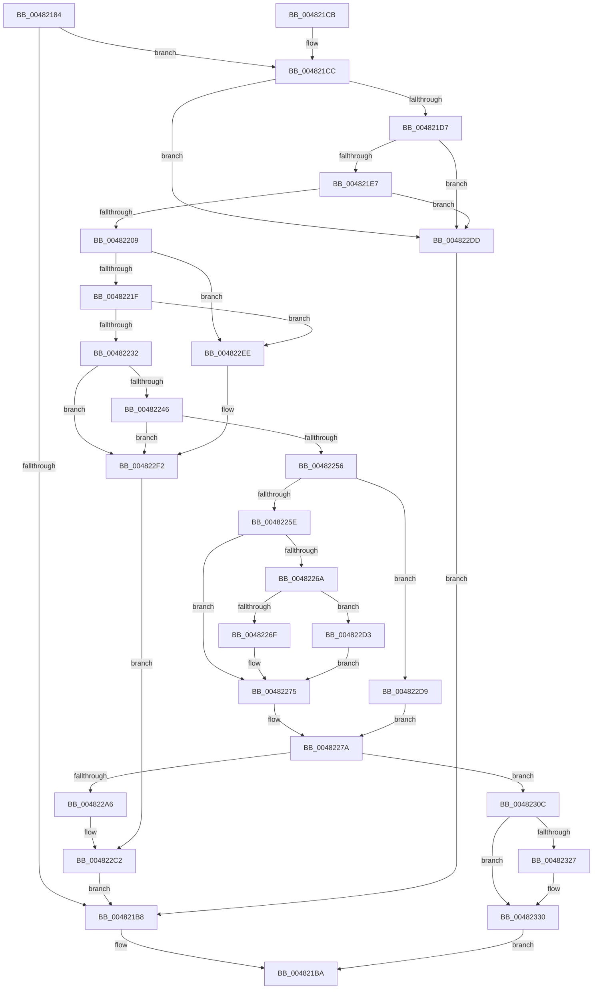

# MiCopyHeaderIfResident

- RVA: `0x00482184`–`0x0048235E` (길이 `474` bytes)
- VA: `0x0000000140482184`
- 실행 섹션: `.text`
- PDB 이름 있음: `예`; PDB Function 태그: `아니요`
- unwind 정보 RVA: `0x000AEDB0`
- 디코드: `121`개 명령, `474/474` bytes 표시
- 미해석 바이트: `0` (있으면 어셈블리에 `.byte`로 보존)

> 이 문서는 커널 이미지의 기계어와 PDB 기호를 분석해 생성했습니다. 4번과 5번은 함수 원형과 자료형을 바이너리 사용 방식에서 추정한 C 해석이며 원본 소스 복구 결과는 아닙니다.

## 1. Dependencies

- 직접 호출 지점: **12**; 고유 호출 대상: **9**
- 직접 호출자로 확인된 함수: **1**
- RIP 상대 이미지 참조: **1**

### Outgoing calls
- `0x004821AB` → [MiLockSectionControlArea](../2B/MiLockSectionControlArea_function_002BC930.md) (function, `0x002BC930`)
- `0x004821FC` → [MiTryLockProtoPoolPageAtDpc](../28/MiTryLockProtoPoolPageAtDpc_function_0028B3C8.md) (function, `0x0028B3C8`)
- `0x00482239` → [MiIsPageOnBadList](../2B/MiIsPageOnBadList_function_002B1018.md) (function, `0x002B1018`)
- `0x00482249` → [MiStandbyPageContentsIntact](../2A/MiStandbyPageContentsIntact_function_002AF0D4.md) (function, `0x002AF0D4`)
- `0x004822AA` → [ExReleaseSpinLockExclusiveFromDpcLevel](../24/ExReleaseSpinLockExclusiveFromDpcLevel_function_002497E0.md) (function, `0x002497E0`)
- `0x004822C9` → [MiUnlockProtoPoolPage](../24/MiUnlockProtoPoolPage_function_00246090.md) (function, `0x00246090`)
- `0x004822E4` → [MiReleaseSpinLockExclusive](../24/MiReleaseSpinLockExclusive_function_002482C0.md) (function, `0x002482C0`)
- `0x004822F6` → [ExReleaseSpinLockExclusiveFromDpcLevel](../24/ExReleaseSpinLockExclusiveFromDpcLevel_function_002497E0.md) (function, `0x002497E0`)
- `0x00482315` → [MiCopyPage](../2B/MiCopyPage_function_002B1B30.md) (function, `0x002B1B30`)
- `0x0048231E` → [ExReleaseSpinLockExclusiveFromDpcLevel](../24/ExReleaseSpinLockExclusiveFromDpcLevel_function_002497E0.md) (function, `0x002497E0`)
- `0x0048232B` → [MiUpdatePageAttributeStamp](MiUpdatePageAttributeStamp_function_00482364.md) (function, `0x00482364`)
- `0x0048234F` → [MiUnlockProtoPoolPage](../24/MiUnlockProtoPoolPage_function_00246090.md) (function, `0x00246090`)

### Direct callers
- [MiCreateImageFileMap](../../page/98/MiCreateImageFileMap_function_00986830.md) at `0x00986987`

### Static image references
- `0x0048225E` → RVA `0x00E2DC80` (`.data`; read)

## 2. Other-region calls and transfers

- 다른 실행 섹션으로 향하는 call: **0**
- 별도 외부 분기/꼬리 이동을 확인하지 못했습니다.

## 3. Assembly (complete function range)

```asm
00482184  48 89 5C 24 10                  mov qword ptr [rsp + 0x10], rbx
00482189  55                              push rbp
0048218A  56                              push rsi
0048218B  57                              push rdi
0048218C  41 55                           push r13
0048218E  41 56                           push r14
00482190  48 8B EC                        mov rbp, rsp
00482193  48 83 EC 20                     sub rsp, 0x20
00482197  48 8B 49 28                     mov rcx, qword ptr [rcx + 0x28]
0048219B  4C 8D 45 30                     lea r8, [rbp + 0x30]
0048219F  4C 8B F2                        mov r14, rdx
004821A2  C6 45 30 00                     mov byte ptr [rbp + 0x30], 0
004821A6  BA 01 00 00 00                  mov edx, 1
004821AB  E8 80 A7 E3 FF                  call 0x1402bc930
004821B0  48 8B D8                        mov rbx, rax
004821B3  48 85 C0                        test rax, rax
004821B6  75 14                           jne 0x1404821cc
004821B8  33 C0                           xor eax, eax
004821BA  48 8B 5C 24 58                  mov rbx, qword ptr [rsp + 0x58]
004821BF  48 83 C4 20                     add rsp, 0x20
004821C3  41 5E                           pop r14
004821C5  41 5D                           pop r13
004821C7  5F                              pop rdi
004821C8  5E                              pop rsi
004821C9  5D                              pop rbp
004821CA  C3                              ret
004821CB  CC                              int3
004821CC  8B 40 38                        mov eax, dword ptr [rax + 0x38]
004821CF  A8 03                           test al, 3
004821D1  0F 85 06 01 00 00               jne 0x1404822dd
004821D7  48 8B B3 88 00 00 00            mov rsi, qword ptr [rbx + 0x88]
004821DE  48 85 F6                        test rsi, rsi
004821E1  0F 84 F6 00 00 00               je 0x1404822dd
004821E7  48 83 65 40 00                  and qword ptr [rbp + 0x40], 0
004821EC  4C 8D 4D 40                     lea r9, [rbp + 0x40]
004821F0  48 83 65 48 00                  and qword ptr [rbp + 0x48], 0
004821F5  4C 8D 45 48                     lea r8, [rbp + 0x48]
004821F9  48 8B CE                        mov rcx, rsi
004821FC  E8 C7 91 E0 FF                  call 0x14028b3c8
00482201  85 C0                           test eax, eax
00482203  0F 88 D4 00 00 00               js 0x1404822dd
00482209  48 8B 45 40                     mov rax, qword ptr [rbp + 0x40]
0048220D  8B 48 20                        mov ecx, dword ptr [rax + 0x20]
00482210  C1 E9 10                        shr ecx, 0x10
00482213  80 E1 C0                        and cl, 0xc0
00482216  80 F9 40                        cmp cl, 0x40
00482219  0F 85 CF 00 00 00               jne 0x1404822ee
0048221F  48 8B 45 40                     mov rax, qword ptr [rbp + 0x40]
00482223  8B 48 20                        mov ecx, dword ptr [rax + 0x20]
00482226  C1 E9 18                        shr ecx, 0x18
00482229  F6 C1 40                        test cl, 0x40
0048222C  0F 85 BC 00 00 00               jne 0x1404822ee
00482232  48 8B 7D 40                     mov rdi, qword ptr [rbp + 0x40]
00482236  48 8B CF                        mov rcx, rdi
00482239  E8 DA ED E2 FF                  call 0x1402b1018
0048223E  85 C0                           test eax, eax
00482240  0F 85 AC 00 00 00               jne 0x1404822f2
00482246  48 8B CF                        mov rcx, rdi
00482249  E8 86 CE E2 FF                  call 0x1402af0d4
0048224E  85 C0                           test eax, eax
00482250  0F 84 9C 00 00 00               je 0x1404822f2
00482256  48 8B 16                        mov rdx, qword ptr [rsi]
00482259  F6 C2 01                        test dl, 1
0048225C  75 7B                           jne 0x1404822d9
0048225E  48 8B 05 1B BA 9A 00            mov rax, qword ptr [rip + 0x9aba1b]
00482265  48 85 C0                        test rax, rax
00482268  74 0B                           je 0x140482275
0048226A  F6 C2 10                        test dl, 0x10
0048226D  75 64                           jne 0x1404822d3
0048226F  48 F7 D0                        not rax
00482272  48 23 D0                        and rdx, rax
00482275  BE 01 00 00 00                  mov esi, 1
0048227A  48 C1 EA 0C                     shr rdx, 0xc
0048227E  4B 8D 3C 76                     lea rdi, [r14 + r14*2]
00482282  48 B8 FF FF FF FF FF 00 00 00   movabs rax, 0xffffffffff
0048228C  48 C1 E7 04                     shl rdi, 4
00482290  48 23 D0                        and rdx, rax
00482293  49 BD 18 00 00 00 00 DE FF FF   movabs r13, 0xffffde0000000018
0048229D  F0 4A 0F BA 2C 2F 3F            lock bts qword ptr [rdi + r13], 0x3f
004822A4  73 66                           jae 0x14048230c
004822A6  48 8D 4B 48                     lea rcx, [rbx + 0x48]
004822AA  E8 31 75 DC FF                  call 0x1402497e0
004822AF  48 8B 45 40                     mov rax, qword ptr [rbp + 0x40]
004822B3  48 BA FF FF FF FF FF FF FF 7F   movabs rdx, 0x7fffffffffffffff
004822BD  F0 48 21 50 18                  lock and qword ptr [rax + 0x18], rdx
004822C2  8A 55 30                        mov dl, byte ptr [rbp + 0x30]
004822C5  48 8B 4D 48                     mov rcx, qword ptr [rbp + 0x48]
004822C9  E8 C2 3D DC FF                  call 0x140246090
004822CE  E9 E5 FE FF FF                  jmp 0x1404821b8
004822D3  48 83 E2 EF                     and rdx, 0xffffffffffffffef
004822D7  EB 9C                           jmp 0x140482275
004822D9  33 F6                           xor esi, esi
004822DB  EB 9D                           jmp 0x14048227a
004822DD  8A 55 30                        mov dl, byte ptr [rbp + 0x30]
004822E0  48 8D 4B 48                     lea rcx, [rbx + 0x48]
004822E4  E8 D7 5F DC FF                  call 0x1402482c0
004822E9  E9 CA FE FF FF                  jmp 0x1404821b8
004822EE  48 8B 7D 40                     mov rdi, qword ptr [rbp + 0x40]
004822F2  48 8D 4B 48                     lea rcx, [rbx + 0x48]
004822F6  E8 E5 74 DC FF                  call 0x1402497e0
004822FB  48 BA FF FF FF FF FF FF FF 7F   movabs rdx, 0x7fffffffffffffff
00482305  F0 48 21 57 18                  lock and qword ptr [rdi + 0x18], rdx
0048230A  EB B6                           jmp 0x1404822c2
0048230C  41 B8 04 00 00 00               mov r8d, 4
00482312  49 8B CE                        mov rcx, r14
00482315  E8 16 F8 E2 FF                  call 0x1402b1b30
0048231A  48 8D 4B 48                     lea rcx, [rbx + 0x48]
0048231E  E8 BD 74 DC FF                  call 0x1402497e0
00482323  85 F6                           test esi, esi
00482325  74 09                           je 0x140482330
00482327  48 8B 4D 40                     mov rcx, qword ptr [rbp + 0x40]
0048232B  E8 34 00 00 00                  call 0x140482364
00482330  48 BA FF FF FF FF FF FF FF 7F   movabs rdx, 0x7fffffffffffffff
0048233A  F0 4A 21 14 2F                  lock and qword ptr [rdi + r13], rdx
0048233F  48 8B 4D 40                     mov rcx, qword ptr [rbp + 0x40]
00482343  F0 48 21 51 18                  lock and qword ptr [rcx + 0x18], rdx
00482348  8A 55 30                        mov dl, byte ptr [rbp + 0x30]
0048234B  48 8B 4D 48                     mov rcx, qword ptr [rbp + 0x48]
0048234F  E8 3C 3D DC FF                  call 0x140246090
00482354  B8 01 00 00 00                  mov eax, 1
00482359  E9 5C FE FF FF                  jmp 0x1404821ba
```

## 4. C-style interpretation (structured pseudocode)

```c
__int64 __fastcall MiCopyHeaderIfResident(__int64 a1, __int64 a2)
{
    __int64 result;
    __int64 v_rdi;
    __int64 v_rsi;
    __int64 v_rsp;
    unsigned __int64 v_stack_p10;
    unsigned __int64 v_stack_p18;
    unsigned __int64 v_stack_p20;
    unsigned __int64 v_stack_p8;

    v_stack_p10 = v_rbx;
    v_rsp = (v_rsp) - (32);
    v_stack_p8 = 0;
    result = MiLockSectionControlArea(*(unsigned __int64 *)(a1 + 40), 1, v_stack_p8, a4);
    if (result != 0) goto loc_004821CC;
loc_004821B8:
    result = 0;
loc_004821BA:
    v_rsp = (v_rsp) + (32);
    return result;
loc_004821CC:
    if ((((unsigned __int8)((unsigned int)(*(unsigned int *)(result + 56)))) & (3)) != 0) goto loc_004822DD;
    if (*(unsigned __int64 *)(v_stack_p10 + 136) == 0) goto loc_004822DD;
    result = MiTryLockProtoPoolPageAtDpc(*(unsigned __int64 *)(v_stack_p10 + 136), 1, v_stack_p20, v_stack_p18);
    if (sign_flag) goto loc_004822DD;
    a1 = (unsigned int)(((unsigned int)(*(unsigned int *)(v_stack_p18 + 32))) >> (16));
    a1 = (unsigned __int8)((a1) & (192));
    if (((unsigned __int8)(a1)) != 64) goto loc_004822EE;
    a1 = (unsigned int)(((unsigned int)(*(unsigned int *)(v_stack_p18 + 32))) >> (24));
    if ((((unsigned __int8)(a1)) & (64)) != 0) goto loc_004822EE;
    result = MiIsPageOnBadList(v_stack_p18, 1, v_stack_p20, v_stack_p18);
    if ((unsigned int)(result) != 0) goto loc_004822F2;
    result = MiStandbyPageContentsIntact(v_stack_p18, 1, v_stack_p20, v_stack_p18);
    if ((unsigned int)(result) == 0) goto loc_004822F2;
    if ((((unsigned __int8)(*(unsigned __int64 *)(*(unsigned __int64 *)(v_stack_p10 + 136)))) & (1)) != 0) goto loc_004822D9;
    if (*(unsigned __int64 *)(v_rip + 10140187) == 0) goto loc_00482275;
    if ((((unsigned __int8)(*(unsigned __int64 *)(*(unsigned __int64 *)(v_stack_p10 + 136)))) & (16)) != 0) goto loc_004822D3;
    result = ~(*(unsigned __int64 *)(v_rip + 10140187));
    a2 = (*(unsigned __int64 *)(*(unsigned __int64 *)(v_stack_p10 + 136))) & (result);
loc_00482275:
loc_0048227A:
    a2 = (a2) >> (12);
    v_rdi = (a2 + a2 * 2) << (4);
    a2 = (a2) & (result);
    if (condition_is_above_or_equal) goto loc_0048230C;
    result = ExReleaseSpinLockExclusiveFromDpcLevel(v_stack_p10 + 72, a2, v_stack_p20, v_stack_p18);
loc_004822C2:
    result = MiUnlockProtoPoolPage(v_stack_p20, v_stack_p8, v_stack_p20, v_stack_p18);
    goto loc_004821B8;
loc_004822D3:
    a2 = (v_stack_p8) & (-17);
    goto loc_00482275;
loc_004822D9:
    v_rsi = 0;
    goto loc_0048227A;
loc_004822DD:
    result = MiReleaseSpinLockExclusive(v_stack_p10 + 72, v_stack_p8, v_stack_p20, v_stack_p18);
    goto loc_004821B8;
loc_004822EE:
loc_004822F2:
    result = ExReleaseSpinLockExclusiveFromDpcLevel(v_stack_p10 + 72, v_stack_p8, v_stack_p20, v_stack_p18);
    goto loc_004822C2;
loc_0048230C:
    result = MiCopyPage(a2, v_stack_p8, 4, v_stack_p18);
    result = ExReleaseSpinLockExclusiveFromDpcLevel(v_stack_p10 + 72, v_stack_p8, 4, v_stack_p18);
    if (0 != 0) {
        a1 = v_stack_p18;
        result = MiUpdatePageAttributeStamp(a1, v_stack_p8, 4, v_stack_p18);
    }
    result = MiUnlockProtoPoolPage(v_stack_p20, v_stack_p8, 4, v_stack_p18);
    goto loc_004821BA;
}
```

## 5. (Beta) C Style

```c
int64_t MiCopyHeaderIfResident(void *Arg1, void *Arg2)
{
    uint8_t *arg1 = (uint8_t *)Arg1;
    uint8_t *arg2 = (uint8_t *)Arg2;

    int64_t result;
    int64_t local_rdi;
    int64_t local_rsi;
    int64_t local_rsp;
    uint64_t v_stack_p10;
    uint64_t v_stack_p18;
    uint64_t v_stack_p20;
    uint64_t v_stack_p8;

    v_stack_p10 = local_rbx;
    local_rsp = (local_rsp) - (32);
    v_stack_p8 = 0;
    result = MiLockSectionControlArea(*(uint64_t *)(arg1 + 0x28), 1, v_stack_p8, a4);
    if (result != 0) goto loc_004821CC;
loc_004821B8:
    result = 0;
loc_004821BA:
    local_rsp = (local_rsp) + (32);
    return result;
loc_004821CC:
    if ((((uint8_t)((uint32_t)(*(uint32_t *)(result + 0x38)))) & (3)) != 0) goto loc_004822DD;
    if (*(uint64_t *)(v_stack_p10 + 0x88) == 0) goto loc_004822DD;
    result = MiTryLockProtoPoolPageAtDpc(*(uint64_t *)(v_stack_p10 + 0x88), 1, v_stack_p20, v_stack_p18);
    if (sign_flag) goto loc_004822DD;
    Arg1 = (uint32_t)(((uint32_t)(*(uint32_t *)(v_stack_p18 + 0x20))) >> (16));
    Arg1 = (uint8_t)((Arg1) & (192));
    if (((uint8_t)(Arg1)) != 64) goto loc_004822EE;
    Arg1 = (uint32_t)(((uint32_t)(*(uint32_t *)(v_stack_p18 + 0x20))) >> (24));
    if ((((uint8_t)(Arg1)) & (64)) != 0) goto loc_004822EE;
    result = MiIsPageOnBadList(v_stack_p18, 1, v_stack_p20, v_stack_p18);
    if ((uint32_t)(result) != 0) goto loc_004822F2;
    result = MiStandbyPageContentsIntact(v_stack_p18, 1, v_stack_p20, v_stack_p18);
    if ((uint32_t)(result) == 0) goto loc_004822F2;
    if ((((uint8_t)(*(uint64_t *)(*(uint64_t *)(v_stack_p10 + 0x88)))) & (1)) != 0) goto loc_004822D9;
    if (*(uint64_t *)(v_rip + 0x9ABA1B) == 0) goto loc_00482275;
    if ((((uint8_t)(*(uint64_t *)(*(uint64_t *)(v_stack_p10 + 0x88)))) & (16)) != 0) goto loc_004822D3;
    result = ~(*(uint64_t *)(v_rip + 0x9ABA1B));
    Arg2 = (*(uint64_t *)(*(uint64_t *)(v_stack_p10 + 0x88))) & (result);
loc_00482275:
loc_0048227A:
    Arg2 = (Arg2) >> (12);
    local_rdi = (Arg2 + Arg2 * 2) << (4);
    Arg2 = (Arg2) & (result);
    if (condition_is_above_or_equal) goto loc_0048230C;
    result = ExReleaseSpinLockExclusiveFromDpcLevel(v_stack_p10 + 72, Arg2, v_stack_p20, v_stack_p18);
loc_004822C2:
    result = MiUnlockProtoPoolPage(v_stack_p20, v_stack_p8, v_stack_p20, v_stack_p18);
    goto loc_004821B8;
loc_004822D3:
    Arg2 = (v_stack_p8) & (-17);
    goto loc_00482275;
loc_004822D9:
    local_rsi = 0;
    goto loc_0048227A;
loc_004822DD:
    result = MiReleaseSpinLockExclusive(v_stack_p10 + 72, v_stack_p8, v_stack_p20, v_stack_p18);
    goto loc_004821B8;
loc_004822EE:
loc_004822F2:
    result = ExReleaseSpinLockExclusiveFromDpcLevel(v_stack_p10 + 72, v_stack_p8, v_stack_p20, v_stack_p18);
    goto loc_004822C2;
loc_0048230C:
    result = MiCopyPage(Arg2, v_stack_p8, 4, v_stack_p18);
    result = ExReleaseSpinLockExclusiveFromDpcLevel(v_stack_p10 + 72, v_stack_p8, 4, v_stack_p18);
    if (0 != 0) {
        Arg1 = v_stack_p18;
        result = MiUpdatePageAttributeStamp(Arg1, v_stack_p8, 4, v_stack_p18);
    }
    result = MiUnlockProtoPoolPage(v_stack_p20, v_stack_p8, 4, v_stack_p18);
    goto loc_004821BA;
}
```

### 관측된 메모리 오프셋

구조체 형식이 확인되지 않은 접근은 인자 기준의 오프셋으로만 기록했습니다.

| 기준 인자 | 오프셋 표현 | 폭 (bit) | 접근 |
|---|---:|---:|---|
| `Arg1` | `+ 0x28` | `64` | `R` |
| `Arg2` | `+ 0x0 + r14*2` | `64` | `R` |

## 6. Execution-region graph

[열기: 2D/3D 그래프와 함수 탐색 컨트롤 패널](../../../control-panel.html?section=text&rva=0x00482184&view=graph)

- 2D 그래프는 위에서 아래로 흐르고, 3D 그래프는 빈 공간을 드래그해 회전합니다. Shift+드래그는 이동, 휠은 확대·축소, 함수 노드 선택은 대상 보고서 이동입니다.

### Static fallback


