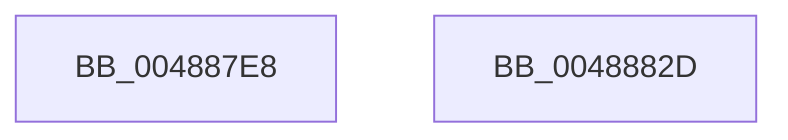

# MiCreatePteCopyList

- RVA: `0x004887E8`–`0x0048882E` (길이 `70` bytes)
- VA: `0x00000001404887E8`
- 실행 섹션: `.text`
- PDB 이름 있음: `예`; PDB Function 태그: `아니요`
- unwind 정보 RVA: `0x0005CAAC`
- 디코드: `22`개 명령, `70/70` bytes 표시
- 미해석 바이트: `0` (있으면 어셈블리에 `.byte`로 보존)

> 이 문서는 커널 이미지의 기계어와 PDB 기호를 분석해 생성했습니다. 4번과 5번은 함수 원형과 자료형을 바이너리 사용 방식에서 추정한 C 해석이며 원본 소스 복구 결과는 아닙니다.

## 1. Dependencies

- 직접 호출 지점: **1**; 고유 호출 대상: **1**
- 직접 호출자로 확인된 함수: **2**
- RIP 상대 이미지 참조: **1**

### Outgoing calls
- `0x0048880F` → [MiReservePtes](../31/MiReservePtes_function_00318D20.md) (function, `0x00318D20`)

### Direct callers
- [sub_00322F5E](../32/Unknown_function_00322F5E.md) at `0x00322F70`
- [MiCopyPagesIntoEnclave](../../page/A4/MiCopyPagesIntoEnclave_function_00A472AC.md) at `0x00A47494`

### Static image references
- `0x00488808` → RVA `0x00E37668` (`.data`; read)

## 2. Other-region calls and transfers

- 다른 실행 섹션으로 향하는 call: **0**
- 별도 외부 분기/꼬리 이동을 확인하지 못했습니다.

## 3. Assembly (complete function range)

```asm
004887E8  48 89 5C 24 08                  mov qword ptr [rsp + 8], rbx
004887ED  57                              push rdi
004887EE  48 83 EC 20                     sub rsp, 0x20
004887F2  33 C0                           xor eax, eax
004887F4  66 C7 42 08 11 00               mov word ptr [rdx + 8], 0x11
004887FA  89 02                           mov dword ptr [rdx], eax
004887FC  48 8B FA                        mov rdi, rdx
004887FF  48 89 42 10                     mov qword ptr [rdx + 0x10], rax
00488803  48 8B D9                        mov rbx, rcx
00488806  8B D1                           mov edx, ecx
00488808  48 8D 0D 59 EE 9A 00            lea rcx, [rip + 0x9aee59]
0048880F  E8 0C 05 E9 FF                  call 0x140318d20
00488814  48 89 47 10                     mov qword ptr [rdi + 0x10], rax
00488818  48 F7 D8                        neg rax
0048881B  1B C0                           sbb eax, eax
0048881D  23 C3                           and eax, ebx
0048881F  89 47 04                        mov dword ptr [rdi + 4], eax
00488822  48 8B 5C 24 30                  mov rbx, qword ptr [rsp + 0x30]
00488827  48 83 C4 20                     add rsp, 0x20
0048882B  5F                              pop rdi
0048882C  C3                              ret
0048882D  CC                              int3
```

## 4. C-style interpretation (structured pseudocode)

```c
__int64 __fastcall MiCreatePteCopyList(__int64 a1, __int64 a2)
{
    __int64 result;
    __int64 v_rsp;
    unsigned __int64 v_stack_p8;

    v_stack_p8 = v_rbx;
    v_rsp = (v_rsp) - (32);
    result = 0;
    *(unsigned __int16 *)(a2 + 8) = 17;
    *(unsigned int *)(a2) = 0;
    *(unsigned __int64 *)(a2 + 16) = 0;
    result = MiReservePtes(v_rip + 10153561, (unsigned int)((unsigned int)(a1)), a3, a4);
    *(unsigned __int64 *)(a2 + 16) = result;
    result = -(result);
    result = (unsigned int)((result) & ((unsigned int)(a1)));
    *(unsigned int *)(a2 + 4) = (unsigned int)(result);
    v_rsp = (v_rsp) + (32);
    return result;
}
```

## 5. (Beta) C Style

```c
int64_t MiCreatePteCopyList(int64_t Arg1, void *Arg2)
{
    uint8_t *arg2 = (uint8_t *)Arg2;

    int64_t result;
    int64_t local_rsp;
    uint64_t v_stack_p8;

    v_stack_p8 = local_rbx;
    local_rsp = (local_rsp) - (32);
    result = 0;
    *(uint16_t *)(arg2 + 0x8) = 17;
    *(uint32_t *)(arg2) = 0;
    *(uint64_t *)(arg2 + 0x10) = 0;
    result = MiReservePtes(v_rip + 10153561, (uint32_t)((uint32_t)(Arg1)), a3, a4);
    *(uint64_t *)(arg2 + 0x10) = result;
    result = -(result);
    result = (uint32_t)((result) & ((uint32_t)(Arg1)));
    *(uint32_t *)(arg2 + 0x4) = (uint32_t)(result);
    local_rsp = (local_rsp) + (32);
    return result;
}
```

### 관측된 메모리 오프셋

구조체 형식이 확인되지 않은 접근은 인자 기준의 오프셋으로만 기록했습니다.

| 기준 인자 | 오프셋 표현 | 폭 (bit) | 접근 |
|---|---:|---:|---|
| `Arg2` | `+ 0x0` | `32` | `W` |
| `Arg2` | `+ 0x4` | `32` | `W` |
| `Arg2` | `+ 0x8` | `16` | `W` |
| `Arg2` | `+ 0x10` | `64` | `W` |

## 6. Execution-region graph

[열기: 2D/3D 그래프와 함수 탐색 컨트롤 패널](../../../control-panel.html?section=text&rva=0x004887E8&view=graph)

- 2D 그래프는 위에서 아래로 흐르고, 3D 그래프는 빈 공간을 드래그해 회전합니다. Shift+드래그는 이동, 휠은 확대·축소, 함수 노드 선택은 대상 보고서 이동입니다.

### Static fallback


